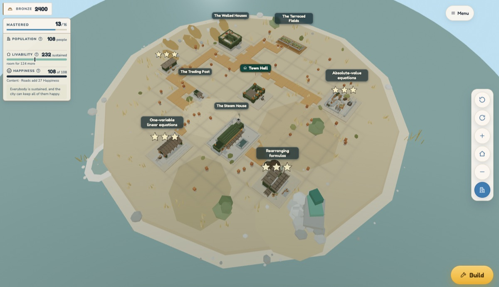
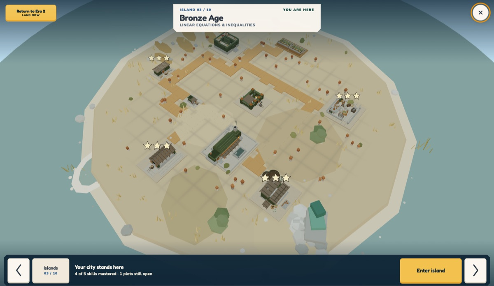
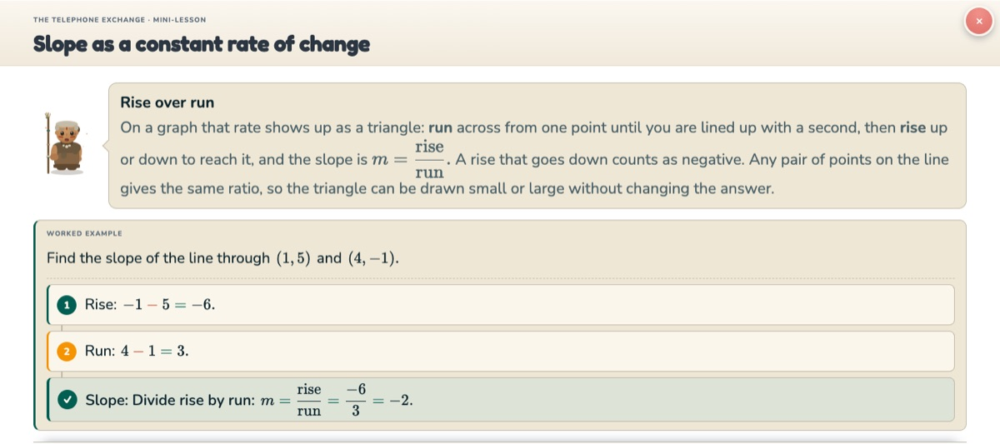
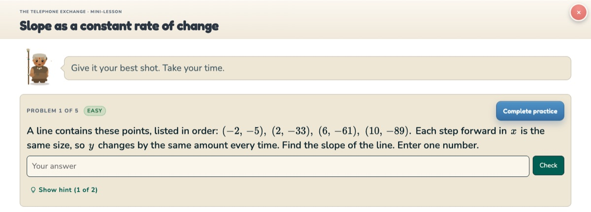
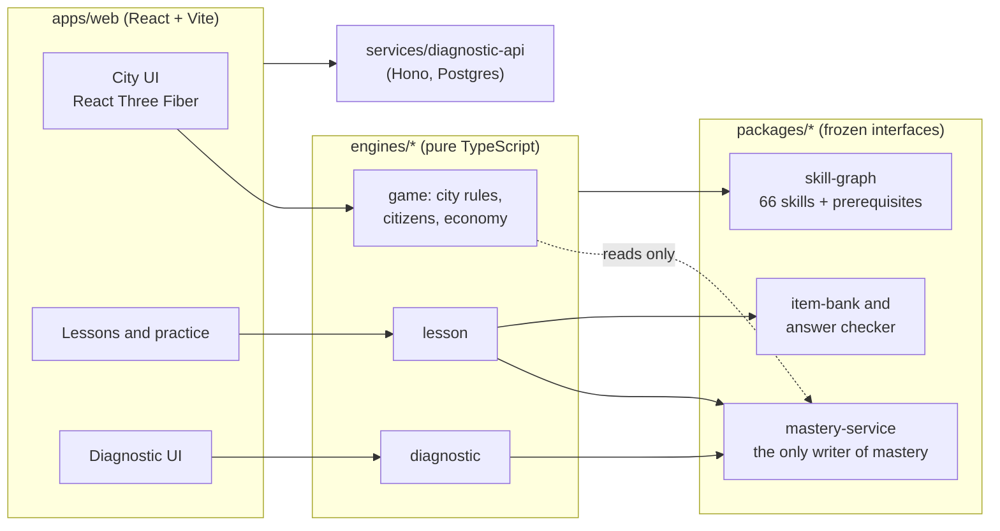

# Remedial Calculus: a calculus-readiness city-builder

**Every math skill a student masters puts a building on their island.** Remedial Calculus is a diagnostic and learning game for students heading into calculus. A placement diagnostic finds what a student already knows. Each skill they still need becomes a building they unlock through a short lesson and a mastery check. Over ten eras, from the Prehistoric to a Cyberpunk future, their progress becomes a city they can see.



> **Team project.** Built in about five weeks (July–August 2026) by a team of three: **Evan Cabrera** (game and city-builder), **Gabriel Xiong** (diagnostic, shared platform, CI) and **Anthony Zheng** (lessons and content). This repository is a public snapshot of our private team repo. Deployment infrastructure and internal team notes were removed, and the app runs fully locally.

---

## How it works

| | |
|---|---|
|  | **Ten islands, one per era.** Each era covers one area of pre-calculus (linear equations, functions, trigonometry and so on), drawn from a graph of **66 skills** and their prerequisites. Finishing an era's checkpoint opens the next island. |
|  | **Click a building to learn its skill.** Short lessons with worked examples, taught by an era-specific advisor character, with math rendered by KaTeX. |
|  | **Mastery checks build the city.** Each building goes from foundation to construction to finished, and earns up to three stars, as the student shows mastery. Practice includes hints, and grading checks whether answers are mathematically equivalent, not just matching strings. |

The game layer never decides what a student knows. It only *reads* mastery. A single shared service is the only thing allowed to write it, so a cosmetic action like building a road can never stand in for learning.

## My role (Evan): the game and city-builder

I owned the game lane (`engines/game` and the city in `apps/web/src/city`). Highlights:

- **The 3D city.** A full-screen city built with React Three Fiber (React + three.js): an RTS-style camera, a per-cell placement grid with building footprints and rotation, moving buildings you've already placed, and construction stages driven by mastery. Code: [`CityScene.tsx`](apps/web/src/city/three/CityScene.tsx), [`CitySurface.tsx`](apps/web/src/city/CitySurface.tsx).
- **The placement rule: no building may be sealed off.** A flood fill over the grid, seeded from the island's outer edge, refuses any placement or move that would leave *any* building unreachable on foot. The same function drives the placement preview, the confirm button and the saved state, so they can never disagree, and refusals are announced to screen readers. Code: [`placementRefusal` in `worldLayout.ts`](apps/web/src/city/worldLayout.ts#L734), tests: [`placementReachability.test.ts`](apps/web/src/city/placementReachability.test.ts).
- **A simulated population.** Population, livability and happiness are derived from what's built, using a deterministic seeded random number generator so the same city always produces the same citizens. They're drawn as a walking crowd in two GPU draw calls (instanced rendering). Code: [`citizens.ts`](engines/game/src/citizens.ts), [`city-vitality.ts`](engines/game/src/city-vitality.ts), [`Citizens.tsx`](apps/web/src/city/three/Citizens.tsx).
- **Roads, the Town Hall and the economy.** Roads add happiness without ever blocking learning. The Town Hall hub hosts interleaved review practice, and the in-game currency is earned only through learning.
- **Onboarding and progression.** A first-run guided tour, coach marks, an advisor character per era, the era-advance "chapter break" and the game's ending.
- **Art direction across ten eras.** I wrote the [era progression design](docs/superpowers/specs/2026-07-27-era-progression-design.md) and per-era [style guides](docs/superpowers/specs/eras), and ran the concept-art and 3D model (GLB) pipeline that turns building designs into in-game models.

Over the project I made **~370 commits** to the team repo. The full ownership map is in [`OWNERS.md`](OWNERS.md).

## Architecture



- **A TypeScript monorepo (npm workspaces).** Each teammate owned one engine. Anything shared lives in a package with an interface frozen early in the project, which let three people work in parallel with few merge conflicts.
- **The engines are plain TypeScript with no rendering code**, so game rules are unit-tested without a browser. The UI is React 19. The city uses three.js through React Three Fiber.
- **The skill graph is data** ([`skill_graph.json`](packages/skill-graph/src/skill_graph.json)), checked by a Python invariant test so a prerequisite cycle or a skill without a lesson fails CI.
- **The client grades instantly for fast feedback; the server re-grades for the official result.** The backend is a Hono API over Postgres ([`services/diagnostic-api`](services/diagnostic-api)).

## Run it locally

Requires Node 24+, npm and Python 3. No accounts or credentials needed.

```bash
npm ci
npm run dev        # http://localhost:5173 → "Start at Era 1"
```

To jump straight to a built-up city, open
[`http://localhost:5173/demo?presenter=1&preset=bronze-city&surface=city&era=bronze_age`](http://localhost:5173/demo?presenter=1&preset=bronze-city&surface=city&era=bronze_age).
On the dev server, the **Demo route** panel (top-left of the title screen) can also start the city in any of the ten eras.

```bash
npm run typecheck  # TypeScript across all workspaces
npm run test:unit  # ~735 unit test files (Vitest)
npm run setup:browsers && npm run test:browser   # ~320 browser test files (Playwright)
```

## Repository map

```
apps/web/          the React app: city, lessons, diagnostic, onboarding
engines/game/      game rules: city, citizens, economy, crises  (Evan)
engines/lesson/    lesson engine                                (Anthony)
engines/diagnostic/ placement diagnostic                        (Gabriel)
packages/          shared, frozen interfaces: skill graph, mastery service, item bank, schema
services/          backend API and server-side scoring
docs/              design specs, contracts and per-era art direction
```

More detail: [architecture](docs/Architecture.md), [shared contracts](docs/Contracts.md) and [development notes](docs/DEVELOPMENT.md).

## Credits

Built by Evan Cabrera, Gabriel Xiong and Anthony Zheng. Music was generated with Suno under a commercial license (see [`apps/web/public/audio/CREDITS.md`](apps/web/public/audio/CREDITS.md)). We used AI coding agents (Cursor and Codex) heavily during development. The product, design and architecture decisions were ours.
