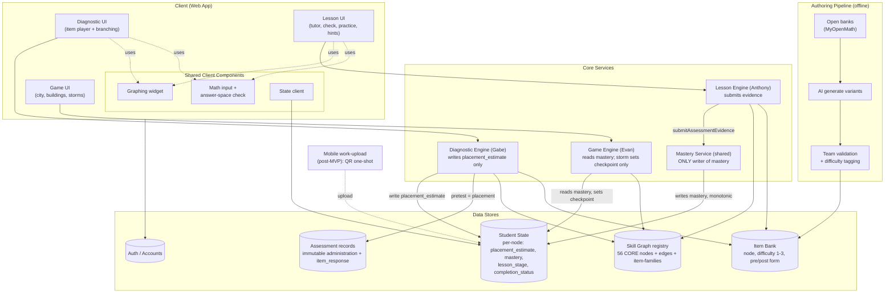
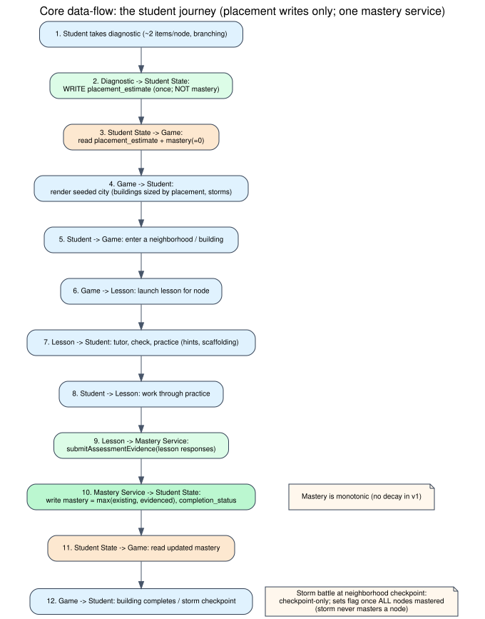
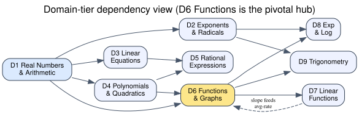
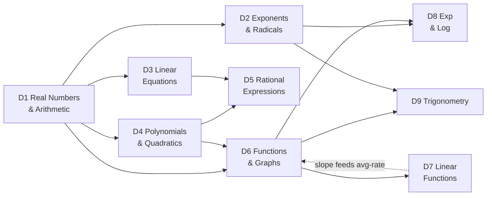

# System Architecture

*First-pass architecture for the calculus-readiness city-builder. Three product surfaces (diagnostic, lessons, game) over one shared student-state store, plus an offline authoring pipeline.*

*Diagrams: rendered SVGs are shown inline. The editable source for each is kept alongside: mermaid in the collapsed block under each image, and Graphviz `.dot` files in `docs/diagrams/`. To re-render after editing a `.dot`: `dot -Tsvg docs/diagrams/NAME.dot -o docs/diagrams/NAME.svg`.*

---

## 1. The layers

**A. Client (web app, primary surface):** three UIs sharing common components:
- **Diagnostic UI:** item player + level-branching.
- **Lesson UI:** tutor NPC, check-for-understanding, practice, scaffolding hints.
- **Game UI:** city, neighborhoods, buildings, storms. (No decay visuals in v1: mastery is monotonic.)
- **Shared client components:** the **graphing widget** (used by diagnostic and lessons only), **math input** (constructed-response entry + answer-space checking), and the **state client** (reads/writes student state within the frozen ownership rules).

**B. Core services (logic):** the three engines, each mapped to an owner. **NOTE: mastery-write ownership is defined authoritatively in Contracts; this reflects the current model (one mastery service, evidence-based).**
- **Diagnostic engine** (Gabe): selects items, runs branching, computes placement, **writes `placement_estimate` only, never mastery** (placement seeds the city blueprint + routes the lesson entry point; mastery starts at 0, nothing is pre-built). *(⚠ **AMENDED 2026-07-23, RATIFIED 2026-07-26**, folded into `docs/Contracts.md` §1.1: the engine still writes only `placement_estimate`, never mastery — but a **passed** placement (`>= 2`, measured or graph-inferred) unlocks + completes that node's building **without the lesson** downstream in the city/mastery lane (build-without-lesson / test-out), at **mastery 0**; only failed nodes (0/1) build via the lesson. Normative: `docs/Contracts.md` §1.1; rationale: `docs/Contracts_Amendment_Diagnostic_TestOut_Unlock.md`.)*
- **Lesson engine** (Anthony): drives lesson-stage progression, hint scaffolding; **submits evidence** (`submitAssessmentEvidence`) to the mastery service, does not write mastery directly.
- **Game engine** (Evan): reads mastery/lesson-stage, renders city, runs storm battles. The storm is **checkpoint-only**: it neither writes nor evidences mastery, it just sets `neighborhood_checkpoint_cleared` once all the neighborhood's required nodes are already mastered (see Mastery_Scoring_Spec / Contracts). Not a mastery writer or evidence source.
- **Mastery service** (shared): the ONLY writer of `mastery`. Recomputes correctness, applies the mastery rules, updates monotonically, records the evidence id.
- **Economy service** (Gabe, **post-MVP ranked expansion**): a fourth authoritative writer added by the ratified cosmetic-economy amendment (Contracts §8). It grants an earned resource (server-side, idempotent) and processes atomic cosmetic purchases; it READS server-verified progression events but its writes never re-enter progression. Resources/cosmetics are **one-way and purely cosmetic** — they never affect mastery, node completion, placement, or storm/checkpoint access. The only client write in the whole economy is `equipCosmetic` (selecting an already-owned cosmetic). Not part of the Day-12 MVP; see Contracts §8 / `Contracts_Amendment_Cosmetic_Economy.md`.

**C. Data stores:**
- **Student state store:** the shared per-node object (the data contract). The one thing all three engines touch.
- **Skill graph:** static, 56 CORE nodes + prerequisite edges + item-family notes. Read by all engines (routing, roads, gating).
- **Item bank:** questions, each tagged with node, difficulty (1–3), and form (pre/post parallel). Read by diagnostic + lessons.
- **Auth / accounts:** identity + progress persistence.

**D. Authoring pipeline (offline, not runtime):** how the item bank gets populated:
- Seed from open banks (MyOpenMath) → AI-generate variants → **team validation** (solve-level correctness + non-similarity) → **difficulty tagging (1–3)** → into the item bank.

**E. Mobile work-upload (post-MVP):** QR one-shot hand-off, photo of handwritten work → feedback; syncs to student state on open.

---

## 2. Component diagram


<details><summary>Diagram source (mermaid + Graphviz)</summary>

Graphviz source: `diagrams/01_component.dot` (this is what the SVG is rendered from). Mermaid equivalent:


</details>

---

## 3. Core data-flow: the student journey

Shows the placement-writes-only / evidence-to-one-mastery-service flow that keeps the seam clean.



<details><summary>Diagram source (mermaid + Graphviz)</summary>

Graphviz source: `diagrams/02_dataflow.dot`. Mermaid equivalent:

```mermaid
sequenceDiagram
    actor S as Student
    participant D as Diagnostic Engine
    participant ST as Student State
    participant M as Mastery Service
    participant G as Game Engine
    participant L as Lesson Engine

    S->>D: Take diagnostic (~2 items/node, branching)
    D->>ST: WRITE placement_estimate (once; NOT mastery)
    ST->>G: read placement_estimate + mastery(=0)
    G->>S: Render seeded city (blueprint ghosts sized by placement, storms)
    S->>G: Enter a neighborhood / building
    G->>L: launch lesson for node
    L->>S: Tutor, check, practice (hints, scaffolding)
    S->>L: Work through practice
    L->>M: submitAssessmentEvidence(lesson responses)
    M->>ST: write mastery = max(existing, evidenced), completion_status
    ST->>G: read updated mastery
    G->>S: Building completes / storm checkpoint
    Note over S,G: Storm battle at neighborhood checkpoint<br/>checkpoint-only; sets flag once all nodes mastered
    Note over M,ST: Mastery is monotonic (no decay in v1)
```
</details>

---

## 4. Skill-graph structure (domain-tier view)

The full 56-node graph is too dense to diagram; this shows the domain-level dependency tiers that drive testing order and the road network. (Node-level edges live in the companion edge doc.)



<details><summary>Diagram source (mermaid + Graphviz)</summary>

Graphviz source: `diagrams/03_domain_tiers.dot`. Mermaid equivalent:


</details>

*D6 (Functions) is the pivotal hub, three domains depend on it. D7→D6 is the one "partly foundational" back-edge (slope precedes general average-rate-of-change).*

---

## 5. Key architectural decisions & their rationale
- **One shared state store, not per-component databases.** Avoids sync bugs; the contract's ownership rules (diagnostic writes once, lessons update, game reads) prevent write-conflicts without locking.
- **Skill graph is static data, read by all three engines.** Routing, roads, and gating all derive from the same source of truth, no divergence.
- **Authoring pipeline is offline / build-time, not a runtime service.** Items are validated and tagged before they enter the bank; the runtime never generates or grades unreviewed content.
- **Graphing widget is a shared client component, built once (Gabe).** It amortizes across graph-bearing diagnostic and lesson content only, never the city canvas. The D1 MVP uses its frozen stub; the scored implementation must land before Phase-2 graph items.
- **Answer-space checking lives in the math-input component**, not per-lesson, one place to handle equivalent forms (1/2 = 0.5, interval notation, etc.).

## 6. Interfaces & code organization (parallel-work safety)

*The three engines split cleanly into three lanes (diagnostic / lessons / game), that part rarely conflicts. Merge conflicts come from **shared files**, not shared concepts. Three shared surfaces need explicit handling so people can work on separate branches without merge battles. Rule: **anything touched by more than one person gets its interface/schema frozen early in its own small file; implementation happens behind that interface in each person's lane.***

### Collision point 1: Shared state schema (the guaranteed conflict)
All three engines depend on the shape of the student-state object. A field add/rename breaks everyone.
- **Fix:** the schema/types live in **ONE shared module** everyone imports (e.g. `shared/state-schema`). Locked Day 1. Changes to it are deliberate and owner-gated (cross-lane change policy, `OWNERS.md`); because a schema change can break all three lanes at once, a broad, multi-lane break there still warrants an all-hands — never a casual commit.
- Do NOT let each engine define its own copy of the shape, that produces *silent* divergence (compiles, breaks at runtime), which is worse than a conflict.

### Collision point 2: Shared client component interfaces
Gabe builds the graphing widget + math-input; the diagnostic and Anthony's lessons consume them. The city renderer stays independent. Changing the shared API still breaks multiple consumers.
- **Fix:** ship a **stub with a frozen API in Week 1** (graphing widget + math-input). Consumers build against the interface; Gabe fills in the implementation behind it. Same "agree interface, then work behind it" pattern as the state schema.

### Collision point 3: Skill graph + item bank data files
Data, but multi-author: Gabe authors/tags items, Anthony references nodes, the team verifies edges. One big JSON = constant conflicts (git handles data files badly).
- **Fix:** **split the data fine-grained** one file per node (or per domain) for items; edges in a separate file. Two people authoring different domains never touch the same file.

### Branch strategy
- **Short-lived feature branches** off a shared **integration branch**; merge to integration **daily-ish**, not one big-bang merge at the end.
- Week 3.5's "integration hardening" is where a deferred big merge would explode; frequent small merges defuse it in advance.
- The three engine directories + the split data files + the frozen shared modules mean most branches touch disjoint files by construction.

### What each person can safely own on their own branch
- **Gabe:** diagnostic-engine dir, item-bank data files, graphing-widget + math-input *implementation* (behind frozen API).
- **Anthony:** lesson-engine dir, lesson content files, review/spacing logic.
- **Evan:** game-engine dir, city/rendering, storm/checkpoint logic (no decay in v1).
- **Shared (frozen, changed only by agreement):** state-schema module, shared-component interfaces, skill-graph edge file.

---

## 7. Architecture decisions (all resolved)

**Client rendering: RESOLVED: per-surface, independent.** Graphs live ONLY in lessons/diagnostic (never in the city), so no shared rendering tech is needed. Evan uses a **game framework (React Three Fiber — React + three.js)** for the city (originally scoped as PixiJS/Phaser; the city shipped on R3F once the buildings became authored GLBs — see `docs/superpowers/specs/Immersive_City_Shell_Spec.md`); Gabe uses **SVG** for the graphing widget (its home turf, far faster to build correct math graphs). They interoperate because they're different views, not the same canvas. Widget stays a self-contained component with a clean API (per §6).

**Backend / state store: RESOLVED: AWS-native — Aurora PostgreSQL Serverless v2 (via the RDS Data API) + Amazon Cognito, all data access through a Lambda.** (Originally Supabase; migrated to an all-AWS footprint per mentor direction — see docs/Deployment.md.) Relational Postgres still wins on Gabe's comfort and the readiness queries; the Data API keeps the Lambda out of a VPC while the browser never touches the DB. **AWS pieces:**
- **AWS Lambda = the authoritative server-side scorer** (§Scoring below). Stateless, event-driven correctness recompute + mastery/metric computation, a textbook Lambda; keeps the trusted scorer off the client without standing up a server.
- **AWS S3 = static asset storage:** the offline-authored item bank (versioned JSON/assets) and the post-MVP QR work-upload photos.
- **Datastore + auth:** Aurora Serverless v2 Postgres holds state, assessment records, and the response log; Cognito is the user directory + JWT issuer. The Lambda is the ONLY DB caller (over the RDS Data API, authenticating as a least-privilege `app_service` role), so there is no browser→DB path. Per-student isolation is enforced in the app layer — the Lambda derives `student_id` from the verified Cognito token and scopes every query to it — rather than by RLS. (This superseded the initial Supabase/RLS plan per mentor direction.)
- **State shape:** a `student_node_state` table keyed by (student_id, node_id), one row per node. Fields per Contracts §1 (placement_estimate, mastery, mastery_updated_at, completion_status, lesson_stage, last_practiced_at). No decay field in v1 (mastery is monotonic; `review_due` is post-MVP). Fine-grained per-node rows still satisfy the merge-safety split.
- **Why relational fits:** the readiness check ("is every node in this domain mastered?") is one `GROUP BY domain HAVING count(mastered) = count(*)`, trivial in SQL vs. a multi-doc assemble in a document store. The **append-only raw-response log** is a textbook Postgres table, and the inheritor's deferred analysis (calibration, pre/post stats) is far easier in SQL, which directly serves the data-asset goal.
- **No realtime listeners.** The game reads state **load-on-enter + refresh-on-explicit-event** (finished lesson, cleared storm), NOT a live subscription bound to the render loop. A single student on a single screen has no concurrent state change to react to, so live updates buy nothing. Realtime is off-roadmap (only matters for a multi-viewer case like a teacher watching live).
- **Access control:** app-layer authorization — the Lambda scopes every query to the `student_id` from the verified Cognito JWT, backed by a least-privilege DB role (not RLS). RLS-via-session-GUC stays available as optional future hardening.

**Scoring & data logging: RESOLVED: client-grades-for-UX + AWS-Lambda authoritative recompute + raw-response logging.**
- **Client grades for instant UX** (diagnostic AND lessons): this drives immediate feedback and the in-lesson feel. The threat model is light (self-directed tool, no payoff to faking), so this is fine for the live experience.
- **The authoritative scorer is an AWS Lambda** that recomputes correctness from the raw answer + versioned key/equivalence-checker for anything that feeds the marketed metric (and the mastery computation). The client verdict is `client_correct` (UX only); the Lambda's is `authoritative_correct` (the record). Same checker version runs both sides (per Answer_Equivalence_Spec).
- **Grading/checker logic isolated in ONE shared module** so the same code runs client-side and inside the Lambda, no divergence.
- **Append-only raw-response log** (a Postgres table in Aurora) is the integrity + data-asset mechanism (NOT anti-cheat). Every response event is logged: `{studentId, itemId, node, difficulty, answer, correct, context (diagnostic|lesson), form (pre|post), attempt, timestamp, hintsUsed, timeOnItem, misconceptionTag}`. (`misconceptionTag` = resolved per-node misconception ID or `other`; feedback/analysis metadata, never a mastery input. See Error_Typing_Spec.)
- **Why log (three consumers, one pipe):**
  1. **Marketed pre/post metric**: computed from immutable assessment records (Contracts §2), not a client-trusted number. Correctness is recomputed server-side. We do NOT claim measurement error auto-cancels across pre-minus-post (form differences, guessing, regression-to-mean, and differential attrition do not cancel); parallel forms handle retest inflation, and limitations are disclosed per Assessment_Scoring_Spec §7.
  2. **Whoever inherits the project**: the deferred work (empirical difficulty calibration, cut-score validation, control-group study) is *impossible retroactively* without this data. `timeOnItem` + `hintsUsed` are exactly the signals needed to calibrate difficulty later; logging them now costs nothing and is the highest-leverage future-proofing move in the architecture (unlogged behavioral data is gone forever).
  3. **Debugging / iteration**: where students stall, broken items, surprising fail rates.
- **Scope guard:** MVP builds the *logging pipe* (append events, a few lines). *Analysis* of that data (dashboards, calibration, the study) is post-MVP / inheritor work. Don't let "collecting data" become "building analytics" in the 24 days.

**AI generation & infinite practice: RESOLVED: offline generation + parameterized templates.**
- **No runtime LLM calls.** AI generation is a build-time authoring tool: generate from seeds → team validates (correctness + non-similarity) → tag difficulty → commit to the bank. The app only ever serves pre-validated content. (Forced by the locked "validate every item before it enters the bank" rule, a runtime service can't validate before serving.)
- **Infinite practice = parameterized templates (AIG).** A template ("factor x² + bx + c" with coefficients as parameters) is validated ONCE, then instantiated deterministically at runtime with fresh numbers. Instances are correct by construction, so they need no per-instance review. Runtime *instantiation of a validated template* is fine (deterministic math); runtime *LLM generation* stays out.
- **Template authoring caveat:** parameter ranges must be constrained so every instance (a) stays valid (e.g. generate factorable quadratics *from* their roots, not by random coefficients) and (b) stays within its tagged difficulty band (bound the ranges so `x²+5x+6` and `x²+47x+510` don't count as the same difficulty). One-time cost per template, then free forever.
- Consequence: "infinite practice" draws from templates + the finite validated static bank; both feel infinite to a real student. True novel-item generation at runtime is a post-launch feature with its own validation story, not v1.

**Mobile work-upload: RESOLVED: QR one-shot hand-off, NOT a native app.**
- **No native app.** App-store approval (days-to-weeks, Apple Developer account, review) is incompatible with a 24-day sprint, and install friction would deter exactly the anxious students we target. Dropped entirely.
- **The mechanism:** on desktop, the student hits "upload my work" → a **QR code** appears carrying a **one-time token tied to their active session**. They scan it → phone browser opens a **single-purpose, ephemeral upload page** (no login on phone, the token does the linking) → snap a photo → it uploads to S3 (with a DB row) against that session → desktop reflects it. Close the phone browser and nothing persists; next upload = fresh QR.
- **Why one-shot, not a persistent mobile companion:** the feature is a momentary "show my handwritten work during a desktop session," not a second surface for doing whole sessions. A persistent authenticated mobile page would be capability no one uses. Zero phone-login friction, and it's genuinely just one tokenized upload route + a QR generator.
- **State impact / conflicts:** the upload writes only its own narrow data (photo + feedback) to a separate table; it **never writes `mastery` or `lesson_stage`**. Separate table from the state web owns → no write contention, no merge logic. This is also why it's cheap enough it *could* sneak into scope, though it stays post-MVP by default.
- Tech: web + a tokenized upload route; the photo lands in **AWS S3** (with a DB row referencing it), no new platform, no store, no install.
