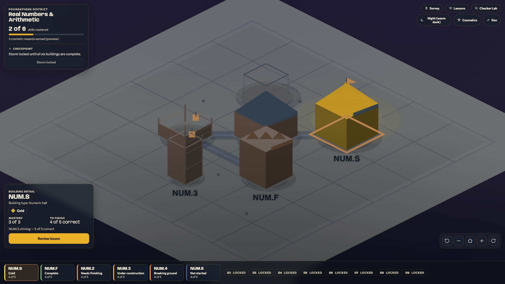

# Game Visual Design Brief — Calculus-Readiness City-Builder

**Purpose of this document:** a self-contained visual design brief for an external
design AI or designer who has **no access to our codebase**. It gives you the full
product context, the locked art direction (with exact colors), the reference games
and why they matter, the current built state (with screenshots), and a prioritized
list of what we want you to design. Everything is described in prose so it stands
alone. Reference games are linked to public URLs.

> **Two screenshots are provided alongside this brief:** `city-day.png` and
> `city-night.png`. **Please attach both to your design tool** — they show the
> current live render (day and warm-dusk night) and are the single most useful
> visual context for this work. They are described in detail in §6.

---

## 1. Product context (what this actually is)

This is a **calculus-readiness diagnostic and remediation product** for incoming
STEM students, delivered as a **city-builder game**. The core idea is a strict
metaphor, not decoration: **the city _is_ the student's math knowledge.** A short
diagnostic measures which prerequisite skills a student has, that result seeds a
city, and the student grows the city by learning. Concretely, the metaphor maps
one-to-one onto real curriculum structure:

- **Math domains → neighborhoods** (10 domains total, incl. the Geometry island
  added by the 2026-07-24 coverage expansion; e.g. "Real Numbers &
  Arithmetic," "Trigonometry").
- **Skills (atomic prerequisite "nodes") → buildings.** Each building is one
  measurable skill.
- **Prerequisite dependencies → roads** between buildings (skill A must come
  before skill B ⇒ a road runs A→B).
- **A building's construction level → the student's real progress** on that skill
  (blueprint → under construction → built → mastered).
- **Neighborhood mastery checkpoint → a "storm"** the student clears once every
  building in the neighborhood is mastered.

The guiding principle is **education-first substance, game-first presentation.**
Underneath the toy city runs a rigorous skill-graph diagnostic + mastery engine
with an auditable pre/post measurement pipeline; on the surface it should feel like
a calm, satisfying city-builder, never like a test. The whole point is to reach
students who abandon traditional tools: they don't see a red score, they see a city
with specific buildings to construct, and every gap becomes a concrete, non-shaming
next action.

---

## 2. Target user & tone

**Primary persona — "Maya," an incoming STEM freshman placed into (or anxious
about) Calculus I.** She is *underprepared, not incapable*: shaky on prerequisite
algebra/arithmetic/trig, not on calculus itself. She is **math-anxious**, has been
burned by timed tests and walls of text, is motivated but easily discouraged, and
abandons anything that feels like a worksheet. She has a vague sense she has "gaps"
but cannot name them.

**The tone every visual must serve:**

- **Calm and non-punishing.** Nothing flashes, nags, shames, or induces urgency.
  Failure is never a loss — it is "this building still needs work."
- **Legible first, pretty second.** A student should understand the state of their
  city at a glance, even zoomed out. Meaning is never carried by color alone.
- **Warm and constructive**, like a cozy diorama you are tending, not a dashboard
  you are being graded on.
- **Accessible by construction** (see §8): full keyboard operation, reduced-motion
  support, and colorblind-safe palettes are hard requirements, not polish.

**Explicitly banned — no manipulative free-to-play mechanics.** This is a learning
tool for an anxious population, so the design must **never** use: countdown/urgency
timers framed as pass/fail, streak-loss guilt, artificial scarcity, loot-box /
variable-reward gambling loops, "energy" gates, or nagging badge/notification
pressure. There are **no real-money purchases of any kind**, ever. Celebration
amplitude stays low and earned; big screenshake belongs in action games, not here.

---

## 3. The game concept & core loop

**Core loop:** **Diagnose → Build → Practice/Master → Storm checkpoint → expand.**

1. **Diagnose (onboarding).** A short placement diagnostic (doubles as the
   pre-test) tags each question to a skill. The result seeds the city: skills the
   student already has start as taller "blueprint" silhouettes; weak areas start as
   empty lots. Placement seeds appearance only — mastery still starts at zero, so
   nothing is pre-built. *(⚠ **AMENDED 2026-07-23, RATIFIED 2026-07-26** (Evan ack'd; Anthony did not),
   folded into `docs/Contracts.md` §1.1 — build-without-lesson:
   a **passed** placement (`>= 2`, measured or graph-inferred) now DOES pre-build —
   the node's building is unlocked + completed on placement without the lesson; only
   failed/unresolved nodes (0/1) start as an un-built ghost/lot and route into the
   lesson. On diagnostic exit, a "You've unlocked N buildings!" popup celebrates the
   N passed nodes. See `docs/Contracts_Amendment_Diagnostic_TestOut_Unlock.md`.)*
2. **Build (learn).** To raise a building, the student works its lesson
   (mini-lesson with a scripted advisor character → check-for-understanding →
   practice). The building visibly accretes as they progress.
3. **Practice / master.** A skill is **mastered** at ≥80% (4 of 5) on its practice
   set; full mastery shows as **gold mastery stars above the building**, not as a change
   to the building itself. Mastery is monotonic in v1 (no decay; completed buildings stay
   complete). *(**CORRECTED 2026-07-28.** This read "a perfect 5 of 5 earns a cosmetic
   **gold** state", naming the retired gold-body treatment — see §4.1's banner.)*
4. **Storm checkpoint.** Once **all** the neighborhood's buildings are mastered, a
   climactic but **non-punishing** "storm" unlocks — a short mixed-review round.
   Clearing it (≥80%) is the neighborhood's victory beat. It has a *soft* timer
   that only grants a bonus (never fails you), unlimited immediate retries, and no
   loss on a miss. The storm is a celebration, not a gate — it never changes
   mastery.

### MVP scope note (important for what to design)

The product is **depth-first on one domain for the MVP: D1 — Real Numbers &
Arithmetic.** D1 is a rich, fully-built neighborhood of **six buildings**; the
other **eight domains are shown as distant, dimmed, locked "outskirts"** on the
horizon (roadmap scenery, never a dead-end "coming soon" wall). The full cosmetic
economy (owned/equipped skins, a wallet, a store) is **post-MVP** — at MVP the game
shows only a display-only "cosmetic rewards earned" *preview* count.

**The six D1 buildings** (this is the concrete set to design against):

| Building | Skill | Archetype (answer-type family) | In-world name |
| --- | --- | --- | --- |
| NUM.S | Signed-number arithmetic | numeric | **Numeric hall** |
| NUM.F | Fraction arithmetic | constructed-response | **Expression workshop** |
| NUM.2 | Order of operations | numeric | **Numeric hall** |
| NUM.3 | Field properties | multiple-choice | **Choice tower** |
| NUM.4 | Evaluate & simplify expressions | constructed-response | **Expression workshop** |
| NUM.5 | Ratios, rates, proportions, percents | numeric | **Numeric hall** |

So D1 contains **three Numeric halls, two Expression workshops, and one Choice
tower** (there is a fourth "generic block" archetype in the system, but D1 does not
use it). The building's *shape family* encodes the **answer type** of the skill;
the building's *construction stage* encodes **mastery progress**.

---

## 4. The LOCKED art direction

This is our design of record. It is intentionally opinionated: **one** locked camera
tilt, **one** lighting model, **one** palette (with switchable day/night/colorblind
environments), **one** icon style, **one** type ramp. Every visible thing encodes
one fact about the student's mastery; nothing is decorative-only. Please treat these
as fixed constraints to *refine and elevate*, not to replace.

**One-line direction:** *A stylized, low-fidelity, meaning-dense isometric toy city
on warm parchment — calm and instantly legible, satisfying but never manipulative.
Buildings are chunky silhouettes lit by one soft key light; gold is earned, not
decorative; the camera orbits freely on one locked tilt; motion is gentle and always
optional.*

### 4.1 Palette (warm "parchment city", exact hexes)

The palette ships as a runtime look-up table so the whole city recolors from one
place and alternate environments are nearly free.

**Calm base (used ~60/30/10):**

| Role | Name | Hex |
| --- | --- | --- |
| Ground / terrain | Parchment | `#ECE4D3` |
| Tile shade / deep ground | Parchment deep | `#D9CCB2` |
| Parks / plazas / "advanced" grounding glow | Sage | `#B9C4A9` |
| Roads / water / distant scenery | Slate mist | `#8FA9B8` |
| **HUD anchor (dark)** | Ink | `#14202E` |

**Per-district hue families** (low-saturation, walking warm → cool). Each domain
owns exactly one hue; within a district, buildings share the body hue and differ by
**silhouette + accent**, never a second body color. **D1 (terracotta) is the only
built district at MVP;** the rest are authored so future districts render in-family
with no engine change:

| Domain | Family | Hex | Domain | Family | Hex |
| --- | --- | --- | --- | --- | --- |
| **D1 Real Numbers** | **Terracotta** | **`#C98A5E`** | D6 Functions | Eucalyptus | `#7E9C8B` |
| D2 Exponents | Clay | `#C9A15E` | D7 Linear Fns | Dusty blue | `#7E93A9` |
| D3 Linear Eqns | Ochre | `#B0A45E` | D8 Exp/Log | Muted indigo | `#8483A8` |
| D4 Polynomials | Sage-green | `#8FA97E` | D9 Trigonometry | Muted violet | `#9585A8` |
| D5 Rational | Teal-sage | `#6FA091` | D10 Geometry | Limestone *(proposed)* | `#BFB199` |

**D10 Geometry (added 2026-07-24) — Limestone `#BFB199`, PROPOSED.** It breaks the
warm → cool walk deliberately. Geometry opens right after D1 (`GEO.1` needs only
`NUM.4`) and nothing depends on it, so it plays as an early, optional excursion
among the *grounded* islands — continuing the walk past D9's violet would give the
earliest island the coolest hue. Limestone is a warm, desaturated stone (survey
markers, chalk lines, quarried block) that reads with its neighbours while staying
clearly distinct from terracotta, clay, and ochre, which are more saturated and
more orange. See `superpowers/specs/Island_Lesson_Themes_Design_Spec.md` §4.

**Reserved meaning colors (do not reuse for anything else):**

> **CORRECTED 2026-07-28 — the gold BODY treatment was retired and never shipped. The
> reservation of `#FFB703` stands; the claim that a body ever renders gold does not.**
>
> The primary row previously read: *"**Reserved.** A building body is gold **only** when fully
> mastered"*, and the secondary row listed *"Gilding, pennants"* among its uses. Four shipped files
> agree that treatment is gone: `apps/web/src/city/masteryVisuals.ts:16` — *"Stars REPLACE the
> retired gold body-tint: mastery is never shown by repainting the building gold, only by earning
> stars above it"*; `buildingAssets.ts:44` — *"Full mastery renders as the normal `built` model —
> there is no gold-mastered stage and no gold tint"*; `palette.ts:253-254` — *"No stage is ever
> tinted gold — mastery is not shown as a gold building"*, with `:81` commenting gold *"reserved:
> reward / UI accent (Build button, readiness)"*; and `palette.ts:234` — *"MasteryStars, never a
> gold building."*
>
> **What mastery actually looks like:** floating **stars above a topped-out building**, 0-3 of 3,
> turning gold and celebratory at 3/3 (`masteryVisuals.ts:8`, `three/MasteryStars.tsx:69`, where the
> filled star's emissive really is `#FFB703`). Stars are gated on the building having topped out, so
> a site foundation or construction scaffold shows none. There is also **no** body-glow or
> "comes alive" treatment (`masteryVisuals.ts:10`).
>
> **`#FFB703` is therefore still reserved, and still carries mastery** — on the stars and on UI
> accents (the Build button and the readiness meter). What it never touches is a building body.
> §4.4, §4.6, §4.7, §6 and §7(a) carried the same error and are corrected in place.
> `superpowers/specs/City_Art_Bible.md` §1.3 / §4 carry the matching banners.

| Role | Hex | Rule |
| --- | --- | --- |
| **Mastery gold (primary)** | `#FFB703` | **Reserved — the mastery accent.** Carried on the **stars** above a topped-out building (gold at 3/3) and on UI accents (Build button, readiness). **A building body is never gold**, in any era. |
| Mastery gold (secondary / warm) | `#F4A261` | Reward tokens and the focus/selection ember. |
| Success (sparing) | `#2DC653` | Storm-cleared chip only; **never** a building body. |
| Timber (construction) | `#B08968` | Scaffolding / under-construction framing. |

**Archetype accent trims** (a small area only — they help identify the answer type
at a glance; they are trims/markers, never the body): numeric → deep teal `#4E7C8A`;
multiple-choice → plum `#7E5A7A`; constructed-response → burnt amber `#CC7A3B`;
generic → slate `#6C7A88`.

### 4.2 Fixed 3-tone face lighting (no runtime lights)

The entire city is lit by **one** soft key light. Every building face is one of
three tones of a **single** hue, so the light direction reads identically
everywhere:

- **Top face — light:** the hue lightened ~26% toward white.
- **Left wall — mid:** the hue itself.
- **Right wall — dark:** the hue darkened ~28% toward black.

This ordering (top > left > right) is invariant across every color environment —
only the resolved hue changes for day/night/colorblind, never the relationship.

**Baked contact shadow / AO:** each plot draws a soft, offset **elliptical** contact
shadow *under* the volume before it is drawn, grounding it (warm brown `#5B4A38` by
day, cool near-black by night). There are **no** runtime/dynamic shadows.

### 4.3 Buildings: silhouette-first, per-district archetypes

One dominant shape + one accent, readable at maximum zoom-out. Shape family encodes
the skill's **answer type**:

| Archetype | Silhouette | Read |
| --- | --- | --- |
| numeric | **hall** | Wide, low, gabled ridge |
| multiple-choice | **tower** | Tall, narrow, pyramidal cap + finial |
| constructed-response | **workshop** | Medium block, sawtooth roof |
| generic | **block** | Simple cube, parapet |

Each building = a 3-tone volume + baked shadow + a single accent trim band on the
sunlit wall + roof detail per silhouette + a text label. **One visual state = one
mastery fact** (never decoration).

### 4.4 Milestone upgrade language (discrete stages, "accretion")

Like Clash of Clans town-hall levels — the building visibly **accretes** as the
skill is mastered. Discrete stages, not a continuous morph:

> **CORRECTED 2026-07-28 — the `Gold-mastered` row described a treatment that does not exist, and
> the stage count is wrong.** The corrected table follows; the original rows are quoted here so
> nothing vanishes silently. See §4.1's banner for the four shipped files that settle it.
>
> 1. **`Gold-mastered` was RETIRED and never shipped.** It read *"Gilded body `#FFB703`, finial,
>    pennant, a warm glow bloom"*. Mastery is shown by **floating stars above a topped-out
>    building**, 0-3 of 3, gold at 3/3 — never by repainting the body.
> 2. **`Advanced`'s "gentle sage grounding glow" is also gone.** There is **no** body-glow or
>    "comes alive" treatment (`masteryVisuals.ts:10`). `advanced` is a real state name, but it
>    **reuses the `built` model** (`buildingAssets.ts:41-44`).
> 3. **There are three model stages, not five:** `ModelStage = "site" | "construction" | "built"`
>    (`buildingAssets.ts:55`) — note `construction`, not `under-construction`. Each node ships its
>    own model per stage, so a building rises **as itself** rather than through a generic scaffold,
>    which retires the shared "muted timber, posts + rails, a small bobbing crate" description too.
>
> The five-tier engine `construction_state` vocabulary is a separate axis and still stands; what
> changed is how many distinct MODELS it resolves to.

| Model stage | From `construction_state` | Look |
| --- | --- | --- |
| **site** | `not_started`, `preview` | The node's own foundation/clearing model, plus a translucent blueprint ghost while placing. |
| **construction** | `teaching` → `practice` | The node's own scaffold model — it rises as itself, so the finished silhouette is already readable. |
| **built** | `unfinished`, `complete`, and full mastery | The finished model. `advanced` (mastery ≥ 2) and full mastery **reuse this same model** — there is no separate gilded or glowing version. |

**Mastery rides above the building, not on it.** Once a building tops out, 0-3 filled stars of 3
float over its roofline, turning gold `#FFB703` and celebratory at 3/3. A site or scaffold shows
**no** stars. The `advanced` tier stays in the state vocabulary for finer-grained mastery later, and
everything stays data-driven (never a hard-coded node id).

### 4.5 Camera: one locked tilt, free 360° orbit + pan/zoom

Clash-of-Clans style — the **tilt is locked and the heading is free.** The downward
tilt is pinned at ~49° elevation (`polarAngle` 0.72 rad, min = max, so drag can never
change it), and the player orbits the **full 360° of azimuth** around the island —
continuously, not in quarter-turn steps. Because the city is real 3D geometry, depth
sorts itself and front/back flip correctly at every heading, not only at four
authored views. Rotate is pointer-drag + `Q`/`E` + on-screen buttons (~15° per
discrete step); pan is pointer-drag + arrow keys/WASD; zoom is wheel/pinch + `+`/`-`
+ buttons, **clamped** to 0.5×–2.6× the default distance so the island can never be
lost off-screen or shrunk to a speck. `0` recenters. Motion is eased (damped); under
reduced motion the damping is disabled so the camera **snaps** with no glide.

**The design consequence — this is the part that matters for art.** The old direction
here assumed four authored views, which let a building be designed as a handful of
flat faces. It cannot be: a building is seen from **every** heading, so every side
must hold up. Keep the *look* isometric-flavoured — chunky silhouettes, flat 3-tone
faces, one key light — but design forms that read as well from behind as from the
front. There are no "back faces nobody sees."

### 4.6 MODERATE juice (calm, low-amplitude, reduced-motion-gated)

Satisfying but never manipulative. **Never screenshake.**

- **Button press:** squash to ~95% on press, elastic settle to ~102% over ~150ms.
- **Skill complete:** a soft bounce on the building, a gentle "poof" of ~8 warm
  puffs, and a soft synthesized chime.
- **Reward → HUD:** a `+1` token arcs from the building to the readiness counter,
  then fades.
- **Mastery stars:** a topped-out building carries 0-3 filled stars of 3 floating over
  its roofline, which turn gold `#FFB703` and celebratory at 3/3. *(**CORRECTED
  2026-07-28.** This bullet read "**Mastery glow bloom:** complete/gold buildings carry a
  soft breathing glow (warm gold for gold, sage for advanced)" — it named the retired
  gold body stage and a body-glow treatment that was never shipped. See §4.1's banner.)*
- **Reduced motion:** bounce/poof/chime/arc are all skipped; the stars hold static;
  presses don't transform.

### 4.7 Ambient life (slow, sparse, optional)

Procedural and cheap: ~4 slow drifting clouds, a crate bob on construction sites, a
gentle bob on the selected plot, and
a few traffic dots + citizen drifters for scale. **Everything non-essential freezes
under reduced motion** — the city is fully legible static.

### 4.8 HUD: dark frosted "drafting glass", sticker icons, one type ramp

- **Dark frosted panels** over the warm world (fill ~`rgba(20,32,46,0.72)` = the
  Ink anchor at ~72%, with a warm hairline ~`rgba(244,162,97,0.26)`), anchored to
  corners + a lower building roster. Bright color is reserved for
  notifications/celebration only.
- **Sticker icons:** one icon = one meaning, **always paired with a text label** —
  meaning is never carried by the glyph alone. The current icon set includes: storm,
  gem/reward, dev, survey, lessons, checker, rotate-left, rotate-right, plus, minus,
  home, sun, moon, contrast.
- **One type ramp:** *Anybody Variable* (wide, signage-like) for display/headings;
  *Commissioner Variable* for body/data. Warm light text (`#F4ECD9` / `#D8CBB2`) on
  the dark HUD.

#### 4.8.1 DECIDED 2026-07-28 (Evan) — the type ramp is Anybody Variable + Commissioner Variable, self-hosted

**Recorded here rather than in `City_Art_Bible.md` §8** because typography is **app-wide**: it is
set in `apps/web/src/styles.css` and reaches the lessons, the diagnostic and the whole shell, not
only the city. The Art Bible's own scope is the city (its module map points at
`apps/web/src/city`), so a shell-wide rule does not belong there. §8 keeps the type ramp and
cross-references this.

**THE RULING (Evan, 2026-07-28), in two parts.**

1. **The type ramp is *Anybody Variable* for display/headings and *Commissioner Variable* for
   body/data.** The documented pair is the intent. **Fredoka Variable and Nunito Variable are to
   be replaced.**
2. **Self-host it**, so the font the UI is designed in is the font it is read in.

**Implementation is Gabriel's**, not this document's: it is shared web-shell territory
(`main.tsx`, `styles.css`) and he found the problem. The change list below exists so he does not
have to rediscover any of it. **Nothing in `main.tsx` or `styles.css` is touched by this PR.**

**The documented pair is unanimous across four places, so the ruling does not need a second
pass.** All read at this tip: §4.8 above (`:295-296`), `City_Art_Bible.md` §8 (`:415`),
`Immersive_City_Shell_Spec.md` (`:275-276`), and §11's HUD note in this file (`:610`). **No design
document anywhere in `docs/` mentions Fredoka or Nunito.**

**This is a DELIBERATE OVERRIDE of an argued choice, not the correction of an oversight.** The
distinction is recorded because it changes how a future reader should treat the shipped pairing.
`styles.css` carries a rationale comment directly above the ramp in `:root`: *"Type pairing (research): Fredoka display +
Nunito body — the Mini Cities 2 / Supercell warmth without the illegible display faces."* So
Fredoka and Nunito were **chosen, on stated grounds, after research** — the ramp did not drift there
by accident and nobody forgot to load Anybody.

**Evan was shown that rationale and confirmed the ruling anyway.** Anybody + Commissioner is the
ramp knowingly, with the warmth argument on the table and overruled. **Nobody should read this
section as having discovered a mistake**; it resolves a genuine disagreement between the design
documents and the shipped code in favour of the documents.

**Which is exactly why the `:7-8` comment must be REWRITTEN rather than deleted when the swap
lands.** The warmth argument is a real one about a real risk — wide signage faces are less warm and
can be less legible at small sizes than rounded ones — and **if the reasoning is deleted rather
than answered, someone will re-propose Fredoka on it**, having no way to know it was already
weighed. The replacement comment should say that Anybody + Commissioner is the ruled ramp, that the
Fredoka warmth argument was considered and overridden, and point here.

**A related line becomes true only after the swap.** `Immersive_City_Shell_Spec.md:275` says to
*"reuse the app's **loaded** pairing — Anybody Variable … Commissioner Variable"*. Today neither is
loaded, so that instruction cannot be followed as written; landing the change list makes it
accurate.

##### What is actually shipped, verified at this tip

| | Family | `@font-face` emitted? |
| --- | --- | --- |
| The documented ramp | Anybody Variable · Commissioner Variable | **No** — installed, never imported |
| `--font-display` / `--font-body` in `:root` (`styles.css`) actually set | `"Fredoka Variable"` · `"Nunito Variable"` | **Yes** |
| Design-doc coverage of Fredoka / Nunito | none anywhere in `docs/` | — |

- **All four families are dependencies:** `apps/web/package.json:26-29` —
  `@fontsource-variable/anybody`, `/commissioner`, `/fredoka`, `/nunito`, all `^5.3.0`.
- **`apps/web/src/main.tsx:1-2` imports only two of them**, fredoka and nunito. Fontsource's
  `@font-face` rules come from those imports, **so those two are the only families with an emitted
  `@font-face` anywhere in the build.**
- **The ramp is defined once**, as `--font-display` / `--font-body` in `:root` (`styles.css`), and there is no second
  definition of either custom property anywhere in `apps/web/src`. Nearly all consumers go through
  `var(--font-display)` / `var(--font-body)` rather than naming a family.

**On the framing "there is no `@font-face` anywhere":** directionally right about the effect,
imprecise about the cause. There is none in hand-written source, and fontsource generates them at
build time — but only for the two families that are imported, which is why the documented ramp
renders as a system fallback. The effect Gabriel described is real; the mechanism is the missing
import rather than a missing rule.

**The four literal declarations that therefore resolve to bare `sans-serif`** — three asking for
Anybody, one for Commissioner, all four in the diagnostic surface:

All four are in the diagnostic block of `apps/web/src/styles.css`. **Cited by selector rather
than by line number deliberately:** this table carried `:7078/:7119/:7158/:7166`, which were
correct when written and wrong within the day — a single forward-merge moved all four, and a
reviewer's re-derived replacements went stale before they could be applied. `rg '"Anybody
Variable"' apps/web/src/styles.css` finds the set in one command and cannot rot.

| Selector | Declared |
| --- | --- |
| `.diagnostic-item__index` | `"Anybody Variable", sans-serif` |
| `.diagnostic-score strong` | `"Anybody Variable", sans-serif` |
| `.diagnostic-gain__value` | `"Anybody Variable", sans-serif` |
| `.diagnostic-gain__value span` | `"Commissioner Variable", sans-serif` |

**Bare `sans-serif` is what renders per-platform** — DejaVu Sans on a Linux runner against
Helvetica or Arial on macOS — and is the behaviour behind the observed **~19% width divergence
between Linux and local**. Reported rather than reproduced: a per-platform render is not something
a docs change can measure.

##### The change list for Gabriel

**1. The import swap** — `apps/web/src/main.tsx:1-2`, which currently reads:

```
import "@fontsource-variable/fredoka";
import "@fontsource-variable/nunito";
```

**Out:** both. **In:** `@fontsource-variable/anybody` and `@fontsource-variable/commissioner`.
Both are already installed, so no `package.json` addition is needed. This is the whole of what
makes the documented families load.

**2. The ramp itself** — the `--font-display` and `--font-body` declarations in `:root` (`apps/web/src/styles.css`). Proposed:

```
--font-display: "Anybody Variable", "Anybody", system-ui, sans-serif;
--font-body: "Commissioner Variable", "Commissioner", system-ui, -apple-system, sans-serif;
```

**Note the fallback changes, not just the family.** `--font-display`'s current chain includes
`ui-rounded`, which was chosen for Fredoka — a rounded face. **Anybody is a wide signage face and
is not rounded**, so keeping `ui-rounded` would make its fallback look nothing like it. Drop it.
And rewrite the `:7-8` rationale comment rather than deleting it, per the dissent noted above.

**3. The four literal rules: move them to the variables — recommended.** Even once Anybody loads,
they should not stay literal. The ramp exists precisely so a family is named in one place; a
literal `"Anybody Variable", sans-serif` also **discards the whole fallback chain**, so it degrades
to a bare system sans while its neighbours degrade gracefully. Three want display, one wants body:

**Cited by selector, for the same reason the table above is:** this list carried
`:7078/:7119/:7158/:7166`, which by the evening of the day they were written pointed at a
`text-transform`, a `gap`, a `border-radius` and `.worked-solution__steps` in an 8,947-line
file. Recomputing them is what rotted, twice over — the reviewer's own re-derived numbers
were stale before anyone could act on them.

- `.diagnostic-item__index`, `.diagnostic-score strong`, `.diagnostic-gain__value` →
  `font-family: var(--font-display);`
- `.diagnostic-gain__value span` → `font-family: var(--font-body);`

That leaves `styles.css` with **no literal family name outside `:root`** except the one deliberate
exception on `.lesson-interactive__input` (see item 5), which is a cleaner invariant than four
scattered literals.

**4. Removing `fredoka` and `nunito` from `package.json` — yes, safe, once items 1-3 land.**
Checked before saying so: **`main.tsx:1-2` are the only fontsource imports in the entire tree** — a
grep for `fontsource` across `apps/`, `packages/` and `engines/` returns only those two lines and
the four `package.json` entries. Nothing else imports either family. Two caveats: remove the
now-dead `"Fredoka"` / `"Nunito"` strings from the fallback chains at the same time (item 2 does
this), and run a clean install afterwards so the lockfile drops them.

**5. Tests that pin font metrics — there are TWO, and the ruling moves neither.**
`apps/web/src/lessons/widgetPlaceholderFit.browser.test.tsx` measures the painted width of the
`root-parity-builder` placeholder (`"e.g. m^2 or |m|"`) against the field's content box and asserts
`available >= needed` — one-sided, **with no tolerance**, which is exactly the shape that fails when
a face renders wider. Its own docstring says *"a later font or padding change that re-breaks it
fails here."*

> **CORRECTED 2026-07-28 — this section said `widgetPlaceholderFit` was "the only `measureText`
> caller in the whole tree", and that is no longer true.** `integration` added
> **`apps/web/src/lessons/answerPlaceholderFit.browser.test.tsx`**, which guards the shared
> answer-format placeholders `practicePlaceholder` / `cfuPlaceholder` hand to the three
> answer-entry surfaces, and calls `measureText` in its own `paintedWidth` helper. Two callers,
> not one — which matters because the second consequence below inferred a culprit from there
> being only one.

**But it measures a surface deliberately outside the ramp.** The field it measures is
`.lesson-interactive__input`, whose `font-family` (in `apps/web/src/styles.css`, cited by
selector because line numbers here have rotted twice) is
`ui-monospace, SFMono-Regular, Menlo, monospace` — a **system monospace stack**, and its comment
calls it *"the only one in the lesson layer allowed to set a font-family at all."* It never reads
`--font-display` or `--font-body`.

**Two consequences, and the second matters more than the first:**

- **The swap should not move this test.** Nothing in items 1-4 touches monospace. Worth running
  it as a check rather than assuming, but no update should be needed.
- **This ruling therefore does not fix the 19% divergence.** Its font is a *system monospace
  stack*, which resolves to Menlo locally and to DejaVu Sans Mono or Liberation Mono on a Linux
  runner. **That is a second, independent instance of the same class of defect**: unpinned
  families measured without tolerance. Self-hosting the ramp is still right, and it will not make
  this test deterministic. **Fixing that one is a separate change** — either self-host a monospace
  face too, or give the assertion a tolerance.
  > **CORRECTED 2026-07-28 — one inference in this bullet is WITHDRAWN, and what replaces it is
  > stronger.** It read *"Being the only text-measuring test in the tree, this is almost certainly
  > the CI failure the divergence was found through."* With a second `measureText` caller on
  > `integration` that elimination no longer closes, so the attribution is dropped. It is not
  > needed: the second caller reproduced the same failure **independently and on a different
  > surface**. `answerPlaceholderFit` first asserted `needed <= available`, passed on the machine
  > it was written on at 278px against 313px, then **failed on the first CI run it ever had, at
  > 310px against 309px, on two strings nobody had changed** — *"same strings, same stylesheet,
  > different `system-ui`"*. So the ~19% between-fallback spread is now **measured twice** rather
  > than inferred once. **And it settles which of the two candidate fixes works:** that test took
  > the tolerance route, a `FIT_HEADROOM` constant that moves the bound off the boundary, with a
  > companion assertion pinning that the margin is real — a working precedent for whoever picks up
  > item 12, and evidence that a boundary-sitting assertion on this quantity is *"a coin toss"*.

**DECIDED 2026-07-28 (Evan): record it and move on, do not fix it.** It is now filed as a known
issue in **`docs/Post_MVP_Backlog.md`, Tier 2 item 12**, carrying the diagnosis, why this ruling
does not address it, both candidate fixes, and the caveat that a one-sided assertion proves little
either way — passing says only that the box is wide enough in whatever face happened to resolve.
**Owner: Gabe**, since it is his test and his lane and he raised the symptom.

**Nothing pins the ramp itself, and that is worth saying out loud.** A grep across `apps/`,
`packages/` and `engines/` finds **no test referencing `--font-display`, `--font-body`, Anybody,
Commissioner, Fredoka or Nunito** — not one of the four families, and neither custom property. Two
consequences pull in opposite directions: **items 1-4 have no test to update**, which makes the
change cheap; and **nothing would catch the ramp drifting again**, which is how it reached a state
where the documented pair was installed but never imported and nobody noticed. If a guard is wanted,
the cheap one is an assertion that the computed `font-family` on `:root` names the ruled families —
**suggested, not ruled on, and it would want writing red first** per `.cursor/rules/qa-verification.mdc`.

**Scope.** Items 1-4 are `main.tsx` and `styles.css` only; no component changes. Item 5's second
consequence is a separate decision.

### 4.9 Runtime palette environments (day / night / colorblind)

One switch recolors the whole city:

- **Day:** the warm parchment identity above.
- **Night:** a warm dusk — every color mixed ~42% toward indigo `#1B2740` and
  slightly dimmed; warmer lit-window accents; darker sky.
- **Colorblind:** deuteranopia-friendly — lifted lightness and a blue-shifted
  "success" (`#1F9ED6`) so hue is never the only cue (shape + word labels still
  carry meaning).

Mastery gold `#FFB703` and the Ink HUD anchor `#14202E` are held across all three.

### 4.10 Global finishing pass

One overlay carries cohesion over the whole scene: a subtle warm **gradient wash**,
a soft **vignette**, and a faint **grain** (~4.5% opacity), multiplied under the HUD.
Night/colorblind get their own tint.

### 4.11 The AVOID list (hard "no"s)

- **No photoreal / PBR realism and no gray, low-contrast palettes** — they lose
  charm and legibility (the Cities: Skylines II problem) and read cold and clinical.
- **No depth-of-field / tilt-shift blur**, and **no free-tilt camera** — the downward
  tilt stays locked (§4.5). Orbiting the *heading* is fine and is what ships; letting
  the player pitch the camera toward the horizon is not.
- **No decorative detail that carries no meaning.**
- **No manipulative free-to-play mechanics** (see §2) and **no big screenshake** —
  keep celebration amplitude low and earned.

---

## 5. Reference games & why (with URLs)

These are the touchstones our locked direction was synthesized from. Each entry says
what to look at and why it matters for us.

- **SimCity (2013) — "art is the UI," tilt-shift toy warmth.**
  Its data-driven diorama look, where the *art itself* communicates city state
  (rather than charts), and its warm, "toy" tilt-shift presentation are the tone
  reference for "the render is the information." (We take the warmth and
  legibility; we **do not** take the tilt-shift blur.)
  <https://en.wikipedia.org/wiki/SimCity_(2013_video_game)>

- **Supercell — Clash of Clans — readable chunky silhouettes, wealth-accretion
  upgrades, tasteful juice.**
  Buildings read instantly as bold silhouettes even when tiny; upgrades visibly
  "accrete" wealth/complexity across discrete levels (this is exactly our
  site → construction → built language, with mastery stars on top); and its press/collect
  micro-animations are satisfying without being frantic. Look specifically at the
  **Town Hall level progression** as the model for our milestone upgrades.
  <https://en.wikipedia.org/wiki/Clash_of_Clans> ·
  Town Hall level gallery: <https://clashofclans.fandom.com/wiki/Town_Hall> ·
  <https://supercell.com/en/games/clashofclans/>

- **Monument Valley — calm fixed-isometric, per-face flat tones.**
  The gold standard for a *calm* fixed isometric world with flat, per-face tinted
  surfaces and a serene, non-anxious mood — the emotional register we want for an
  anxious learner, and the justification for our fixed 3-tone face lighting.
  <https://en.wikipedia.org/wiki/Monument_Valley_(video_game)> ·
  <https://www.monumentvalleygame.com/>

- **Townscaper — tiny palette, detail concentrated at the edges.**
  Proof that a *very* small, harmonious palette plus crisp edge detail produces a
  cozy, high-craft city look cheaply — the reference for our restrained palette and
  "detail where it counts" approach.
  <https://en.wikipedia.org/wiki/Townscaper> ·
  <https://store.steampowered.com/app/1291340/Townscaper/>

- **ISLANDERS — non-punishing, low-stakes, meditative building.**
  A building game with no fail-state anxiety and a gentle, satisfying placement loop
  — the reference for "stakes without punishment," matching our non-punishing storm.
  <https://en.wikipedia.org/wiki/Islanders_(video_game)>

- **Anno 1800 — dark, always-on, frosted HUD.**
  Its dark, information-dense but disciplined always-on HUD is the rationale for our
  dark "drafting glass" panels (bright color reserved for moments). See the Anno
  Union dev blog for the UI reasoning.
  <https://en.wikipedia.org/wiki/Anno_1800> · Dev blog: <https://www.anno-union.com/en/>

- **Mini Motorways — colorblind-safe, shape + color redundancy.**
  A model for never relying on color alone: it pairs color with **shape** so
  colorblind players read the board perfectly — exactly our accessibility rule.
  <https://en.wikipedia.org/wiki/Mini_Motorways> ·
  <https://dinopoloclub.com/games/mini-motorways/>

*(What the three reference studies converged on: stylized beats realistic — it ages
better, reads faster, stays calm; buildings are readable chunky silhouettes with
fake 3-tone lighting and baked shadows; a restrained low-saturation palette with
gold reserved for mastery; discrete milestone upgrades tied to progress; a dark
frosted always-on HUD with bright color saved for moments; tasteful,
reduced-motion-gated life; and no photoreal realism, no depth-of-field blur.)*

---

## 6. Current state (what's already built) — see the two attached screenshots

The direction above is **already implemented and live** as a full-bleed, in-browser
city rendered in **React Three Fiber** (React + three.js / WebGL) — real 3D geometry
under a locked-tilt orbit camera (§4.5), styled to read isometric rather than
projected as true isometric.

> **The two screenshots below predate the 3D engine and the authored building art.**
> They are kept because the *palette, HUD, and state-legibility* they show are still
> the design of record. Two things in them are out of date: the city was PixiJS 2.5D
> when they were taken, and the buildings were procedural placeholder geometry. The
> live city now loads authored GLB models per node and per construction stage
> (`apps/web/src/city/buildingAssets.ts`). Treat the images as a colour and UI
> reference, not as a render target.

> **CORRECTED 2026-07-28 — a third thing in them is out of date, and it is the one most likely to
> mislead an artist: the gold building.** NUM.S renders with a **gold body and a pennant** in both
> shots, and the roster chip below it reads *"NUM.S / Gold"*. That is the **retired gold-mastered
> treatment**, faithfully captured — these images predate its removal. **Do not draw from it.** Full
> mastery now renders the finished `built` model at its **normal body colour**, with gold mastery
> **stars floating above the roofline**. The description below is left accurate about what the
> pixels show, with the retired parts marked; §4.1's banner cites the four shipped files.

**`city-day.png` — daytime render.**


**`city-night.png` — warm-dusk "night" render.**



**What the screenshots show (described in prose so this brief stands alone):**

- A **full-bleed warm-parchment isometric city** filling the viewport. The ground is
  a large sage-tinted diamond with a faint grid; roads (slate paths) connect
  buildings along real prerequisite edges.
- **The six D1 buildings in different mastery stages at once:** a **fully-mastered**
  building — drawn here in the **retired** gold body (`#FFB703`, pennant, warm glow bloom);
  **today it would be the ordinary terracotta `built` model with three gold stars above it**;
  an **advanced/built** terracotta building with a slate-blue roof; two **timber
  under-construction** buildings with visible scaffolding and small crates; and a
  **blueprint ghost** (a translucent wireframe cube outline) for the not-started
  skill. Each has a soft **baked elliptical contact shadow** grounding it, and a text
  label (NUM.S, NUM.2, etc.).
- **Dark frosted "drafting glass" HUD.** Top-left: neighborhood identity
  ("Foundations District — Real Numbers & Arithmetic"), a "2 of 6 skills mastered"
  readiness meter, a cosmetic-preview count, and a "Checkpoint / Storm locked" card.
  Bottom-left: a building-detail card (building type, mastery "3 of 3", "to finish 4
  of 5 correct", a "Review lesson" action). Top-right: entry points (Survey, Lessons,
  Checker Lab) and toggles (Day/Night, Cosmetics, Dev). Bottom-right: camera controls
  (rotate-left, zoom −, home/reset, zoom +, rotate-right). Bottom edge: a roster of
  all six D1 buildings with word-label states, then D2–D9 shown as **LOCKED** chips.
- **The night render** recolors the entire scene toward warm indigo dusk, makes that same
  (retired) gold building glow, warms the construction-site lights, and shows the selected
  building ringed by a warm ember focus outline. The night recolour and the ember focus
  outline are still the design of record; the glowing gold body is not.

**Be aware (important):** the buildings are **procedurally-rendered stylized
geometry**, not bespoke art yet. Shapes are simple extruded footprints (a wide
"hall," a tall "tower," a sawtooth "workshop," a plain "block") drawn as flat 3-tone
polygons with programmatic roofs, scaffolds, and trim. It reads well and is fully
functional, but it is deliberately low-fidelity placeholder geometry. **This is
exactly where your design work comes in:** taking this correct-but-basic look and
elevating it into cohesive, high-craft building art and UI while staying 100% within
the constraints above.

---

## 7. Requested design deliverables (prioritized)

What we want you to design. Priorities are marked **[P0]** (highest), **[P1]**,
**[P2]**.

- **[P0] (a) Refined building concept art per D1 archetype, across all upgrade
  stages.** For each of the three archetypes present in D1 — **Numeric hall**,
  **Expression workshop**, **Choice tower** — design the building across the **three
  model stages** (site/blueprint → construction scaffold → built), and then show the
  **full-mastery read**: the *same* built model at its normal body colour with **three gold
  `#FFB703` mastery stars floating above the roofline**. Keep the fixed 3-tone lighting, the
  terracotta D1 body hue, the per-archetype accent trim, and instant silhouette readability
  at zoom-out. This is the single most valuable deliverable: it turns placeholder geometry
  into craft.

  > **CORRECTED 2026-07-28 — this brief used to commission a stage that does not exist.** It read
  > *"design the building across the five milestone stages (blueprint ghost → under-construction
  > scaffold → built → advanced → gold-mastered)"*. Two things were wrong, and because this is a
  > **live instruction for commissioning art**, following it produced work the engine can never
  > render. **There is no `gold-mastered` stage** — full mastery reuses the `built` model
  > (`buildingAssets.ts:41-44`) and gold rides on the stars above it
  > (`three/MasteryStars.tsx:69`), never on the body. **And there are three model stages, not
  > five**: `ModelStage = "site" | "construction" | "built"` (`buildingAssets.ts:55`); `advanced`
  > is a mastery tier that reuses `built`, not a separate render. **Full mastery is still a
  > distinguishable visual state** and still wants designing — as the star cluster over an
  > unchanged building, which is what the deliverable now asks for. See §4.1 and §4.4.

- **[P0] (b) A cohesive sticker-icon set for the HUD.** One consistent icon family
  covering (at minimum): storm, reward/gem, survey, lessons, checker, rotate-left,
  rotate-right, zoom-in, zoom-out, home/reset, sun (day), moon (night), contrast
  (colorblind), and a dev marker. Every icon must remain legible small and always
  works paired with a text label.

- **[P1] (c) Polished HUD & screen mockups** for the key states, on the dark frosted
  "drafting glass" system: (1) the main **city view** with the always-on HUD; (2)
  the **building-detail** card; (3) the **storm** encounter screen (non-punishing,
  soft timer, celebratory not tense); and (4) the **in-world lesson entry** screen
  (the full-bleed scene the player enters when they tap a building to learn).

- **[P1] (d) Palette & finishing refinement.** Sanity-check and refine the exact
  palette (§4.1), the day/night/colorblind environment transforms (§4.9), and the
  finishing pass (gradient wash + vignette + grain) for maximum warmth, cohesion,
  and legibility — without breaking the reserved-gold rule or the accessibility
  requirements.

- **[P2] (e) Forward-looking concepts** (lower priority, exploratory): how the other
  **eight neighborhoods** could look as distant locked outskirts and, later, as
  their own populated districts in their assigned hue families (§4.1); and a mood
  concept for the roadmap **"Attacks = Calculus I" endgame**, in which mastered
  Calculus-I concepts (limits, derivatives, integrals) arrive as a *non-punishing*
  defensive set-piece over the finished city. Keep it aligned with the calm,
  non-punishing tone — this is vision framing, not a spec.

---

## 8. Hard constraints & guardrails (any design must satisfy these)

**Technical feasibility (web / React Three Fiber, true 3D):**

- Target is **true 3D in the browser via React Three Fiber** (React + three.js /
  WebGL). Buildings are real 3D meshes — authored GLB models per node and per
  construction stage — under a **locked-tilt, free-360°-orbit** camera (§4.5). Design
  for a form seen from **any heading**, not for a fixed iso projection with a few
  authored views.
- **Isometric is the LOOK, not the projection.** Keep the calm, flat, chunky,
  low-fidelity read the palette and lighting model give us; do not assume the
  flat-2D-sprite affordances that a real iso projection would grant (no free
  back faces, no per-view art, no depth-sort tricks — the renderer sorts depth).
- Keep it **lightweight:** low polygon counts, flat/unlit-looking materials, one soft
  key light, no heavy textures, no realistic PBR. It must run smoothly on a laptop
  integrated GPU, and every model is preloaded, so budget geometry accordingly.
- Every building state must be expressible as **silhouette + 3-tone hue + accent +
  stage**, so it can be recolored by the runtime palette LUT at any camera heading
  without bespoke per-state or per-view art pipelines.

**Accessibility (non-negotiable):**

- **Never color alone.** Every state (construction stage, storm phase, readiness,
  archetype) must also be conveyed by shape and/or a word label.
- **Colorblind-safe:** the design must survive the deuteranopia-friendly environment
  (§4.9); pair color with shape (à la Mini Motorways).
- **Reduced motion:** all ambient life and juice must be safely removable; the city
  must be fully legible completely static.
- **Keyboard + DOM layer:** beneath the canvas is a keyboard-navigable DOM mirror
  that is the semantic source of truth. The canvas is a *visual enhancement* over an
  operable DOM — designs must not assume mouse-only or canvas-only interaction, and
  must fail closed to a legible non-canvas fallback.

**Tone:**

- **Calm, warm, non-punishing, earned.** No urgency, no shaming, no manipulation
  (§2). Low celebration amplitude. This is a tool for an anxious learner.

**Out of scope (do not design these):**

- **The deep customization / cosmetic economy** (owned & equipped skins, decor,
  district palettes as purchasables, a wallet, a store, prices, spend/unlock flows)
  — that is **post-MVP**. At MVP there is only a display-only "rewards earned"
  preview count; there are **no** real-money purchases ever.
- **Playable D2–D9 content and the endgame attack scene as built features** — D2–D9
  are locked scenery at MVP, and the endgame is roadmap vision only (concept mood in
  §7(e) is welcome; a built spec is not wanted).
- **Lesson and diagnostic *content* / interaction design** (question flows,
  graphing widgets, tutoring/hint UX, the assessment pipeline) — those surfaces are
  owned by other team members and are a separate lane. This brief is about the
  **city / game visual layer** only. (The "in-world lesson entry" screen in §7(c) is
  just the *doorway* into a lesson from the city, not the lesson itself.)

---

### Appendix: quick-reference color card

Base — Parchment `#ECE4D3` · Parchment deep `#D9CCB2` · Sage `#B9C4A9` · Slate mist
`#8FA9B8` · Ink (HUD) `#14202E`. D1 body — Terracotta `#C98A5E`. Reserved — Mastery
gold `#FFB703` *(carried on the mastery stars above a topped-out building and on UI
accents — **never on a building body**; see §4.1)*, warm gold `#F4A261`, success green
`#2DC653`, timber `#B08968`.
Accents — numeric `#4E7C8A`, multiple-choice `#7E5A7A`, constructed-response
`#CC7A3B`, generic `#6C7A88`. Night mixes ~42% toward indigo `#1B2740`; colorblind
success shifts to `#1F9ED6`. Type — *Anybody Variable* (display) + *Commissioner
Variable* (body).

*Two reference screenshots — `city-day.png` and `city-night.png` — are provided with
this brief. Please attach both to your design tool.*
