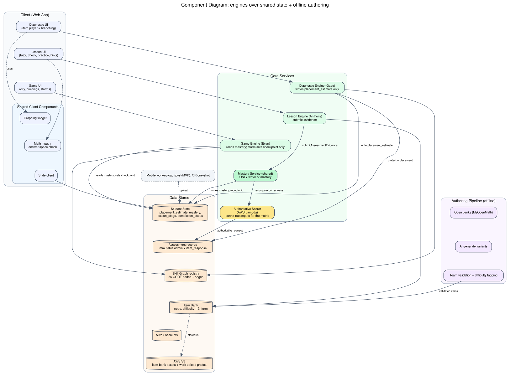

# Calculus-Readiness City-Builder: Project One-Pager

**The pitch:** a game where an incoming student's city *is* their math knowledge. A diagnostic builds the starting city (mastered skills stand tall; weak areas are empty lots under storms), and the student grows it by learning, practicing, and clearing storms. Underneath the game runs a rigorous skill-graph diagnostic and remediation engine.

**The problem:** most incoming STEM students who struggle in Calculus I are not weak at calculus, they are weak at the *prerequisites* (algebra, functions, trig fluency), and they cannot name their own gaps. Existing tools either feel like a punishing worksheet (which anxious students abandon) or place students without teaching them anything. We measure the gap, remediate it, and keep the student engaged.

---

## Core themes

**1. Knowledge made visible and actionable.** The student does not see a red score; they see a city with specific buildings to construct. Every gap maps to a concrete, non-shaming next action. This directly targets the population that quits traditional tools.

**2. A real skill graph, not a topic list.** 56 curated prerequisite skills ("nodes"), grounded in validated frameworks (MDTP / ALEKS / OpenStax objectives), wired with prerequisite edges. The diagnostic places you *on the graph*; remediation follows the graph's dependencies.

**3. Rigor the student never sees as rigor.** Mastery is earned honestly (accuracy on a difficulty-balanced problem set), and the product measures a real before/after gain, but all of it is wrapped in game mechanics so the difficulty feels like a challenge, not a test.

**4. An honest, defensible measurement claim.** We report a pre/post gain on a fixed, parallel-form instrument, and we are explicit about what that does and does not prove. We do not overclaim "calculus-ready"; we claim measured improvement on foundational prerequisites.

---

## What makes it different

- **The game is the product, not a wrapper.** The city-builder is not gamification bolted onto a quiz; the knowledge graph and the game map are the same object. Progress in one *is* progress in the other.
- **Built for the anxious learner specifically.** No 90-question wall (a short diagnostic that doubles as the pretest), gaps shown as buildable rather than failed, no punishing timed tests (the one timed moment is a game "storm," framed as fun stakes).
- **Objective, auditable measurement, built for a controlled study.** Success is a parallel-form pre/post gain on our own aligned instrument (the objective metric every product needs; parallel forms mean the student never sees the same items twice). A control group is required for the efficacy claim and the product is built to support one (treatment/control assignment, immutable records), though the controlled study itself is run after handoff. Every response is logged with versioned items and server-recomputed correctness, so the number is auditable rather than self-reported.
- **Error-typed feedback.** Wrong answers are classified by *misconception* (not just right/wrong), so feedback names the actual mistake and, later, routes practice toward it.
- **A deep city-builder, not a cosmetic skin.** Different question and answer types render as visually distinct BUILDING types (numeric-answer, multiple-choice, constructed-response), and mastering different item types yields different RESOURCES used to build and customize the city. Because the MVP goes deep on one domain, that one neighborhood is rich, not a thin cosmetic layer.
- **A roadmap that ends in calculus itself: "attacks = Calculus I."** Once a student's city of prerequisites is built, actual Calc I concepts (limits, derivatives, integrals) arrive as attacks the student defends against with the skills they built. Prerequisite mastery becomes a launch point, not the finish line. (Future/vision, beyond the shipped product.)
- **Engineered to actually ship.** One machine-readable skill-graph registry as the single source of truth, an automated test that guarantees the built skill set is prerequisite-complete (no dead-end "you failed a skill we never taught"), and a three-lane architecture that lets a small team build in parallel without collisions.

---

## Architecture at a glance

*Three product surfaces (diagnostic, lessons, game) over one shared student-state store, with one mastery service as the sole writer of mastery and an offline pipeline that validates every item before it ships. This separation is what lets a 3-person team build in parallel and keeps the measurement data auditable.*

---

## Scope and status (honest)

- **Team:** 3 people, ~24-day build. **MVP:** ONE fully-built domain, D1 (Real Numbers & Arithmetic), shown deep, a 6-node / 6-lesson (~3 interaction archetypes) depth-first foundational-readiness game (core loop + rich city + measurement pipeline), rather than 18 nodes spread thin across 9 domains. Mentor guidance: depth beats shallow breadth. Then a ranked expansion to the other 9 domains toward the full product target (62 nodes as of 2026-07-25, per `packages/skill-graph/src/skill_graph.json`; the earlier "48-node" figure was superseded by the 2026-07-24 coverage expansion, PR #50).
- **Locked:** product vision, skill graph, data model, mastery and assessment scoring, the parallel-work architecture. Design has been stress-tested across multiple external review rounds.
- **Known gates before scaling content:** an answer-checker capability spike (can the math-equivalence checker handle our item forms), and team verification of the prerequisite edges. Both are scoped, neither is a design unknown.
- **Deliberately deferred:** adaptive placement, decay/spaced-review, mobile, full 56-node coverage, efficacy study. Each is a documented growth path, not a gap.

**One-line takeaway:** a rigorous prerequisite-diagnostic-and-remediation engine that an anxious student experiences as a city-builder game, measurably closing the gaps that sink them in Calculus I.
