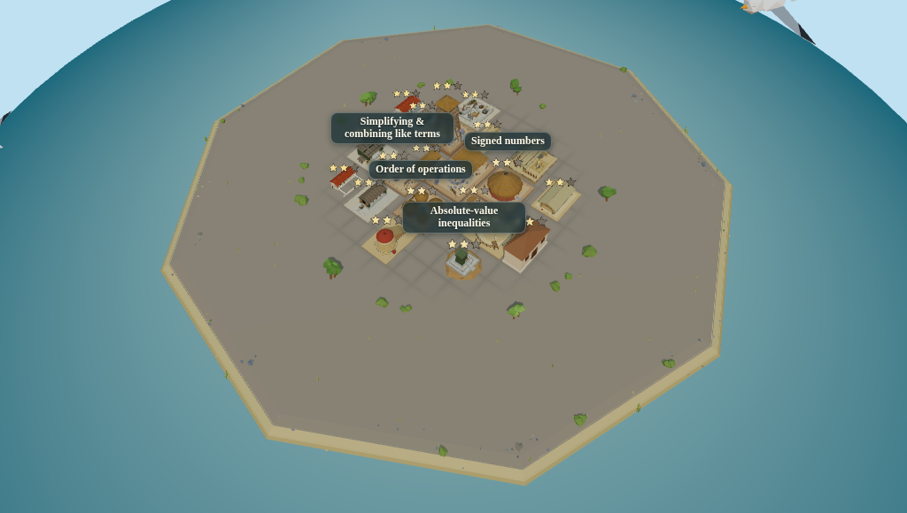
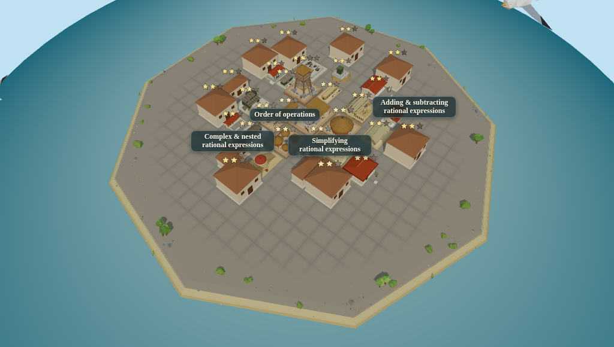

# The land the player can build on is the land the era is drawn on

Frames for the buildable-disc fix — the third instance of one bug, after #521 (the ground art)
and #537 (the props and dressing). `isCellBuildable` closed over `BUILDABLE_RADIUS`, so the
surface a learner could place buildings on stayed at era one's 88 cells however far beat two grew
the drawn land.

Taken by `apps/web/src/city/three/buildableDiscOnTheIsland.browser.test.tsx`, which is gated off
by default:

```
VITE_BUILDABLE_DISC_SHOTS=1 npx vitest run --config vitest.browser.config.ts \
  apps/web/src/city/three/buildableDiscOnTheIsland.browser.test.tsx
```

⚑ **SINCE 2026-08-04 THAT NO LONGER REPRODUCES THESE FILES, AND THAT IS DELIBERATE.** Every frame
here carries the island's baked cell grid, because that grid was drawn always. It is now gated on
`placing || roadPainting` (`StarterIsland`'s `buildGrid`, and
`docs/design-refs/island-reads-as-a-place/` for the measurement and the frames), and none of these
moments has a placement in progress — so a regeneration today gives the same islands with no grid
on them. They are kept as they were on purpose: their value is that they are before/after PAIRS in
which exactly one thing differs, and re-taking one half would spend that. Nothing this file claims
— does the disc follow the land, does era one stand still — is about whether the grid is drawn,
and the era-one pair is byte-identical either way because the gate is uniform across eras.

⚑ **AND THE ISLAND AROUND THE CITY IS NOW MEASURED**, because this change's cost to it was larger
than the report above priced. Growing the disc narrows the decoration band from 18.8 units to era
one's 2.8 at every era, so the share of the island carrying **neither a building nor decoration**
goes from 9.5% to 32.2% at era six's full roster, and the undressed centre of the island goes
from 30.0% of its area to 80.7% — which at the pre-seeded cold open is nearly all of it. The
numbers, the frames at 1024x580 on this merged tree, and what is proposed about it are in
`docs/design-refs/island-reads-as-a-place/`. Nothing there asserts a bar against this change: the
size of the disc is this lane's to author.

## The viewport is half the evidence, and it is 1024x580

Every frame here is **1024x580**, the lead's own short window, from a fixed-size container the
capture is clipped to rather than from a `page.viewport` call that would leak into a neighbour's
measurement.

**Before and after are one tree and one camera.** "Before" is not the old tree: it is this tree
with the defect injected, by overwriting `layout.buildableRadius` with era one's constant. Same
island radius, so the same camera distance and the same framing; what changes is the placement
grid, the decoration floor and the ground the city was seated on. Two trees would have differed
in a dozen ways this change is not about.

Each frame is **framed to show the whole island**, because the claim is about the relationship
between the land that is drawn and the land that can be built on. Cropped to the settlement it
would prove nothing about the apron around it.

## The demo's own case

A learner **placed** in era six walks **five** handed ages — `eraPlacementFromSeed` hands over
the ages before the placed one — and earns era six's own six nodes themselves. Measured through
the mounted walk: **26 of 26 seated, nothing left over**, landing on a disc of 38, against
**19 of 26** before. The disc walks out 22, 30, 35, 38, 38 as the ages found.

The frames below are the fuller picture: era six's whole cumulative roster of 32, which is what
the island holds once the learner has built their own age out.

## Era six — the demo's own age

| | |
| --- | --- |
|  |  |
| **before** — 19 buildings on a disc of 22 | **after** — 32 buildings on a disc of 38 |

The island is drawn at grass 46 in both. Before, the city is a knot in the middle of an empty
grey apron that reaches most of the way to the shore; after, it fills the land it stands on.

Measured (`measured-renaissance-1024x580.txt`), with the island's own on-screen box as the
control — it is **identical in both frames**, so the camera did not move, the drawn land did not
move, and everything that changed is the city:

- **39.1%** of the island's bare ground is newly built on (183,462px → 111,729px)
- the change spans **585px** of the island's **705px** width, so the new buildings are out
  towards the shoreline rather than packed into the middle
- **18.10%** of the whole frame moved
- median frame **196.20ms → 226.60ms**, a **1.15x** cost for 68% more buildings, and
  **204.50ms → 240.30ms / 1.18x** on a re-run after a further forward-merge. The absolutes are
  SwiftShader's — a headless Chromium on a CI VM with no GPU — so the ratio is the transferable
  figure and the absolutes are not a promise about any real machine. The two runs are what the
  1.6x bar leaves room for.

Every pixel measurement above reproduced exactly across those two runs, on two different merged
trees; only the wall clock moved.

## Era one — the control

`before-prehistoric-1024x580.png` and `after-prehistoric-1024x580.png` are **byte-identical
files**. `buildableRadiusForLand(30)` is 22, which is era one's own disc, so the injection is a
no-op there and the two renders agree exactly — same grid, same decoration floor, same six
buildings on the same cells.

That is the picture half of the era-one claim, and it is **the narrower half**. Both renders are
on the same tree with the same disc, so what the pair catches is precisely *"the disc-following
path is not a no-op at era one"* — a change that moved era one UNIFORMLY would move both frames
together and this comparison would see nothing. Measured: injected with a decoration floor at
`1.02x` the annulus, era one's island really did move and these two frames still matched byte for
byte.

The wider claim is `apps/web/src/city/three/eraOneIslandUnchanged.test.ts`, which compares
against `integration` at `11a6eed4` rather than against a second render of the same tree: every
mesh position AND geometry extent in era one's island (545 of them), and every transform its two
shipped layouts seat its roster at. The uniform injection above is red there, as are a grid
masked two cells wider and a disc raised by one unit.

## The injection ledger

Every assertion this change added or moved, observed **red** under a defect injected into the
shipped code and reverted immediately after. Re-run in full on the twice-merged tree
(`integration` at `0eabe468`): **26 injections, 26 red, none still green.**

| # | Injected defect | Guard | Red at |
| --- | --- | --- | --- |
| I0 | the disc stops following the land, at the DEMO's own case | `eraDiscSeatsTheRoster` | `expected […(19)] to have a length of 26 but got 19` |
| I1 | the disc stops following the land — the original defect | `eraDiscSeatsTheRoster` | `four handed ages seated 18 of 21 buildings; POL.1, POL.3, POL.8 had no room` |
| I2 | the same, at the walk's shortfall guards | `catchUpFlow` | `expected […(19)] to have a length of 50 but got 19` |
| I3 | the layout runs one cell wider than the session's gate | `ringLayout` | `expected 0 to be greater than 0` |
| I4 | the walkable annulus scales with the disc | `ringLayout` | `expected ['town-hall'] to deeply equal []` |
| I5 | the growth ceiling is raised, leaving nothing to report | `ringLayout` | `expected 64 to be less than 64` |
| I6 | a wired footprint grows past the 2×2 default | `eraFootprints` | `RAD.1: expected {w:3,d:3} to deeply equal {w:2,d:2}` |
| I7 | `computeCityLayout` pins the disc to the constant | `cityFraming` | `expected 22 to be greater than 22` |
| I8 | the reachability walk gains a road argument | `placementReachability` | `expected ['placements', …(2)] to deeply equal ['placements','buildableRadius']` |
| I9 | the disc TRACKS beat two instead of latching | `islandLand` | `survey 0.2: expected 23.6 to be 22` |
| I10 | the disc is keyed on the ERA, two beats late | `islandLand` | `expected 22 to be 30` |
| I11 | the era-one floor comes off the disc | `cityFraming` | `expected 4 to be 22` |
| I12 | the disc's margin drifts two units off the land's | `islandLand` | `expected 24 to be 22` |
| I13 | the same drift, four units, at the on-the-grass check | `eraCityLand` | `prehistoric: expected 28.83 to be less than or equal to 27.6` |
| I14 | the ex-tripwire's probe cell stops gaining | `eraCityLand` | `expected false to be true` |
| I15 | the session's gate stops seeing the land a beat opened | `eraDiscSeatsTheRoster` | `four handed ages seated 18 of 21 buildings` |
| J1 | a plot re-pinned to half the size its ring allows | `eraTwoGround` | `expected 0.403 to be close to 0.806` (share 3.4%) |
| J2 | a plot re-pinned to the `0.35` constant | `eraTwoGround` | `expected 0.245 to be close to 0.806` (share 1.3%) |
| J3 | the decoration floor back at era one's literal 25 | `eraTwoGround` | `expected 2.811 to be less than or equal to 1.220` |
| K1 | era one's decoration floor moves one unit | `eraOneIslandUnchanged` | island digest `f307f381…` ≠ `af0b130f…` |
| K2 | era one's grid masked two cells wider | `eraOneIslandUnchanged` | island digest `ca8e5783…` ≠ `af0b130f…` |
| K3 | era one's disc gains a unit, so its city re-seats | `eraOneIslandUnchanged` | island digest `f307f381…` ≠ `af0b130f…` |
| L1 | the annulus scales, at the greedy layout's sweep | `placementReachability` | `expected 0 to be greater than or equal to 24` |
| L2 | the flood fill seeded from era one's annulus | `placementReachability` | `expected 306 to be 299` |
| L3 | the greedy layout stops seating past era one's disc | `placementReachability` | `expected 163 to be 299` |
| L4 | the island stops narrowing its decoration band | `islandMeshBudget` | the ten-era mesh table |

**K2 is the one that found a hole rather than confirming one.** The era-one digest started as
positions only, following #537, and stayed green under it: #537's subject was a scatter, where
anything that moves moves its own origin, and this change's subject is a placement grid that is
ONE plane at the origin whose span follows the disc. The digest covers each mesh's geometry
extent as well because that injection went green first.
