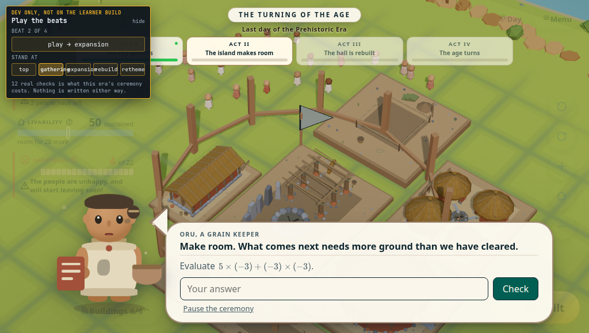

# The ceremony's dev hatch, and the island under it

Taken at **1024x580**, the lead's own short window, with the live canvas on and the ceremony
open on act two. The onboarding replay panel is hidden because it belongs to another surface
and is not the subject; the ceremony's own hatch is left in, because it **is** the subject.



## What the frame is here to show

The amber panel top-left is `CeremonyDevSkip`, the presenter's instrument for walking the four
beats without answering twelve real questions. It lays out at **x 10..262, y 10..172**, a
252x162 box — **6.9% of this frame** — and it is on screen for the whole ceremony.

Everything under it is island, and since #529 that island is **live**: `.era-advance-stage` is
`pointer-events: none` precisely so the camera stays the player's while the age turns, which is
the lead's *"the camera locks during the end of era ceremony which is bad. user needs to be able
to move."*

Until this change the panel's container took the pointer, so that whole box was a dead patch
where a camera drag did not answer. Measured by
`city/devPanelsPassClicksToTheIsland.browser.test.tsx` at the same window: of 144 sampled points
inside the panel, 50 are its own controls and **94 are background, of which 0 reached the
island**. Afterwards, 94 of 94 do, and all of the panel's own controls still take their presses.

This is a **dev-build** panel — `import.meta.env.DEV` at the call site, `isDevPersistenceEnabled()`
in the component — so no learner ever saw it. A presenter on the demo route did.

## What the fix costs on screen: nothing, measured

`measured-1024x580.txt` holds the reading. `pointer-events` paints nothing, and this says so
rather than assuming it:

```
  nothing changed at all:      0 of 60000 pixels differ
  pointer-events none vs auto: 0 of 60000 pixels differ
  the hatch hidden altogether: 52247 of 60000 pixels differ
```

The third line is the floor under the instrument — the same comparison reads a change that
really does paint, so the zeroes above it are a measurement and not a blind diff.

The diff is clipped to the top-left 300x200, the corner the panel stands in, and that is not
tidying. The advisor bobs and blinks on his own CSS and `reducedMotion` does not stop him, so
over the **whole** frame two captures with nothing changed at all differ by 3614 of 593920
pixels. There is no zero to be had over the full frame; the corner holds still, so the corner is
where the question can be answered.
