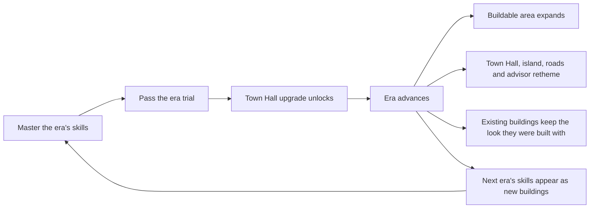

# Era Progression — one city, ten eras (APPROVED DESIGN — the era data model is merged, the rest unbuilt)

> ## 2026-08-09 OWNER RULING — 80% OPENS A ONE-BEAT ISLAND UNLOCK EXAM
>
> This ruling supersedes every older full-mastery trial gate and multi-stage advance below.
> The current island is `getEraNodes(eraId)`. At least `ceil(80% × island skills)` must hold
> full mastery to enter; the exam then interleaves the complete island pool to a `2N` net
> target. Passing founds the destination Town Hall without moving the learner. **Sail to the
> next island** moves standing; **Keep learning here** does not. 100% mastery remains the
> independent completion reward. The final era has no next-island exam. Diagnostic placement
> auto-founds its derived skipped prefix. The current executable contract is
> `2026-07-29-era-trial-contract.md`.
>

> ## ⚑ 2026-08-04 RULING — THE CHRONICLER, THE ALBUM AND THE TIMELINE ARE CUT
>
> **Team lead, 2026-08-04.** The two panels are removed from the product. **The list names
> three things and there were two**, which is the first thing to record because §11.2
> predicted exactly this confusion: **the Chronicler IS the Album** — the same surface,
> renamed on this document's own advice at §11.2's resolution note, and [#514]'s title says
> so outright (*"The Chronicler was already built"*). The third near-homonym, **the
> Chronicle (D-ERA19 layer 2), was never built and is not cut**; it is Evan's, and #568 §8.8
> gives it a home on the revisited island's hall.
>
> | | State before | State now |
> | --- | --- | --- |
> | **The Chronicler / the Album** (D-ERA19 layer 4, §11.2) | Shipped `#393`, extended `#514`. ☰ Menu → **Album**, ungated, reachable by a learner | **Panel deleted.** `cityAlbumView.ts`'s reconstruction is **kept** |
> | **The era timeline** (`#230`, §11.2's first row) | Shipped. ☰ Menu → **Timeline**, ungated, reachable by a learner | **Panel deleted.** `eraTimelineView.ts` and `packages/skill-graph/src/eraTimeline.ts` are **kept** |
> | **The Chronicle** (D-ERA19 layer 2, §11.4) | Unbuilt, Evan's | Unchanged. Nothing to cut |
>
> **The reason is the archipelago, and it is #568's own analysis rather than a new argument.**
> §8.8 of `2026-08-04-archipelago-design.md` reads §11.2's three surfaces against §11.2's own
> inputs test and finds the overview absorbs the Timeline (*"the overview screen, whose inputs
> are exactly these plus lock state"*) and the revisited island IS the Album (*"the album
> reconstructs each past era's composition from current placements; under the archipelago that
> reconstruction stops being a reconstruction"*). The broader point behind the ruling is that
> the product had four or five overlapping systems answering *"what have I done"*.
>
> **THE LOGIC IS KEPT AND THE SURFACES ARE NOT, which is the whole shape of the change.**
> #568 §8.8 is a plan to reuse both read models, so deleting them would mean writing them
> again. Each now carries a header saying what it is held for. `cityAlbumView.test.ts` and
> `eraTimelineView.test.ts` are kept with them, because an untested read model waiting on a
> stage that has not started is worth less than nothing to it.
>
> **⚑ THE REPLACEMENT IS NOT BUILT, and this ruling opens a window.** #575's stages 1 and 2
> are inert behind a double flag and revisitable islands are stage 3, unstarted. So between
> now and stage 1 there is **no surface in the product that answers "what are the ten ages and
> where am I on them"**, and between now and stage 3 there is none that answers *"what did my
> city look like in the Neolithic"*. Both were on a learner's path. §11.3's argument that the
> Album is *"the only place nine retired halls can ever be seen again"* is unanswered for the
> length of that window. Judged worth it for the Timeline, whose replacement is stage 1 and is
> the cheapest stage; **flagged for the lead on the Album**, whose replacement is stage 3.
>
> Nothing below is deleted. D-ERA19 keeps its four layers, §11.2 keeps its distinction — which
> is now what keeps the two KEPT read models from collapsing into one thing — and §11.3's
> judgement is left standing as the argument this ruling overrides rather than refutes.
>
> [#514]: PR #514

> ## 2026-07-29 AMENDMENT — seven rulings from the team lead, and the decided items they supersede
>
> Seven rulings arrived on 2026-07-29, after this document was approved. Four of them overturn
> something decided here, so they are recorded as a dated amendment rather than applied
> silently: the ruling wins, the decided item records that it was superseded and by whom, and
> nothing is deleted. **Two of the seven overturn nothing and are recorded because they were
> ASKED** — the shape question, and whether the re-dressing ruling reached the setting. **No new
> `D-ERA` id is allocated** — every item is amended in place, following D-ERA6's precedent (§16),
> so §16 stays the authoritative list and the id space does not grow for a change of mind.
>
> **The rulings were written up twice, independently, and the two records disagreed in six
> places.** `eras/2026-07-29-skill-building-rulings.md` §1 names all six with the reading that
> landed and why, so a later reader can tell a decision from an accident.
>
> | Ruling — team lead, 2026-07-29, verbatim | What it does to this document | Amended at |
> | --- | --- | --- |
> | *"on the building upgrades, we think that everything should stay the same because of the art overhead, with the exception of the town hall, which should retheme."* | **OVERTURNS D-ERA8's re-dressing clause and D-ERA7's "Across eras" row.** A skill building's look is set once, when it is built, and never changes again; the Town Hall is the single exception and rethemes at every advance. Knock-ons for **D-ERA22** (what the third resolution axis now means) and **§12.1** (the budget) | §6, §6.1, §6.4a, §12.1, §12.2, §16 |
> | *"i don't think it should"* — asked whether a building's shape should tell the learner something about the skill | **EXTENDS D-ERA8 from the building to the SHAPE.** Which of the six masses a node is given carries no mathematical meaning either, so a `store` does not mean the skill is about collecting | §6.1, §16 |
> | *"each lesson should get its own building, so that a user can always click it and review a prior lesson/skill they built and look at it again."* | **CONFIRMS D-ERA7's 1:1 mapping and D-ERA19's third layer**; overturns neither. What it adds is that the review affordance is a **requirement**, and what it exposes is that 6 of 62 nodes have a building to click at all | §6, §11 |
> | *"the chronicler is a log of what your empire looked like at each era, and lets you basically see the progress."* | **NEW** — defines a feature this repo has referenced without ever defining. Recorded as a fourth layer under D-ERA19, distinguished from the **shipped** era timeline (#230) and from D-ERA19's own **Chronicle** | §11, §16 |
> | *"it should allow for both"* — asked whether the chronicler's entries open the **lesson** or the **practice**, since D-ERA19 layer 2 said practice and the commitment named lessons | **WIDENS D-ERA19's layer 2; supersedes nothing.** An entry offers both doors and does not pick, so **practice was never wrong, it was incomplete**. No new controls are needed: the shipped `LessonMenu` is already an ungated lesson card beside two gated practice cards, and was extracted to be opened from more than one place | §11, §16 |
> | *"i think these should definitely be redressed. i know evan has plans to expand/re-theme the island."* — asked whether the art-overhead argument also retired the island, the roads and the advisor | **HOLDS D-ERA26, D-ERA30 and D-ERA28 as written; no amendment owed to any of the three.** It is what BOUNDS the re-dressing ruling to buildings, and it states the line as **per-era art freezes where it MULTIPLIES with a catalogue and is kept where it is one-per-era** — which is also what retroactively explains the Town Hall exception | §5.2, §5.4, §5.5, §6.4a, §16 |
> | *"i think there shouldn't be a generation economy to begin with honestly - just resources on lesson completion and completing practices make more sense. we dont need the buildings to passively produce income"* | **OVERTURNS D-ERA13's trickle clause, both §7 tuning rows that priced it, D-ERA7's "produce" half, and half of D-ERA23.** Ruled and reasoned in full at `2026-07-29-era-resource-model-design.md` §5; the amendments its §5.5 names as owed here are the ones made here | §6, §7, §13, §16 |
> | *"flint should be stone, ingots should be bronze … kilowatt-hours should be electricity, compute cycles should be something else and less abstract"* | **Renames seven of the ten era materials** (`#233`). D-ERA13's *"from flint through to credits or data"* is the one line in this document that printed a retired name | §7 |
>
> **Owner note.** These sections are Evan's. The team lead authorised editing them, and
> [issue #181](issue #181) is the vehicle for a
> notice so he meets this as a comment rather than as a diff. **The comment is STILL OWED and is
> not posted** — it needs a seat with write access to issues, which no agent on this change had.
> The decided items it has to name are listed at
> `eras/2026-07-29-skill-building-rulings.md` §8. Nothing is assigned to him beyond reading it,
> except the D-ERA22 question at §12.2 and the `gridwork-modern/` era assignment.

> ## 2026-07-27 AMENDMENT to the merged citizens design — D-CIT6's no-punishment guarantee is REVERSED IN PART
>
> `docs/superpowers/specs/2026-07-27-citizens-and-city-life-design.md` ratified
> **D-CIT6** as a hard constraint: *"Nothing is ever lost, damaged, or degraded. No
> citizen leaves, starves, sickens, riots, or dies... no number goes down"*, with people
> who have nowhere to live waiting *"patient, not suffering"*. **The happiness model in
> this spec reverses that.** Citizens can be unhappy, unhappy citizens leave, and
> population can fall. The reversal is recorded here, in the same convention that spec
> used for its own overcrowding reversal, so that two merged documents do not quietly
> contradict each other. **Where this banner disagrees with D-CIT6, this banner wins;
> everything else in the citizens design stands.**
>
> **What is reversed:** "no number goes down" and "no citizen ever leaves". Population
> is no longer monotone in learning state, and the departure path is a real one.
>
> **What survives, and is strengthened rather than weakened:**
>
> 1. **Nothing keys off the learner.** D-CIT6 existed to stop a struggling student being
>    shown their people suffering for slow progress. That is now **INV-ERA-3** (§8),
>    which is a narrower and more enforceable statement of the same intent: happiness
>    responds to how you built, never to how fast you study.
> 2. **Departures are slow, signposted, and reversible.** Warning well before anyone
>    leaves; fixing the shortfall brings people back. There is no fail state and no
>    scold.
> 3. **INV-COS-1 still holds.** No shortfall gates a lesson, a mastery, a trial, or an
>    era advance (§8, Contracts §8).
> 4. **The mid-game crowd still reads as hopeful.** D-CIT4's settled reading is scoped
>    to the era, not the game: an era still resolves.
>
> **Why the reversal is defensible.** D-CIT6 was written when the only lever the player
> had was *learn faster* — under that model any consequence is a consequence of study
> pace, which is exactly the streak-guilt loop `docs/Game_Visual_Design_Brief.md`
> bans at lines 69-70 ("countdown/urgency timers framed as pass/fail, streak-loss guilt,
> artificial scarcity"). The era economy gives the player a **second, independent lever**:
> allocation. A shortfall now originates in a spending decision made with the resource in
> hand (§8.1), which is a management failure and fair game, and is reachable without
> studying at all. The ban is on scarcity aimed at the learner, not on consequence as such.
>
> **Owed on implementation, and not negotiable.** D-CIT6 is not merely written down, it is
> **machine-checked** — `engines/game/src/citizens-roster-invariants.test.ts` ("no
> eviction, over all 4096 mastery vectors and every single-node advance") and
> `citizens-invariants.test.ts` ("never lowers population or capacity across all 4096
> mastery vectors"), both merged in #160. Loosening an assertion owes the same evidence
> as a bug fix: whoever retunes these must **inject a departure caused by study pace and
> watch the loosened assertion go red at the loosened lines** before claiming the guard
> still catches what it was written for. An assertion relaxed without a demonstrated red
> is not evidence that anything is still guarded (`.cursor/rules/qa-verification.mdc`).

**Status:** APPROVED DESIGN. **The era data model is merged; nothing else is
implemented.** `packages/skill-graph/src/eras.ts` shipped in **#180** and was extended by
**#202** (era one's land budget authored at 22), so this document's claims about era code
are no longer claims about a vacuum — see §5.1's correction block and §19. The design was
worked through in a long session and is recorded here faithfully; this document
**sequences and grounds it, and redesigns nothing.** Decisions are numbered up to
**D-ERA36** and five invariants (**INV-ERA-1..5**) are stated as testable rules. **§16's
table is the authoritative list, and this line no longer carries a total** — *(it read
"Twenty-four (D-ERA1..D-ERA24)" until 2026-07-28 and then "Twenty-nine", and it went stale
both times because a decision lands in §16 without anyone bumping a count in the banner. A
range is cheap to keep true; a tally is not.)* **`D-ERA30` is allocated to the per-era road
surface** and is cited from `apps/web/src/city/roadSurfacing.ts`; its §16 row belongs to that
change and is not written here. §17 lists what is
genuinely still open, each with a **named owner and a decision point** — this spec does
not quietly pick where the session left something open.

**Grounded at:** `integration` @ **`1ea5986`** (the #160 merge). Every code claim below
was read at that SHA. Where the source plan is wrong about the code, that is recorded as
a **GROUNDED CORRECTION** in §14 rather than repeated — there are **eight**, and two of
them change a number the design leans on.

**Owner:** Evan (game/city lane — `engines/game`, `apps/web/src/city`). Four pieces are
**Gabriel's** and are marked as such throughout: the domain renumber (§3.2), the era data
model (§3.1), the economy implementation (§7), and the diagnostic prologue plumbing (§10).
The split and its sequencing are in §18.

**Supersedes** (§2): the island model itself, the merged D2 Boomtown Square island
design, and the eight D3-D10 island briefs open on PR #140.

**Builds against:** `docs/Contracts.md` §1/§3/§8 (the frozen write boundary and
INV-COS-1..5), `docs/Mastery_Scoring_Spec.md` §5/§8 (monotonic mastery, the `mastery >= 2`
gate), `docs/Game_Visual_Design_Brief.md` §2 (the explicit ban on urgency timers,
streak-loss guilt and artificial scarcity) and §4 (the locked art direction, including
the reserved meaning colours), `docs/superpowers/specs/Game_Architecture_Blueprint.md` (the
descriptor-registry model and extension discipline), and
`docs/superpowers/specs/2026-07-25-town-hall-design.md` (the hub this promotes into a
chapter marker). **Where this doc disagrees with any of those, those win.**

---

## 1. Summary

Today the game is an archipelago: ten islands, one per domain, each a parallel place the
learner visits and leaves. **This replaces it with one city that advances through ten
eras** — prehistoric through cyberpunk — where mastering an era's skills unlocks a Town
Hall upgrade that expands the map, rethemes the hall and the ground it stands on, and
introduces the next era's skills as new buildings.

> **AMENDED 2026-07-29: this paragraph and the diagram below used to say the advance
> *"re-skins and levels up every existing building"*.** Both halves are withdrawn — the
> re-skin by the re-dressing ruling (§6.1) and the level-up by the no-generation ruling (§7).
> **A standing building is untouched by an era advance.** Corrected here as well as at the
> two decided items, because a summary is where most readers form their model of the design.

The chapter break is the Town Hall upgrade. The loop is:

> **THE LOOP ABOVE HAS NO CRISIS BEAT, AND AFTER 2026-07-31 THAT IS CORRECT FOR SIX ERAS OUT OF
> TEN RATHER THAN AN OMISSION.** The mid-era crisis is a separate encounter, designed in
> `2026-07-29-mid-era-crisis-design.md`, and the team lead cut it from one per era to **four —
> eras 1, 4, 6 and 9** (**D-CRISIS-31**, whose set moved from 1 / 4 / 7 / 10 to 1 / 4 / 6 / 9 later
> the same day by **D-CRISIS-33**; the count did not move and nothing below depends on which four).
> In those four eras a crisis fires partway through, at
> `ceil(n / 2)` of the era's own mastered nodes — which is **three** in all four — and the player
> chooses when to answer it; in the
> other six nothing sits between mastering the era and its trial. **The loop itself is unchanged
> and complete for all ten eras**, because passing the trial is what advances an era and a crisis
> never gated one. **The same ruling confirms the trial for all ten** — see §9.
>
> > **THE LAST CLAUSE IS WITHDRAWN, 2026-07-31: A CRISIS NOW GATES THE ADVANCE IN THE FOUR ERAS
> > THAT HAVE ONE.** *"A crisis never gated one"* was true when it was written and is not any
> > more. The team lead ruled that a player who is given a crisis call and does not enter the
> > crisis **cannot do anything in their city** — no building, no road laying, no civic purchases,
> > no moving of placed buildings — **and cannot advance the era** until they enter. That is
> > `2026-07-29-mid-era-crisis-design.md` **D-CRISIS-35** (§5.43), which closes **O-13** there.
> >
> > **The rest of this note is unaffected and the loop diagram above still stands.** The order of
> > the beats does not change, the six eras with no crisis are untouched, and passing the trial is
> > still what advances an era. **What changes is that in eras 1, 4, 6 and 9 there is now a
> > condition on reaching the trial's advance at all**, and the loop reads truthfully only if the
> > reader knows it.
> >
> > **This clause is corrected in place because it is a CITATION SITE.** The gate is ruled in
> > another document, and a reader who comes to the loop to find out what advances an era would
> > otherwise have been told *a crisis never gated one* in confident present tense, four hundred
> > lines from **D-ERA5**, which is where the gate is actually reconciled (§4). That is precisely
> > how a withdrawn clause survives a ruling.
> >
> > **And the era advance is gated EXPLICITLY rather than as a consequence of the freeze, which
> > is the part a reader is most likely to reconstruct wrongly.** The freeze reaches building,
> > roads, civic purchases and moves. **The advance needs none of them** — it needs mastery and
> > the trial, and lessons and practice are explicitly NOT frozen — so nothing about being unable
> > to build would have stopped a frozen player mastering the rest of the era and advancing out
> > from under the crisis. **The gate is a separate clause of the same ruling** for exactly that
> > reason; the crisis document's §5.43b records the failed derivation in full.
> >
> > **The player still chooses WHEN.** *"The player chooses when to answer it"* above is
> > unchanged and still accurate: the crisis never interrupts, a player mid-lesson finishes the
> > lesson, and the moment of entry is theirs. **What is no longer true is that the choice
> > includes never.**

Five properties carry the whole design, and each is stated as an invariant because each
is the thing most likely to be violated by someone who did not sit through the session:

- **INV-ERA-1 — footprints are invariant across eras.** A building changes silhouette,
  height and material; it never changes the cells it occupies. An era advance can
  therefore never reshuffle a layout the player arranged (§6.3).
- **INV-ERA-2 — every node is retained.** Eras are curated node sets; grouping and order
  may change, knowledge may not be dropped (§3).
- **INV-ERA-3 — happiness responds to how you built, never to how fast you study.**
  Nothing may key off study pace, absence, streaks, or elapsed time since the last
  lesson (§8).
- **INV-ERA-4 — the solvency guarantee.** The game never manufactures a shortfall the
  player could not have prevented (§8.1).
- **INV-ERA-5 — the era sequence is explicit data, never inferred from `DomainId`** (§3).

And **INV-COS-1 still holds**, unchanged: no economy or cosmetic state is an input to a
progression decision. No shortfall may gate a lesson, a mastery, a trial, or an era
advance.

---

## 2. What this supersedes

This document does not sit beside the island framing; it replaces it. Three things are
named explicitly so nobody builds against them.

| Superseded | Status | What happens to it |
| --- | --- | --- |
| **The island model** — ten parallel places, one per domain, the learner visiting and leaving each. Expressed in `docs/superpowers/specs/Island_Lesson_Themes_Design_Spec.md`, `D1_City_Builder_Design_Spec.md`, and the `NEIGHBORHOOD_DESCRIPTORS` registry | Superseded as a **model**; the machinery survives | The descriptor-registry discipline, the resolution path, and the fail-loud fences are kept (§13). What goes is "ten parallel places": the registry has to express **sequence and accumulation** instead |
| **`docs/superpowers/specs/2026-07-26-d2-boomtown-square-island-design.md`** (merged 2026-07-26) | Superseded as an **island** brief, **LEGACY** since 2026-07-29; salvageable as **era two** only at the identity layer | It is a single spec, not eight, and **D2's numbering does not move** under the renumber, so it is the one island document worth reading rather than rewriting. Its frontier-boomtown theming was written as *a town that keeps growing*, which is not far from a first settlement. **How much survives is now ANSWERED (§17 O-11, Evan, 2026-07-29): the through-lines survive, the buildings do not** — take each identity's through-line and footprint and take nothing else |
| **The eight D3-D10 island briefs on PR #140** (`gabe/d3-d10-island-briefs`, **OPEN**, `mergedAt: null` as of this writing) | **To be rewritten, not salvaged** — decided with Gabriel, 2026-07-27 | They rest on two assumptions this overhaul removes: the island model itself, and the old domain numbering, under which a brief labelled D6 now describes a different domain (§3.1). Patching around both would leave a document arguing with itself. **The branch should not be merged in its current form** |

**On PR #140's status:** read at `1ea5986` it is genuinely open and unmerged. That
matters, because "the D6 brief describes the wrong domain now" is a statement about a
diff, and it only becomes a statement about the tree if the branch lands. Do not merge it
to then fix it.

---

## 3. The ten eras

**D-ERA1 (DECIDED): eras replace islands.** One place, one continuous city, ten chapters.
The city is still the map of the student's knowledge — carried by how much of it there is
and how far it has come, which is where the metaphor always lived.

**D-ERA2 (DECIDED): the era sequence is its own explicit ordered list, and is never
inferred from `DomainId`.** This is **INV-ERA-5**, and it is load-bearing rather than
fastidious: play order and domain numbering diverge today (Geometry is `D10` and plays
sixth), and even after the renumber (§3.1) makes them agree, **a derivation would be a
latent bug waiting for the next content change**. Sorting `DomainId` numerically is
already done once in the codebase — `getLockedDistricts` in
`engines/game/src/neighborhood.ts:95-99` sorts by `Number(domain.slice(1))` with a comment
explaining that a plain string sort puts `D10` before `D2` — which is exactly the kind of
incidental ordering logic that must not become the era sequence. The order is authored
data; a reader must be able to see it and edit it.

Ordered by prerequisite, so play order and the civilization arc agree. Anything not
already ending in "Age" is named an "Era".

| Era | Name | Domain (after the renumber) | Domain (today) | Why here |
| --- | --- | --- | --- | --- |
| 1 | **Prehistoric Era** | D1 Real Numbers & Arithmetic | D1 | Counting, tallying, sharing a kill |
| 2 | **Neolithic Era** | D2 Exponents & Radicals | D2 | First settlements and agriculture: seed that multiplies, grain stores doubling, harvests scaling |
| 3 | **Bronze Age** | D3 Linear Equations & Inequalities | D3 | Trade on a balance scale — what weight of tin balances this copper |
| 4 | **Classical Era** | D4 Polynomials | D4 | Geometric algebra, areas as products, many terms in one expression |
| 5 | **Medieval Era** | D5 Rational Expressions | D5 | Guild ledgers, tithes, land divided into shares |
| 6 | **Early Modern** | **D6** Geometry | D10 | Perspective, surveying, domes |
| 7 | **Industrial Era** | **D7** Functions & Coordinate Geometry | D6 | A machine is input to output; railways on plotted grids |
| 8 | **Atomic Age** | **D8** Linear Functions & Rates | D7 | The century that measured everything per hour |
| 9 | **Information Age** | **D9** Exponential & Logarithmic | D8 | Doubling transistors, orders of magnitude |
| 10 | **Cyberpunk Era** | **D10** Trigonometry | D9 | Waves, signals, rotation, rendering |

Prerequisites all hold: polynomials before rational expressions, functions before rates,
exponentials before logarithms, geometry before trigonometry, exponents before logarithms.

**Geometry sits at era six deliberately.** It depends on nothing in eras one through
five; Renaissance perspective is the strongest thematic pairing available; and placing it
immediately before Functions & Coordinate Geometry gives a real bridge — learn shapes,
then learn to put them on axes.

### 3.1 An era is a curated node set, not a domain

**D-ERA3 (DECIDED): an era is a curated set of nodes sized for pacing, respecting
prerequisites — not simply "one domain".** Node counts per domain are badly uneven.
Counted from `packages/skill-graph/src/skill_graph.json` at `1ea5986` (in-product nodes,
`product_scope` of `mvp` or `target`; **62** in total):

| Domain | Nodes | | Domain | Nodes |
| --- | --- | --- | --- | --- |
| D1 | 6 | | D6 | **11** (`CG.1` + `FUN.1`..`FUN.10`) |
| D2 | 5 | | D7 | 4 |
| D3 | 5 | | D8 | 6 |
| D4 | 8 | | D9 | 9 |
| D5 | 6 | | D10 | **2** (`GEO.1`, `GEO.2`) |

Strict one-domain-per-era would give a 2-lesson Early Modern era against an 11-lesson
Industrial Era. Splitting Functions across the Industrial and Atomic eras, with Geometry
and Coordinate Geometry combined, brings every chapter into roughly a 3-to-9 range.

**INV-ERA-2, the hard constraint: every node is retained.** Ordering and grouping may
change; knowledge may not be dropped. A curation that "simplifies" an era by cutting a
node has broken the curriculum, not the pacing. The exact node sets are **open (§17 O-1,
Gabriel)** and are the first thing the era data model needs.

### 3.2 The domain renumber

**D-ERA4 (DECIDED, and signed off): renumber the domains so the id is the era.** Rather
than let play order and domain numbering diverge permanently. Five domains move:

- `D10` Geometry becomes **`D6`**
- `D6` Functions & Coordinate Geometry becomes **`D7`**
- `D7` Linear Functions & Rates becomes **`D8`**
- `D8` Exponential & Logarithmic becomes **`D9`**
- `D9` Trigonometry becomes **`D10`**

`D1` through `D5` are unchanged. **Node ids do not change** — they are mnemonic (`NUM.S`,
`RAD.1`, `LF.1`, `GEO.1`), not numeric, so only the `domain` field moves.

> **SIGNED OFF — Gabriel, 2026-07-27.** Approved in conversation. The skill-graph
> registry, `DomainId`, and the CI invariant are his lane, and the cross-lane change
> policy requires his review and explicit sign-off. **Carry this attribution into the
> implementing PR's description and the work log.**

**Now is the cheapest this will ever be.** Wait until D6-D10 are authored and this becomes
a large, risky rename instead of a small one.

What it touches, verified at `1ea5986`:

| Site | Detail |
| --- | --- |
| `packages/skill-graph/src/skill_graph.json` | **66** `domain` fields (62 in-product + 4 `excluded`) |
| `packages/skill-graph/test/graph_invariants.py` | **CI-gated** via `npm run check:graph` and `.github/workflows/invariants.yml:293`. (The plan puts this file in `src/`; it is in `test/` — §14 GC7) |
| `engines/game/src/neighborhood.ts` | `NEIGHBORHOOD_LABELS`, a `Record<DomainId, string>` |
| `engines/game/src/descriptors.ts` | the `Record<DomainId, NeighborhoodDescriptor>` registry, plus the D2 and Geometry placeholder descriptors |
| `packages/item-bank/src/d7/` and `content/lessons/d7/` | directory renames to `d8`, plus tests and snapshots |
| Docs naming domains by number | including the island themes spec and the citizens design |
| `neighborhood_state.neighborhood_id` | `text not null`, half the primary key (`db/migrations/0001_core_contracts.sql:39-43`) |

**Only `d7` moves.** Four domains have authored content — `d1`, `d2`, `d5`, `d7` — and of
those only `d7` is renumbered. (The plan says three; it omits `d5`, which exists in both
`content/lessons/` and `packages/item-bank/src/`. The conclusion is unchanged, the audit
scope is not — §14 GC2.) Every other renumbered domain is an empty architected slot.

**The no-migration argument has one unverified premise, and it is the whole argument.**
The claim is that only `D1` has real `neighborhood_state` rows and none of the renumbered
ids are populated, so no data migration is needed. The **schema** is verified above. The
**row contents** are a fact about the deployed database, not about a checkout, and cannot
be confirmed from this repo. **This must be checked against the deployed database before
the renumber lands** (§17 O-2, Gabriel). If it is wrong, the renumber needs a migration
and stops being small.

---

## 4. The chapter break

**D-ERA5 (DECIDED): the Town Hall upgrade is the chapter break, and it is gated on
learning alone.** Mastering every skill in the era unlocks the era trial (§10); passing
the trial advances the era. Advancing does four things at once:

1. **The buildable area expands** (§5).
2. **The island, its roads and the advisor re-dress into the new era** (D-ERA26, D-ERA30,
   D-ERA28). **Existing buildings do not.**
3. **The next era's skills appear as new buildings** to be earned.
4. **The Town Hall itself becomes its next landmark** — ten authored halls, one per era,
   unique by right (§12).

> **AMENDED 2026-07-29 — item 2 above used to read *"Every existing building re-skins into
> the new era and levels up — more capacity or output — at an unchanged footprint"*, and both
> halves of it are now withdrawn by two different rulings.** The re-skin half goes to the
> re-dressing ruling (§6.1): a standing building keeps the look it was built with, and the hall
> in item 4 is the only thing on this list that still re-dresses. The *"levels up — more
> capacity or output"* half goes to the no-generation ruling (§7): there is no output to
> increase, and an advance grants no capacity to a building that already stands.
>
> **This item is recorded rather than quietly corrected because it is a CITATION SITE, not a
> definition site.** It restated D-ERA8 and D-ERA13 in a section about the chapter break, four
> hundred lines from either of them, which is precisely how a withdrawn clause survives a
> ruling: the reader who comes here to find out what an era advance does would have been told
> the old model in confident present tense. **What an advance does to buildings is now
> exactly nothing**, and the visible change comes from the ground, the roads, the advisor,
> the hall, and the new buildings the next era's lessons earn.

> **AMENDED 2026-08-01 — item 2 now covers the CITIZENS as well, so the surfaces an advance
> re-dresses are the island, its roads, the advisor and the crowd.** Recorded here for the reason
> the block above gives: this is a citation site, and a reader who comes to §4 to find out what an
> advance does would otherwise be given a shorter list than the decision carries. The definition
> site and the argument are D-ERA28's 2026-08-01 amendment (§5.4); the implementation is
> `apps/web/src/city/citizenDress.ts`. **Item 2's second sentence is untouched — existing buildings
> still do not re-dress**, because a citizen is not a standing building: **D-CIT1** makes the
> population derived from learning state on every load, so there is no built or bought era to
> freeze onto.

**Resources can never buy progress.** Era advance is gated on mastery and the trial,
never on a balance, a population figure, or a happiness reading. This is INV-COS-1 and
INV-COS-2 applied to the new gate, and it is why the economy can carry real stakes at all
(§8).

> **D-ERA5 IS NARROWED 2026-07-31, and the sentence directly above is NOT touched — the two
> facts are separate and the second is the one a reader is likely to get wrong.**
>
> **The narrowing.** In the four eras that have a mid-era crisis — **1, 4, 6 and 9** — **a
> standing crisis call the player has not answered also gates the advance.** The team lead
> ruled that such a player can do nothing in their city and cannot advance the era until they
> enter the crisis: `2026-07-29-mid-era-crisis-design.md` **D-CRISIS-35** (§5.43, §5.43b),
> closing **O-13** there. So *gated on learning alone* acquires a second condition, in four
> eras out of ten, and this decision is amended in place rather than left to be contradicted
> from another document. **No `D-ERA` id is allocated** — the crisis document owns the new id,
> following the same split D-CRISIS-31 and D-CRISIS-33 already used against §9.
>
> **What is NOT touched, and why the narrowing does not reach it.** *Resources can never buy
> progress* survives **word for word**. A crisis is an **encounter**, not a resource: a
> standing call is not a balance, not a population figure and not a happiness reading, and no
> quantity of gold, materials, livability or citizens opens the new gate. **The only thing that
> opens it is entering an encounter built out of the learner's own mastered skills** —
> `2026-07-29-mid-era-crisis-design.md` **D-CRISIS-14** — so **INV-COS-1 and INV-COS-2 are
> untouched and §8's stakes are unaffected.** The new gate sits on the **learning** side of
> this decision's own line, which is what makes it addable without repealing the decision.
>
> **It is EXPLICIT rather than a consequence of the freeze, and the difference matters here
> more than anywhere.** The freeze reaches building, road laying, civic purchases and moving a
> placed building. **This decision's two gates are mastery and the trial, and neither is a
> build action** — lessons and practice are ruled explicitly NOT frozen. So a player who was
> only unable to *build* could master the era's remaining nodes, pass the trial, and **advance
> out from under the crisis**, which would have made this very decision the exit from the
> freeze. **The crisis document rules the advance gate as its own clause for that reason**, and
> the failed derivation is recorded there in full rather than being quietly repaired.
>
> **It is also the same shape as D-ERA17 one level down** (§10.1): an **encounter** is not
> discharged by not doing it, and what prior credit or delay discharges is always the
> **teaching**. A banked era still owes its trial; a called crisis still owes its entry.

The Town Hall is promoted from *island hub* to *chapter marker*, and it keeps everything
the town-hall spec settled: pre-seeded and always built (2026-07-26 amendment), a `3x2`
footprint registered in `NODE_FOOTPRINTS` (D-TH6), movable (D-TH9), the advisor's home
(D-TH5), and labelled **Civic Center** (D-TH7, final). It gains the Chronicle (§12).

---

## 5. Land expansion

**D-ERA6 (DECIDED): the buildable radius becomes a function of the era.**

Today it is a single fixed constant. Verified at `apps/web/src/city/worldLayout.ts:37`:
`BUILDABLE_RADIUS = 22`, with `GRID_CELL = 4` (line 35), and `isCellBuildable` (line 197)
a pure radius check on the cell centre with **no interior exclusions**. The visible grass
disc is `ISLAND_GRASS_RADIUS = 30` and the lagoon `SEA_RADIUS = 58`, so the terrain has
some headroom but not four eras' worth — the surrounding scene has to grow with the
buildable area, not just the rule.

**The arithmetic, enumerated rather than estimated** (§14 GC6 records where this differs
from the plan):

| Radius | Buildable cells | Method |
| --- | --- | --- |
| 22 (today) | **88** | Exact enumeration of `isCellBuildable` over the grid |
| 45 (**end state WITHDRAWN** — see the correction below and §5.1; kept only as the worked enumeration) | **392** | Same enumeration. The area ratio `(45/22)^2 x 88 = 368` under-counts, because cell centres near the rim round inward |

At 62 skill buildings and roughly two cells each — about **124 cells** — a fully built
Cyberpunk city occupies **~32%** of the ground. Denser than era one, comfortably not
crammed, because footprints stay fixed while land quadruples. **How much land each era
unlocks is open (§17 O-3, Evan)**; the end point above is the target the curve has to
reach, not a schedule.

> **CORRECTED 2026-07-28 — both figures in the paragraph above are withdrawn, and the
> "~45" end state with them.** "Roughly two cells each" is not true of the authored data,
> "~32%" counts tiles where SLOTS are what bind, and the paragraph omits roads entirely.
> The cell counts in the table above are correct and stand. **O-3 is now RESOLVED —
> D-ERA25.** The corrected arithmetic, and the reason island growth is gated on the
> camera's depth budget rather than on the terrain, are in §5.1.

### 5.1 D-ERA25 — the radius is authored per era, set as each era's buildings are designed

**DECIDED 2026-07-28 (Evan).** There is no global expansion curve. The buildable radius
becomes **per-era authored data**, and each era's value is set when that era's buildings
are designed and their real footprints exist — domain by domain, beside the content. Era
one is the shipped **22**.

**Why not a curve.** A ten-era curve has to assume an average footprint, and the per-node
building designs are deliberately undecided (their own task; sizes will range from 1x1 to
2x3). Ten radii derived from a guessed average would be false precision and would be
redone anyway. Authoring the radius per era also keeps this robust to **O-1** still being
open, in the same way the era sequence is authored rather than inferred (D-ERA2 /
INV-ERA-5).

**What Gabriel needs from this, and all he needs.** The era data model carries a `radius`
field per era. Era one is `22`. Later eras may be unset until their content lands, and the
model must tolerate that rather than demanding ten values up front. Nothing else in O-3
blocks the data model freezing.

> **CORRECTED 2026-07-28 — the era data model shipped before this decision reached it, and the
> paragraph above describes it wrongly in three places.** `packages/skill-graph/src/eras.ts`
> landed in **PR #180 (merged 2026-07-28T16:07:52Z)**, read at that tip rather than inferred:
>
> 1. **There is no `radius` field.** Each era carries `land: EraLandBudget`, a discriminated
>    union — `{ status: "unauthored" }` or `{ status: "authored"; buildable_radius: number }`.
>    The pending variant has **no radius property at all**, deliberately, so that reading a
>    radius before O-3 lands is a **type error rather than a wrong answer**. That is a stricter
>    and better shape than the nullable field this paragraph imagined, and the decision below is
>    unaffected by it.
> 2. **Era one was not `22` in code when #180 shipped — it was pending like the other nine**,
>    and `eraBuildableRadius()` threw citing O-3 rather than returning a default. `eras.ts`
>    gives the reason: returning today's `BUILDABLE_RADIUS = 22` would "make an unauthored
>    curve look authored". **That code change is now DONE — #202 (merged
>    2026-07-28T21:35:52Z).** Era one is `{ status: "authored", buildable_radius: 22 }`, the
>    pending literal is **`unauthored`** rather than `awaiting_o3` (O-3 is resolved, so an
>    unset era now waits on its own building designs rather than on a decision), the other
>    nine stay unset, and the accessor's throw cites **D-ERA25** rather than O-3.
>    `eras.test.ts` moved with it: `authored` is exactly `["prehistoric"]`, `unauthored` has
>    length 9, and the no-property and fail-loud sweep still runs over every unauthored era
>    with a floor asserting it swept **9** of them, so authoring era one could not silently
>    empty the sweep. **D-ERA25 needed no change to permit this** — the union always allowed
>    exactly this partial authoring.
> 3. **"Nothing else in O-3 blocks the data model freezing" is backwards.** `eras.ts`'s own
>    header states the opposite: O-3 "is due *before this model freezes*, since the radius is
>    per-era data", and the accessor's error text says the model "cannot freeze until it does".
>    **O-3 is precisely what blocks the freeze.**
>
> **The decision itself stands unchanged.** Per-era authored data, tolerant of unset, never
> inferred — `EraLandBudget` implements exactly that, per era, and the type already permits the
> partial authoring D-ERA25 asks for (era one authored, later eras pending); only the
> all-pending test currently forbids it. **The ordering rule below is also unaffected**, and now
> has authored sets to apply to.

> ## ⚑ ALL TEN RADII ARE AUTHORED, 2026-08-01. The REQUIREMENT is D-ET8's; the DERIVATION is a PROPOSAL
>
> **Read the two halves separately, because only one of them is ruled.** An earlier attempt at
> this (#298) cited *"the lead ruled the per-era land budgets are decided rather than deferred,
> and that building count is the basis"* and no document contained that ruling before that PR
> added it, which made the PR its own authority. That is a shape this repo watches for, so it is
> not repeated here.
>
> **RULED, and the citation is prior.** `D-ET8`
> (`docs/superpowers/specs/2026-07-29-era-trial-contract.md` §19.1, landed 2026-07-30) gives the
> end-of-era ceremony four beats in a ruled causal order, and beat two is verbatim **"The island
> expands."** A beat that fires at every era advance cannot be built over nine eras with no
> authored ground, so ten authored budgets is a requirement rather than a preference. `#376`
> is the evidence it bites rather than an inference: it built all four beats on the real island
> and shipped beat two as **surveyors staking out ground** instead of ground, naming the reason
> in terms: *"Under D-ERA25 nine of the ten eras carry `land: { status: "unauthored" }`
> ... Growing the island by an invented radius would put a number on screen that nothing
> ratified. The alternative is authoring per-era land budgets, which unblocks a real
> expansion."* D-ERA25 supplies the rest of the shape: the radius is per-era data, and each
> authored era must unlock strictly more buildable cells than the one before it.
>
> **PROPOSED, and owed a decision. See O-16.** *How* a budget is derived. No document rules a
> basis, and this section is not going to invent a ruling to cite. The derivation below is a
> proposal from the code lane, chosen because it is the only calibration the tree contains, and
> a lead who wants denser or emptier islands overturns it by moving one number
> (`ERA_ONE_OCCUPIED_CELLS`), not ten.
>
> ### The ten
>
> | Era | radius | cells | cum skill | cum civic | hall | occupied | fill |
> | --- | --- | --- | --- | --- | --- | --- | --- |
> | 1 Prehistoric | **22** | 88 | 17 | 24 | 6 | 47 | 53.4% |
> | 2 Neolithic | **30** | 172 | 35 | 48 | 6 | 89 | 51.7% |
> | 3 Bronze Age | **35** | 248 | 53 | 72 | 6 | 131 | 52.8% |
> | 4 Classical | **42** | 332 | 69 | 102 | 6 | 177 | 53.3% |
> | 5 Medieval | **46** | 408 | 85 | 126 | 6 | 217 | 53.2% |
> | 6 Early Modern | **51** | 524 | 107 | 156 | 6 | 269 | 51.3% |
> | 7 Industrial | **55** | 608 | 127 | 180 | 6 | 313 | 51.5% |
> | 8 Atomic | **60** | 716 | 163 | 210 | 6 | 379 | 52.9% |
> | 9 Information | **64** | 812 | 187 | 240 | 6 | 433 | 53.3% |
> | 10 Cyberpunk | **69** | 936 | 223 | 261 | 6 | 490 | 52.4% |
>
> Era one is unmoved. The rule reproduces its shipped 22 rather than being fitted around it.
>
> ### The derivation, in five clauses
>
> - **A radius is in WORLD UNITS.** The "1,520" that made radius 22 look inconsistent with 88
>   cells is `pi x 22^2` in square world units; a cell is 4x4 = 16 of them, so the disc holds
>   `pi r^2 / 16 = 95.0` and the centre rule takes it to 88. Measured, actual cells over
>   `pi r^2 / 16` runs 0.926 at radius 22, 0.986 at 45 and 1.000 by 120.
> - **Demand is CUMULATIVE**, because nothing is ever torn down under the freeze rulings. Three
>   sources: one skill building per node at `footprintFor`, the era's cheapest closing civic
>   city, and the hub's 6 cells.
> - **Where two cheapest cities tie, the demand takes the LARGER footprint.** Era two is the
>   case: since #293 re-priced the catalogue, three Granaries plus three Bread Ovens (18 cells)
>   and four Village Houses plus two Bread Ovens (24 cells) both cost 1,080 grain. A learner may
>   buy either, so the budget owes the worse one.
> - **The fill ratio is measured off era one**, the only era with a shipped radius: 17 skill + 6
>   hall + 24 civic = **47 of 88, 53.4%**. Corroborated twice: 65 free tiles carry only 13
>   further 2x2 buildings (this section's own figure, re-measured), and era one's whole content
>   packs with 7 legal 2x2 anchors still open.
> - **Each era takes the smallest cell count with `cells x 47 >= occupied x 88`**, named by the
>   TOP of its tread, which is the convention era one's own 22 already follows. Integer
>   arithmetic, so no rounding decides a radius.
>
> **Eras eight, nine and ten's 24 nodes are assumed at the 2x2 default**, because their guides
> closed no footprint item. That is an UPPER bound rather than a guess: no authored plot in the
> run exceeds 2x2, so authoring them can only free cells. Held as a named list that fails both
> ways in `apps/web/src/city/eraLandBudget.test.ts`.
>
> ### Three findings worth reading before anyone acts on these numbers
>
> **The rendering does not follow, and must not yet.** `isCellBuildable` and `computeCityLayout`
> read the module constant, so no era's radius reaches the scene and this change moves nothing a
> player sees on the island. It also cannot: the depth-budget table below gives ~5% of growth
> before `depthPrecision.test.ts` goes red. Era two's 30 lands exactly on `ISLAND_GRASS_RADIUS`,
> era three's 35 is the first past the drawn grass, and era eight's 60 the first past
> `SEA_RADIUS`. Wiring the scene is the road-art lane's, gated as this section already says.
>
> > **⚑ HALF OF THIS IS DONE AS OF 2026-08-02, and the ~5% it rests on was wrong.** The
> > paragraph splits into two claims and they have come apart:
> >
> > - **`computeCityLayout` DOES follow now, and beat two of the era advance drives it.**
> >   #419 made it take a radius and framed the island by a projection view offset rather
> >   than a dolly; `apps/web/src/city/islandLand.ts` authors each era's drawn grass as its
> >   buildable budget plus era one's own 8-unit margin, and `CeremonyCityStage.landRadius`
> >   walks the shore out to the incoming era's during beat two. The first three advances
> >   grow the island for real: **grass 30 → 38 → 43 → 46**.
> > - **`isCellBuildable` does NOT, and that is now a recorded split rather than a gap.**
> >   `worldLayout.ts` carries the four reasons beside the predicate and names the follow-up.
> >
> > The **~5% is corrected in the banner further down**: measured against D-ERA30's road
> > stack the island grows to about **grass 46**, and `three/depthPrecision.test.ts` now
> > sweeps every era's shipped radius through that same arithmetic rather than quoting it.
> > Eras four to ten want more than 46 and are **clamped**, so seven of the ten are drawn on
> > a smaller island than their buildings were budgeted for — `eraLandIsClamped` reports
> > which, and the lead has that as an open item rather than a hidden one.
>
> **Land does not bite on the lesson channel, and that is inherited from era one rather than
> introduced.** Era one's entire 600-stone grant buys at most 28 cells of civic building, so a
> learner spending every stone on the most land-hungry rows still leaves 37 of 88 cells empty on
> the SHIPPED island. A ratio calibrated on era one cannot make land binding later, and every
> era's whole affordable set fits with room to spare. What does bite is practice, which is
> bounded by effort alone: filling era one's 41 free cells costs 820 stone against 80 of
> headroom, which is 37 practice sets at the current payout against a per-era bound of ten.
> **Making land bite on lesson income would mean tightening the ratio past the only measurement
> available**, and a budget that cannot hold the city an era can afford is the dead end the
> scarcity ruling explicitly does not want.
>
> **One fence was lost, and it is recorded as a loss rather than replaced.** `hardWinterIsland`
> threw for nine eras, which is what kept the Hard Winter encounter on era one's ground. It now
> builds a real island for every era, so nothing in `engines/game` stops the crisis being
> pointed at an era with no questions in it. What keeps it era one's is the item pool
> (`D1_PRACTICE_ITEMS`), and `apps/web/src/winter/crisisEra.ts` now states both halves of that
> condition instead of reading the land alone.

**The ordering rule, which is not optional.** Buildable cells do not advance smoothly with
the radius. `isCellBuildable` (`worldLayout.ts:250`) tests the cell CENTRE, which sits at
`(index + 0.5) * GRID_CELL`, so the count climbs in a staircase with flat treads: radius
21 and 22 both yield **88** cells; 23 and 24 both **112**; 32 and 33 both **208**; 41 and
42 both **332**. **An era authored one unit larger than its predecessor can therefore
unlock ZERO new land.** Every authored radius is validated on its cell count, never on the
radius, and the rule is: **each era's buildable cell count is strictly greater than the
previous era's.** Pin it with a test over the authored sequence, since a rule with no test
is a preference.

> **O-1 IS ANSWERED, as of PR #180 (merged 2026-07-28).** `ERA_SEQUENCE` in
> `packages/skill-graph/src/eras.ts` authors all ten curated node sets, so "the authored
> sequence" above is now a real array rather than a forward reference, and the strictly-
> increasing-cells test has something concrete to iterate. Per-era counts are
> **6 / 5 / 5 / 7 / 6 / 3 / 6 / 9 / 6 / 9 = 62**, all inside the 3-9 pacing band, and the sets
> are a partition of the 62 in-product nodes asserted against the registry.
>
> **This supersedes §12.1's node-count row and §3's era-to-domain mapping as a membership
> claim.** Gabriel's entry records that the spec's strict mapping was **prerequisite-infeasible**,
> not merely unbalanced: `POL.5` requires `CG.1` and `FUN.1`, so graphing quadratics cannot be
> taught in the Classical Era. The curation moves `POL.5` to Industrial, brings `CG.1` into
> Early Modern, and splits Functions across Industrial and Atomic Age — which is what §3.1 had
> suggested. **Three eras now hold more than one domain**, and `ERA_SEQUENCE` deliberately
> carries **no domain field at all** (INV-ERA-5), so era membership is over node ids only.
>
> **§12.1's derived asset budget survives the change, and the recomputation is the evidence.**
> The naive one-model-per-building-per-era sum over the *authored* sets is **317**, against the
> 324 §12.1 computes from the strict mapping and the 320 it computes from the suggested
> regrouping. §12.1 claimed the argument "does not depend on the node sets being final"; that
> claim now has a third data point and holds.

**Corrections to the arithmetic above.** Enumerated at `764adde`; §14 GC6 corrected this
same paragraph once and got the cell counts right — these are the parts it did not reach.
**Re-enumerated 2026-07-28**, twice: `NUM.2` went `2x1 -> 2x2` and **stands**, while `NUM.5`
went `2x2 -> 1x1` and was **reverted to 2x2** the same day once rendered measurement showed a
smaller plot spends height and buys no slenderness (§6.3). Every figure below is a fresh
enumeration over the CURRENT table, with the harness validated against the previous two tables
before being trusted on this one — never the old figures scaled.

- **Tiles are not slots, and slots are what bind.** `isFootprintInBounds`
  (`apps/web/src/city/worldLayout.ts`) requires every cell of a footprint to be buildable,
  so a building needs CONTIGUOUS tiles while a road tile needs exactly one
  (`isRoadCellLayable`, `apps/web/src/city/roads.ts`). On the shipped island the seven D1
  occupants take 23 of 88 tiles and
  leave 65 free — but **13** further 2x2 buildings fit in them. **That 13 is the same 13 at
  every footprint table tried so far**: 15 skill cells (67 free), 14 (68 free) and now 17
  (65 free) all enumerate to exactly 13, which is the bullet's thesis holding rather than a
  coincidence worth smoothing over. Contiguity binds, not tile count — freeing or spending a
  cell changes nothing unless it changes where a 2x2 can seat. An occupancy figure computed
  on raw tiles overstates capacity by **exactly five times** here (65 free tiles, 13 slots).
- **"Roughly two cells each" is not the authored data.** `footprintFor`
  (`apps/web/src/city/worldLayout.ts`) falls back to `DEFAULT_FOOTPRINT` at 2x2 = **4**
  tiles, and `NODE_FOOTPRINTS` in the same module authors only the six D1 nodes plus the
  3x2 hub. D1's six now
  total **17** tiles (4 + 2 + 4 + 1 + 2 + 4) and average **17/6 = 2.83**; the other 56
  nodes resolve to 4. So the authored average has moved *further* from "roughly two" than
  the 2.5 this bullet was first written against, and the 56 fallbacks at 4 tiles each are
  what the phrase was most wrong about anyway.
- **The "~45" end state does not fit 62 buildings.** At radius 45 the disc is 392 tiles.
  Against a deliberately conservative **0.75** packing factor — an assumption, not a
  measured law; measured usable is 80% in the D1 case and 95% on an empty disc — that is
  294 usable tiles, of which buildings ALONE occupy **62%** at D1's 2.83-tile average,
  **55%** at 2.5, **65%** at 3, **76%** at 3.5 and **86%** at 4, before one road tile. The
  end state is therefore withdrawn rather than restated at a new number, because any new
  number depends on designs that do not exist yet.
  **The numerator rule, stated so nobody has to infer it: `(62 x average + 6) / 294`** —
  the 62 skill buildings at the given average **plus the hub's 6 tiles**, which is the same
  "skill buildings + hub" population the two bullets above count (*"the seven D1
  occupants"*, *"the six D1 nodes plus the 3x2 hub"*). The numerators are 181.7 / 161 / 192
  / 223 / 254.
  > **ROUND TRIP, 2026-07-28: these four percentages were challenged as irreproducible and
  > the challenge was WRONG.** A recomputation dropped the hub from the numerator, got
  > 49/53/63/74/84, and concluded from the mismatch that "no single divisor yields the set".
  > It does: the rule above reproduces all four exactly (54.76 / 65.31 / 75.85 / 86.39).
  > The original figures are restored and the numerator rule is now explicit, which is what
  > the row was actually missing. **Only the era-one row is new** — 62% at the 2.83 average,
  > restated from 51% when the `NUM.5` footprint was reverted. Recorded rather than erased so
  > a later reader finding 55% can see it was questioned and why the question failed.
- **The island a player perceives is 76 tiles, not 88.** The visible grid is radially
  masked (`buildGrid`'s radial mask, `apps/web/src/city/three/StarterIsland.tsx`): fully
  opaque only to `BUILDABLE_RADIUS - 3` = 19,
  fully transparent by `BUILDABLE_RADIUS + 2` = 24. Twelve of the 88 legal tiles sit in
  that faded band and read as off-island. Growing the buildable radius without growing
  `ISLAND_GRASS_RADIUS` (30) and `SEA_RADIUS` (58) puts buildable tiles on sand or water.

**PREREQUISITE FOR THE FIRST EXPANSION: the growing era's road art must exist, and the
depth guard must be re-derived from it.** Island growth is gated by the road layer's depth
budget rather than by the terrain — but the remedy is a road-ART decision, not a fixed
tune, because **roads change with the era** and today's road is not any era's final answer.

`depthPrecision.test.ts` requires the road layer to stay separable at the furthest view,
with a bar of **4** depth steps. Its worst case is derived from the island:
`cameraDistance = islandRadius * 2.3` (`worldLayout.ts:420`) feeds
`maxViewDistance = cameraDistance * 2.6 + seaRadius + panBound` (`orbitCamera.ts:283`),
and depth resolution degrades with the SQUARE of that distance (`depthResolutionAt`,
`:268`). Today's headroom is **4.42** against a bar of 4 — #157 spent most of the original
slack on the rubber-band overscroll and recorded that figure. Recomputed at larger islands,
lagoon scaled proportionally:

| Grass radius | Buildable ~ | Headroom | Guard (> 4) |
| --- | --- | --- | --- |
| 30 (today) | 22 | 4.42 | pass |
| 31 | 23 | 4.14 | pass |
| 32 | 24 | 3.88 | **fail** |
| 35 | 27 | 3.24 | fail |
| 40 | 32 | 2.48 | fail |

**The island can grow ~5% — buildable 22 toward about 23.5 — before that test goes red.**
That is mechanical rather than a matter of intent: `depthPrecision.test.ts` reads the
`ROAD_SURFACE_TOPS` constants that exist today, so while those constants stand, growth past
about grass 31 fails the guard whatever the road is meant to become.

> **CORRECTED 2026-08-02 — the table above and the ~5% are STALE, and by a factor of 2.5.**
> They were measured against the three-surface road stack whose tightest gap was `0.02u`.
> **D-ERA30 replaced that stack**, and the replacement is recorded further down this very
> section: the courses now continue the island's own uniform ladder, so the tightest gap any
> era can present is `0.05u` and the headroom at today's island went `4.42` → `11.04`. Every
> row above scales by exactly `0.05 / 0.02`, which is the control that says this is the same
> measurement and not a different one — `4.42 × 2.5 = 11.05`, `3.88 × 2.5 = 9.70`,
> `3.24 × 2.5 = 8.10`, `2.48 × 2.5 = 6.20` against measured `11.04`, `9.70`, `8.11`, `6.21`.
> Re-measured at `033cb60c` through `depthPrecision.test.ts`'s own helpers, lagoon and camera
> distance scaled with the grass disc as the original table did:
>
> | Grass radius | Headroom | Guard (> 4) |
> | --- | --- | --- |
> | 30 (today) | 11.04 | pass |
> | 38 | 6.88 | pass |
> | 40 | 6.21 | pass |
> | 45 | 4.90 | pass |
> | 50 | 3.97 | **fail** |
> | 55 | 3.28 | fail |
>
> **The island can grow to about grass 46 — better than half again its radius — not to 31.**
> Read against D-ERA25's ten authored radii, holding era one's 8-unit grass-over-buildable
> margin: eras one (22 / grass 30, 11.04), two (30 / 38, 6.88) and three (35 / 43, 5.37) pass;
> **era four is the first that fails** (42 / 50, 3.97), and every era after it fails by more.
>
> **What this does and does not unblock.** It unblocks growing the island for real across the
> first three eras with no road-art work at all, which the stale table said was impossible at
> the very first advance. It does not repeal the paragraph below: the late eras still need
> their road art derived against the largest island the game will ever show, and that is still
> the road lane's. **One thing to hold onto**: the headroom above assumes the camera pulls
> back with the island (`cameraDistance = islandRadius * 2.3`). A design that grows the ground
> and holds the camera spends none of this budget, because `FURTHEST` never moves — it pays in
> framing instead, since at 1024x580 the island already overflows the frame on three sides.

**What that does NOT mean is "re-tune the current stack".** Roads carry no era awareness at
all today — `roadModels.ts` branches on nothing, so there is exactly one road design in the
codebase — and it is built as three stacked meshes (asphalt, curb, dash), which IS the
fight. Era one is the **Prehistoric Era** (§3), so era one's road is a dirt path, and a
single surface cannot fight itself at any distance. Whether a given era's road stacks at all
is decided with that era's art, not here.

**The rule, stated once so every era's road art can be checked against it.** Whenever an
era's road has more than one stacked surface, those surfaces must stay resolvable at the
**largest island the game will ever show**, not at whatever island exists when the art is
authored. **The late eras are the worst case**, because layered paving (mortar lines,
painted markings) and maximum island size arrive together — most layers at the greatest
distance. The cheapest way to satisfy the rule is to **not stack**: markings baked into the
surface rather than floating above it removes the constraint instead of budgeting for it, at
the cost of the kerb's 3D read (its box is 0.12u tall today). If a stack is kept, #152's own
remedy sizes it — *"one uniform step (~0.08u) between all three of its top faces, rather
than the current 0.02/0.04 mix"* — which multiplies today's headroom by four, with
`nearPlane` a second lever at `1` against a measured solid-geometry floor of 3u
(`orbitCamera.ts:55-71`).

The guard is also conservative by about 2x as it stands: the pair it measures is
curb-to-asphalt at **0.02u** (`ROAD_SURFACE_TOPS`, `Roads.tsx:51-55`), which is the pair
#152 gave `polygonOffset`, so it cannot actually trade places; the tightest UN-biased pair is
asphalt-to-dash at 0.04u. Read that generously, growth still stops near buildable 36.

**O-13 stays open**, and this sharpens it: the faded band above is the nearest existing
precedent for land that is legal but does not read as buildable.

### 5.2 D-ERA26 — the island re-dresses with the era, not only the buildings

**DECIDED 2026-07-28 (Evan).** The island's **terrain, shoreline, water treatment and
vegetation are per-era art**, re-dressed at every era advance. *(This clause read "alongside the
buildings"; since the 2026-07-29 re-dressing ruling the buildings do not re-dress and **D-ERA26 is
untouched by it** — the island, the roads, the advisor and the Town Hall are the four surfaces that
still do. §6.4a.)* §5 and
§5.1 govern how much land there is; this governs what that land looks like.

> **⚑ TESTED AND HELD 2026-07-29 — no amendment.** Whether the re-dressing ruling's art-overhead
> argument also reached the island was **put to the lead rather than assumed**, and he ruled that
> it did not: *"i think these should definitely be redressed. i know evan has plans to
> expand/re-theme the island."* **The reason is the art-overhead argument rather than an exemption
> from it — the island is ONE surface per era, ten in total, where buildings multiply by the
> catalogue.** And it is **load-bearing for the re-dressing ruling**: a frozen building reads as
> *old* only against a setting that has moved on, and as *unfinished* otherwise. **ACTIVE WORK,
> not dormant spec** — Evan has live plans to expand and re-theme the island. §6.4a and
> `eras/2026-07-29-skill-building-rulings.md` §2.

**The gap this closes.** Everything written so far re-dressed the *objects* on the island and
left the island itself alone, so a Cyberpunk city would have stood on a Prehistoric shore —
mudflat, scrub and gravel beach under neon towers. The ground is most of what a player sees at
the locked ~49° tilt, and it was the one surface nothing owned.

**Why this is allowed where changing a footprint is not.** INV-ERA-1 / D-ERA10 (§6.3) is about
buildings and the cells they occupy: *"A building changes silhouette, height and material
across eras. It never changes the cells it occupies."* It says nothing about terrain. So
re-dressing the ground is permitted precisely where re-dressing a footprint is forbidden.

**The one hard constraint, and it holds by construction rather than by care.** An era advance
may **add** buildable cells; it may never **remove or relocate** one the player has already
built on. That is automatic, because `isCellBuildable` (`worldLayout.ts:250`) tests the cell
**centre**, and a centre does not depend on the radius — so the satisfying set is monotone in
`BUILDABLE_RADIUS`. Verified exhaustively rather than argued: growing from 22 to 60 in
half-unit steps removes **0** cells. **Two changes would break it, and both are therefore
forbidden:** shrinking the radius (30 → 28 removes 16 cells) and changing `GRID_CELL` (4 → 5
invalidates 28 of the 88 cells at radius 22, because every centre moves).

**Terrain re-dressing and land growth are coupled, so they are one job.**
`ISLAND_GRASS_RADIUS` (30) and `SEA_RADIUS` (58) do **not** follow `BUILDABLE_RADIUS` — they are
independent constants that `computeCityLayout` reads separately (§5.1). **Every era that grows
the island therefore also re-authors its shore**, or buildable cells end up on sand or water.

**Where per-era terrain art may go, measured at the tip rather than assumed:**

- **Decoration lives outside the buildable disc.** Trees scatter between
  `innerR = BUILDABLE_RADIUS + 3` and `grassR - 2.2` (`StarterIsland.tsx:672-673`), and boulder
  clusters from `BUILDABLE_RADIUS + 3` outward (`:711`). That is a band roughly 25 to 28 units
  from the centre — **narrow**, and it is the entire stage for an era's vegetation.
- **The visible grid fades from radius 19 to 24** (`:375-376`), so the outer buildable band
  already reads as half off-island. Per-era ground treatment has to work with that fade rather
  than against it.
- **The shore is five stacked rings, not one surface** (`:655-660`): an underwater mass, two
  dirt courses, a sand course and a meadow lip. "Re-dress the shoreline" means re-authoring a
  stack.

**The dock must become per-era art, and today it is a single built harbour.** `buildDock`
(`:411`) is called unconditionally (`:728`) and builds **stonework**: a weathered stone
abutment, a stepped and bevelled shore threshold, courses of masonry blocks with mortar gaps
kerbing each deck edge, then a plank pier on pilings with railings, mooring bollards, cargo and
a lamp. Bollards and a lamp are late-era objects and the masonry is wrong for the first two eras
outright — era one has no stonework meeting the water at all
(`eras/era-01-prehistoric/style-guide.md`). The tree and boulder scatters also both carve out a
clear "harbour approach" lane (`:687-690`, `:714-716`) which exists only to serve that dock, so
an era without one has a lane with nothing to keep clear.

**The ten island descriptions are authored per era**, in each era folder's `style-guide.md`
alongside its buildings, and follow one arc: era one is a shoreline camp on barely-altered
land; era two brings the first cleared fields; the Bronze Age brings the first quay and
retaining wall, which is the moment the island stops being landscape and becomes **site**; and
from there it hardens through paved ground, engineered banks and canalised water until the
shoreline is wholly constructed and the original island is only readable underneath.

### 5.2a D-ERA32 — the island carries the era; the buildings carry the lesson

**DECIDED 2026-07-30 (team lead).** The rule had been implicit since D-ERA26 and was never
written down. It is the reason the four surfaces that still re-dress are the four that do, and
it is the test an era's art should be scoped against.

**The ruling, in one line: the island carries the era, and the buildings carry the lesson.**

**Why each half is the way round it is.** A skill or civic building freezes because it is **a
record of what the learner built and when** — it is theirs, and re-dressing it edits their
history. The island re-dresses because it is **the age you are standing in**, and an age is a
fact about the present rather than about anything anybody has done. That is not a new line: it
is exactly the line already drawn by D-ERA26, D-ERA28, D-ERA30 and the re-dressing ruling's
Town Hall carve-out. **The four surfaces still moving are the four that describe the present;
the frozen ones are the ones a learner earned.** §6.4a derives the same split from **art
economics** (*per-era art freezes where it multiplies with a catalogue*). This derives it from
**meaning**, and the two agree — which is worth more than either alone, since a rule that
lands twice from two directions is unlikely to be an artefact of either.

**The consequence, and it is the load-bearing half.** An era's identity has to be visible **in
the ground**, because the ground is the only large surface that changes at an advance. **If an
era's distinctness lives in its architecture, the learner who advances sees the city they
already had with one new building in it**, and the advance reads flat however good that
building is. If it lives in the land, the whole screen changes at once.

**The case it was ruled on.** Era two's guide had made its identity *sun-dried mud brick with
square corners for the first time in the run*. Era one is also earth and also brown, so a
player advancing out of it saw brown huts and then slightly straighter brown huts, and the
team lead's verdict on the generated art was that the transition **still reads flat** and the
distinction is **not noticeable enough to a player**. He was right, and the diagnosis is that
the era had chosen the wrong signature: **the Neolithic Revolution is agriculture, not
masonry**, and era two's own resource was already **grain**, its buildings a Granary, a Seed
House and a Sheep Pen. Era two is now signed by its **worked land**, and its brick is demoted
from the era's signature move to the era's *building language* — unchanged, still true, and no
longer the headline. `eras/era-02-neolithic/style-guide.md` §1.

**What this obliges, folder-wide.** Every era's island section is authored to the depth its
materials and structural language are authored to, and **each is written explicitly against
its predecessor**, because a step the player can see at the boundary is the entire point.
`eras/README.md` carries the anatomy an island re-theme consists of — six axes and a read,
plus D-ERA30's road surfacing — and the ten-era ladder.

**What it does NOT do.** It does not reopen the re-dressing ruling, change any footprint, or
touch a single building. Era two's ten generated building images are unaffected, because no
building changed.

### 5.2b D-ERA33 — the island re-dresses WHOLESALE, and the ground never stratifies

**DECIDED 2026-07-30 (team lead, reasoning recorded here).** The island expands at every
chapter break (D-ERA6 / D-ERA25), so each advance reveals land that was not there before. **Does
the whole island take the new era's ground, or does the new ring arrive in the new dressing
while older ground keeps its own?** D-ERA26 says *the island re-dresses*, which reads as
wholesale but had never been tested against the freeze logic. **The answer is WHOLESALE**, and
the tension is real enough to be worth resolving on the record rather than by reading D-ERA26
literally.

**1. D-ERA32 decides it.** The island is *the age you are standing in*. An age is not a place.
Stratified ground would have the island saying *this part of me is Neolithic and that part is
Classical* — which is a claim about **when a piece of ground was reached**, and that is a
history. **History is what buildings carry.**

**2. The freeze test, applied honestly to a patch of ground, comes back empty.** A building
freezes because it records **what the learner built and when**. Ask the same of a ring of
land: *what did the learner do to earn this?* Nothing individually. The land arrived because
the radius grew, and the radius grew because they mastered a set of nodes — which is **already
recorded, once each, by every building that went up**. **A thing the learner did not
individually earn has nothing to freeze**, and that is the discriminator the freeze logic
turns on. It looks as though it should reach the ground and it does not.

**3. Stratifying would be the buildings' job done twice and done worse.** The
archaeological-layers reading D-ERA11 claims is carried by the buildings and carried well: an
era-one thatch roundhouse standing beside an era-ten deck **is** the stratigraphy, and it is
legible precisely because each object is individually earned and individually dated. Ground
rings record only that a constant increased.

**4. It also fails mechanically, which settles it independently of taste.** The land does not
arrive in drawable rings. `ISLAND_GRASS_RADIUS` and `SEA_RADIUS` are independent constants that
do **not** follow `BUILDABLE_RADIUS` (§5.1 and above), so **there is no authored boundary
between old land and new land to run a dressing seam along.** Stratifying would mean inventing
that boundary and then maintaining it for ten eras.

**5. And it is the cheap option, not the expensive one.** Wholesale needs `CURRENT_ERA_ID` and
nothing else. Stratified needs **per-cell persisted state** — the era each cell was revealed in
— which is new saved data, a new migration, and a new way for a save to be wrong. **The
right answer is also the one that stores nothing.**

**6. Ten concentric rings of different ground read as a tree stump, not as a city.**

**The ruling, stated so it can be implemented from.** At an advance the **entire visible
island takes the incoming era's ground** — the newly revealed ring, and land that has been
buildable for nine eras, alike. **No seam, no ring, no ageing.** Older buildings stand on the
new ground unchanged, and that contrast is **the intended image rather than a side effect**: it
is the whole reason D-ERA26 was held against the re-dressing ruling, whose own note says a
frozen building *"reads as old only against a setting that has moved on, and as unfinished
otherwise."*

**Two things this does NOT rule out, named because both look like stratification and neither
is.**

- **Authored survivals.** An era may deliberately keep a fragment of an earlier surface,
  because it is a good image: era five's Classical paving *"still there and failing in an
  interesting way"*, era seven's Renaissance slabs *"in one or two protected corners"*, era
  eight's lifted rail beds *"surviving as scars"*, era nine's Atomic concrete *"showing at the
  retaining faces"*, and era ten's three named fragments. **These are the INCOMING era
  authoring an old surface as part of its own composition.** The test that keeps them honest,
  and it is a sharp one: **the incoming era's own guide must name the survival.** If a reader
  would have to consult the *previous* era's guide to know what is on the ground, that is
  stratification and it is forbidden.
- **A building's own base plate**, which every model has always brought with it.

**The one real cost, accepted rather than hidden.** A learner who watched era two's fields
appear will see them gone at the next advance, replaced by Bronze Age terraces and metalled
routes — and the fields *were* partly theirs. **That is the same bargain D-ERA26 already
struck** for every island in the run, and the compensation is that their buildings are all
still standing on the new ground, which is the half of the record that was actually earned.

### 5.3 D-ERA27 — hue is an ERA property, not a domain property

**DECIDED 2026-07-28 (Evan).** **The per-domain hue axis is retired.** Colour belongs to the
**era**, not to the domain: every domain now shares one island, skill buildings re-dress into
their era's palette at every advance, and civic buildings freeze in the palette of the era they
were built. **Domain hue has nothing left to express.**

**This is what dissolves the D10 question.** Geometry needed a hue only because hue was keyed to
domain. Under an era palette it needs **no colour of its own at all** — not Limestone, not a
placeholder grey, not a row anywhere. The question does not get answered; it stops existing.

**Reconciling all four locations that declared or discussed a D10 hue.** All four were read at
this tip:

| Location | What it says | What becomes of it |
| --- | --- | --- |
| `docs/Game_Visual_Design_Brief.md:173` | `\| D10 Geometry \| Limestone *(proposed)* \| #BFB199 \|`, with a PROPOSED rationale at `:175` arguing it *"breaks the warm → cool walk deliberately"* | **Moot, not wrong.** It was a sound proposal for an axis that no longer exists. The per-district table it sits in is superseded with it |
| `apps/web/src/city/palette.ts:103` | `D10: 0x9a9a9a, // Geometry — neutral gray placeholder hue`, flagged *"needs Evan to finalize theme/hue/buildings"* | **Moot.** The placeholder was waiting on a decision that has now been taken away rather than made. It goes when the axis does — see the code consequence below |
| `docs/superpowers/specs/City_Art_Bible.md` §1.2 | Nine rows, D1 to D9. **D10 absent entirely** | **The omission stops being a gap.** There was never a tenth row to write. §1.2 gets a superseded banner |
| `docs/superpowers/specs/Island_Lesson_Themes_Design_Spec.md:533` and `:539` | *"since the brief has no row for it yet"* and *"(newly proposed — no row in the brief yet)"* | **Doubly stale.** It was already wrong — the brief **does** carry a D10 row at `:173`, in the very colour this spec proposed, so the brief adopted the proposal and the parenthetical was never updated. Now the axis is gone as well. Fold it in when that spec receives its superseded-as-a-model banner; **not corrected here**, since it is a lesson-theming document and out of this PR's scope |

**The code consequence, named but NOT made here.** `palette.ts` keys hue by domain and that is
where the axis lives:

- `DISTRICT_HUES` (`palette.ts:92`) — the `Record<DomainId, number>` table itself
- `districtHue(domain, variant)` (`:212-213`), which falls back to `DISTRICT_HUES.D1`
- its consumer at `:261`, and `buildingFaces(domain, state, variant)` (`:275`)

**It is smaller than it looks, and that is worth recording rather than discovering.**
`buildingFaces` has **no production caller** — the only reference outside `palette.ts` is
`palette.test.ts:58`. The 3D city renders per-node GLB models (`buildingAssets.ts`), not
palette-tinted faces, so the per-domain hue machinery is already largely dead in production.
**Retiring it is still a real change to shared city code and belongs in a follow-up PR, not this
one**; this section exists so whoever writes it starts from a list rather than a search.

**`#FFB703` stays reserved.** A per-era palette does not license the mastery hue. It is the
mastery accent, carried on the stars above a topped-out building and on UI, and **no era palette
may use it as a material** (see `City_Art_Bible.md` §1.3).

**Each era's palette is authored in its own `style-guide.md`.** Era one is terracotta
`#C98A5E` — which was D1's family hue and is now simply **the Prehistoric era's palette**, a
coincidence that happened to be right for rammed earth. The other nine are **PROPOSED** for
Evan's review, derived from the material language each guide already carries, and all ten sit
inside §1.1's calm parchment base.

### 5.4 D-ERA28 — the advisor re-dresses with the era too

**DECIDED 2026-07-28 (Evan).** The **advisor character is per-era art**, re-dressed at every
era advance as the ground (D-ERA26) and the roads (D-ERA30) are. *(This read "exactly as the
buildings (D-ERA8) and the ground"; the buildings stopped re-dressing on 2026-07-29 and **D-ERA28 is
untouched by that ruling** — see §6.4a.)* Each era has **one**
advisor and it belongs to that era.

> **⚑ TESTED AND HELD 2026-07-29 — no amendment.** Asked whether the re-dressing ruling reached the
> advisor, the lead ruled that it does not: *"i think these should definitely be redressed."* **The
> advisor is one character per era, ten in total, so it never multiplied with a catalogue** — the
> line is *per-era art freezes where it multiplies and is kept where it is one-per-era* (§6.4a).
> **The asymmetry the section below draws with buildings has therefore INVERTED rather than
> vanished:** a building is now drawn once and kept, while the advisor is still per-era art. **This
> also settles the CityGuide question below in practice** — a per-era advisor is confirmed, so the
> preserved set still has an era to be assigned to.

> **⚑ AMENDED 2026-08-01 — the list an advance changes is FIVE, not four: THE CITIZENS RE-DRESS
> TOO. Nothing this decision rules about the advisor moves, and no new `D-ERA` id is allocated**,
> following the amend-in-place precedent the head banner sets for the 2026-07-29 rulings, and
> recorded in the shape `2026-07-29-era-trial-contract.md` §19.2 used on the half of this decision
> it overturned: quote what moves, name what survives, delete nothing.
>
> **What changed in the tree.** `apps/web/src/city/citizenDress.ts` (`abeb93bf`, `63675a00`,
> `8ef8fe58`) gives the city's crowd a per-era dressing — one row per era; eras one, two and three
> authored from each guide's advisor dressing, the other seven wearing a visible fallback that is
> never a previous era's clothes. So the sentence this decision leaves behind — *"the hall, the
> ground, the roads and the advisor as the only things an advance still changes"* (that contract's
> §11.2) — now names four of five.
>
> - **What survives:** all of it. The advisor is still per-era art, still one-per-era, and still
>   carries the pose-vocabulary constraint that is this decision's reason for holding its own id.
>   The crowd is ADDED to the list this decision sits on, not substituted for anything on it.
> - **What is added:** the citizens, on the same present-tense clock as the ground, the roads, the
>   advisor and the hall.
>
> **It is decided by the rule the re-dressing ruling already wrote for cases nobody had raised,
> rather than by extending an enumeration.** `eras/2026-07-29-skill-building-rulings.md` §2.1:
> *"**Per-era art is frozen where it multiplies with a catalogue and kept where it is
> one-per-era.** Anything added later is decided by asking which side of that line it falls on
> rather than by arguing from R3's wording"* — and it says in terms that *"stated that way it also
> answers the question for things nobody has proposed yet, which a bare 'buildings only' does
> not."* **A crowd is one-per-era by construction:** the whole population shares one cloth, one cut
> and one ornament, so ten rows buy ten crowds and there is no catalogue to multiply against. That
> puts it on the KEPT side of the line, beside the island, the advisor and the road surface, which
> §2.1's own table prices at *"one"* each per era and *"ten"* across the run.
>
> **The second argument is the stronger one: a freeze has nothing to freeze ONTO here.** §2.3's
> *"three clocks in one city"* puts a skill building on the era it was CONSTRUCTED in and a civic
> building on the era it was PURCHASED in — two clocks that turn on EVENTS. **A citizen has
> neither event**, and `2026-07-27-citizens-and-city-life-design.md` **D-CIT1** makes citizens
> *"DERIVED, never persisted … recomputed from learning state on every load"*, with `citySession.ts`
> storing no citizen at all. So there is no raised era to carry and nowhere to carry it, and putting
> the crowd on a frozen clock would require inventing the persistence D-CIT1 refuses. **Present
> tense is therefore not merely the better option; it is the only one available.**
>
> **What is claimed, precisely:** that the list is five rather than four. Not that this decision is
> wrong about any of its four, and not that anything STANDING re-dresses — a skill building is
> frozen at construction and stays frozen. The full argument, including why the re-dressing
> ruling's own reason (*"a building stays as it was built, permanently"*, a frozen building as *"a
> spatial index into the learner's history"*) does not reach a person who is re-derived on every
> load, is written out in `citizenDress.ts`'s header, beside the table it defends.
>
> **Where this document still says FOUR, and it is left as prose rather than swept.** Three
> sentences say *"the four surfaces"* — one in §5.2 and two in §5.2a — each while arguing about the
> ISLAND, and every one of them is sound about the thing it is arguing — the argument is why a surface that describes
> the present re-dresses, and the crowd is a fifth instance of it rather than a correction to it.
> **The two sites a reader consults for the LIST are amended**: §4's advance list and §6.4a's clock
> table, both dated 2026-08-01. `eras/README.md` carries the same distinction, with the citizen row
> the guides now owe.

**Why this earns its own id rather than folding into D-ERA26 or D-ERA8.** It is the same *kind*
of gap D-ERA26 closed — a visible surface nothing owned — and D-ERA26 got an id for exactly that
reason, so the symmetry is the argument. It does not belong inside D-ERA26, whose scope is
written as terrain, shoreline, water and vegetation and which would have to be rewritten rather
than extended; and it does not belong inside D-ERA8, which is organised around the two *building*
classes (§6) that a character is neither of. **The deciding factor is that it carries a hard
constraint neither of them does** — the one below — so this is a new rule rather than a
restatement of an old one.

**The constraint: an era advance may SHRINK the advisor's pose vocabulary, and call sites depend
on it.** A building's contract across eras is three stage models and a footprint, which is fixed.
An advisor's contract is a **set of named poses**, and it is not: era one's Oru has
`idle` / `talk` / `point` / `squint`, where the outgoing CityGuide had
`idle` / `talk` / `wave` / `cheer`. **Two poses simply ceased to exist**, and both were mapped
somewhere — `AdvisorNpc`'s `happy` beat wanted `cheer`, and the onboarding reel's `unlock` beat
wanted it too. Both were remapped onto `point`, which is the nearest thing Oru can do.

So the rule, and it is the one thing to get right when era eight's advisor is authored:

- **Every advisor's pose set is a per-era authoring decision**, not a fixed interface. Do not
  assume the previous era's poses exist.
- **Every consumer maps the semantic beat to a pose through a total, typed table** — the shipped
  pattern is `Record<AdvisorMood, OruMood>` and `Record<DemoBeat, OruMood>`, so an unmapped beat
  is a **compile error** and a pose the era's advisor cannot strike **does not typecheck**. A
  string default or a loose union would have silently rendered nothing on the beat that lost its
  pose.
- **An era whose advisor cannot express a beat says so, rather than the beat quietly degrading.**
  Era one has no celebration pose at all; the unlock beat leans on the reward chip and the mastery
  star for the congratulation and uses the advisor to point at what appeared.

**A retired advisor is preserved, not deleted** — the same treatment D-ERA22's model story gives
`art/models/gridwork-modern/`. CityGuide's hard hat, hi-vis jacket, rolled blueprint and chest
skyline badge are roughly **eras 8-10** vocabulary, so it is kept, documented and deliberately
unwired against the era that will wear it (`apps/web/src/city/art/sources/README.md`). **Which
era that is, is not decided here.** Note the asymmetry with buildings: a building is re-dressed
into every era, whereas an advisor is a *character* and a character does not obviously survive
being redrawn as a different person — whether the ten advisors are ten characters or one
character in ten costumes is **open**, and so is whether an advance stages a **handover** between
them (the surviving half of the retired travelling-narrator idea,
`Island_Lesson_Themes_Design_Spec.md` §1.6.4).

**Two things this does NOT touch.** The advisor's **voice and persona** are separately Evan's for
every era already (`Content_Authoring_Split.md` §1.1) — this decision is about the art. And the
**dialogue-first rule stands unchanged**: the character is `aria-hidden` decoration, every word
the advisor says lives in the DOM, and the motion is CSS gated by `prefers-reduced-motion`. An
era advance re-dresses the art and may not move meaning into it.

**Era one's advisor is authored in its own `style-guide.md` §6c** — Oru, a Prehistoric elder in a
hide tunic and a stone hood, with the four poses above.

### 5.5 D-ERA30 — the roads are surfaced per era, and era one's is worn earth

**DECIDED 2026-07-28 (Evan).** The **city's road surface is per-era art**, re-dressed at every
era advance alongside the ground (D-ERA26), the palette (D-ERA27) and the advisor (D-ERA28).
Era one's roads are **earth worn into the ground**.

> **⚑ TESTED AND HELD 2026-07-29 — no amendment.** Asked whether the re-dressing ruling reached the
> roads as well as the buildings, the lead ruled that it does not: *"i think these should definitely
> be redressed."* **The road surface still re-dresses at every advance.** The three companions named
> above are the right list and are now the *whole* list — the ground, the palette and the advisor —
> since buildings have left it (§6.1). The reason is the same art-overhead argument that froze
> buildings rather than an exception to it: **per-era art freezes where it MULTIPLIES with a
> catalogue and is kept where it is one-per-era**, and the road surface is one per era, ten in
> total. §6.4a and `eras/2026-07-29-skill-building-rulings.md` §2.

**The gap this closes.** Evan, on seeing era one: *"I would like the roads to be like dirt
pathing in the ground."* `three/Roads.tsx` drew a twentieth-century street — dark slate
**asphalt**, light-grey concrete **curb** shoulders and a white **painted** dashed centreline —
through a settlement of thatch and lashed timber. Paint and aggregate are not in era one's
material list (`eras/era-01-prehistoric/style-guide.md` §2) at all, so this is the same class of
gap D-ERA26 and D-ERA28 closed: a visible surface nothing owned, still wearing the art it
shipped with.

**Why this earns an id rather than being a one-line colour change.** The game's tenth era is a
modern city, so **asphalt and painted lane markings have to be able to come back**. Replacing
them with dirt would fix era one by breaking eras eight to ten, which is precisely the trade
D-ERA26/27/28 each declined. So the surfacing is a table keyed by `EraId`, in the same idiom
`eraDressing.ts` keys the dressing subtitles.

**The shape, and D-ERA28's constraint applied to a second vocabulary.** D-ERA28 records that an
era advance may **shrink** a vocabulary, and that consumers must therefore map through a total
typed table rather than assume the previous era's vocabulary survives. Roads have exactly that
property: era one wants **two** courses (a scuffed verge and a packed tread) where the outgoing
modern road had **three** (curb, asphalt, markings), and `markings` is a course kind era one
cannot express at all. So an era declares an **ordered list of courses**, lowest first:

- the list may be **any length**, so an era may simply not have a course another era has;
- each course is a **discriminated union** on `kind`, and the renderer switches exhaustively —
  a course kind a future era introduces is a **compile error** until it is drawn, rather than a
  course that typechecks and silently renders nothing;
- **the depth rung a course sits on is derived from its index, never authored**, so no era can
  invent a height between two rungs and quietly walk back the z-fighting fix (#152).

**An era with no authored row degrades to ONE course of bare earth**, not to nothing. This
differs from `eraDressing`'s `null` on purpose: a building with no dressing still reads under its
stable name, but a **road tile the player spent gold on cannot render nothing**, so the honest
fallback is the plainest thing a road can be rather than an invented surface or the previous
era's borrowed one. Only era one is authored — the nine later guides are PROPOSED, and
`eraDressing` set the precedent that unratified art is not wired — so **each later era owes a
surfacing row** as its guide is ratified.

**How era one's dirt avoids being redundant with the worn earth the island already draws.**
`StarterIsland` already renders worn bare earth and footpaths as decals in the margin, and two
systems telling the same fiction is the likeliest way this change fails. They are therefore made
**one material system separated by value**, rather than two that happen to share a hue:

- the **verge** is the island's ambient worn-earth tone *exactly* (`C.earth`), because a road's
  edge is the same soil scuffed the same way;
- the **tread** is darker than every worn tone the island uses, which reads as a route walked
  every day rather than the incidental scuffing around a drying rack.

They also cannot meet in plan — roads are inside `BUILDABLE_RADIUS` and every island decal is
outside radius 25 — so there is no seam for them to fight along.

**And it does not vanish into ground that is already earth-coloured**, which was the other
failure mode. The ground the roads actually lie on is not the margin's dirt but the **vivid
yellow-green tussock** the re-saturation pass left. Judged against that, the path is legible from
**both** sides: the verge is lighter than the tussock and the tread darker. That two-sided
contrast is also what makes it read as **sunken** rather than laid on top — a pale dusty rim
stepping down into a dark packed hollow — which is what Evan asked for. The outline is broken by
worn lumps riding on the course's own rung, biased in the island's own `decalBias` idiom, because
a straight edge is most of what makes a flat band look laid rather than walked.

**It buys depth headroom rather than spending it.** The old stack was three coplanar surfaces at
ad-hoc heights (0.11 / 0.13 / 0.17 above the surface), tightest gap **0.02u ≈ 4.42** resolvable
depth steps at full zoom-out — while the island's flat detail sat on a uniform **0.05u** ladder
clearing **11**. Two ladders on one plane is what let the road stack be the tight one, so the
roads now **continue the island's ladder** from the first free rung above the highest decal. Era
one's two courses land at 0.15 and 0.20, so:

| | Before | After |
| --- | --- | --- |
| Coplanar road surfaces | 3 | **2** |
| Tightest gap between road surfaces | 0.020u = **4.42** steps | 0.050u = **11.04** steps |
| Clearance from the highest island decal | 0.010u = **2.21** steps | 0.050u = **11.04** steps |

Because the step is uniform, the gap is **always** one step whatever an era declares, so no
future surfacing can be the tight one. The selection highlight and the pick target are measured
from the stack top rather than hardcoded, so a taller paved era cannot rise into them.

**One thing to know before touching the depth tests.** `depthPrecision.test.ts`'s camera
regression assertion used to read *"the current road stack's tightest gap cannot be resolved at
the old camera range"*, and **that sentence stops being true once the ladder widens**: era one's
0.05u step *is* resolvable at the old bad range (1.10 steps). Left as it was, it would have gone
green for a reason that has nothing to do with the camera being fixed. It is therefore pinned to
the **curb-to-asphalt gap that actually shipped and actually flickered** (0.02u → 0.441 steps
there), which is a fact about history no later era can move. `groundDepth.test.ts`'s 0.11 decal
ceiling is deliberately **unchanged**: it is now stricter than the roads require, and it is a
ceiling on *decals*, which is what that file guards.

**Not resolved here, and reported rather than fixed:** `apps/web/src/city/roadModels.ts` registers
an authored road GLB but has **no non-test importer**, so it is tree-shaken and its model is never
bundled — the asset is reachable only from `roadModels.test.ts`. It is left in place because its
own header explains it is waiting on authored **single-cell** tiles (the supplied GLB is a
composite kit sample that cannot tile), and that reasoning is unaffected by this decision: when
those tiles land, a GLB piece becomes another course kind or a per-shape swap. **A per-era road
GLB set is the natural home for it**, and whoever authors one should read this section first.

---

### 5.6 D-ERA33 — era distinctness is measured, not judged

> ## ⚑ PROPOSED for Evan — the principle is his, and so are the thresholds
>
> **Evan, 2026-07-30:** *"we want the eras to be distinct/unique in design."* He said it
> after calling era two too similar to era one and asking for its redesign. **The principle
> is ratified; the numbers below are not.** They are proposed because a threshold is a taste
> judgement dressed as arithmetic, and this section's job is to put the taste judgement
> somewhere it can be argued about once rather than re-litigated per era.

**The reason this is a decision and not a note.** "Distinct" was a judgement call, and a
judgement call is applied to whatever is in front of the reviewer. Era two was in front of
Evan because era two had been drawn — its eleven models shipped on 2026-07-29. **Every other
era is prose, so nothing was in front of anyone.** Measured rather than reviewed, era two was
not the worst case in the run and not close to it, and the pair that is worst has never been
looked at by anybody.

**Era two's redesign landed at `a14955c` while this section was being written, and it fixed era
two only** — which is the cheapest possible confirmation of the point. Its hue went 10.1 → 25.2
and its inherited-material share 60% → 50% with two demotions; **`4 vs 6` at ΔE 2.7 did not
move, because nothing in that lane was looking at eras four and six.** Four pairs are now
squeezed where era two used to be the fifth, and all four are undrawn.

#### The four axes, and which of them can carry a number

| Axis | What it measures | Status |
| --- | --- | --- |
| **1. Body hue distance** | CIELAB ΔE between two eras' authored body hues | **MEASURED**, and the one axis with a guard: `test/eraVisualDistinctness.test.ts` |
| **2. Material-set overlap** | How much of era N's substance palette it inherited | **MEASURED here, deliberately NOT guarded** — see "why the material axis is not a test" |
| **3. Plan geometry** | Cardinal wall-area share: how much of the wall faces a plot-aligned direction | **MEASURED for eras one and two only**, because only they have models. Authored intent for the other eight |
| **4. Footprint variety** | How many distinct plot shapes an era's roster uses | **MEASURED**, and frozen by D-ERA10 / INV-ERA-1 the moment an era is wired |

**A fifth candidate was considered and is the one axis that already passes.** Ornament and
structural signature — era one's lashing, era two's brick course, era four's repeated bay,
era five's frame outside the wall, era six's drawing made physical, era ten's emissive edge.
All ten guides state a signature move and no two state the same one, so this axis needs a
threshold no more than the era names do. It is recorded as passing rather than omitted,
because the next reviewer should know which lever is already pulled.

#### Axis 1 — the hue ladder, re-derived

Read out of the ten guides' own palette sections and computed in CIELAB. **CIE76 ΔE, with
CIEDE2000 beside it** because the two disagree about how bad the problem is, and the
disagreement is itself a finding.

**Two columns for era two, because it was redesigned while this section was being written.**
Everything here was first derived at **`7afe712`** and re-derived at **`a14955c`**, where the
era-two lane's palette redesign moved its body hue from `#B4714F` to `#D9C288`. Both readings
are kept, because the whole argument of this decision is *era two is not the only failure*,
and dropping the before-column would delete the case that started it.

| Adjacent step | ΔE76 at `a14955c` | ΔE2000 | Was at `7afe712` | Body hues now |
| --- | --- | --- | --- | --- |
| 1 → 2 | 25.2 | 19.1 | **10.1** / 8.7 | `#C98A5E` terracotta → `#D9C288` straw-tempered brick |
| 2 → 3 | 23.7 | 18.7 | 15.5 / 11.8 | `#D9C288` → `#A8824E` mud-brick ochre |
| 3 → 4 | 26.1 | 17.7 | unchanged | `#A8824E` → `#C4B79A` dressed ashlar limestone |
| **4 → 5** | **11.2** | **8.8** | unchanged | `#C4B79A` → `#A99A85` lime-washed daub |
| **5 → 6** | **12.9** | **9.8** | unchanged | `#A99A85` → `#CDBB9E` warm stucco |
| 6 → 7 | 35.2 | 31.1 | unchanged | `#CDBB9E` → `#8E5F4E` soot-darkened brick |
| 7 → 8 | 35.8 | 30.9 | unchanged | `#8E5F4E` → `#B9B5AC` pale poured concrete |
| **8 → 9** | **14.2** | **12.4** | unchanged | `#B9B5AC` → `#96A1AB` anodised grey-blue |
| 9 → 10 | 32.6 | 32.7 | unchanged | `#96A1AB` → `#4A4E58` dark composite panel |

**At `7afe712`, era two was the tightest adjacent step and it was not an outlier:** `4→5` at
11.2, `5→6` at 12.9 and `8→9` at 14.2 sat in the same band as its 10.1. Four of nine steps
were squeezed, and **only one of the four had been drawn.** That is the whole case.

**At `a14955c` era two has been fixed and the other three have not**, so the tightest adjacent
step in the run is now `4→5` at 11.2, and era two is the fifth loosest of the nine. **The
squeeze did not turn out to be about era two.** It was about which era someone had looked at.

#### The adjacent ladder is the wrong population, and the freeze ruling is why

§6.4a fixes a skill building's look at construction and a civic building's at purchase, so
**at era N the city holds every earlier era's buildings in their original looks.** Era six
does not stand next to era five. It stands next to eras one through five at once, on one
island, in one camera frame. So the property that makes a colour collision possible is
**co-visibility**, which all 45 unordered pairs have — not adjacency, which is a fact about
the mechanics of an advance.

Measured over all 45 pairs at `a14955c`, that distinction is the entire finding:

| Pair | ΔE76 | ΔE2000 | |
| --- | --- | --- | --- |
| **4 vs 6** | **2.7** | **2.6** | co-visible — **the tightest pair in the run, 4.1× tighter than the worst adjacent step** |
| 4 vs 5 | 11.2 | 8.8 | adjacent — now the tightest adjacent step |
| 4 vs 8 | 11.4 | **7.7** | co-visible |
| 5 vs 8 | 12.5 | 9.7 | co-visible |
| 6 vs 8 | 12.5 | **8.5** | co-visible |
| 1 vs 3 | 12.5 | 9.6 | co-visible |
| 5 vs 6 | 12.9 | 9.8 | adjacent |
| 8 vs 9 | 14.2 | 12.4 | adjacent |
| 2 vs 6 | 15.5 | **7.7** | co-visible — new, from era two's redesign. Clears the CIE76 floor, not a perceptual one |
| 2 vs 4 | 16.3 | **8.1** | co-visible — same |

**Classical dressed ashlar limestone `#C4B79A` and Renaissance warm stucco `#CDBB9E` are the
same colour.** ΔE 2.7 is inside the range a viewer reads as one paint batch, and under the
freeze ruling era four's buildings are still standing when era six arrives. **It survived era
two's redesign untouched, because nobody was looking at eras four and six.** Neither has been
drawn, which is exactly why nobody has noticed.

**The mechanism is on the record in era six's own guide, and it is worth naming because it
will repeat.** Its palette section justifies the hue as *"warms back up from Medieval grey
without returning to earth"* — an argument against era **five**, its immediate predecessor,
and the only era it compares itself to. Every guide reasons the same way. **Pairwise
reasoning against N−1 is exactly the wrong comparison under a freeze ruling that makes
1..N−1 co-visible**, and it is how a 2.7 got authored without anyone being careless.

#### Two crowded neighbourhoods, and the known one is the looser of the two

| Cluster | Widest internal pair | Internal pairs |
| --- | --- | --- |
| **Earth-bodied `{1,2,3}`** at `7afe712` | 15.5 | 1v2 = 10.1, 1v3 = 12.5, 2v3 = 15.5 |
| **Earth-bodied `{1,2,3}`** at `a14955c` | 25.2 | 1v2 = 25.2, 1v3 = 12.5, 2v3 = 23.7 — **era two has left the hue cluster** |
| **Pale neutral `{4,5,6,8}`** | **12.9**, both SHAs | 4v5 = 11.2, **4v6 = 2.7**, 4v8 = 11.4, 5v6 = 12.9, 5v8 = 12.5, 6v8 = 12.5 |

The earth-bodied cluster is the one everyone knows about: the body substance does not change
until era four's dressed ashlar, so eras one, two and three compete in one narrow material and
hue space. **That constraint is still live and still binds era three, which is next to be
authored** — the substances have not moved, and era two escaped it by taking a pale straw-buff
rather than by ceasing to be brick. What remains of it in hue is `1 vs 3` at 12.5.

**`{4,5,6,8}` is four eras in a tighter space than the three ever were, it was untouched by
era two's redesign, and nobody has written it down before now.** Its widest internal pair,
12.9, is tighter than the earth-bodied cluster's was at its worst.

#### Axis 2 — material-set overlap

Share of era N's substance families that it inherited from era N−1, classified by a reader
(the classification is the point — see below):

| Step | Inherited at `a14955c` | Shared substances |
| --- | --- | --- |
| 1 → 2 | 3/6 = 50% *(was 3/5 = 60%)* | earth-daub, thatch-reed, undressed stone — **and the first two are now demoted off the wall plane** |
| 2 → 3 | 2/4 = 50% | mud brick, undressed stone |
| 3 → 4 | 1/4 = 25% | timber |
| **4 → 5** | **3/5 = 60%** | fired roof tile, lime render, timber — **and stone, so all four of era four's families carry** |
| **5 → 6** | **3/5 = 60%** | lime render, fired roof tile, lead |
| 6 → 7 | 1/4 = 25% | glass |
| 7 → 8 | 1/4 = 25% | glass |
| **8 → 9** | **3/4 = 75%** | steel, glass, anodised metal — **the highest in the run** |
| 9 → 10 | 1/4 = 25% | glass |

**Era two's guide admitted its overlap in its own words, which is how this axis got its first
numbers.** At `7afe712` wattle and daub was *"Era one's surface, kept on deliberately"*, thatch
and reed was *"exactly as in era one … the same material, made by people with more practice"*,
and undressed stone was *"Carried over rather than counted as a fifth material"* — four named
materials, five worked in, three of them era one's.

**At `a14955c` that lane has answered it**, and the answer is a useful model for the other
eras: wattle and daub is now *"Demoted: upper gables, screens and penning only … never a wall
plane at ground level"*, thatch keeps the substance and changes its colour and its job, and
woven cloth arrives as a genuinely new fifth material. Undressed stone is still *"Carried over
rather than counted as a material of this era's own"*. **So the fix was not a repaint: it was
one new material plus two demotions**, which is what moves an inherited substance off the
surface a player reads.

**Era six does the same thing and nobody has quoted it back.** Its §2 carries *"Terracotta
roof tile continues from era four unchanged"* below the table — a fifth material, uncounted,
inherited. Between that, the stone, the lime render and the lead, **era six's only genuinely
new material is glass**, and its own one-line identity is *"the same town re-drawn to a
measured drawing"*. Era six is the run's worst distinctness failure on both axes at once, and
it is undrawn.

#### Why the material axis is documented and not tested

A guard here would parse prose, and the honest way to settle whether that works is to build
the metric and check whether it ranks the pairs a reader ranks. It does not:

- A token-overlap metric over the same §2 tables ranks **`9→10` second-worst in the run**
  where a reader ranks it **best of the nine** — misranked by seven places out of nine, at
  both SHAs. It is fooled by era nine's *"Anodised and composite panel"* sharing words with era
  ten's *"Dark composite panel"*, while the substances differ and the hues sit 32.6 apart.
- **At `7afe712` it put `1→2` fourth rather than second — the exact pair Evan objected to** —
  because era two had renamed its materials (*"Mud brick, sun-dried"* against *"Rammed earth /
  daub"*) while keeping the substances. Lexically distant, substantively the same. *(At
  `a14955c` both metrics agree on fourth, because the redesign made the rename real. The point
  stands as evidence about the metric: it agreed with the reader only after the defect was
  gone.)*
- Both load-bearing carry-over admissions live in **prose outside the table**, so a table
  parser scores zero overlap for precisely the two eras that are the problem — era two's
  undressed stone and era six's terracotta roof tile.
- **It cannot see a demotion at all**, which is half of what era two's fix actually did.
  Wattle and daub is still in era two's table and is still era one's material; what changed is
  that it may no longer be a ground-level wall plane. To a token metric that fix is invisible;
  to a player it is the whole difference.

**So the metric would have reported green on the defect that prompted the principle and red
on the healthiest pair in the run.** Per `.cursor/rules/qa-verification.mdc`, a guard that
cannot fail for the right reason is worse than a documented rule, so this axis is a **review
item**: a new or reworked era guide states its inherited substances explicitly, including the
prose carry-overs, and a reviewer counts them.

#### Axis 3 — plan geometry, measured on the models that exist

Cardinal wall-area share, read straight out of the delivered GLBs: every triangle whose
world-space normal is near-horizontal is wall, area-weighted by compass azimuth, and the
share facing within 5° of a plot-aligned direction. ~100% is a square-cornered prism; low is
a drum or a cone.

| Era | Mean over its delivered models | Spread |
| --- | --- | --- |
| **One** (six models) | **55.4%** | Roundhouse 30.1% … Hide Shed 81.5% |
| **Two** (five models) | **68.5%** | Sheep Pen 37.6% … Seed House 95.5% |

Era two is 13 points boxier, which is its guide's intent (*"Corners are square for the first
time in the run — a true vertical arris arrives here"*) and is real differentiation the hue
ladder cannot see. **Only eras one and two have models, so for the other eight this axis is
authored intent and not measurement, and it must not be quoted as one.**

*(An earlier reading circulated as 52.3% for era one. Re-derived here it is 55.4%; era two's
68.6% reproduces at 68.5%. The gap and the conclusion are unchanged, and the number to cite
is this one.)*

#### Axis 4 — footprint variety, and it is already spent

| Era | Distinct plot shapes |
| --- | --- |
| **One** | **five** — 2×2, 2×1, 1×1, 1×2, and the hub's 3×2 |
| Two … seven | **two** — 2×2 and 2×1, nothing else in six eras |
| Eight, nine, ten | **one** — all 24 nodes on `DEFAULT_FOOTPRINT`, 2×2 |

**Era one alone has more plot variety than eras two to ten combined.** This axis is
unrecoverable for any wired era, by D-ERA10 / INV-ERA-1: footprints are invariant, so a plot
shape not chosen before wiring is never available again. That makes it the one axis with a
deadline rather than a threshold.

#### The thresholds

| Rule | Proposed | Why |
| --- | --- | --- |
| **Minimum adjacent ΔE** | **15** (CIE76) | An adjacent step is the moment the player experiences as *the advance*, so a squeeze there does not read as two similar quarters — it reads as nothing having happened. At `a14955c` 15 flags the three steps a reader flags (`4→5`, `5→6`, `8→9`) and leaves the six that work untouched. It flagged four at `7afe712`, era two among them |
| **Minimum co-visible ΔE** | **10** (CIE76) | Lower on purpose: two eras several steps apart occupy different quarters, so they may sit closer than consecutive eras without failing. What they may not do is wear the *same* colour. It is nearly free — 35 of 36 non-adjacent pairs already clear it |
| **Maximum inherited material share** | **50%** | Era N must bring at least half its substance palette. Review item, not a test |
| **Cardinal wall share** | **±10 points from every earlier era** | For eras with models. Era one → two is 13.1 points and passes |
| **Footprint variety** | **at least two distinct shapes per era, decided before wiring** | The only axis that expires |

**Both hue floors are stated in CIE76 because that is the metric the ladder was first stated
in, and one thing Evan should decide is whether to move them to CIEDE2000.** The two metrics
rank `4 vs 6` first either way, but they disagree materially about the pale-neutral cluster:
`4 vs 8` is 11.4 under CIE76 and **7.7** under CIEDE2000, so a CIE76 floor of 10 clears it
while a perceptual reading does not — and era two's new hue lands at 15.5/**7.7** against era
six and 16.3/**8.1** against era four, clearing the CIE76 floor by a wide margin and a
perceptual one not at all. **CIE76 overstates distance in exactly the low-chroma
warms where four of the ten eras sit**, which is the region the problem is in.

#### How this sits with three existing decisions

**The freeze ruling (§6.4a, team lead 2026-07-29) — and the tension is real, not smoothed
over.** An advance re-dresses nothing already standing, so at era N the city holds every
earlier era's buildings in their original looks. That stratification is **presented as a
virtue**, and the argument for it is good: *"the player walks outward from a mudbrick core
through stone and brick and iron to neon"*, and a frozen building reads as *old* only against
a setting that has advanced. **It also means era N's new buildings are the only thing carrying
era N's identity, against a backdrop of everything that came before.** Both halves are true at
once. The ruling is not reopened here — it is *why the population is all 45 pairs instead of
the 9 adjacent steps*, so this decision depends on the freeze rather than arguing with it. The
honest statement of the cost: **stratification converts a weak per-era identity from a
transition problem into a permanent one**, because a colour that merely failed to change is on
the island for the rest of the run beside the era it failed to differ from.

**D-ERA10 / INV-ERA-1 — footprints freeze, so axis 4 has a deadline.** Nothing here proposes
a per-era footprint table and nothing here weakens the invariant. What it adds is that
**footprint variety is a distinctness lever that expires**, and that eras eight to ten are
sitting on the last of it.

**D-ERA27 — hue is an era property, which is where these floors live.** D-ERA27 retired the
per-domain hue axis and gave each era a palette; it did not say two eras' palettes must
differ, because with one island and ten eras that went without saying. It did not go without
saying: `4 vs 6` is 2.7. **This decision adds the floor D-ERA27 implies and does not restate
or contradict any part of it**, and no era's palette value is changed here — the knock-ons
below are recommendations.

#### Two levers that can never differentiate an era, by existing ruling

Recorded because they are the first two things a reviewer reaches for.

**The role slate is identical in all ten eras.** `CIVIC_ROLES` is
`["food", "dwelling", "amenity", "blend"]` (`packages/economy/src/civicCatalogue.ts`), every
era's catalogue is exactly one of each by Evan's 2026-07-29 ruling, and two tests enforce it:
`civicCatalogue.test.ts` resolves all 40 `(era, role)` pairs, and
`test/eraCivicCatalogueParity.test.ts` asserts each era's four roles are themselves a
partition of the four. **So the slate can never differentiate any era from any other**, and
"give this era a different mix of civic buildings" is not available.

**Eras one, two and three are all earth-bodied.** The body substance does not change until
era four's dressed ashlar limestone, so the first three eras compete in one narrow material
space. **That was the deeper cause of era two's problem and it still binds era three**, which
is next to be authored. Note what era two's fix did and did not do here: it took a pale
straw-buff and left the substance alone, so it escaped the *hue* cluster without leaving the
*material* one — `2 → 3` still shares mud brick and undressed stone. Era three cannot borrow
that particular escape twice.

#### Ranked, with what a fix costs

Cheap means unauthored: prose only, no models, no wired footprints.

| # | Pair | ΔE76 | Material | Cost |
| --- | --- | --- | --- | --- |
| **1** | **4 ↔ 6** co-visible | **2.7** | era six inherits 4 of 5 families | **CHEAP** — neither drawn |
| **2** | **8 → 9** | 14.2 | **75%, highest in the run** | **CHEAP** — neither drawn |
| **3** | **4 → 5** | 11.2 | 60%, all four of era four's families carry | **CHEAP** — neither drawn |
| **4** | **5 → 6** | 12.9 | 60% | **CHEAP** — neither drawn |
| 5 | 4 ↔ 8, 5 ↔ 8, 6 ↔ 8 | 11.4–12.5 | — | **CHEAP** — the rest of the `{4,5,6,8}` cluster |
| 6 | 2 → 3 | 23.7 | 50% | Era three is prose. Hue is fine; the earth-bodied *substance* constraint still binds it |
| 7 | 2 ↔ 4, 2 ↔ 6 | 15.5, 16.3 | — | Clear the CIE76 floor; **7.7 and 8.1 under CIEDE2000.** Watch item, not a violation |
| — | 1 → 2 | ~~10.1~~ **25.2** | ~~60%~~ **50%** | **FIXED at `a14955c`.** Was **EXPENSIVE** — 11 delivered models |

**Era two was the tightest adjacent step and the fifth-worst problem in the run**, and it is
now fixed while the four above it are not. **It was seen because it was drawn**, which is the
whole reason this decision exists: the remaining four are cheaper to fix than era two was, and
every one of them will become as expensive as era two the day its models are commissioned.

#### The cheapest wins are in eras eight to ten, and the window is still open

`apps/web/src/city/eraFootprints.test.ts` wires the authored footprints for eras one to seven
and holds eras eight, nine and ten as a named exception list that fails both ways, because
each of those guides *"closes nothing"*. **Its own reasoning is that the window is open and
that closing it is cheap:** *"every authored plot is 2×2 or 2×1, so wiring only ever FREES
cells and leaving an era on the default is the costlier option rather than the safer one. What
is missing is a decision, and a decision is the lead's to make and not this file's."*

**So `#270`'s wiring left the window open rather than closing it — but the guides do not agree
with the test, and that contradiction is the finding.** All three of those style guides state
their nodes *"resolve to `DEFAULT_FOOTPRINT`, 2×2"* and are **"fixed forever"**, and era
nine's brief calls its uniform 2×2 *"a design fact, not a placeholder"*. One of the two
records is wrong. **The test is the one that matches the mechanism**: D-ERA10 freezes a
footprint against a later *era*, and there is no era after ten to freeze these against, so
nothing has bitten yet. **The three guides' "fixed forever" is a description of the default
they inherited, not a decision anyone made**, and it should be corrected to say so before
someone reads it as one and the window closes by paperwork.

Eras eight, nine and ten are therefore **24 nodes on one plot shape, with the choice still
live** — the largest single distinctness win available, and the only one that expires.

#### Knock-on recommendations — proposed, and no palette value is changed here

1. **Era six is the priority, ahead of era two.** Move `#CDBB9E` off era four's `#C4B79A`, and
   argue the new value against **eras four and five and eight**, not against era five alone.
2. **Give eras eight, nine and ten more than one plot shape**, before anybody reads "fixed
   forever" as a ruling.
3. **Era nine owes a material change, not just a hue change** — 75% inheritance is the run's
   worst, and its hue sits 12.4 from era eight under CIEDE2000.
4. **Era three should be authored against eras one *and* two**, since all three are
   earth-bodied and `1 vs 3` is already 12.5.
5. **Every guide's palette section should state which eras its hue was compared against.**
   The 2.7 exists because era six compared itself only to era five, and this is the one-line
   process fix.
6. **For the era-two lane, whose fix has landed and holds:** `#D9C288` clears both proposed
   floors under CIE76 (`1→2` 25.2, `2→3` 23.7, `2 vs 6` 15.5, `2 vs 4` 16.3), and the
   materials work is the model the other eras should copy — one new material plus two
   demotions rather than a repaint. **The one thing to look at again: under CIEDE2000 it lands
   7.7 from era six's warm stucco and 8.1 from era four's limestone, tighter than the 8.7 it
   was changed to escape**, and both of those are co-visible with it under the freeze. It is
   not a violation of the proposed floors and it is not asked to change; it is the sharpest
   argument for Evan ratifying the floors in CIEDE2000 rather than CIE76, because a fix that
   clears one metric and not the other is how the next 2.7 gets authored.

#### The guard, and what it does not cover

`test/eraVisualDistinctness.test.ts` guards **axis 1 only**. Its population is derived from
`ERA_SEQUENCE` and the folder set is asserted against it as a bijection, so a new era cannot
escape the sweep by not being written down. Both thresholds carry a named exception list
asserted in **both** directions: an unlisted pair below its floor fails, a listed pair that
rises above its floor fails as stale, and a listed pair naming an era `ERA_SEQUENCE` no longer
carries fails. **Shown red in all four of those directions at `a14955c` before it was
committed**, and re-shown rather than carried over from `7afe712`, because a red is evidence
about a SHA.

**One of the four fired for real rather than by injection.** The file was written when `1 vs 2`
was a listed exception at ΔE 10.1. Era two's redesign landed mid-review, and the sweep refused
to keep excusing it: *"'1 vs 2' is excused as too close but measures ΔE 25.2 … THE FIX HAS
LANDED: delete the entry."* The entry is gone. That is the direction an exception list usually
lacks, demonstrated without anyone arranging it.

**Axes 2, 3 and 4 are review items, and the reasons are above** — parsing prose for materials
measures the wrong thing, plan geometry has models for two eras of ten, and footprint variety
is a deadline rather than a threshold.

**One limit of the guard worth stating, since it is not obvious from a green run.** The root
`test/` directory is in no `tsconfig` project and the repo carries no `@types/node`, so
`tsc --build` type-checks neither this file nor its siblings there. It runs under vitest's
`repo-hygiene` project, which is what CI invokes, and it was checked separately against
`strict` plus `noUncheckedIndexedAccess`. **A green `tsc --build` is not evidence about it**,
which is the `#215` shape and is recorded here so nobody cites one.

---

## 6. The two classes of building

**D-ERA7 (DECIDED): there are exactly two classes, and they mean different things.**

> **AMENDED 2026-07-29 by two team-lead rulings. Two rows of the table below changed and
> the class split itself survives both.**
>
> - **The no-generation ruling** withdrew "produce". Nothing in the game produces on a
>   per-tick basis, so the two classes are no longer distinguished by *what they do
>   economically* — they are distinguished by **how they are acquired**, which was always
>   the load-bearing half. Ruled at `2026-07-29-era-resource-model-design.md` §5.
> - **The re-dressing ruling** withdrew "re-dresses automatically every era", on the stated
>   grounds of **art overhead**. A skill building keeps the look it was built with. §6.4a
>   states the resulting model, which is now three freeze rules and one moving part.
>
> **What survives untouched, and it is the whole of D-ERA7:** skill buildings are earned
> 1:1 with lessons and never bought; civic buildings are bought and placed freely. The
> **1:1 mapping was separately re-affirmed** the same day — *"each lesson should get its
> own building"* — and is enforced in code (`placeSkill` no-ops on an already-placed node;
> there is no demolish and no rebuild path).

|  | **Skill buildings** | **Civic buildings** |
| --- | --- | --- |
| How you get it | **Earned** — one per lesson, strictly 1:1, never bought | **Bought** with the era resource and placed freely |
| Count | 62, one per in-product node | ~4 era-exclusive types per era (§12.1) |
| Economic role | **Neither produces.** A skill building's only credit is the one-time lump for completing its lesson, which is paid by the *lesson* and not by the building | **Provide** — they carry the primary livability and happiness values. Also per-placement, never per-tick |
| Also does | Entry point to its skill's lesson, practice and drill; the map of the player's knowledge; a small livability or happiness contribution typed by `citizen_roles` | Carries the era's visual character, because it is what the player chooses between |
| Across eras | **Frozen in the era it was built** | **Frozen in the era it was built** |

**Skill buildings are earned; civic buildings are bought.** That is the distinction, and
after 2026-07-29 it is the only one — see §6.4a for what the two freeze rules do to the
city, and §7 for what replaced the economic half.

The small per-skill-building livability or happiness contribution is **typed by the
`citizen_roles` map already on the descriptor** — `residence` / `school` / `civic`, keyed
by node id, landed in #160 at `engines/game/src/descriptors.ts:109-123` and resolved onto
`ResolvedPlot.citizen_role` (line 423). A gathering place nudges happiness and a residence
nudges livability **without a second classification system**. This is a real saving: the
key is already the registry's primary key, the resolution path already exists, and
architected domains already resolve to zero plots so the map is never read on an
unauthored era.

### 6.1 Skill buildings are ordinary architecture — they never symbolise their skill

**D-ERA8 (DECIDED): a skill building does not symbolise its skill.** This is the
resolution of a long dead end and it is recorded as a **rejected approach** (§15) because
it will be proposed again by anyone who has not tried it.

> **AMENDED 2026-07-29 by the team lead, in two directions at once. The core of D-ERA8 is
> untouched and one clause of it is withdrawn.**
>
> **(a) THE RE-DRESSING CLAUSE IS WITHDRAWN.** Verbatim: *"on the building upgrades, we
> think that everything should stay the same because of the art overhead, with the exception
> of the town hall, which should retheme."* So *"Upgrading changes only the look"* below is
> **superseded**: there is no upgrade at all. A skill building is drawn once, in the era it
> is built, and keeps that look for the rest of the run. **The Town Hall is the single
> exception** and is re-drawn every era, which is consistent with its being the chapter
> marker (D-ERA5, §4) rather than an ordinary building.
>
> **The stated reason is ART OVERHEAD and is recorded as the reason**, because that is what
> makes the ruling reviewable later. It is worth knowing that measured in models the saving
> is smaller than it sounds: §12.1's re-derivation puts it at **9 mass-looks out of ~110**,
> about 8%, because the six-mass model had already captured most of the saving. What the
> ruling removes at full weight is the **re-dressing design work** — the seven forward
> chains, the three recorded chain breaks, and the shared-dressing collision rule, which is
> where the ten guides' hardest sections live (`eras/README.md`).
>
> **(b) THE SHAPE CARRIES NO MEANING EITHER — the same ruling one level down.** Asked
> whether a building's shape should tell the learner something about the skill, the lead's
> answer was, verbatim: *"i don't think it should."* D-ERA8 as written forbids a building
> from *expressing* its mathematics; this settles the residual question it left open, which
> is whether the **choice of mass** expresses anything. It does not. **A `store` does not
> mean the skill is about collecting and holding, a `yard` does not mean it is about laying
> things out, and a `tower` does not mean it is about magnitude.** The six mass names are an
> art vocabulary and a join key, and nothing more.
>
> **This is worth stating rather than assuming, because the vocabulary reads semantically
> whether or not anybody intended it.** The names below — dwelling, workshop, store, hall,
> tower, yard — are ordinary English nouns for what a building is *for*, and nine of the ten
> style guides key their rosters on them. A building author reaching for "which mass suits
> this lesson" is asking a question with no answer. The shipped set is the proof: `NUM.3`
> (field properties) sits on `workshop`, `NUM.S` (signed numbers) on `hall`, and `NUM.5`
> (ratios and percents) on `tower`, and no reading of those three assignments recovers a
> rule. **What a mass IS for is the footprint and the silhouette** — which cells the
> building occupies (INV-ERA-1, §6.3) and how it reads at full zoom-out — and those are
> decided by the island's layout, not by the mathematics.

Attempts to make each building express its mathematics — a tally post for signed numbers,
a foundry for rearranging formulas — **produced rebuses, not buildings.** The D1 set that
already works proves the point: City Bank, Public Library, Rowhouse Flats, Community
School, Central Park and Clock Tower are ordinary civic buildings that simply **house**
their lessons. **None of them encodes its skill, and they read well precisely because of
that.**

So skill buildings are the **ordinary architecture of their era**, drawn from natural
types — dwelling, workshop, store, hall, tower, yard — with skills **assigned** to them
rather than **expressed** by them. The lesson is inside; the sign on the door says which.
Per the amendment above, the assignment is **arbitrary by design**: these six words name
shapes, not subjects.

Era progression is then the most familiar ladder in the genre: hut, mudbrick house, stone
cottage, timber-framed townhouse, brick terrace, tenement, apartment block, tower.
Instantly readable, needs no explanation, and looks like a city at every rung.

> **SUPERSEDED 2026-07-29, and kept because the ladder above is what it explained.** That
> ladder was the *sequence one building walked through*. After the re-dressing ruling it is
> the sequence the **city** walks through instead: the hut is still standing when the
> apartment block arrives, so the run is read across the island rather than down one plot.
> The rungs are unchanged and only one building — the Town Hall — still climbs them.

**Upgrading a skill building changes only its look.** The Community School is a thatched
schoolhouse, then stone, then brick, then glass and steel. It never becomes a university
or anything else — same building, same plot, same lesson.

> **WITHDRAWN 2026-07-29** by the ruling in the amendment above: there is no upgrade, so
> there is nothing for it to change. **The sentence is kept rather than cut because its
> second half is still load-bearing** — *same building, same plot, same lesson* remains
> exactly true, and is now true because nothing about the building ever changes at all. The
> Community School's four looks become four *different* buildings' looks, one per era that
> introduces a `workshop`-mass node.

### 6.2 Skill building names are fixed, plain and era-neutral

**D-ERA9 (DECIDED): only the visuals carry the period. The name never changes.**

> **AMENDED 2026-07-28 by D-ERA29 (§6.2a).** The accessibility requirement below **stands
> unchanged and is the reason D-ERA29 exists**: the handle a screen-reader user navigates by
> may not move. What is amended is the *reading* — "the name never changes" was taken to mean
> "no era flavour may appear anywhere near a skill building's name", which is stronger than
> the reason requires. A **stable name plus a per-era subtitle** keeps the handle fixed and
> recovers the flavour. The example set below (Dwellings, School, Granary, Workshop,
> Watchtower) is superseded as a *proposal* by the shipped set in §6.2a, which derives from
> §6.1's six ordinary types instead; and the §15 rejection of "in-world signage" is
> **narrowed rather than reversed** — what stays rejected is a *second, unannounced* name.

Any period-flavoured name is wrong in some era: "Rowhouse Flats" is absurd in the
Prehistoric Era and "Sharing Stone" is absurd by the Industrial. The fix is a **plainer
name** — Dwellings, School, Granary, Workshop, Watchtower — not a name that changes.

**This matters more than flavour, because the game leans on names.** The canvas is
`aria-hidden` decoration and the DOM roster is the semantic source of truth
(`Immersive_City_Shell_Spec.md` §8, `City_Art_Bible.md` §11), so **a screen-reader user
navigates the city entirely by name.** Announcements, the roster, the build menu and the
Chronicle all speak them. A building that renames itself ten times breaks that user's
mental map completely, and multiplies the copy tenfold for everyone.

**REJECTED: a hybrid of stable UI names with era-flavoured in-world signage.** Two names
for one building is a real cost in exactly the surface this project has spent effort
making coherent — and it buys flavour the art already delivers. Recorded in §15 with its
reasoning, because it is the obvious-sounding compromise.

**Civic buildings are the opposite, and can be as era-flavoured as they like.** A Bronze
Age bathhouse is only ever Bronze, so its name never has to survive a period change. The
flavour budget goes where it costs no clarity, which is also where the character is meant
to live.

### 6.2a D-ERA29 — a stable name plus a per-era subtitle, and the subtitle is announced

**DECIDED 2026-07-28 (Evan).** A skill building carries **two** strings: a **STABLE NAME**
that is identical in all ten eras, and a **PER-ERA DRESSING SUBTITLE** that changes with the
era. The display name is `"{stable}, {subtitle}"` — for example **"Dwellings, Hut Cluster"** in
the Prehistoric Era and **"Dwellings"** in an era that has authored no dressing yet.

**Three options were on the table and all three were rejected.** Keeping the modern names
(City Bank, Public Library, Clock Tower) leaves the roster describing art that no longer
loads. Renaming to era one's dressing names (Roundhouse, Hide Shed, Hut Cluster) is
period-flavoured and would be just as wrong by era ten. Renaming to a plain era-neutral set
and stopping there is correct but throws away flavour the guides have already authored, for
no gain. This is the fourth option: **the stable name is the handle and the subtitle carries
the era.**

#### Why this does not reopen the harm D-ERA9 was written against

D-ERA9's reason is worth restating exactly, because the amendment turns on it. The Three.js
canvas is `aria-hidden` decoration and the DOM roster is the semantic source of truth, so a
screen-reader user navigates the city **entirely through these names**. A building that
renames itself ten times destroys the only handle that user has.

**That requirement is about the HANDLE, and "the name never changes" is a stronger claim than
the requirement needs.** A handle has to be findable and stable — the same word, in the same
place, in every era — and a *suffix* leaves all of that untouched. So D-ERA9's constraint is
satisfied by a weaker rule than D-ERA9 wrote down, and the flavour fits inside the difference.

#### THE RULING: the subtitle enters the accessible name. It is not `aria-hidden`

This was the one genuine question, and it is not close once both costs are written out.

**If the subtitle were `aria-hidden`**, a sighted learner would call a building "Hut Cluster" and
a screen-reader user would call the same building "Dwellings". They could not talk to each
other about it — not in a classroom, not to a tutor, not to a parent reading over a shoulder.
That is **the rejected hybrid of §15 rebuilt inside a single element**: two names for one
building, one of them invisible to the person who needs it most. The mistake would be
believing the hybrid was rejected for being *decorative*; it was rejected for **divergence**,
and hiding the subtitle reintroduces exactly the divergence rather than the decoration.

**With the subtitle announced**, the announced name does change per era — and that is
acceptable because **the leading token does not**. Alphabetical ordering, type-ahead, "find
the one beginning with D", and the word a user has memorised all key on the front of the
string, and the front of the string is invariant. The handle has not moved; it has gained a
suffix. The cost is a few extra spoken words on a persistent surface, which is the cheapest
currency in this design.

**The rule that makes the argument true rather than merely plausible:** the stable name is
**always the leading token**, and nothing may ever be prefixed to it. That is pinned by a
test, not by discipline — `apps/web/src/city/eraDressing.test.tsx` reads the callout's
accessible name **out of the rendered DOM** (following `aria-labelledby`, the way a screen
reader computes it) in two different eras and asserts the leading token is identical and
equal to the stable name. The test was demonstrated red before the mechanism existed, and
demonstrated red again with the composition deliberately flipped to `"{subtitle}, {stable}"`
*and the obvious string expectation updated to accept the flip* — the leading-token
assertions still failed, which is the property worth having.

**Where the subtitle appears, and where it deliberately does not.** It is on the
**persistent** surfaces, which a learner can read at leisure: the roster row and the building
callout's title (the callout's title is its accessible name, so that is the one place the
ruling is literally the announced string). It is **not** in the transient live-region
**announcements**, which already carry the skill topic and the construction state; a fourth
clause there would bury the outcome the listener asked for. Recorded in `announcements.ts` as
a decision rather than left to look like an oversight.

#### The stable set, derived rather than invented

§6.1 already authors the six ordinary types — "dwelling, workshop, store, hall, tower,
yard" — and `eras/era-02-neolithic/style-guide.md` §5 maps the shipped masses onto them one
for one. The stable names are those types, so the set is a **consequence** of decisions
already taken:

| Node | Mass = ordinary type | Stable name | Era one's subtitle |
| --- | --- | --- | --- |
| `NUM.S` | `hall` | **Assembly Hall** | Roundhouse |
| `NUM.F` | `store` | **Store** | Hide Shed |
| `NUM.2` | `dwelling` | **Dwellings** | Hut Cluster |
| `NUM.3` | `workshop` | **Workshop** | Tool Shelter |
| `NUM.4` | `yard` | **Commons** | Clearing |
| `NUM.5` | `tower` | **Tower** | Lookout |
| hub | `town-hall` (landmark) | **Civic Center** (D-TH7, unchanged) | Stone Circle |

> **THE MASS AND ORDINARY-TYPE COLUMNS WERE MERGED ON 2026-07-29, because they became the same
> word.** The table read *deco* / hall, *slab* / store, *rowhouse* / dwelling, *school* /
> workshop, *park* / yard, *tower* / tower — era one's shipped mass ids beside the type each
> mapped to. Those ids named the **retired Gridwork art** (an art-deco tower, a glass slab, a
> brownstone terrace, a schoolhouse, a lawn), and the nine later guides all used the type words
> instead, so the folder carried two names for one axis and a translation line in every guide.
> **The ids were renamed onto the types.** The mapping was already one to one, so no mass was
> reused; and **nothing on disk moved**, because a GLB filename is built from the node id
> (`nodeFilePrefix`) and never from the mass. The old ids are kept as history where they describe
> that art: `apps/web/src/city/art/models/gridwork-modern/README.md` and
> `docs/design-refs/BUILDING_ASSETS.md`.
>
> **The two subtitles in that table's first and last rows were the other way round until
> 2026-07-28, when D-ERA31 (§16) swapped them.** `NUM.S` held *Gathering Round* and the hub
> held *Great Hearth*. **Only the subtitles moved** — both stable names are as this section
> first wrote them, so nothing in D-ERA29's argument or D-TH7's constraint is disturbed.

**Four choices in that table are arguable, so each is recorded with its reason.**

- **`yard` is Commons, not "Yard".** The dwelling's own through-line is *"several small
  dwellings, one shared yard"*, and it is load-bearing in all ten guides. Naming a different
  building "Yard" would collide with it in prose the guides depend on. "Commons" is open
  ground held in common, and it survives cleared ground → garden → plaza → park.
- **`workshop` is Workshop, not "School"**, even though D-ERA9's illustrative list says School.
  Three in-repo places call this mass the *workshop* — §6.1's type list, era two's §5 mapping,
  and `eras/README.md`'s through-line note that "the workshop's open floor cannot survive era
  nine's sealed laboratory" — against one illustrative mention that is not mass-keyed. The
  chain is a firing yard and a signal lab as much as it is a schoolhouse.
- **`tower` is Tower, not "Watchtower"**, again departing from D-ERA9's example. Era one's
  guide states the invariant as *"the CLIMB and the OPEN HEAD rather than any particular kind
  of tower"*, and the chain ends at a comms mast, which watches nothing.
- **`hall` is Assembly Hall rather than bare "Hall", and D-TH7 was re-checked rather than
  assumed.** D-TH7 requires exactly one name in the city to read as the town hall, and that
  name is the hub's **Civic Center**; `NUM.S` was renamed once already (#148) to end that
  collision. "Assembly Hall" shares no token with "Civic Center", so it does not collide
  alphabetically, in type-ahead, or in a roster read aloud — where bare "Hall" plausibly
  would. "Assembly" is also era two's own word for this chain ("a corbelled assembly
  rotunda").

**Era one's subtitles are transcribed, not composed.** All seven come from
`eras/era-01-prehistoric/style-guide.md` §6 verbatim.

#### The mechanism, and how it degrades

The subtitle is **per-era data** (`apps/web/src/city/eraDressing.ts`), keyed by `EraId` and
node id, with the era supplied by the caller. **Only era one has a row.**

**The nine later guides do re-dress all seven masses, and their dressings are still not
usable here — which is a finding, not an omission.** Era one is Evan's canonical text and the
only guide that names its dressings as proper nouns ("the Stone Circle", "the Hide
Shed"). The nine later guides write theirs as lower-case descriptive forms ("the granary
rotunda", "the raised grain store") and every one of them is marked **PROPOSED**. Wiring
those would ship unratified strings into an accessible name. So **each guide owes a subtitle
row as it is ratified** — recorded as an obligation in `eras/README.md`.

An era with no row **degrades to the stable name alone**: no placeholder, no em dash, and
never the previous era's dressing, all of which would read as authored. `Partial<Record<EraId,
…>>` makes that the default rather than something a caller must remember.

**There is no era state in the app yet** (the chapter break that would advance it is D-ERA5
and unbuilt), so `CURRENT_ERA_ID` is derived from `ERA_SEQUENCE[0]` — fail-loud, never the
`"prehistoric"` literal, so it stays a derivation rather than becoming a hard-coded default
(INV-ERA-5). It is the single seam that era state lands on.

#### One name set, one copy

`three/GridworkModelPreview.tsx` held a **second hard-coded copy** of the display names, and
it had already drifted: it still offered "City Bank" and "Clock Tower" after the live city was
re-dressed to era one. It now derives its picker from `D1_SKILL_IDS`, `nodeFilePrefix` and
`buildingDisplayName`, so there is one source. **The preview genuinely wants the dressing in
its label** rather than the bare handle, because the GLBs on disk *are* era one's art and the
bench exists to tell you which asset you are looking at.

#### Not closed by this decision, and the owner

**The item-bank practice prose and the lesson JSON still speak the old names**, and they are
not renamed here: `packages/item-bank/src/d1/theming.ts` generates prompts like *"City Bank's
account starts at $0 dollars"*, *"The Clock Tower plaza ticket booth"*, *"A Public Library
shelf"*, and `content/lessons/d1/*.json` names buildings in teaching prose. That is
**Anthony's**, already recorded as open in `2026-07-25-island-decay-and-gold-design.md` §
"Item-bank theming" and in `2026-07-25-town-hall-design.md`. Two things make it safe to leave
rather than half-do: `theming.ts`'s own `D1_BUILDINGS` map has **no code readers** (it is
parallel documentation, like `gridworkId`), so nothing resolves a name through it; and the
prose was **already wrong against era one's art** before this rename, since a bank vault and a
ticket booth do not exist in a settlement of thatch and lashed timber. It is the same defect
one layer deeper, and it wants a content pass rather than a find-and-replace.

### 6.3 Footprints are invariant across eras

**D-ERA10 (DECIDED): INV-ERA-1.** A building changes silhouette, height and material
across eras. **It never changes the cells it occupies.**

The reason is not tidiness. Placement is the one thing in this game the player fully
controls, and an era advance that reshuffled a layout the player arranged would take that
away at the exact moment it was meant to be a reward. Every placement funnels through one
validity path — `isFootprintInBounds` then `isPlacementValid(transform, footprint,
occupied)` in `worldLayout.ts` — shared by drag placement, `citySession.placeSkill` and
the build menu, so a footprint that varied by era would have to thread the era through
all of it and could still collide with a neighbour placed three eras ago.

**Concretely, what this forbids:** a per-era `NODE_FOOTPRINTS` table; a footprint derived
from the era's model bounds; and any "the tower gets bigger so it needs another cell"
reasoning. Height is the lever for "bigger" and it is already there —
`MAX_BUILD_HEIGHT = GRID_CELL * 6` (`worldLayout.ts:156`) caps rendered height and
`footprintFitScale` is a contain fit, so a taller silhouette reads as bigger within the
same cells.

**This should be pinned by a test, not by discipline:** for every node and every era, the
resolved footprint is equal. That test is cheap and it is the only thing standing between
this rule and a plausible-sounding art request.

**What INV-ERA-1 does NOT forbid, and the window that closed on 2026-07-28.** The rule binds
an era *advance*; it says nothing about the era-one values themselves, which are simply the
shapes every era then inherits. So the footprints were free to set right up to the point era
one ships, and two were reset while era one's art was being fitted — **one of which was
reverted the same day, and the revert is the more instructive half.**

- **`NUM.2` (the Hut Cluster, the island's only residence): `2x1 -> 2x2`, and it STANDS.** A
  cluster of huts round a shared yard is a near-square plan that a 2:1 strip could only hold
  by wasting half the plot. Rendered measurement confirmed it: on the strip the model filled
  4.247u of a 7.6u plot (**44.1% of the width empty**) and the fit crushed its height to
  **1.457u**, the shortest building in the settlement; on the square it fills the plot and
  stands **2.608u**, **1.79x taller**.
- **`NUM.5` (the Lookout): `2x2 -> 1x1 -> 2x2`, REVERTED.** The 1x1 argument was that a
  smaller plot would reinforce "slender and vertical". **It does the opposite, and this is
  the mechanic worth carrying out of this section:** a building is contain-fit to its plot by
  ONE uniform scale, so **rendered height is set by the PLOT, not by the model**, and the
  model's width:height survives the fit untouched. A smaller plot therefore scales the whole
  thing down and buys no shape at all. Measured: at 2x2 the Lookout renders **9.769u**
  against the Roundhouse's **4.821u** (**2.03x taller**, because on a shared plot the
  slenderer model is the taller one); at 1x1 it renders **4.885u**, within **1.3%** of the
  Round and the **smallest building on the island**; width:height is **0.778 at both**.

**That was the last such change this project gets.** The current table is `NUM.S` 2x2,
`NUM.F` 2x1, `NUM.2` 2x2, `NUM.3` 1x1, `NUM.4` 1x2, `NUM.5` 2x2 and the hub 3x2 — **17 cells
across the six skills, 23 with the hub** — and `worldLayout.test.ts`'s `EXPECTED_FOOTPRINTS`
is the per-node pin the paragraph above asks for, with `townHall.test.ts` holding the hub's.
**The fit mechanic is pinned too**, by a test asserting the scale is linear in plot span and
that a shared-plot height ratio is the inverse of the two native width:height ratios — a
docblock alone did not prevent the wrong change, so there is now an assertion. Era one's
style guide §6 carries the same table with the design reasoning; later era guides design
**to** it.

### 6.4 Civic buildings freeze, the catalogue is era-exclusive, and there is no renovation

**D-ERA11 (DECIDED): a civic building is frozen in the era it was built, the catalogue is
era-exclusive, and renovation does not exist.**

- **Frozen** in the era it was built, and — since 2026-07-29 — so are skill buildings.
  *(This bullet read "Skill buildings re-dress every era automatically; civic buildings never
  do" until the re-dressing ruling, §6.1. The contrast it drew is gone; the freezing it
  states is unchanged. §6.4a has the resulting model.)*
- **Era-exclusive.** Each era offers its own set of civic types, buildable **only while
  you are in that era**. Nothing carries forward into the next era's menu.
- **No renovation.** The earlier proposal to add it is **withdrawn**.

**Era-exclusivity follows from freezing, and the derivation is the argument.** A frozen
building is rendered in the era it was built. A type available across many eras would
therefore need a look for **each** of them — roughly 110 renderings for a twenty-type
catalogue, more than every skill building combined. Era-exclusive types need exactly one
look each, which is around 40. It also gives each era a distinct character and a real
"build it now or not at all" pull.

**And renovation follows from era-exclusivity.** You cannot bring a Bronze bathhouse up to
date when Early Modern has no bathhouse to bring it to. Preserving renovation would
require Civ-style upgrade chains mapping each type to a successor — which is precisely the
expensive design this model exists to avoid.

**D-ERA12 (DECIDED): teardown remains, for a cost, with no refund.** It is the only way to
reclaim an old quarter's land. Because the current era's catalogue is entirely different
buildings, **clearing does not modernise a quarter — it converts it into something else.**
The decision is to keep a piece of the city's history or turn that ground over to the
present, which is a sharper choice than paying to refresh. Pricing is **open (§17 O-4,
Gabriel)**; the session's starting suggestion is roughly a quarter of the current-era
build cost, scaling with the era multiplier.

**Why the two classes differ, stated so it is not read as inconsistency.** A skill
building represents **knowledge**, which is current — you still know signed numbers and
you know them better than you did, so it being modern says something true. A civic
building represents **a decision made at a moment**, and a bathhouse built in the Bronze
Age is a Bronze Age decision. Leaving it Bronze is an honest record of when you chose it.

> **SUPERSEDED 2026-07-29: the two classes no longer differ on this axis, so this paragraph
> must not be cited as though they do.** The re-dressing ruling froze skill buildings too, so
> the asymmetry the paragraph exists to explain is gone. **§6.4a states what replaces it** —
> one rule covering both classes: a building records *when you did the thing that earned or
> bought it*. Kept rather than cut because the half about civic buildings is still exactly
> right, and because a reader who remembers the old argument needs to find out here that it
> has been retired rather than infer it from silence.

Three consequences, all of which the design wants:

- **Era quarters become visually real.** Each era's expansion opens new ground, that era's
  civic buildings are placed there, and they stay in that era's dress. The player walks
  outward from a mudbrick core through stone and brick and iron to neon. This is the
  archaeological-layers reading that uniform upgrading could not produce, and **it arrives
  without extra art** — a building is simply rendered in the era it was built rather than
  the era you are in.
- **Legacy decay applies here too** (D-ERA23, §8). A frozen civic building keeps working
  but contributes less relative to a city whose needs are scaling exponentially. Old
  quarters become charming rather than load-bearing.
- **The player must keep building.** With no renovation and exponential population, each
  era needs its own new civic buildings, which is what drives the city outward and gives
  expansion land a purpose.

> **Three leftovers from the withdrawn renovation model, recorded rather than silently
> dropped.** The source plan carries three sentences from the draft that predates
> era-exclusivity, and each contradicts D-ERA11. They are ruled against here so nobody
> cites them later:
>
> 1. *"The catalogue grows: each era unlocks new civic types, and everything previously
>    unlocked stays available, so the menu widens as the game goes on."* **Contradicts
>    era-exclusivity directly** ("nothing carries forward into the next era's menu"). The
>    era-exclusive ruling wins: it is the one with a derivation and the one the asset
>    budget depends on.
> 2. *"The catalogue is however many types the game wants in total — on the order of
>    twenty — not twenty per era,"* with a Bathhouse as *"one identity paired with the ten
>    era guides."* That is the cross-era model, and it costs ~200 renderings. **The
>    era-exclusive count is ~40** (§12.1) and it is what the ~110 budget is built from.
> 3. *"Renovation and teardown costs are percentages of each building's own current-era
>    build cost."* **Teardown pricing survives; renovation does not** (D-ERA11).
>
> None of these is an open question. They are residue, and the reversal that produced them
> is the one recorded in D-ERA11.

**D-ERA24 (DECIDED): new civic types are different, not better — and each is priced from
its own profile along three axes.**

- **Resource efficiency** — value per unit spent
- **Land efficiency** — value per grid cell occupied
- **Mix** — pure livability, pure happiness, or a blend

**No building may win on every axis**, or the catalogue collapses to one right answer. A
small dwelling might be cheap per unit but poor per cell; a large one land-efficient but
expensive up front — and which is better depends on whether the player is short of
resource or short of space, which itself changes era by era as land expands. A pure
amenity gives more happiness per unit than a mixed building, but the mixed one saves a
plot.

This is what gives "different, not better" teeth. It is not only that late buildings avoid
being strictly stronger; it is that **within any single era the options trade against each
other**. Otherwise each era would obsolete the last era's choices and the catalogue would
become a ladder to climb rather than a set of decisions to make.

### 6.4a The whole city now stratifies — three freeze rules and one moving part

**ADDED 2026-07-29, as the positive statement of what the re-dressing ruling leaves behind.**
Recorded here, beside D-ERA11 and D-ERA12, because this is where the freezing argument already
lives — and recorded as a design property rather than left as an absence, since "skill
buildings no longer re-dress" describes a deletion and says nothing about what the player
sees.

**The model, in three rules and one exception:**

| What | When its look is fixed | Authority |
| --- | --- | --- |
| **Civic buildings** | At **purchase**. A bathhouse bought in the Bronze Age is Bronze forever | D-ERA11, D-ERA12 (unchanged) |
| **Skill buildings** | At **construction**. A shelter raised in the Neolithic is Neolithic forever | D-ERA8 as amended 2026-07-29 |
| **The island, its roads and the advisor** | Per era, re-dressed at every advance | D-ERA26, D-ERA30, D-ERA28 (unchanged — see the scope note below) |
| **The Town Hall** | **Never fixed.** It rethemes at every advance, and it is now the only building that does | The 2026-07-29 ruling's named exception |

> **ADDED 2026-08-01 — the third row is the island, its roads, the advisor AND THE CITIZENS.** The
> crowd is per-era art on the same present-tense clock, per D-ERA28 as amended that day (§5.4), and
> `apps/web/src/city/citizenDress.ts` holds one row per era. **The two freeze rules above are
> untouched and no fourth clock is needed**: both of them turn on an event — construction, purchase
> — and a citizen has neither, because **D-CIT1** makes the population derived and never persisted.
> A crowd is also one-per-era rather than a catalogue, which is the side of the 2026-07-29 line
> this table's third row is made of.

**So exactly one building in the city tracks the present, and it is the chapter marker.**
Every other building is a dated layer. That is a stronger version of the reading D-ERA11
already argued for civic buildings — *"the player walks outward from a mudbrick core through
stone and brick and iron to neon"* — and it now covers the whole island rather than the
bought half of it. The Town Hall reading the current era is what keeps the stratigraphy
legible: without one contemporary reference point a city of ten frozen layers has nothing to
be ten layers *behind*.

**Why the two freeze rules are no longer justified differently, which is a real change.**
§6.4 argued the classes differ because *"a skill building represents knowledge, which is
current"* while *"a civic building represents a decision made at a moment"*. **That asymmetry
is gone**: both are now frozen, so the argument no longer distinguishes them and must not be
cited as though it does. What replaces it is simpler and covers both — **a building records
when you did the thing that earned or bought it.** A Neolithic shelter says *you learned
radicals here*, in the same voice a Bronze Age bathhouse says *you chose this here*. The
knowledge is still current; the building is a record of when it was acquired, not a claim
about how fresh it is.

**ASKED AND ANSWERED the same day, so the third row above is ruled rather than assumed.** The
ruling's words are *"on the building upgrades"*, so whether the same art-overhead argument also
retired the island, the roads and the advisor was put to the lead rather than extended by
inference. **He ruled that they DO still re-dress:** *"i think these should definitely be
redressed. i know evan has plans to expand/re-theme the island."* **So D-ERA26, D-ERA30 and
D-ERA28 all stand exactly as written and no amendment is owed to any of the three.** Record:
`eras/2026-07-29-skill-building-rulings.md` §2.

**And that ruling is the same art-overhead argument, not an exception to it — the line is that
per-era art freezes where it MULTIPLIES with a catalogue and is kept where it is one-per-era.** A
building's cost is `catalogue × eras`, which is where the unaffordable number came from, and it is
exactly why the town hall could be excepted at all: it is one building, not a catalogue. **The
island, the advisor and the road surface are one each per era by construction**, so re-dressing
them costs ten apiece and buys the whole visual progression. Stated that way the rule also decides
the case for anything proposed later, which a bare "buildings only" does not.

**The two rulings support each other rather than merely coexisting**, which is why the table above
is coherent and not a compromise. A frozen building reads as *old* only against a setting that has
moved on, and as *unfinished* otherwise: era one's thatch reads as early precisely because the
ground it stands on, the road past it and the advisor beside it have all advanced. **So
re-dressing the setting is what makes a frozen skill building legible as a record of when the
learner earned it** — which is R2's whole functional purpose. **`D-ERA26` is ACTIVE WORK rather
than dormant spec:** the lead confirms Evan has live plans to expand and re-theme the island.

### 6.5 Persistence and clutter

**All skill buildings persist.** The final era's city must read as **dense, not crammed**.
*(This sentence carried a "~32% ground occupancy" figure until 2026-07-28; §5 withdrew that
figure, so the intent is stated without it. §5.1's corrected arithmetic puts buildings alone
at 55–86% of the usable disc depending on the average footprint, and declines to name an end
state at all until the per-node designs exist — so there is no current occupancy number for
this section to cite.)*

**Older-era buildings recede subtly** — less contrast, no glow, no stars once mastered —
**never so far that the places the player worked hardest stop reading as theirs.** The
recede treatment must not converge with the island-condition/decay visual language
(`2026-07-25-island-decay-and-gold-design.md`), which weathers buildings to signal
neglect. An old building is old, not neglected.

---

## 7. The economy

**D-ERA13 (DECIDED): one spendable resource, two capacities, and two derived readouts.**

> **AMENDED 2026-07-29 by the team lead, twice, and neither amendment touches the ledger,
> the capacities or the lump.**
>
> **(a) THE TRICKLE CLAUSE IS WITHDRAWN.** Verbatim: *"i think there shouldn't be a
> generation economy to begin with honestly - just resources on lesson completion and
> completing practices make more sense. we dont need the buildings to passively produce
> income"*. So the **lump survives in full** and *"a trickle from skill buildings into a
> storage cap"* is superseded, taking its rationale — *"so returning is rewarded and idling
> is not"* — with it, because there is no longer an idling channel to compare against. Ruled
> and reasoned in full at `2026-07-29-era-resource-model-design.md` §5, which is also where
> the two withdrawn §7 tuning rows and the split of D-ERA23 are recorded. **Every unit of
> every resource is now earned by completing a lesson or a practice set, and there is never a
> third channel.**
>
> **This makes three merged designs agree rather than introducing a new position.**
> `2026-07-25-resource-model-xp-gold-design.md` §5 principle 5 already banned passive income
> for xp and gold, and `2026-07-27-citizens-and-city-life-design.md` D-CIT2 already banned a
> time-based trickle for population. **The era material was the last quantity in the game
> still specified to accrue with time**, so this clause was the outlier and not the pattern.
>
> **(b) SEVEN OF THE TEN MATERIAL NAMES CHANGED**, by the lead's recognisability ruling, and
> the sequence below is the one line in this document that printed a retired one. It read
> *"from flint through to credits or data"*. The ten as shipped in
> `packages/economy/src/materials.ts` are **stone, grain, bronze, silver, coins, gems, coal,
> electricity, silicon, data** — so the sequence's endpoint is `data` and *"credits"* was
> never an id. Three names were kept (`grain`, `coal`, `data`); `gold` was refused for era
> five because it is already a `ResourceType` on the same ledger, and era five takes it the
> day this decision's own gold-drop frees the word. Recorded at
> `2026-07-29-era-resource-model-design.md` §4.1a, shipped in `#233`.

- **One spendable resource**, era-themed, from stone through to data. It
  arrives as a **lump on lesson completion** — and that is the only way it arrives, per the
  amendment above. **Gold as a separate
  currency is dropped** — it was the era material under a modern name.
- **Housing and food are the two capacities.** Farms and their era successors are civic
  buildings that support N people. **Food is a capacity, not a stockpile:** no draining
  stock, no offline decay. The city can only ever fail from **what you built**, never from
  **when you logged in**.
- **Population and happiness are derived readouts**, never stored and never spent.
- **Resources can never buy progress** (D-ERA5).

**Accepted consequence, stated as a design position rather than a regret:** with one
spendable resource, cosmetics compete with housing and food. That competition is the
mayor's trade-off, not a guilt trip — and it is a stance only available because the stakes
are now real.

**D-ERA23 (DECIDED): legacy decay.** A skill building's output falls as it ages behind the
current era, so recent eras carry the economy and sixty accumulated producers do not
trivialise it. The same rule applies to frozen civic buildings (§6.4). **The decay curve is
open (§17 O-5, Gabriel)**; it is the single most load-bearing unset number in the economy,
because too steep makes old quarters worthless and too shallow makes the late game free.

> **AMENDED 2026-07-29 — SPLIT by the no-generation ruling. One half has no subject left;
> the other half survives and is the half that was always going to be measured.**
>
> - **"A skill building's OUTPUT falls as it ages" is WITHDRAWN.** There is no output. The
>   clause has nothing to decay.
> - **"The same rule applies to frozen civic buildings' CONTRIBUTIONS" SURVIVES**, unchanged,
>   and is what O-5's curve actually multiplies. A value is now decided for it:
>   **`0.9 ^ (eras behind the current era)`, floored at 0.5** — Gabe, 2026-07-29, spelled out
>   with its reasoning at `eras/era-01-prehistoric/civic-buildings.md` §7.
> - **The stated rationale is VOID and is not merely weakened.** *"Sixty accumulated
>   producers do not trivialise it"* described a runaway that can no longer happen, because
>   there are no producers to accumulate. So the sentence *"the single most load-bearing unset
>   number in the economy"* was earned by a risk this ruling removed: the curve is **still
>   open in shape** and **materially less load-bearing** than that line claims. Do not cite
>   the superlative.
>
> **What the ruling did not weaken** is the reading D-ERA23 exists for: old quarters becoming
> charming rather than load-bearing. That still follows, and it now follows from the era
> multiplier alone — a building three eras behind is worth an eighth of a current one before
> any decay is applied at all, which is why the curve wants to be gentle.

**Provisional tuning.** One multiplier drives everything: **era N scales by `2^(N-1)`**.
The relative economy is therefore identical in every era while the absolute numbers
compound, which is what produces a civilization curve without ten separate balance passes.
Every figure below is an **illustrative anchor for checking the arithmetic**, not a
shipping number:

| Quantity | Provisional | Note |
| --- | --- | --- |
| Dwelling | `20x` livability for `80x` | Not a claim that every dwelling costs the same |
| Amenity | `20x` happiness coverage for `100x` | |
| Mixed building | `10x` of each for `120x` | Saves a plot; that is what the premium buys |
| Lesson completion | pays `100x` | The lump. The only material channel wired today |
| Mastering a skill | pays `60x` | **AMENDED 2026-07-29: the `60x` lump stands; *"and doubles that building's output"* is withdrawn.** Which star counts as "mastered" is still open (`2026-07-29-era-resource-model-design.md` §7 item 3) |
| ~~Skill building output~~ | ~~`2/hour x`, doubled at mastery, into a **12-hour** storage cap~~ | **WITHDRAWN 2026-07-29 by the no-generation ruling — the whole row, including the *"a full day of idling is worth roughly one lesson"* note that justified its magnitude.** Kept struck through rather than deleted so the withdrawal is legible to anyone who read this table before. Nothing replaces it: there is no rate |
| Population | climbs toward total livability over **play time** | ~60 sustained in the Prehistoric Era; tens of thousands by Cyberpunk |

**Two dials, not three.** **Livability** sets how many people the city can sustain;
**happiness** decides whether they stay. There is no separate housing capacity.

**The population readout must be prominent.** At ~250-plus citizens against
`MAX_RENDERED_CITIZENS = 48` (`citizens-tuning.ts:176`) the crowd is a **visual sample**
and the counter is the source of truth. Players stop being able to count by eye around era
three, so the number has to be legible from then on — and per D-CIT13 it lives in the DOM,
never in the canvas alone.

**Each era's resource identity and the forward-conversion rate at era change are open
(§17 O-6, Evan for identity, Gabriel for the rate).**

---

## 8. Happiness, population, and what the player can be blamed for

**D-ERA14 (DECIDED): happiness responds to how you built, never to how fast you study.**
This is **INV-ERA-3**, and it is the line that makes the D-CIT6 reversal defensible. It is
stated in the amendment banner at the top of this document and repeated here because it is
the rule an implementer will be tempted to break.

**What is fair game.** Shortfalls in housing, food, jobs, or amenities. These are
**management failures**, they arise from allocation choices, and a player can prevent every
one of them.

**What is forbidden, exhaustively.** Nothing may key off:

- study pace,
- absence or time-since-last-session,
- streaks or streak loss,
- elapsed wall-clock time of any kind.

**This is a structural rule, not a tuning preference, and the code shape has to make it
true rather than merely intend it.** Two structural guarantees already do most of the work:

1. **Food is a capacity, not a draining stock**, so a city cannot decline while nobody is
   playing. There is no tick to run while the tab is closed.
2. **Departures are measured in play time, never wall-clock** — roughly one per ten minutes
   of play, after a ten-minute grace period. The existing citizens derivation is already
   clockless and **has a test that says so**: `citizens-roster-invariants.test.ts:42`,
   *"does not read the clock, so an hour later is the same city"*, which spies on
   `Date.now`. That test is the natural home for INV-ERA-3 and should be widened rather
   than replaced.

**Departures are slow and clearly signposted**, with warning well before anyone leaves,
and **fixing the shortfall brings people back**. What pulls departed citizens back and how
the return reads is **open (§17 O-7, Evan)**.

**New arrivals come with a grace period.** Newcomers are visible and clearly flagged, and
unhappiness only begins if you ignore them. The waiting crowd survives as a motivator
without becoming cruelty.

**INV-COS-1 still holds.** No shortfall may gate a lesson, mastery, a trial, or an era
advance. A population figure is exactly the kind of cosmetic/economic state Contracts §8
forbids as a progression input, and the citizens design already pinned the equivalent
("capacity never gates arrivals", `citizens-invariants.test.ts:269`).

### 8.1 The solvency guarantee

**D-ERA15 (DECIDED): INV-ERA-4 — the game never manufactures a shortfall the player could
not have prevented.**

This needs stating as an invariant the tuning must satisfy, not as a hope, because it is
the thing that makes real stakes fair. Concretely:

1. **Every population increase arrives together with resource sufficient to house and feed
   it.** Finishing a lesson always hands you the means alongside the mouths.
2. **The starting city is solvent by construction.** The Town Hall feeds and houses its
   founders on its own, and the first farm is free — introduced by the tutorial as the
   player's first real placement choice.
3. **A shortfall therefore only ever originates in an allocation choice** — spending on a
   statue instead of a farm — which is a decision the player made with the resource in
   hand.

This is the invariant that answers *"are my people starving between lessons?"*. They are
not, unless you chose it.

**As a testable rule:** for every reachable learning state, the resource granted up to that
point is at least the cost of the livability and food capacity needed to cover the
population at that point. That is a sweep over build orders, which is exactly what the
citizens work already does over all 33 D1 orders and all 4,096 mastery vectors — the
harness exists.

**How the free first dwelling is introduced through the coach-mark system is open (§17
O-8, Evan).** The system landed in the tutorial refresh and is available:
`apps/web/src/city/coachmarks/` holds `CoachMarks.tsx`, `coachMarksCore.ts` and
`coachAnchorRegistry.ts`, a `useSyncExternalStore` anchor registry — so pointing a
coach-mark at the free farm costs a `ref`, not a refactor.

---

## 9. The end-of-era trial

**D-ERA16 (DECIDED): storms are removed as fiction and replaced by a themed end-of-era
trial, which in code is a re-skin of the existing checkpoint machinery.**

**Unlock and gate.** Mastering every skill in the era unlocks the trial; passing it
advances the era. This is the same unlock condition storms use today, **with a consequence
attached where there was none.**

> **CONFIRMED FOR ALL TEN ERAS, 2026-07-31 — and it is worth recording here because the same
> ruling CUT the encounter beside it.** The team lead reduced the mid-era crises from one per
> era to **four**, at eras 1, 4, 6 and 9, and ruled in the same breath that *"there will always
> be a persistent end-of-era progression"*. That is
> `2026-07-29-mid-era-crisis-design.md` **D-CRISIS-31**, and its third clause is about **this
> section**: **D-ERA16 is unchanged and covers all ten eras.** Six eras lose a crisis; **no era
> loses its ending.**
>
> **The SET moved once more the same day and the third clause did not.** **D-CRISIS-33** replaced
> eras 7 and 10 with eras 6 and 9. **It is still four crises and still ten progressions**, so
> everything this note says is unchanged — **D-ERA16 is confirmed by both rulings, no `D-ERA`
> decision moves, and no new one is added.** The set is recorded here only so a reader who arrives
> from the crisis document is not reading two different lists. **One consequence does land in this
> document and it lands at §9's endgame rather than here:** era ten no longer has a mid-era crisis
> at all, so the last era's ending is its trial, its progression and the completion ceremony —
> which is what `2026-07-31-game-completion-ceremony-design.md` already describes.
>
> **Recorded here rather than left in the crisis document, because this is where a reader will
> come looking.** *"The crises were cut to four"* invites the question *"were the trials cut
> too?"*, and the answer is no. **No `D-ERA` decision moves and no new one is added** — the
> ruling confirms an existing one, and the crisis document owns the new ids.
>
> **What it costs this section is one consequence, and it lands on
> `2026-07-29-era-trial-contract.md`'s D-ET3 rather than here:** in the six eras with no crisis
> the trial is the era's **only** set-piece, so it carries the whole of that era's ending alone.
> D-ET3's *"The same ritual in all ten eras, and the sameness is the point"* becomes more
> load-bearing rather than less, and **§11.3 there carried the sentence this ruling actually
> contradicted** — *"The rhythm of an era is master the era, survive its crisis, rebuild the
> hall, enter the next age"* — which is corrected in place there with a dated note. **This
> document contains no such sentence**: its loop (§1) has never had a crisis beat in it, which
> was verified rather than assumed before this note was written.

**What the existing machinery already gives us, verified at `1ea5986`:**

| Requirement | Already true | Where |
| --- | --- | --- |
| A pure reducer over `locked` / `ready` / `in_progress` / `cleared` / `failed` | yes | `storm.ts:167`, `stormReducer` at `:212` |
| The reducer never reads a clock ("time is passed as data") | yes | `storm.ts:204` |
| Unlock requires every required node at `mastery >= 2` | yes | `isStormUnlocked` at `storm.ts:46` over `isNeighborhoodReady`, `neighborhood.ts:75` |
| Clearing is an 80% threshold | yes | `STORM_CLEAR_RATIO = 0.8`, `storm.ts:23` |
| Retries are unlimited and lossless | yes | `can_retry: true` unconditionally, `storm.ts:162` |
| It writes exactly one thing, through a game-owned port | yes | `checkpoint_cleared` via `CheckpointWriter`, `checkpoint.ts:18` — the single ratified game write in the whole contract |

**Rebuilding this as a new gate would mean re-negotiating that write path for no benefit.**
Keep the plumbing, change the theme, attach the consequence.

**Retries are free but not cheap, and memorisation is prevented structurally.** Each
attempt draws **fresh parameterizations** from the item bank, which already carries seeded
generators, so there is nothing to memorise across attempts. **No cooldown and no resource
cost** — the gate is learning, so the price of failing is doing the practice that would
have helped anyway. A timer or a fee would land as a penalty on the slowest learner, which
is precisely who this game protects.

**A failed attempt names the specific skills that were missed and routes the learner to a
targeted practice set on exactly those; completing that practice is what re-opens the
trial.**

> **Two places this is more than a re-skin, and the spec says so rather than inheriting
> the plan's "keep the plumbing" as if it covered everything** (§14 GC3, GC4):
>
> - **The practice-gated re-open is new state.** `stormReducer`'s `retry` moves `failed`
>   to `ready` **unconditionally** (`storm.ts:247`). Routing through a targeted practice
>   set adds a phase the reducer does not have. **It must not become a cooldown in
>   disguise** — the distinction is that the gate is *work that helps*, available
>   immediately, with no clock anywhere near it.
> - **The soft timer already exists and has to be ruled on.** The storm is not timerless:
>   `DEFAULT_STORM_TIMER_BUDGET_MS = 90_000` (`storm.ts:25`) is a field on **every**
>   neighborhood descriptor (`descriptors.ts:278`) and `stormSpeedBonusRatio` scales a
>   bonus by time remaining. It never affects pass/fail. The trial's no-timer rule is
>   therefore a decision to **remove or neutralise an existing field**, not a decision to
>   decline adding one. **Open (§17 O-9, Evan)**, with the recommendation to remove it: a
>   speed bonus is a speed reward, and rewarding speed on a remedial trial is the same
>   mechanism as punishing slowness.

**What the trial looks like per era, and how much of the storm's presentation layer
survives the re-skin, is open (§17 O-10, Evan).** So is **whether the unbuilt "calculus
attack" endgame becomes the final era's trial** (§17 O-14, Evan) — the seam exists as
`ENDGAME_ATTACK_SCENE` in `descriptors.ts:218` with `built: false` as a literal, so
turning it on is a deliberate type edit rather than a flipped boolean.

---

## 10. The diagnostic and the prologue

The diagnostic currently pre-builds the skills a student already knows, but **a building
cannot stand in an era that has not happened yet**, so the two systems need reconciling.

**D-ERA18 (DECIDED): fast-forward, and everyone places era one by hand.**

- **Eras the diagnostic shows you have mastered advance in a compressed sequence you
  watch**, and then you take over. This turns the diagnostic reveal into the game's best
  teacher for the era mechanic: **you learn what advancing feels like before you have to
  earn one**, where today that moment is a static map of buildings.
- **Placement is part of the prologue, not replaced by it.** `citySession.seedFromPlacement`
  clears `placements` and only marks node state complete, so a student placed past era one
  would have complete nodes and bare ground — **there is nothing to animate**. So **every**
  student, whatever the diagnostic said, places their era-one settlement by hand — roughly
  six buildings — and **each later era auto-fills during its montage**. The agency and the
  teaching both land the first time; repeating them is repetition rather than learning, and
  buildings appearing as the world transforms shows the civilization growing instead of
  making the player assemble it. **Everything stays movable afterwards** (D-TH9), so nothing
  auto-placed is permanent.
- **The diagnostic reads at the domain level.** It produces one mastery verdict per domain,
  and that verdict sets the starting era. It does **not** pre-seed individual buildings: a
  student who has three of a domain's six nodes does not arrive with those three standing.
  Partial knowledge inside a domain is not expressed as pre-built structures.

**The worst case is bounded, and it is smaller than the plan claims.** The shipped
diagnostic scopes to `getNodesByScope("mvp")` — **the six D1 nodes** — at every live
composition point, so **the fast-forward can skip at most one era today**. A student cannot
test out of era seven because nothing asked them about it. (The plan says D1 and D2, eleven
nodes, and two eras; that is a measured *candidate* scope whose widening was declined —
§14 GC1. The direction of the error is safe: the worst case is smaller, not larger.)

### 10.1 Out-of-order mastery: banked, not skipped

**D-ERA17 (DECIDED).** Domains are a prerequisite graph but eras are strictly linear, so a
student's knowledge may not be a prefix of the sequence — they might know D7 while D6 is
still a gap. They start at the **earliest era whose domain they have not mastered**, and
later domains they *have* mastered are **banked**.

**A banked era, when reached, skips its lessons only. Its mastery practice and its trial
are still required.** Skipping an era wholesale would gut the progression the eras exist to
create, and diagnostic evidence from an hour or a week earlier is not fresh enough to stand
in for a trial — retention decays. So the reward for prior knowledge is **not doing the
teaching again**, rather than **not doing the era**.

The prologue is the single exception, and it is an exception about *placement* rather than
about skipping content mid-run: eras the student is placed past are discharged outright, on
evidence the diagnostic gathered moments earlier.

**The rule, stated plainly:**

> The diagnostic discharges lessons. It never discharges mastery or a trial, except for the
> eras the prologue places you past, while its evidence is still fresh.

This is consistent with the gate the codebase already defends. `isNeighborhoodReady`
requires `mastery >= 2` and its comment (`neighborhood.ts:65-73`) records that **two
readers have already mistaken this for a bug** on the grounds that a tested-out learner is
locked out. They are not locked out, they are unfinished: test-out skips the **lesson**
only, so a tested-out node completes at mastery 0 and its stars are still earned by the
practice. **A banked era is the same shape, one level up**, and the same misreading is
waiting for it.

---

## 11. Revisiting old skills

**D-ERA19 (DECIDED): three layers, because the 3D scene alone fails at sixty buildings.**

1. **The roster becomes grouped by era**, with the current era expanded. It is the semantic
   source of truth (the canvas is `aria-hidden`), so this is the primary navigation, not a
   fallback.
2. **The Civic Center gains a Chronicle** — browse the civilization era by era and jump
   into any past skill's practice directly.
3. **Older buildings remain clickable in world**, so scene navigation is *available* and
   never *required*.

> **AMENDED 2026-07-29 in three places, and nothing above is overturned.** Layer 3 is promoted to
> a requirement (§11.1), a FOURTH layer is added (§11.2), and **layer 2 is WIDENED to offer both
> doors** (§11.4) — so every one of the three amendments adds to D-ERA19 rather than replacing any
> part of it.

### 11.1 Layer 3 is a requirement, and it is built for 6 of 62 nodes

**The team lead, verbatim:** *"each lesson should get its own building, so that a user can
always click it and review a prior lesson/skill they built and look at it again."*

**Read carefully, this ruling contains two claims and one of them was already decided.** The
1:1 instance claim is **D-ERA7** and is enforced in code — `placeSkill`
(`apps/web/src/city/citySession.ts`) no-ops when the node already has a placement, and there
is no demolish and no rebuild path, so a node cannot have two buildings or none-after-one.
Nothing there is new. **What the ruling promotes is layer 3 above, from an availability nicety
(*"available and never required"*) to a stated requirement: clicking a placed building must
open the lesson it came from.**

**The affordance itself is SHIPPED and works.** `PlacedBuilding`
(`apps/web/src/city/three/PlacedBuilding.tsx`) puts an `onClick` on the building group that
calls `onSelect`, and `CitySurface` opens the advisor plus the three entry points — **Review
lesson, Practice, Infinite practice** — which is the same revisit menu the lesson itself lands
on. So the design does not need a new mechanism.

**What it needs is buildings.** `D1_NODE_BUILDINGS` (`apps/web/src/city/buildingAssets.ts`)
maps exactly the **six** prehistoric nodes — `NUM.S`, `NUM.F`, `NUM.2`, `NUM.3`, `NUM.4`,
`NUM.5` — and `resolveBuildingModel` returns `null` for every other node id. In
`PlacedBuilding` the clickable `<group>` is rendered unconditionally but the model inside it
is gated on `model && builtUrl`, so a node with no model contributes **no geometry and
therefore no raycast target**: an empty pad that cannot be clicked. **So "click it and review
a prior lesson" is impossible for 56 of the 62 nodes**, not because the affordance is missing
but because there is nothing standing to receive the click. That is the gap this ruling
exposes, it is an art-and-wiring gap rather than a design gap, and it is stated here so nobody
reads the ruling as asking for a feature that exists.

**The DOM roster has the same 6-of-62 reach**, and it is the accessible path, so this is not a
gap a screen-reader user routes around: `NEIGHBORHOOD_DESCRIPTORS` resolves D2-D10 to zero
plots, so the roster lists what the island holds.

### 11.2 THE CHRONICLER — layer 4, and it is not the timeline and not the Chronicle

**DEFINED 2026-07-29 by the team lead, verbatim:** *"the chronicler is a log of what your
empire looked like at each era, and lets you basically see the progress."*

**This is the first definition it has had.** Before today the word appears **nowhere in this
repository** — not in a spec, not in code, not in a work log — so there is nothing to
reconcile it against and no prior reading to preserve. It is recorded as a new feature
requirement under D-ERA19 because D-ERA19 is what owns looking back.

**Three adjacent surfaces, and they will be confused unless the difference is written down.**
Two of the three already exist in some form, so the distinction is not hypothetical:

| Surface | What it is about | State |
| --- | --- | --- |
| **The era timeline** | **The curriculum.** The ten eras as ten chapters, what each one teaches, and where this learner stands on it. Derived from `ERA_SEQUENCE` plus the learner's mastered node ids; every row carries a concept line and a summary, and each is `complete` / `current` / `ahead` | ~~**SHIPPED** in `#230`~~ **PANEL CUT 2026-08-04** (banner at the top of this file). `EraTimeline.tsx` is deleted; `packages/skill-graph/src/eraTimeline.ts` and `apps/web/src/city/eraTimelineView.ts` are **kept**, because #568 §8.8 makes the archipelago's overview screen out of exactly these inputs |
| **The Chronicle** (D-ERA19 layer 2) | **A door back into a skill.** Browse era by era and jump straight into any past skill's practice | Specced above, **unbuilt**, Evan's (§18). **Not cut** — the lead's list named the Chronicler, which is the row below, not this one. #568 §8.8 puts it on a revisited island's hall |
| **The chronicler** (this section) | **The player's own city, era by era.** What the settlement looked like when it was Neolithic, and when it was Classical, so the run can be seen as progress | ~~DEFINED here, unbuilt, unowned~~ ~~**SHIPPED 2026-08-01 as the ALBUM**, `#393` (`mergedAt` `2026-08-01T21:28:05Z`, merge commit `1c0a3113`)~~ **PANEL CUT 2026-08-04.** `CityAlbum.tsx` is deleted; `cityAlbumView.ts`'s reconstruction is **kept**, because #568 §8.8 makes the revisited island out of it. Renamed on this row's own advice, below — and the rename is why the lead's cut list read as three surfaces when it was two |

**Stated as one sentence each:** the timeline is the syllabus, the Chronicle is a door, the
chronicler is a photo album. The timeline is about mathematics nobody has met yet; the
chronicler is about a city only this player has built. **Neither can be derived from the
other**, which is the test for whether they are really three things: the timeline is identical
for two learners at the same mastery, and the chronicler never is.

**Naming.** *"Chronicler"* and *"Chronicle"* differ by two letters and name different things,
which is a real collision. Both names are the lead's and Evan's respectively and neither is
renamed here — but whoever builds the second one should expect to rename one of them, and this
row is the record of why.

> **RESOLVED 2026-08-01: the chronicler is renamed, and it is now the ALBUM.** #393 built it
> and took the rename this paragraph anticipated, on the grounds the backlog recommends
> (§6.1): the Chronicle is the one that is specced, and a *chronicler* is a person where this
> is a log. **The decision id, this section and the code comments all still say chronicler**,
> so it is one learner-facing string if the lead prefers his own word. `#219`'s rule applies
> to the pair as much as to anything else: they are two surfaces, and the two-letter gap was
> the reason a third one nearly got built.
>
> **⚑ AND THE COLLISION COST SOMETHING ON 2026-08-04, which is worth recording where the
> warning is rather than only in the banner.** The lead's cut list read *"the Chronicler, the
> Album and the Timeline"* — three names over two surfaces, because the rename above left both
> words live and this section is the only place that says they are the same thing. A cut
> executed off the list without reading this row deletes two panels and then goes looking for a
> third, and the nearest thing to a third is **the Chronicle**, which is Evan's, unbuilt, and
> not what anybody meant. That is §11.2's predicted failure arriving from the opposite
> direction: it was written to stop a fourth surface being BUILT by mistake, and it stopped a
> third being CUT by mistake.

### 11.3 Does the re-dressing ruling make the chronicler more or less necessary?

**A judgement, argued, and not a decision to make alone** — it changes what gets built, so it
belongs to the lead.

**The case that it makes it LESS necessary.** After §6.4a the standing city already *is* a
record: a Neolithic building stays Neolithic, so walking the island shows every era the player
has lived through, in the proportions they contributed. A per-era snapshot log on top of a city
that is itself a log is close to redundant, and the cheaper way to spend the same effort is to
make the layers legible **in world** — an era filter on the roster, a "built in the Neolithic"
line on the building callout, a highlight that dims everything but one era. That alternative is
real and should be costed before the chronicler is.

**The case that it makes it MORE necessary, which is the stronger one, and it has two parts.**

1. **A spatial record is not a temporal one.** The island tells you *which* eras you passed
   through and *how much* each contributed. It cannot show you the city **as it stood at a
   moment**, because era three's city is now buried inside a city that also holds eras four
   through ten, and there is no way to subtract them by looking. Layers give composition;
   only a snapshot gives a *then*.
2. **The one thing that still re-dresses is the Town Hall, so its earlier looks are now the
   only art in the game that is genuinely lost** — and that cuts in the chronicler's favour
   twice. It makes the chronicler the **only** place nine retired halls can ever be seen
   again. And it makes the feature far **cheaper** than it was: before the ruling a snapshot
   record had to preserve nine whole cities' worth of vanished dressing, and after it the only
   thing that vanishes is one building. **A per-era snapshot is now tractable precisely
   because so little changes**, which is an argument for building it that did not exist
   yesterday.

**Verdict: more necessary, and much cheaper than it was** — with the in-world alternative
named above as the thing to weigh it against rather than a straw man. **Not decided here.**

> **DECIDED 2026-08-04, and the lead took the LESS-necessary case** — not by rejecting the
> argument above but by adopting the in-world alternative this section names, at a scale it
> did not anticipate. *"The cheaper way to spend the same effort is to make the layers legible
> in world"* is precisely what the archipelago is: rather than an era filter on a roster, the
> past age is **an island you fly to and walk around**. Under that, point 1's *"a spatial
> record is not a temporal one"* stops holding — era three's city is no longer buried inside
> eras four through ten, it is somewhere else in the bay.
>
> **Point 2 survives the ruling and is the residual cost, so it is named rather than
> waved off.** The retired halls really are the only art in the game that is genuinely lost,
> the Album really was the only place they could be seen again, and **there is nothing showing
> them between now and stage 3.** Whether a revisited island shows its own era's hall is a
> stage-3 question nobody has answered; the reconstruction kept in `cityAlbumView.ts` still
> computes `hallLabel` per era, so the data is there for it.

### 11.4 Layer 2 is WIDENED, not superseded — a Chronicle entry offers BOTH DOORS

**RULED 2026-07-29 (team lead): *"it should allow for both."*** Layer 2 above jumps into *"any past
skill's **practice** directly"*, and the commitment that produced §11.2 asked for a record of prior
***lessons***. That one word is a revision surface against a review surface, so it was put to the
lead rather than resolved on paper. **His answer is both: an entry offers re-reading the lesson OR
practising the skill again, and does not pick.**

**So PRACTICE WAS NEVER WRONG — it was INCOMPLETE.** Nothing in layer 2 is retracted; a door is
added beside the one it already had. That is worth stating in those words, because *"the lead asked
for lessons"* invites deleting the practice half and he did not ask for that.

**THE TWO-DOOR PATTERN ALREADY SHIPS, so this needs no new controls — it needs a ROUTE into the
menu that exists.** `LessonMenu` (`apps/web/src/lessons/LessonMenu.tsx`) renders exactly the pair
the ruling describes: an **ungated** lesson card (`:164-169`, no `locked` prop) beside two practice
cards that do carry one, "Practice set" (`:170-178`) and "Infinite practice" (`:179-187`). Its own
docblock records that it was *"Lifted out of `AdvisorLesson` so it can be opened directly from TWO
places without forking the markup"* (`:5-18`), which makes **the Chronicle a third caller rather
than a new surface.** The lesson card's label is already state-sensitive — "Review lesson" / "Read
lesson" / "Resume lesson" / "Start lesson" (`apps/web/src/city/announcements.ts:299-310`) — so an
entry inherits honest copy for free. **This spec therefore names no buttons:** it points at the
component, and the two doors stay defined in one place.

**The gate on the practice half CANNOT BITE ON PROGRESS, and it is not mastery-shaped.** One prop
gates both practice cards, `practiceLocked={!pastFoundation}` (`CitySurface.tsx:3172`, `:3110`),
satisfied by construction state `practice`, `complete`, `gold` or `unfinished`. **Mastery only ever
OPENS it:** `deriveConstructionState` reaches `complete` on `mastery >= 2` before it consults
`lesson_stage`, so a well-mastered node can never be locked. Every state a past-era node can hold
clears the gate, **including the two that look risky** — a **tested-out** node is pre-seeded to
`lesson_stage: "done"` at mastery 0 and so derives `complete`, and a **banked** era (D-ERA17)
discharges its lessons by that same path. **Tested-out is where the ruling pays best:** the lesson
is *unread* material and the stars are *unearned*, so both doors are live and neither would have
served alone.

**ONE state does lock it, it is not about progress, and the lock is CORRECT there.** `preview` is
returned *first*, ahead of mastery and lesson stage, and means the node's item bank cannot fill a
valid 5-item practice set. A practice door there would open onto nothing, so it *should* be shut.
**An entry should inherit the popup's treatment rather than assume the case away:** the card stays
present and disabled with its reason in text, which `LessonMenu` already does. Free, because it is
the same component. **A separate finding worth its own attention:** a `preview` node can never
reach `complete`, so one sitting in an era would block that era's chapter break (D-ERA5) — a
progression problem rather than a Chronicle one.

> **THAT FINDING GOT WORSE ON 2026-07-31 IN FOUR ERAS, and it is recorded here because this is
> where it is first written down.** `2026-07-29-mid-era-crisis-design.md` **D-CRISIS-35** freezes
> the city of a player who has a standing crisis call and has not entered it. So in eras 1, 4, 6
> and 9 a learner holding a preview node **loses the exit and the reward layer at once**: the
> trial cannot unlock, so there is no advance, and the city is frozen, so there is nothing to
> build in the meantime. **The two traps stack rather than overlapping.**
>
> **And the crisis's own release gate would NOT catch this one**, which is the part worth
> carrying forward rather than assuming. A crisis draws its pool from **mastered** nodes, and a
> preview node can never be mastered — so it is **absent** from that pool rather than short, the
> crisis composes exactly as it would in a fully authored era, and a gate asking *can this era
> compose a playable crisis* passes over a learner who is trapped anyway. The full argument, in
> both directions, is that document's §5.43d. **The answer here is unchanged and is
> `2026-07-29-era-trial-contract.md` §14's** — INV-TRIAL-1 and D-ET6, *block the release, not the
> student*.

Full record, including which surface the entries should live on:
`eras/2026-07-29-skill-building-rulings.md` §3.

### 11.5 D-ERA34 — the preview-node freeze is answered at RELEASE, and it is D-CRISIS-35's sibling

**THE RULING (the team lead, 2026-08-01): the safeguard is a RELEASE GATE AT AUTHORING TIME — a
check that fails if any era contains a node that cannot compose a valid practice set, so the state
can never ship. Not an in-game escape hatch.** Recorded here because §11.4 above is where the
freeze is first written down, and a finding with no dated decision against it is a finding that
gets rediscovered.

**The state being forbidden, re-measured at `9fdc2856` rather than carried over from §11.4.**
`deriveConstructionState` (`engines/game/src/construction.ts`) returns `preview` on
`!authoring_complete` **before** it consults either `mastery` or `lesson_stage`, so a preview node
**cannot reach `complete` whatever the learner does**. Two consequences follow and neither is
recoverable in play: **D-ERA5** gates the chapter break on mastering every skill in the era, so the
era's progression stops; and `eraTrialUnlockState` (`engines/game/src/era-trial.ts`) holds the trial
shut until every era node is at `ERA_TRIAL_MASTERY_GATE`, which is **2**, so the era's other exit is
shut as well. The learner cannot lift that mastery, because the practice door is precisely what
`preview` means is empty. **There is no action available to them**, which is what makes this a
release question and not a design one.

**Implementation status (2026-08-18): shipped.** `EraDefinition.release` is the one explicit
release predicate. `apps/web/src/release/eraReleaseGate.ts` separately validates practice and
crisis readiness over that predicate. The practice rule calls the real five-item composer for
every released node and reads the same `isNodeAuthoringComplete` predicate the city renders. The
crisis rule calls each shipping crisis's real composer at its derived trigger state and drives a
bounded path to the engine's terminal phase. Both carry non-vacuous floors; crisis exemptions are
named and asserted in both directions. Injected thin-pool, unavailable-composer, and non-terminal
tests prove the failure paths.

**What the gate asserts:**

| | The gate must assert | The state it forbids |
| --- | --- | --- |
| **A** | For every node of every **released** era, the node's item pool composes a valid practice set — `PRACTICE_SET_SIZE` distinct items — asserted **through the real composer** rather than by re-deriving its arithmetic | A node the city would render `preview` sitting inside a live era |
| **B** | The predicate the gate reads is **the same predicate** the city passes as `authoring_complete`, never a second copy of it | A green gate over a city that is drawing a preview building |
| **C** | The trial's own draw and composition — **deliberately NOT restated here.** `2026-07-29-era-trial-contract.md` §14.3's assertions B and C are that specification, and a second wording of them in a second document is how two gates come to disagree | A trial that cannot be composed even where practice can |
| **D** | A **floor** under the population, and any era legitimately owing none of the above named in a list asserted **in both directions** | A gate that is green because it measured nothing |

**A and B are the two this ruling adds to the era design's record; the rest already exists and is
not re-specified.** `2026-07-29-era-trial-contract.md` §14.3 is the buildable specification — its
host argument, its four assertions and its five vacuity rules — and **D-ET6** already requires the
era registry to gain an explicit release state, which is **OT-8** and unbuilt. What this row adds is
the era design's own dated statement that the answer is a release gate rather than an escape hatch,
which is the half a reader of *this* document needs.

#### The sibling question, answered explicitly: TWO RULES, ONE RELEASE PREDICATE

**They are the same shape, and whoever builds either should know it here rather than discover it
later.** Both say *fail the release if an era cannot serve what it promises*; both are answered at
authoring time rather than in play; both are **INV-TRIAL-1**'s *block the release, not the student*
applied to an encounter. `2026-07-29-mid-era-crisis-design.md` **D-CRISIS-35** Part 3 is the other
one, specified at that document's §5.43c.

**They must be TWO ASSERTION SETS, because each is blind to the other's failure, in a different
direction.**

- **The crisis gate cannot catch this one.** A crisis draws its batch from **mastered** nodes
  (**D-CRISIS-14**), and a preview node can never be mastered, so it is **absent** from the crisis
  pool rather than short. The crisis composes exactly as it would in a fully authored era, the
  crisis gate passes, and the learner is trapped regardless.
- **This one cannot catch the crisis gate's.** Nothing in A to D above runs a crisis composer or
  reads the predicate a freeze would key on. An era can hold five distinct items on every node and
  still freeze a city against a call that opens nothing, which is §5.43c's own row A.
- **Their populations differ, and folding them would corrupt one of the two.** This gate's
  population is every node of every released era, all ten of them. The crisis gate's is **every era
  that can freeze a city**, which §5.43c scopes by behaviour and which is not all ten. A single
  check would either apply a crisis assertion to eras that have no crisis, or carry an internal
  branch — and a branch is two checks wearing one name, with one floor spread across both, which is
  the shape a derived population goes wrong in.

**But they must share ONE release predicate, and that is the half neither existing document
states.** Both gates filter on *is this era exposed*. If each reads its own notion of released, an
era can be exposed having satisfied one and not the other, which is the state both exist to forbid,
reached through the seam between them. D-ET6 already rules that the release state is explicit and
lives in the registry; what is added here is that **the crisis gate must read that same state**. It
is the discipline **O-23 as promoted** applies to the freeze predicate, one level up: the predicate
that decides an era ships must be the predicate both gates filter on.

**So: two rules, separately written and separately proved non-vacuous, over one release state.** Not
one check with an extra row, and not two independent notions of shippable.

---

## 12. Art: the asset budget and how it was reached

**D-ERA21 (DECIDED): art is authored outside this repo.** The user designs the buildings in
Claude. This lane's deliverable is **written per-era descriptions to design from**, not
models and not a kit spec.

**D-ERA20 (DECIDED): author two sets and derive the rest.** Rather than writing every
building-era combination:

- **Ten era style guides** — materials, structural language, roof and support forms,
  palette, level of ornament, visible technology, and the era's signature move.
- **One identity per building** — era-agnostic; its type, footprint, what it does for the
  city, and its **through-line**, the recognisable element that survives every re-dress.

Around **seventy documents authored**, with combinations generated on demand by pairing a
guide with an identity. **It fails safe:** a bad combination is fixed by editing one guide
or one identity, improving everything downstream, rather than by editing dozens of frozen
descriptions.

### 12.1 The budget: ~110 models against a naive 324

**The naive figure is 324, and it is derived, not estimated.** A skill building introduced
in era *N* must be drawn for eras *N* through 10, so the naive one-bespoke-model-per-
building-per-era count is the sum over eras of `nodes(era) x (11 - era)`, using the strict
one-domain-per-era mapping in §3 and the node counts verified from `skill_graph.json`:

| Era | 1 | 2 | 3 | 4 | 5 | 6 | 7 | 8 | 9 | 10 | **Total** |
| --- | --- | --- | --- | --- | --- | --- | --- | --- | --- | --- | --- |
| Nodes | 6 | 5 | 5 | 8 | 6 | 2 | 11 | 4 | 6 | 9 | **62** |
| Renderings needed (`x (11 - era)`) | 60 | 45 | 40 | 56 | 36 | 10 | 44 | 12 | 12 | 9 | **324** |

**The figure is robust to the curation.** D-ERA3 replaces the strict domain mapping with
curated node sets, which moves nodes between eras and therefore moves this total — but only
slightly. Under the session's own suggested regrouping (Geometry combined with `CG.1` at
era six, Functions split across eras seven and eight) the same sum comes to **320**. The
argument does not depend on the node sets being final.

**Against that, the budget is roughly 110 models:**

| Group | Count | Composition |
| --- | --- | --- |
| **Skill buildings** | **60** | Six ordinary types (dwelling, workshop, store, hall, tower, yard) authored once per era, **plus a per-era props kit** for signage, roof variants and extensions. All 62 skill buildings are covered, because a building is **a type plus props** |
| **Landmarks** | **10** | The Town Hall in each era — the chapter marker, unique by right |
| **Civic buildings** | **~40** | About four **era-exclusive** types per era, one look each (§6.4) |
| | **~110** | |

> **RE-DERIVED 2026-07-29 under the re-dressing ruling — and the honest answer is that the
> saving is much smaller than "art overhead" suggests.** This is recorded rather than left
> implicit because art overhead is the ruling's **stated reason**, so the size of the saving
> is what makes it reviewable.
>
> **The skill row falls from 60 to 51.** Under the old model every era had to author all six
> masses, whether or not it introduced a node on one, because every standing building
> re-dressed into the current era — era four introduces nothing on `dwelling` or `tower` and
> still owed both, since era one's `dwelling` and `tower` were standing and had to wear
> era-four clothes. Under the ruling an era authors only the masses **its own new roster
> uses**. Counted off the ten guides' own roster tables — not estimated:
>
> | Era | 1 | 2 | 3 | 4 | 5 | 6 | 7 | 8 | 9 | 10 | **Total** |
> | --- | --- | --- | --- | --- | --- | --- | --- | --- | --- | --- | --- |
> | New nodes | 6 | 5 | 5 | 5 | 5 | 6 | 6 | 9 | 6 | 9 | **62** |
> | **Distinct masses used** | 6 | 5 | 5 | 4 | 5 | 4 | 4 | 6 | 6 | 6 | **51** |
>
> **Five eras reuse a mass inside their own roster, eleven times in total** — era four doubles
> `workshop`; era six doubles `hall` and `yard`; era seven doubles `hall` and `workshop`; era
> eight doubles `hall`, `workshop` and `store`; era ten doubles `hall`, `workshop` and `tower`.
> **Those eleven reuses are exactly why the total is 51 rather than 62** (62 − 11 = 51, which is
> the check on the row above), and per §6.1's shape amendment they are not a defect: two lessons
> on one mass in one era are separated by scale, plan and props (`eras/README.md`), never by
> geometry.
>
> **The landmark row is unchanged at 10, and it is now the only re-dressing in the game.**
> The civic row is unchanged at ~40. **So ~110 becomes ~101 — a saving of about 8%.**
>
> **What the ruling genuinely buys is not model count, it is the re-dressing DESIGN work**,
> and that is where the ten guides' hardest sections live: seven forward chains that must keep
> a mass reading as the same building matured across up to nine re-dresses, three chain breaks
> recorded as genuine failures, and a whole published rule for separating an inherited building
> from a roster node wearing its dressing (`eras/README.md`, *"the one thing three separate
> authors got wrong in the same way"*). **All of that disappears**, and it was never counted in
> a model budget. The 8% is the honest number for models; the qualitative saving is the real
> one, and both should be on the table if this ruling is ever revisited.

**Roughly a third of the naive cost, and the saving is concentrated where it is safe** —
the 62 skill buildings, which by D-ERA8 are ordinary architecture and were never going to
be individually expressive. The bespoke effort goes to the civic buildings, which is where
the player is making choices and where the character is meant to live.

**Early eras deserve the most care.** The six Prehistoric buildings are rendered ten
different ways, while a Cyberpunk building is drawn once and barely needs a through-line at
all. Likewise the early style guides carry more weight: the Bronze Age guide dresses sixteen
buildings while the Prehistoric guide dresses six.

> **REVERSED 2026-07-29, and the reversal is worth reading because it is exactly backwards.**
> Under the ruling **the six Prehistoric buildings are drawn ONCE, not ten times**, and no era
> re-dresses anything but the hall. So the paragraph above no longer describes the work, and
> its conclusion inverts: **every era now carries the same weight**, because each authors
> exactly its own new buildings and nothing else. The one place care is still asymmetric is
> the opposite of the one named — **an early building's look is permanent from the moment it is
> drawn**, where before a weak era-one drawing was replaced at era two's re-dress. **Nothing
> gets a second pass now**, which is a reason for care in every era rather than in the early
> ones.

**REJECTED: accretion**, where older buildings look built-upon to show their age. It fights
the level-up premise, and an ancient-looking building in a neon city reads as broken rather
than storied (§15).

### 12.2 The code-side consequence: model resolution becomes three-way

**D-ERA22 (DECIDED): resolution gains an era dimension, and the 18-URL guard is replaced.**

> **RESOLVED 2026-08-18 — SKILL BUILDINGS USE THEIR HOME ERA.** A skill building is always
> raised in the era that owns its node, including banked mastery (D-ERA17) and diagnostic
> catch-up (D-ERA18). Its built era is derived with `getEraOfNode(nodeId)`; it is not stored
> on the placement and requires no schema migration. Model and subtitle resolution share that
> source. The Town Hall remains the sole building resolved against the live era. Missing model
> art continues to fail closed to the neutral procedural building.

> **AMENDED 2026-07-29 — D-ERA22 STANDS, and the third axis changes meaning. It is not
> deleted, and it does not survive unchanged either.** The re-dressing ruling withdrew the
> thing that made the axis *ambient*, so this needs working out rather than assuming.
>
> **Before the ruling, `era` meant THE ERA THE CITY IS IN.** Every standing building
> re-dressed, so resolution was a render-time lookup against one global value, and
> `eraDressing.ts`'s `CURRENT_ERA_ID` is exactly that shape. **After the ruling, `era` means
> THE ERA THE BUILDING WAS BUILT IN** — a property of the thing, not of the moment. Same
> arity, different semantics, and the difference is what decides how much of D-ERA22 is left.
>
> **The Town Hall keeps D-ERA22 verbatim.** It rethemes at every advance, so its resolution
> is genuinely `(stage, live era)` — one node, three stages, ten eras, resolved ambiently
> exactly as this section describes. Today `townhall/` holds three models, and it is the one
> subdirectory whose count is expected to grow tenfold. **This half is unambiguous and it is
> why D-ERA22 is amended rather than withdrawn.**
>
> **For skill buildings it turns on one question that this document does not answer, and both
> readings have real consequences:**
>
> - **If a skill building is always raised in its own era**, then its built era is a pure
>   function of its node — `getEraOfNode(nodeId)`, already shipped in
>   `packages/skill-graph/src/eras.ts` — and **resolution stays two-way with no new field and
>   nothing stored.** D-ERA22's third axis collapses for 62 of the 63 buildings, and the
>   completeness assertion's population is `62 nodes × 3 stages = 186` rather than a product of
>   three factors.
> - **If a skill building can be raised while the city stands in a different era**, then the
>   built era is **not** derivable from the node and **must be written onto the placement**,
>   which makes resolution genuinely three-way *and* adds a persistence requirement that does
>   not exist today: `citySession.ts` keeps `placements` in an in-memory map and persists
>   nothing (**O-15**), so a reload would re-derive a building's look and could re-derive it
>   differently.
>
> **ANSWERED 2026-08-18:** D-ERA17 banked buildings and D-ERA18 catch-up buildings always
> arrive in each node's home-era clothes. Test-out changes the teaching path, not the node's
> authored era, so no built-era field is stored.
>
> **What is unaffected either way:** the guard replacement below. The literal `18` and the
> derived `nodes × stages` assertion both still have to be dealt with, the derived one is still
> the hazard, and the completeness assertion still needs a count behind it — the population it
> counts is just smaller than a `nodes × stages × eras` product, and under the first reading it
> is not a three-factor product at all. **Fail-closed placeholder behaviour is unaffected and
> is now MORE important**, because a missing model is permanent for that building rather than
> corrected at the next advance.

This lands on the engineering lane regardless of who draws the models. Today
`resolveBuildingModel(nodeId, stage)` (`apps/web/src/city/buildingAssets.ts`, cited by symbol
because the line moves) resolves per node and per construction stage against a non-recursive
`import.meta.glob("./art/models/*.glb")`. Era variants make that **three-way — node, stage,
era** — with the amendment above on what `era` now means.

**What replaces the guard.** The "exactly 18" invariant is a **test assertion in two
forms**, and both have to be dealt with (§14 GC5):

- `buildingAssets.test.ts:104` asserts the **literal** `18`, with a sibling assertion at
  `:108` that the three Town Hall models are disjoint from it — that subdirectory split is
  deliberate and must survive.
- `buildingAssets.test.ts:84` asserts the **derived** `D1_NODES.length * MODEL_STAGES.length`.

The literal is the one an implementer will notice and edit. **The derived one is the
hazard**: it will keep passing while quietly meaning something new, so the replacement must
assert the era dimension explicitly rather than letting a product of two factors become a
product of three by accident. The replacement should be a **completeness** assertion — every
(node, stage, era) the era data model declares resolves to exactly one URL — with **a count
behind it**, since a "resolves for all declared combinations" check holds trivially over an
empty declaration.

**Fail-closed behaviour is kept.** A missing GLB already falls back to deterministic
placeholder geometry (`buildingAssets.ts:33-37`), and it must keep doing so per era: a
missing Bronze Age variant shows a placeholder, never an empty pad and never last era's
model silently.

---

## 13. Code the model contradicts

Five places where the current code expresses the island model and will have to change.
Each is verified at `1ea5986`.

| Site | What it says today | What eras need |
| --- | --- | --- |
| `engines/game/src/descriptors.ts` | `NEIGHBORHOOD_DESCRIPTORS` is a `Record<DomainId, NeighborhoodDescriptor>` of **ten parallel islands** (line 391). `resolveNeighborhood` is **fail-loud** on the `populated` / `architected` distinction: it throws if a `populated` descriptor has no built nodes (line 460) and if an `architected` one has any (line 466), and throws again on a missing authored plot position (line 476) | To express **sequence and accumulation**, not ten parallel places. **The fail-loud fences are an asset and must survive the restructure** — they are what makes "author a descriptor entry" the only way to add content. An era model that resolves silently to an empty city is strictly worse than one that throws |
| `apps/web/src/city/worldLayout.ts` | A single fixed `BUILDABLE_RADIUS = 22` (line 37), with `isCellBuildable` a pure radius check and **no interior exclusions** (line 197) | Expansion makes the radius **a function of era**. `CELL_REACH` (line 260) is derived from it and follows automatically; the terrain radii (`ISLAND_GRASS_RADIUS`, `SEA_RADIUS`) do not and must be grown deliberately |
| The citizens tuning table (`engines/game/src/citizens-tuning.ts`, merged in #160) | Calibrated to **one island, six buildings, 44 people** — `FOUNDING_POPULATION = 8`, per-node capacities summing to 44, `ENDGAME_SPARE_HOMES = 0` | **The architecture survives; the numbers do not.** D-CIT14 put every number in one table precisely so a retune is one edit with no migration, and nothing is persisted, so this is the cheap kind of change. The **assertions** are the expensive part — see the amendment banner |
| The merged citizens design's **D-CIT6** | No citizen ever leaves; no number goes down; machine-checked | **Reversed in part** by the happiness model. Recorded in the amendment banner rather than left to contradict |
| `packages/economy` and `apps/web/src/economy` | Built around **gold as the single learning-earned currency with no production**: `earn.ts` grants XP + gold on lesson complete and on an interleaved clear, `resources.ts` prices a cosmetic catalog in gold, `cap.ts` caps earning. There is **no production, no storage cap, and no capacity concept** | **AMENDED 2026-07-29: era resources and two capacities are still a different model; *production into a storage cap* is WITHDRAWN and is no longer owed.** The code's absence of production was never a gap — the no-generation ruling makes it the design. Both halves have since landed in Gabriel's lane: `materials.ts` (per-era materials on the one ledger) and `capacity.ts` (livability and happiness, derived and clockless) |

**One small staleness to fix while in the file:** `descriptors.ts` says "D2-D9 are typed,
`architected` slots" at line 28 and "D2-D9 resolve to zero plots" at line 449, while the
registry has ten entries including `D10`. Harmless today, actively misleading during a
renumber that moves five domain ids.

---

## 14. GROUNDED CORRECTIONS — where the source plan is wrong about the code

Eight. Recorded rather than repeated, per the convention the citizens design established.
Two of them move a number the design leans on; none of them changes a decision.

**GC1 — the diagnostic covers D1 only, not D1+D2, so the fast-forward can skip at most ONE
era.** The plan states: *"The diagnostic covers D1 and D2 only — eleven nodes, per the scope
measurement in PR #121 — so the fast-forward can skip at most two eras today."* Every live
composition point scopes to `getNodesByScope("mvp")`, the **six D1 nodes**:
`services/diagnostic-runtime/src/aurora-server.ts:265`,
`apps/web/src/diagnostic/browserRuntime.ts:34` (`D1_WALK_SCOPE`),
`engines/diagnostic/src/engine.ts:169`, and `services/diagnostic-api/src/reads.ts:29`. PR
#121 (merged 2026-07-27) is a **measurement of a candidate scope** and says so in its own
first line: *"Measurement only — no production code changed, and nothing here decides the
widening."* The widening was then **declined by Gabriel on 2026-07-26**, recorded at
`engines/diagnostic/README.md:107-110`. It is also blocked on a checker migration: 22 of
the 66 candidate walk items are ungradable under v1, wedging 4 of the 11 nodes, and all
four composition points still construct `createD1AnswerChecker`. **Direction: the worst case
is smaller than the plan assumed, so the design survives unchanged** — but "two eras" must
not be written into the prologue's bounds.

**GC2 — four domains have authored content, not three.** The plan's renumber-is-cheap
argument says *"Only three domains have authored content: `d1`, `d2`, and `d7`."*
`content/lessons/` holds **`d1`, `d2`, `d5`, `d7`** (`d5` has `RAT.1`..`RAT.6`), and
`packages/item-bank/src/` holds the same four. **The conclusion is unaffected** — `d5` does
not move under the renumber — but the blast-radius audit must be run against four
directories, and a reviewer briefed on "three" who finds a fourth will stop and re-ask.

**GC3 — the storm is not timerless, so "no timer" is a decision about an existing field.**
The plan calls `stormReducer` *"a clockless reducer"*. That is true of the **reducer**
(`storm.ts:204`, "time is passed as data, never read from a clock") and false of the
**storm**: `DEFAULT_STORM_TIMER_BUDGET_MS = 90_000` (`storm.ts:25`) is a field on every
neighborhood descriptor (`descriptors.ts:278`) and `stormSpeedBonusRatio` (`storm.ts:90`)
scales a bonus by time remaining. It never touches pass/fail. §9 opens the ruling (O-9).

**GC4 — the practice-gated re-open is new behaviour, not a re-skin.** `stormReducer`'s
`retry` case moves `failed` to `ready` **unconditionally** (`storm.ts:247`) and `gradeStorm`
returns `can_retry: true` in every result (`storm.ts:162`). Routing a failure through a
targeted practice set that must be completed to re-open the trial adds a phase and state the
reducer does not carry. **Everything else in the plan's re-skin claim checks out** — the
mastery-2 unlock, the 80% clear, the unlimited lossless retries, and the single
`checkpoint_cleared` write through `CheckpointWriter` are all exactly as described.

**GC5 — the 18-URL guard is a test assertion in two forms, and the second is the trap.**
The plan describes one hard invariant. `buildingAssets.test.ts` carries both a **literal**
`expect(skillUrls).toHaveLength(18)` (line 104) and a **derived**
`expect(urls).toHaveLength(D1_NODES.length * MODEL_STAGES.length)` (line 84). The derived
one will keep passing across the era change while silently meaning something new. §12.2.

**GC6 — the occupancy arithmetic does not come out at 43%.** The plan reads: *"Sixty-two
buildings at roughly two cells each is about 124 cells against a grid that reaches ~360, so
the Cyberpunk city sits near 43% occupied."* Exact enumeration of `isCellBuildable` gives
**88** cells at `BUILDABLE_RADIUS = 22` — the plan's own figure, which confirms the method —
and **392** at radius 45, not ~360 (the ~360 is the area ratio `(45/22)^2 x 88 = 368`, which
under-counts because cell centres near the rim round inward). 124 cells against 392 is
**~32%**; against the plan's own 360 it is ~34%. **43% does not follow from either.** The
conclusion is not merely unaffected but strengthened: the final city is **less** crammed
than claimed. *(Both figures here are arithmetic ON THE PLAN'S OWN premise of "roughly two
cells each", which §5 later withdrew as untrue of the authored data — so ~32% refutes 43%
and is not itself a current occupancy claim. §5.1 carries the corrected arithmetic, and
declines to name an end-state occupancy at all. The cell counts, 88 and 392, stand.)*

**GC7 — `graph_invariants.py` is in `test/`, not `src/`.**
`packages/skill-graph/test/graph_invariants.py`, invoked by `npm run check:graph`
(`package.json:15`) and gated in CI at `.github/workflows/invariants.yml:293`. **CI-gated is
correct**; the path in the plan is not, and a renumber PR that greps the wrong directory
will conclude the gate does not exist.

**GC8 — the no-migration premise cannot be verified from the repo, and it is the whole
argument.** The plan asserts *"Only `D1` has real rows today, and none of the renumbered ids
are populated, so no migration is needed if this happens now."* The **schema** is confirmed:
`neighborhood_state.neighborhood_id` is `text not null` and half the primary key
(`db/migrations/0001_core_contracts.sql:39-43`). The **row contents** are a fact about the
deployed database. **Claimed but unverified** — §17 O-2.

---

## 15. Rejected alternatives

Recorded with reasoning, because each will be proposed again by someone who did not sit
through the session.

| Rejected | Reasoning |
| --- | --- |
| **Buildings that symbolise their skill** — a tally post for signed numbers, a foundry for rearranging formulas | Produced **rebuses, not buildings**. The D1 set that already works is the counter-example: none of its six encodes its skill, and they read well precisely because of that. The metaphor never lived in each building being a symbol; it lives in how much city there is and how far it has come (D-ERA8, §6.1) |
| **Era-flavoured skill building names** — "Sharing Stone" in the Prehistoric Era, "Rowhouse Flats" by the Industrial | Any period name is wrong in some era. The fix is a **plainer** name, not a changing one (D-ERA9, §6.2). **Still rejected as the NAME after D-ERA29** — era flavour now lives in a *subtitle* hanging off a stable name, and what is rejected here is a period name standing alone as the handle (§6.2a) |
| **A hybrid: stable UI names with era-appropriate in-world signage** | The obvious-sounding compromise, and it is worse than either half. **Two names for one building is a real cost in exactly the surface this project has spent effort making coherent** — the canvas is `aria-hidden`, so a screen-reader user has only the name, and a second in-world name they cannot see helps them not at all while doubling the copy and the mental map for everyone else. It buys flavour **the art already delivers** (D-ERA9). **NARROWED, NOT REVERSED, by D-ERA29 (§6.2a):** the fatal property was **divergence** — one name the sighted user says and a different one the screen-reader user says — and not flavour as such. D-ERA29's subtitle is therefore **announced**, so both users say the same words; an `aria-hidden` subtitle would be this row rebuilt inside a single element and stays rejected |
| **Accretion** — older buildings look built-upon to show their age relative to the current era | Fights the level-up premise, and an ancient-looking building in a neon city reads as **broken rather than storied** (§12.1). **Not to be confused with the locked art direction of the same name.** `Game_Visual_Design_Brief.md` §4.4, "Milestone upgrade language (discrete stages, 'accretion')", is about a **single building accreting through its own construction stages as its own skill is mastered** — site, scaffold, built, advanced. That is a per-building mastery ladder and it is untouched. What is rejected here is **cross-era ageing**: a building looking older because the *city* has moved on. Different axis, same word, and the collision will otherwise be read as this spec contradicting a locked direction. **NOTE 2026-07-29: this rejection is now MOOT rather than live** — accretion was a *re-dressing* mechanic (it changed a standing building's look as eras passed) and the re-dressing ruling removed the mechanism it would have used. **It stays rejected on its own reasoning** so that nobody revives it as "the cheap way to show the layers", and because the reading it was rejected for — old reads as broken — is the reading §6.4a's stratification has to avoid by other means |
| **Renovation** — pay to bring an old civic building up to date | Withdrawn. Under an era-exclusive catalogue there is nothing to bring it *to*: Early Modern has no bathhouse. Preserving it would require Civ-style upgrade chains mapping each type to a successor, **the expensive design this model exists to avoid** (D-ERA11, §6.4) |
| **A cross-era civic catalogue** — ~20 types, each paired with all ten era guides | ~200 renderings, more than every skill building combined, and it dissolves the "build it now or not at all" pull that gives each era its own character. Era-exclusive types need one look each: ~40 (§6.4) |
| **Gold as a separate currency alongside the era resource** | It was the era material under a modern name. One spendable resource is what makes cosmetics compete with housing and food, and that competition is the design's central trade-off (D-ERA13, §8) |
| **Food as a draining stockpile** | The single mechanic most likely to make a city decline while nobody is playing, which is the exact failure INV-ERA-3 exists to prevent. As a **capacity** there is no tick to run while the tab is closed (§8) |
| **A cooldown or a fee on a failed trial** | Lands as a penalty on the slowest learner, which is precisely who this game protects. The price of failing is **doing the practice that would have helped anyway** (D-ERA16, §9) |
| **Skipping a banked era wholesale** | Guts the progression the eras exist to create, and diagnostic evidence from an hour or a week earlier is not fresh enough to stand in for a trial — retention decays. The reward for prior knowledge is **not doing the teaching again**, not **not doing the era** (D-ERA17, §10.1) |
| **Pre-seeding individual buildings from partial within-domain knowledge** | A student with three of a domain's six nodes arriving with three buildings standing expresses partial knowledge as architecture, which the era model cannot support (a building cannot stand in an era that has not happened). The diagnostic reads at the **domain** level (§10) |
| **Per-era footprints** — a taller tower gets another cell | Would let an era advance reshuffle a layout the player arranged, at the exact moment it is meant to be a reward. Height is already the lever for "bigger" (D-ERA10, §6.3) |

---

## 16. Decisions

Thirty-six (D-ERA1..D-ERA36). IDs are never renumbered or reused.

> **⚑ THE SAME PAIR HAS NOW BEEN RENUMBERED TWICE, ON 2026-07-30 AND AGAIN ON 2026-08-01,
> and the warning below has stopped being hypothetical.** Two lanes authored different
> decisions under `D-ERA32` and `D-ERA33` on the same day without seeing each other:
> `#295`'s *the island carries the era* / *the island re-dresses wholesale*, and this
> branch's *reachability* / *era distinctness is measured*. **`#295` merged to
> `integration` first and keeps both ids**; this branch's two moved to `D-ERA34` and
> `D-ERA35` on that forward-merge. **On the 2026-08-01 forward-merge they moved again, to
> `D-ERA35` and `D-ERA36`**, because `7009da71` had meanwhile landed *the preview-node
> freeze is answered at release* on `integration` under `D-ERA34`. The tie-break is the
> same one and was applied the same way: **the decision that reached `integration` first
> keeps the id**, and nothing about either of this branch's decisions changed but its
> label. **The rule above is about ids that have landed** — a branch-local number nobody
> outside the branch could cite is not yet an id — but twice in three days is the cost of
> writing a number before claiming it, and the next long-running branch will pay it again.

> **This total is machine-checked, which is why the section may still carry one.**
> `test/eraDecisionCount.test.ts` derives the count and the highest id from every `D-ERA`
> id written anywhere in this document and asserts both this sentence and the status
> banner's *"numbered up to **D-ERA36**"* agree with them. It went stale twice by hand —
> "Twenty-four" until 2026-07-28, then "Twenty-nine" while `D-ERA30` and `D-ERA31` were
> landing the same day — so the banner's *"a range is cheap to keep true; a tally is not"*
> is answered here by a test rather than by dropping the number. **It did its job on
> 2026-07-30**, when `D-ERA32` and `D-ERA33` landed: both tallies were updated because the
> test failed on them, which is the mechanism working rather than a third instance of the
> drift. **And again on 2026-08-01**, when `D-ERA34` landed: the suite failed on both the
> tally and the banner, and both were corrected here rather than found stale later. **And a
> second time that day**, on the forward-merge that brought `D-ERA34` into a branch already
> holding two ids above it: the renumber to `D-ERA35`/`D-ERA36` moved the maximum again, and
> the suite is what says both tallies followed it.

| ID | Ruling | Recorded at |
| --- | --- | --- |
| **D-ERA1** | **Eras replace islands.** One place, one continuous city, ten chapters. The city stays the map of the student's knowledge | §1, §3 |
| **D-ERA2** | **The era sequence is its own explicit ordered list, never inferred from `DomainId` (INV-ERA-5).** Play order and domain numbering diverge today, and a derivation would stay a latent bug after the renumber makes them agree. `getLockedDistricts` already sorts domains numerically for an unrelated reason — that logic must not become the era sequence | §3 |
| **D-ERA3** | **An era is a curated node set sized for pacing, not a domain.** Counts are uneven (Geometry 2, D6 eleven), so strict one-domain-per-era gives a 2-lesson Early Modern era against an 11-lesson Industrial. **INV-ERA-2: every node is retained** — grouping and order may change, knowledge may not be dropped. The exact sets are open (O-1) | §3.1 |
| **D-ERA4** | **Renumber the domains so the id is the era.** `D10`→`D6`, `D6`→`D7`, `D7`→`D8`, `D8`→`D9`, `D9`→`D10`; `D1`-`D5` unchanged; **node ids do not change**. One PR. **SIGNED OFF — Gabriel, 2026-07-27**; carry the attribution into the PR and the work log | §3.2 |
| **D-ERA5** | **The Town Hall upgrade is the chapter break, gated on mastery plus the trial.** Resources can never buy progress (INV-COS-1/2). **NARROWED 2026-07-31 by `2026-07-29-mid-era-crisis-design.md` D-CRISIS-35, in the four eras that have a mid-era crisis (1, 4, 6, 9): an UNANSWERED CRISIS CALL ALSO GATES THE ADVANCE.** A player given a call who has not entered the crisis can do nothing in their city and cannot advance the era until they do. **The resource clause is untouched word for word** — a crisis is an encounter and not a resource, so INV-COS-1/2 and §8's stakes are unaffected, and the new gate sits on this decision's own learning side. **It is ruled explicitly rather than derived from the city freeze**, because neither of this row's two gates is a build action and a frozen player would otherwise have advanced out from under the crisis (that document's §5.43b). **No `D-ERA` id is allocated**; the crisis document owns the new id | §4 |
| **D-ERA6** | **The buildable radius becomes a function of era**, 22 today. Enumerated: 88 cells now, 392 at radius 45. **AMENDED 2026-07-28: the "~45" end state is WITHDRAWN as a target** — it does not fit 62 buildings once footprint contiguity is counted (§5.1). How much land each era unlocks is answered by **D-ERA25** | §5, §5.1 |
| **D-ERA7** | **Two classes of building.** Skill buildings are earned 1:1 with lessons; civic buildings are bought. Skill buildings' small livability/happiness contribution is typed by the existing `citizen_roles` map, not a second classification system. **AMENDED 2026-07-29 (team lead): the classes are distinguished by HOW THEY ARE ACQUIRED, not by what they do economically — "produce" is withdrawn, because nothing produces (see D-ERA13). The 1:1 mapping was re-affirmed the same day** (*"each lesson should get its own building"*) **and is enforced by `placeSkill`** | §6 |
| **D-ERA8** | **A skill building never symbolises its skill.** It is the ordinary architecture of its era, housing a lesson assigned to it. Symbolic buildings were tried and **produced rebuses**; the working D1 set encodes nothing and reads well because of it. **AMENDED 2026-07-29 (team lead), twice: (a) *"Upgrading changes only the look"* is WITHDRAWN — there is no upgrade. A skill building is drawn once, in the era it is built, and never re-dressed; the Town Hall is the single named exception and rethemes every era. Stated reason: ART OVERHEAD, re-derived at ~8% of the model budget in §12.1. (b) THE SHAPE CARRIES NO MEANING EITHER — which of the six masses a node gets says nothing about its mathematics, so a `store` is not a skill about collecting.** *Same building, same plot, same lesson* survives in full | §6.1, §6.4a, §15 |
| **D-ERA9** | **Skill building names are fixed, plain and era-neutral.** Only visuals carry the period. **The hybrid of stable UI names plus era-flavoured in-world signage is REJECTED**: the canvas is `aria-hidden`, so a screen-reader user navigates entirely by name, and a second name they cannot see costs copy and coherence for flavour the art already delivers. Civic names, by contrast, can be as era-flavoured as they like | §6.2, §15 |
| **D-ERA10** | **Footprints are invariant across eras (INV-ERA-1).** Silhouette, height and material change; **the cells never do**, so an era advance can never reshuffle a layout the player arranged. Forbids a per-era footprint table and any footprint derived from model bounds. Height is the "bigger" lever and already exists. Pin it with a test | §6.3 |
| **D-ERA11** | **Civic buildings freeze at build time, the catalogue is era-exclusive, and there is NO renovation.** Era-exclusivity follows from freezing (a cross-era type needs a look per era: ~200 renderings vs ~40), and no-renovation follows from era-exclusivity (there is no Early Modern bathhouse to upgrade to). Three sentences in the source plan predate this and are ruled against in place | §6.4, §15 |
| **D-ERA12** | **Teardown remains, for a cost, with no refund.** The only way to reclaim an old quarter's land, and because the current catalogue is different buildings, clearing **converts** a quarter rather than modernising it. Pricing open (O-4) | §6.4 |
| **D-ERA13** | **One spendable era-themed resource; housing and food are CAPACITIES; population and happiness are derived readouts.** The resource arrives as a lump on lesson completion. **Gold is dropped** — it was the era material under a modern name. Food as a capacity is what makes offline decline structurally impossible. **AMENDED 2026-07-29 (team lead), twice: (a) THE TRICKLE INTO A STORAGE CAP IS WITHDRAWN — there is no generation economy, every unit is earned by completing a lesson or a practice set, and both §7 tuning rows that priced the trickle go with it (`2026-07-29-era-resource-model-design.md` §5). (b) Seven of the ten material names changed, so the sequence is stone → data rather than "flint through to credits or data"** (`#233`, §4.1a there). **A further amendment reads housing and food as INPUTS to livability rather than as capacities in their own right** — two capacities, livability and happiness (Gabriel, 2026-07-29; `eras/era-01-prehistoric/civic-buildings.md` §2) | §7 |
| **D-ERA14** | **Happiness responds to how you built, never to how fast you study (INV-ERA-3).** Nothing may key off study pace, absence, streaks, or elapsed wall-clock time. Departures are measured in **play time**, slow, signposted, and reversible. **This reverses D-CIT6 in part** — recorded in the amendment banner | banner, §8 |
| **D-ERA15** | **The solvency guarantee (INV-ERA-4): the game never manufactures a shortfall the player could not have prevented.** Every population increase arrives with resource sufficient to house and feed it; the starting city is solvent by construction; a shortfall only ever originates in an allocation choice. Testable as a sweep over build orders, using the harness the citizens work already built | §8.1 |
| **D-ERA16** | **The end-of-era trial re-skins the checkpoint machinery.** Mastery unlocks, passing advances, fresh parameterizations each attempt, no cooldown and no fee, failure names the missed skills and routes to targeted practice that re-opens it. The mastery-2 unlock, 80% clear, unlimited lossless retries and the single `checkpoint_cleared` write are all reused as-is. **Two pieces are genuinely new**: the practice-gated re-open (new reducer state) and the ruling on the existing soft timer (O-9) | §9, §14 |
| **D-ERA17** | **Out-of-order mastery is BANKED, not skipped.** Start at the earliest era whose domain is not mastered; later mastered domains are banked. **A banked era skips its lessons only — its mastery practice and its trial are still required.** The prologue is the single exception, and it is about placement | §10.1 |
| **D-ERA18** | **Every student places era one by hand; later eras auto-fill during the montage.** Forced by `seedFromPlacement` clearing placements — a student placed past era one would have complete nodes and bare ground, with nothing to animate. The diagnostic reads at the **domain** level and never pre-seeds individual buildings. Everything stays movable | §10 |
| **D-ERA19** | **Revisiting has three layers:** an era-grouped roster with the current era expanded, a **Chronicle** in the Civic Center for browsing era by era and jumping into any past skill's practice, and old buildings staying clickable in world — so scene navigation is available and never required. **AMENDED 2026-07-29 (team lead): layer 3 is promoted from available-not-required to a REQUIREMENT — clicking a placed building must open the lesson it came from. The affordance is SHIPPED (`PlacedBuilding`'s `onClick` → the Review lesson / Practice / Infinite practice menu); the gap is that only 6 of 62 nodes have a building to click. A FOURTH LAYER is added, the CHRONICLER: a per-era record of what the player's own city looked like — distinct from the SHIPPED era timeline (the curriculum, `#230`) and from layer 2's Chronicle (a door into a past skill). And LAYER 2 IS WIDENED, not superseded: asked whether an entry opens the lesson or the practice, the lead ruled "it should allow for both", so a Chronicle entry offers BOTH DOORS and practice was never wrong, it was incomplete. No new controls are needed — the shipped `LessonMenu` is already an ungated lesson card beside two gated practice cards and was extracted to be opened from more than one place, so the Chronicle is a third CALLER. The gate on the practice half cannot bite on progress and is not mastery-shaped (mastery only ever opens it); the one state that locks it, `preview`, means the item bank cannot fill a practice set, where a shut door is CORRECT** | §11, §11.1, §11.2, §11.4 |
| **D-ERA20** | **Author ten era style guides and one identity per building; generate combinations on demand.** ~70 documents rather than ~320 frozen descriptions. Fails safe: a bad combination is fixed by editing one guide or one identity | §12 |
| **D-ERA21** | **Art is authored outside this repo.** The deliverable from this lane is written per-era descriptions, not models and not a kit spec | §12 |
| **D-ERA22** | **Model resolution becomes three-way (node, stage, era), and the 18-URL guard is replaced by a completeness assertion with a count behind it.** The literal `18` and the derived `nodes x stages` assertion must **both** be dealt with; the derived one is the hazard, because it keeps passing while meaning something new. Fail-closed placeholder behaviour is kept per era. **AMENDED 2026-07-29: the decision STANDS and the third axis CHANGES MEANING** — `era` was *the era the city is in* (ambient, re-resolved at every advance) and is now *the era the building was built in* (a property of the thing). **The Town Hall keeps the axis verbatim** and is the only building that does. **For skill buildings it may collapse to two-way**: if a building is always raised in its own era the built era is `getEraOfNode(nodeId)` and nothing need be stored, and if it can be raised out of era it must be written onto the placement — which is an open question owned by Evan, out of D-ERA17/D-ERA18. Fail-closed placeholders are now MORE important, since a missing model is permanent | §12.2 |
| **D-ERA23** | **Legacy decay applies to both classes.** A skill building's output and a frozen civic building's contribution both fall as they age behind the current era, so recent eras carry the economy and old quarters become charming rather than load-bearing. **AMENDED 2026-07-29 — SPLIT by the no-generation ruling: the "skill building's output" half is WITHDRAWN (no output, so nothing to decay) and the civic-contribution half SURVIVES unchanged. The stated rationale ("sixty accumulated producers do not trivialise it") is VOID, so "the most load-bearing unset number in the economy" is no longer earned — the curve is still open in shape but materially less load-bearing.** A value is now decided: `0.9 ^ (eras behind)`, floored at 0.5 (Gabe, 2026-07-29) | §7, §6.4 |
| **D-ERA24** | **New civic types are different, not better**, and each is priced from its own profile across resource efficiency, land efficiency, and mix. **No building may win on every axis**, or the catalogue collapses to one right answer. Within any single era the options must trade against each other | §6.4 |
| **D-ERA25** | **The buildable radius is AUTHORED PER ERA, set as each era's buildings are designed — there is no global expansion curve.** Era one is 22; later eras may be unset until their content lands. **(#180 shipped the model as `land: EraLandBudget` with all ten eras pending; #202 then authored era one at 22 and renamed the pending literal to `unauthored` — see §5.1's correction. The decision is unchanged and the code change is landed.) EXTENDED 2026-08-01: ALL TEN ARE NOW AUTHORED IN CODE, at 22 / 30 / 35 / 42 / 46 / 51 / 55 / 60 / 64 / 69. The REQUIREMENT for that is D-ET8's, whose beat two is "the island expands" (`2026-07-29-era-trial-contract.md` §19.1); the DERIVATION is a proposal from the code lane and is open item O-16, not a ruling. The `unauthored` variant stays in the type with no member. §5.1's banner has the ten, the derivation and its three findings.** Each authored radius must yield strictly MORE buildable cells than the previous era's, because the count climbs in a staircase with flat treads and a naive +1 can unlock nothing. Resolves **O-3** and withdraws D-ERA6's "~45". **Island growth is gated on the road layer's depth budget, not on the terrain:** ~5% growth exhausts `depthPrecision.test.ts`, so the growing era's road art must exist and the guard be re-derived from it before the island moves. Since roads change per era, that is an art constraint (surfaces resolvable at the LARGEST island, late eras worst) rather than a one-time tune | §5.1 |
| **D-ERA26** | **The island itself re-dresses with the era — terrain, shoreline, water treatment and vegetation are per-era art**, re-authored at every advance. *(Said "alongside the buildings" until 2026-07-29; **this decision is UNTOUCHED** by the re-dressing ruling, which reached buildings only — the island, roads, advisor and Town Hall are what still re-dress. §6.4a.)* **TESTED AND HELD 2026-07-29: whether the ruling's art-overhead argument reached the island was ASKED, not assumed, and the answer was *"i think these should definitely be redressed. i know evan has plans to expand/re-theme the island."* The island is ONE surface per era, ten in total, where buildings multiply by the catalogue, so the same argument spares it — and it is load-bearing for the ruling, since a frozen building reads as OLD only against a setting that has advanced. ACTIVE WORK, not dormant spec.** Permitted because INV-ERA-1 governs building footprints, not ground. **One hard constraint:** an advance may ADD buildable cells and may never remove or relocate one, which holds by construction since `isCellBuildable` tests the cell centre — growth 22 → 60 removes 0 cells, while shrinking the radius or changing `GRID_CELL` would. Terrain and land growth are **coupled**: `ISLAND_GRASS_RADIUS`/`SEA_RADIUS` do not follow the buildable radius, so every era that grows the island re-authors its shore. The **dock becomes per-era** — today's is one built stone harbour, wrong for the early eras | §5.2 |
| **D-ERA27** | **Hue is an ERA property, not a domain property — the per-domain hue axis is RETIRED.** Every domain shares one island; skill buildings re-dress into their era's palette and civic buildings freeze in theirs, so domain hue has nothing left to express. **This dissolves the D10 question rather than answering it** — Geometry needs no colour of its own. Reconciles all four locations that declared or discussed one: the brief's Limestone proposal and `palette.ts`'s placeholder become **moot rather than wrong**, the Art Bible's omission stops being a gap, and the theme spec's "no row in the brief yet" was already stale. `#FFB703` stays reserved. Code retirement (`DISTRICT_HUES`, `districtHue`, `buildingFaces`) is a **follow-up PR** | §5.3 |
| **D-ERA28** | **The advisor character is per-era art too**, re-dressed at every advance alongside the ground (D-ERA26) and the roads (D-ERA30); one advisor per era, belonging to that era. *(Said "alongside the buildings (D-ERA8) and the ground" until 2026-07-29; **this decision is UNTOUCHED** by the re-dressing ruling. §6.4a.)* **TESTED AND HELD 2026-07-29, by the same asked-and-answered ruling that held D-ERA26: the advisor is one character per era, ten in total, so it never multiplied with a catalogue. Note the asymmetry with buildings has INVERTED rather than vanished — a building is now drawn once and kept, while the advisor is still per-era art — and a per-era advisor being confirmed is what keeps the preserved CityGuide set waiting for an era rather than for a decision.** **Its own id because it carries a constraint neither of those does: an advance may SHRINK the pose vocabulary.** Era one's Oru has `idle`/`talk`/`point`/`squint` where the outgoing CityGuide had `idle`/`talk`/`wave`/`cheer`, so two poses ceased to exist and both were mapped somewhere. Therefore **every consumer maps its semantic beat to a pose through a total, typed table** (`Record<AdvisorMood, OruMood>`, `Record<DemoBeat, OruMood>`), so an unmapped beat is a compile error and an unavailable pose does not typecheck — a loose union would have silently rendered nothing on the beat that lost its pose. A retired advisor is **preserved and deliberately unwired**, not deleted (CityGuide is eras 8-10 vocabulary; which era wears it is open). Whether the ten advisors are ten characters or one character in ten costumes, and whether an advance stages a handover between them, are both **open**. Voice/persona (Evan's already) and the dialogue-first `aria-hidden` rule are untouched. **AMENDED 2026-08-01: THE LIST AN ADVANCE CHANGES IS FIVE, NOT FOUR — the CITIZENS re-dress with the era too** (`apps/web/src/city/citizenDress.ts`, `abeb93bf`/`63675a00`/`8ef8fe58`: one row per era, three authored and seven on a visible fallback that is never a previous era's clothes). **Nothing above moves and no new id is allocated** — the crowd is added to this decision's list, not substituted into it. Decided by the 2026-07-29 ruling's own predictive line, *"per-era art is frozen where it multiplies with a catalogue and kept where it is one-per-era"*, which that ruling says explicitly is meant to settle cases nobody had raised: a crowd shares one cloth, one cut and one ornament, so ten rows buy ten crowds and nothing multiplies. **And the freeze has nothing to freeze onto** — §2.3's two frozen clocks turn on CONSTRUCTION and PURCHASE, a citizen has neither event, and **D-CIT1** makes citizens derived and never persisted, so a frozen crowd would need the persistence D-CIT1 refuses. Nothing STANDING re-dresses | §4, §5.4, §6.4a |
| **D-ERA29** | **A skill building carries a STABLE NAME plus a PER-ERA DRESSING SUBTITLE**, displayed as `"{stable}, {subtitle}"` ("Dwellings, Hut Cluster"). **This AMENDS D-ERA9 rather than contradicting it:** D-ERA9's accessibility requirement stands in full — the canvas is `aria-hidden`, so the handle a screen-reader user navigates by may not move — but "the name never changes" was a stronger reading than that reason needs, since a *suffix* leaves the handle findable and stable. **The subtitle is ANNOUNCED, not `aria-hidden`:** hiding it would give a sighted user and a screen-reader user different names for one building, which is the §15 hybrid rebuilt inside one element (the hybrid was rejected for divergence, not for decoration). The announced name therefore does vary per era, but **the LEADING token never does**, so ordering, type-ahead and a memorised word all behave identically in all ten eras — pinned by a test that reads the accessible name out of the DOM in two eras. The stable set is **§6.1's six ordinary types** (Assembly Hall, Store, Dwellings, Workshop, Commons, Tower; the hub keeps D-TH7's Civic Center), not an invented set; four departures from the type word are recorded with reasons. Subtitles are **per-era data** and only era one's are authored — the nine later guides' dressings are PROPOSED and lower-case descriptive, so **each owes a subtitle row** (`eras/README.md`) and an era with no row degrades to the stable name alone. Subtitles sit on the **persistent** surfaces (roster row, callout title) and deliberately **not** in transient announcements. Item-bank prose and lesson JSON keep the old names and stay **Anthony's** open item | §6.2, §6.2a, §15 |
| **D-ERA30** | **The city's ROAD SURFACE is per-era art, and era one's is earth worn into the ground.** *(**TESTED AND HELD 2026-07-29**: the re-dressing ruling does not reach the roads — *"i think these should definitely be redressed."* One surface per era, ten in total, so it never multiplied with a catalogue. The three companions below are now the WHOLE list, since buildings have left it.)* The fourth decision in the same family: D-ERA26 gave the era the island, D-ERA27 the palette, D-ERA28 the advisor, and the road network was the last visible surface nothing owned — it drew slate asphalt, pale concrete curbs and a white PAINTED centreline between era one's thatch and lashed timber, and paint and aggregate are not era-one materials at all. **Why per-era rather than simply replacing it with dirt:** the game ends in a modern city, so asphalt and lane markings must be able to come BACK, and hardcoding dirt would trade one era's wrong road for nine others'. **An era declares an ORDERED LIST of courses rather than filling in fixed named slots, because D-ERA28's constraint applies here too** — an advance may SHRINK the vocabulary. Era one wants TWO courses where the modern road had three, and `markings` is a course kind era one cannot express; so the list is any length, each course is a **discriminated union switched exhaustively** (a new kind is a compile error until it is drawn, never a course that typechecks and silently renders nothing), and **the depth rung each course sits on is DERIVED from its index, never authored**, so no era can invent a height between two rungs and walk back the z-fighting fix. **An era with no authored row degrades to ONE bare-earth course** — a real surfacing rather than `eraDressing`'s `null`, because a name may be omitted and the building still reads, but a tile the player PAID for must draw something. Only era one is authored; the nine PROPOSED guides each **owe a surfacing row**. **Era one relates to the island's existing worn earth on purpose rather than competing with it:** the verge is the island's ambient worn-earth tone exactly (`C.earth`) because a road's edge is the same soil scuffed the same way, and the tread is darker than every worn tone the island uses, which reads as a route walked daily rather than the scuffing around a drying rack. Neither disappears into the ground, because the ground the roads lie on is the vivid yellow-green tussock, not the margin's dirt: the verge is **lighter** than the tussock and the tread **darker**, and that two-sided value contrast is also what makes the path read as SUNKEN rather than laid on top. **It buys depth headroom instead of spending it:** three coplanar surfaces at ad-hoc heights (tightest gap 4.42 depth steps at full zoom-out) become two on the island's uniform 0.05u ladder, so any two courses are always 11.04 steps apart in every era and the clearance over the island's highest decal rises from 2.21 steps to 11.04. Authored in `apps/web/src/city/roadSurfacing.ts`; rendered generically by `three/Roads.tsx`, which knows nothing about earth or asphalt | §5.5 |
| **D-ERA31** | **The island HUB wears era one's round dressing — and `NUM.S` becomes the round house.** *(Authored as the *Gathering Round* and the *Round House*; both were renamed on 2026-07-29 to **the Stone Circle** and **the Roundhouse**, which moved the words and nothing else in this decision.)* The round-plan CHAIN stays with `hall`.** Two halves, and the second is the load-bearing one. **(a) The dressings swap.** Era one's §6 gave the Gathering Round to `hall` (a *skill* node) and the Great Hearth to the hub, and the code matched the guide exactly — so this is a design ruling and **not** a correction of drift. What §6 did not reckon with is that it also made that dressing the settlement's largest roof and its tallest roofed building, so a player's eye read the *skill* building as the town hall while the actual civic centre sat in a wide low canopy beside it. **Only the subtitles move: both stable names are untouched**, so D-TH7 still has exactly one name reading as the town hall (the hub's *Civic Center*) and `NUM.S` stays *Assembly Hall*. **(b) The chain does NOT follow the dressing.** `hall` keeps its round plan through all ten eras — granary rotunda, colonnaded tholos, domed rotunda, transit concourse — and keeps its *one big communal roof* through-line; the hub keeps *a sheltered communal fire* and its own chain (bake house, furnace court, public hearth, guildhall, council hall, engine house). **So the hub wears a round in era one without inheriting the round-plan chain, and NOT ONE of the nine later guides' two entries changed** — which is why this half was chosen: that chain is what resolved the `POL.3` basilica and `GEO.1` domed-hall collisions on 2026-07-28, and migrating it would have made four or five sibling guides wrong. **The consequence, not papered over: two round buildings now stand on adjacent plots.** They are separated by **plan** (a ring open over its hearth against a closed cone) and **scale** (3×2 wide-and-low against 2×2 and taller), per `eras/README.md`'s never-by-geometry rule — era one's §6 carries the table. **The shipped art for both is approved as it stands** (Evan, 2026-07-28): the hub reads as a hearth with a shelter, which is what the Stone Circle names, and no new model is required | §6.2a, era one §6 |
| **D-ERA32** | **THE ISLAND CARRIES THE ERA; THE BUILDINGS CARRY THE LESSON.** Implicit since D-ERA26 and never written down. A building freezes because it is **a record of what the learner built and when**; the island re-dresses because it is **the age you are standing in**, and an age is a fact about the present rather than about anything anybody did. That is the same line §6.4a draws from **art economics** (*per-era art freezes where it multiplies with a catalogue*), arrived at from **meaning** instead — and the two agreeing is worth more than either alone. **The load-bearing consequence:** an era's identity has to be visible **in the ground**, because the ground is the only large surface that changes at an advance; an era whose distinctness lives in its architecture shows the learner the city they already had with one new building in it. **Ruled on era two**, whose guide had made its identity *sun-dried mud brick with square corners* — an architect's distinction between two brown settlements, which is why the lead found the transition *"still reads flat"* and *"not noticeable enough to a player"*. **The Neolithic Revolution is agriculture, not masonry**, and era two's resource was already grain; era two is now signed by its **worked land** and its brick is demoted to the era's *building language*, unchanged and no longer the headline. **Obliges** every era's island section to be authored to the depth of its materials and structural language, and **each written explicitly against its predecessor**. **Touches no building, no footprint and no generated image** | §5.2a, `eras/README.md`, era two §1 |
| **D-ERA33** | **The island re-dresses WHOLESALE, and the ground NEVER STRATIFIES.** The island expands at every chapter break (D-ERA6 / D-ERA25), so an advance reveals land that was not there before, and D-ERA26's *"the island re-dresses"* had never been tested against the freeze logic. **At an advance the entire visible island takes the incoming era's ground** — the new ring and land buildable for nine eras alike. **No seam, no ring, no ageing.** Six reasons, and the first two are the decision: **(1)** D-ERA32 — the island is the age you are standing in, and stratified ground is a claim about *when a piece of ground was reached*, which is a **history**, which is what buildings carry. **(2)** The freeze test applied to a patch of ground comes back **empty**: a building records what the learner *individually earned*, and nobody earns a ring of land — the radius grew because nodes were mastered, which every building already records once each. **(3)** Stratifying is the buildings' job done twice and worse; an era-one roundhouse beside an era-ten deck **is** the stratigraphy. **(4)** It fails mechanically: `ISLAND_GRASS_RADIUS` and `SEA_RADIUS` do not follow `BUILDABLE_RADIUS`, so **there is no authored boundary to run a seam along**. **(5)** Wholesale needs only `CURRENT_ERA_ID`; stratified needs **per-cell persisted state** for the era each cell was revealed in — new saved data and a new way for a save to be wrong. **(6)** Ten concentric rings of ground read as a tree stump. **Older buildings standing on the new ground is the INTENDED image**, and the reason D-ERA26 was held against the re-dressing ruling. **Two things it does not rule out:** a building's own base plate, and **authored survivals** — era five's failing Classical paving, era seven's protected Renaissance slabs, era eight's rail scars, era nine's exposed Atomic concrete, era ten's three fragments. The test that keeps those honest: **the INCOMING era's guide must name the survival**; if a reader must consult the previous era's guide to know what is underfoot, that is stratification and it is forbidden | §5.2b, `eras/README.md` |
| **D-ERA34** | **THE PREVIEW-NODE FREEZE IS ANSWERED BY A RELEASE GATE AT AUTHORING TIME, not by an in-game escape hatch.** *(**RULED by the team lead, 2026-08-01; IMPLEMENTED 2026-08-18.**)* A node whose item pool cannot compose a valid 5-item practice set sits in `preview`, and `deriveConstructionState` returns `preview` **first**, ahead of both the mastery and the lesson-stage checks, so it **can never reach `complete` whatever the learner does**. The shipped gate fails the RELEASE: `EraDefinition.release` is explicit; every released node is driven through the real composer for five distinct items; the city reads the same authoring predicate; the population has a floor; and injected thin-pool tests fail. The sibling crisis rule is separate over the same release predicate, drives all four shipping composers at their trigger states, proves bounded terminal paths, and holds its exemptions in both directions. Implementation and failure-path tests are in `apps/web/src/release/eraReleaseGate.ts` and `.test.ts` | §11.4, §11.5 |
| **D-ERA35** | **RENUMBERED TWICE, FROM `D-ERA32` ON THE 2026-07-30 FORWARD-MERGE AND FROM `D-ERA34` ON THE 2026-08-01 ONE.** Both moves are the same tie-break: this decision collided first with `#295`'s *the island carries the era* and then with `7009da71`'s *the preview-node freeze is answered at release*, each of which reached `integration` before it did and therefore keeps the id. Nothing about this decision has changed but its label, twice. **A building may only be placed where every building remains reachable on foot, and an invalid placement is BLOCKED rather than penalised.** DECIDED 2026-07-29 (Evan), closing **O-13**: *"a person should be able to reach the building so the user can't just toss all the buildings in a big blob."* Four parts, each load-bearing. **(a) WALKABLE-touching, not road-touching.** Bare grass is a path; the road requirement was explicitly rejected, because requiring one would contradict INV-COS-1 (*"a road only ever blocks a CELL, never progress"*) and D-CIT7/D-CIT18, where roads-as-required-infrastructure is already a rejected alternative. Nothing in the rule reads a road or a wallet — `worldLayout.ts` imports nothing at all, which is what makes that true by construction. **(b) It is NOT an interior exclusion**, which is why it answers O-13 without making `isCellBuildable` lumpy: all 88 cells stay buildable and the rule constrains only how footprints sit relative to one another, so era quarters remain emergent. **(c) It is checked over the WHOLE SET after the hypothetical placement**, because the building that gets sealed off is usually not the one being dropped — validating only the moved footprint is the naive version and misses every seal. **(d) It governs MOVES as well as placements, the Town Hall included** (D-TH9 is not an exemption; the hub's 3×2 is the widest wall on the island). **It costs no land**: citizens walk a disc three units wider than anything can be built on (`WALKABLE_RADIUS`), so every layout has a permanent open perimeter to be reached from. **One deliberate narrowing: it refuses what a move BREAKS, never what a layout already inherited**, so a city saved before the rule stays playable and repairable one move at a time — which is why `DEV_SESSION_SCHEMA_VERSION` is NOT bumped and nobody's buildings are relocated. Measured: the rule never fires across the buildable disc (0 of 5000 random legal layouts) and fires on 14.7% of layouts packed within two cells of the origin — the blob it exists for | §5, `worldLayout.ts`, `placementReachability.test.ts` |
| **D-ERA36** | **RENUMBERED TWICE, FROM `D-ERA33` ON THE 2026-07-30 FORWARD-MERGE AND FROM `D-ERA35` ON THE 2026-08-01 ONE.** Both moves are the same tie-break: this decision collided first with `#295`'s *the island re-dresses wholesale*, and then its renumbered id was displaced in turn when `7009da71` took `D-ERA34` on `integration` and this branch's pair shifted up together. Nothing about this decision has changed but its label, twice. **ERA DISTINCTNESS IS MEASURED, NOT JUDGED — four named axes, each with a threshold. PROPOSED for Evan; the principle is his ruling and the numbers are his to ratify.** From *"we want the eras to be distinct/unique in design"* (Evan, 2026-07-30), said of era two. **The point of the decision is that era two is not the only place it fails — it is the one that had been drawn.** Axes: **(1) body hue ΔE**, proposed at **15 adjacent / 10 co-visible** (CIE76); **(2) material-set overlap**, proposed at **≤50% inherited**; **(3) plan geometry**, cardinal wall share within 10 points, measured for eras one and two only because only they have models; **(4) footprint variety**, ≥2 shapes and **decided before wiring**, since D-ERA10 makes it the one axis that expires. Ornament/structural signature is the fifth candidate and **already passes** — all ten guides state a different signature move. **The population is all 45 co-visible pairs, not the 9 adjacent steps, and the freeze ruling (§6.4a) is why**: at era N the city holds every earlier era's buildings, so era six stands beside eras one to five at once. Measured that way **`4 vs 6` is ΔE 2.7 — Classical limestone `#C4B79A` against Renaissance stucco `#CDBB9E`, the same colour, 4.1× tighter than the worst adjacent step** — and the cluster `{4,5,6,8}` is tighter (widest internal pair 12.9) than the earth-bodied `{1,2,3}` ever was (15.5). Era six inherits four of its five materials and its only new one is glass. **Confirmed by events: era two's redesign landed at `a14955c` mid-review and fixed era two alone** — 10.1 → 25.2, materials 60% → 50% with two demotions — **while `4 vs 6` did not move**, because that lane was not looking at eras four and six. Era two was the fifth-worst pair and is now fixed; the four above it are all undrawn. **The mechanism, on the record: every guide argues its hue against era N−1 alone**, which is the wrong comparison under a freeze that makes 1..N−1 co-visible. **Two levers can never differentiate an era, by existing ruling:** the role slate is one food/dwelling/amenity/blend in all ten eras (Evan, 2026-07-29; enforced by `civicCatalogue.test.ts` and `eraCivicCatalogueParity.test.ts`), and eras one to three are all earth-bodied until era four's ashlar. **Interacts with, and does not reopen:** §6.4a's freeze (whose stratification-as-virtue is honestly in tension with era N's new buildings being the only carrier of era N's identity), **D-ERA10/INV-ERA-1** (footprint variety cannot be recovered once wired; eras eight to ten are 24 nodes on one shape with the window still open), and **D-ERA27** (which gave each era a palette and is where a minimum-ΔE floor belongs). **No palette value is changed here; knock-ons are recommendations, and era six is the priority ahead of era two.** Guarded on axis 1 only by `test/eraVisualDistinctness.test.ts`, population derived from `ERA_SEQUENCE`, exceptions asserted both ways, shown red four ways. **Axis 2 is deliberately NOT tested**: a token metric over the guides' own material tables ranks `9→10` second-worst where a reader ranks it best, and `1→2` fourth — it would report green on the defect that prompted the principle | §5.6, §16 |

---

## 17. Open items — who decides, and when

These are genuinely undecided. The session left them open and this spec does **not** pick
them. Each names the decision, the owner, and the point by which it must be answered.

| ID | The decision | Owner | Must be answered by |
| --- | --- | --- | --- |
| **O-1** | ~~**The exact era node sets**, subject to INV-ERA-2 (every node retained) and the prerequisite graph. Target roughly 3-9 per era~~ **ANSWERED 2026-07-28 by PR #180** — `ERA_SEQUENCE` in `packages/skill-graph/src/eras.ts` authors all ten sets, 6/5/5/7/6/3/6/9/6/9 = 62. Row kept so the ID is never reused | **Gabriel** | **Done.** The strict era-to-domain mapping in §3 was found prerequisite-infeasible and is superseded as a membership claim (§5.1) |
| **O-2** | **Does the deployed `neighborhood_state` table hold rows for any renumbered domain id?** The no-migration argument rests entirely on "no", and it cannot be checked from a checkout | **Gabriel** | Before the renumber PR is opened |
| **O-3** | ~~**How much land each era unlocks** — the curve from radius 22 to ~45~~ **RESOLVED 2026-07-28 → D-ERA25 (§5.1).** Authored per era as each era's buildings are designed; no global curve, and the ~45 end state withdrawn. Row kept so the ID is never reused | Evan | **Done.** The first expansion is additionally gated on the growing era's road art existing, with the depth guard re-derived from it (§5.1). **The code change is landed**: #180 shipped every era's land budget as pending with a test pinning that, and #202 authored era one at 22, renamed the pending literal to `unauthored` and updated `eras.test.ts` with it. **All ten are authored in code as of 2026-08-01**, so no era is waiting on its own building designs; what that leaves open is the BASIS, which is a new row (O-16) rather than a reopening of this one |
| **O-4** | **Teardown pricing.** Starting suggestion: ~25% of the current-era build cost, scaling with the era multiplier, no refund | Gabriel (economy) | With the economy implementation |
| **O-5** | **The legacy-decay curve** — how fast a building's contribution falls as it ages behind the current era. **NARROWED 2026-07-29 by the no-generation ruling: it decays CAPACITY CONTRIBUTIONS only, because the "skill building's output" half of D-ERA23 has no subject left.** A value is decided — `0.9 ^ (eras behind)`, floored at 0.5 (Gabe, 2026-07-29; reasoning at `eras/era-01-prehistoric/civic-buildings.md` §7) — and what is still owed is a **sweep**, not a decision | Gabriel (economy) | With the economy implementation. Too steep makes old quarters worthless; too shallow makes the late game free. **No longer "the most load-bearing unset number"** — that superlative rested on sixty accumulating producers, which the ruling removed |
| **O-6** | **Each era's resource identity**, and the **forward-conversion rate** at era change | Evan (identity) / Gabriel (rate) | Identity with the era style guides; rate with the economy |
| **O-7** | **What pulls departed citizens back, and how the return reads** | Evan | With the citizens retune, and it gates the D-CIT6 reversal being shippable — a departure with no legible return is the punitive version |
| **O-8** | **How the free first dwelling is introduced through the coach-mark system.** The machinery exists (`apps/web/src/city/coachmarks/`, with a `useSyncExternalStore` anchor registry) | Evan | With the prologue |
| **O-9** | **What happens to the storm's soft timer** (`DEFAULT_STORM_TIMER_BUDGET_MS`, `stormSpeedBonusRatio`). Recommendation: **remove it** — rewarding speed on a remedial trial is the same mechanism as punishing slowness | Evan | With the trial re-skin |
| **O-10** | **What the trial looks like per era**, and how much of the storm's presentation layer survives | Evan | With the trial re-skin |
| **O-11** | ~~**How much of the D2 Boomtown Square theming survives as the Neolithic Era.** It was written as a growing frontier town, which is not far from a first settlement, and D2's numbering does not move~~ **ANSWERED 2026-07-29 (Evan): the through-lines survive, the buildings do not.** None of the boomtown dressing carries into era two — not the names, the materials, the silhouettes or the renders — while each identity's through-line and footprint transfer intact, and the island brief is marked LEGACY. It costs no content rework, because `content/lessons/d2/` leads with everyday era-neutral nouns. Row kept so the ID is never reused | Evan | **Done.** Ruling at `eras/era-02-neolithic/style-guide.md` (head of file), attributed in that folder's `civic-buildings.md`, and listed in `eras/README.md`'s per-era closure table |
| **O-12** | **How many civic types each era's catalogue holds, and what they are.** The budget assumes ~4 per era | Evan | With the era style guides |
| **O-13** | ~~**Whether era quarters are enforced by placement rules or simply emerge from where the new land is.** Note that a placement rule would be the first interior exclusion `isCellBuildable` has ever had~~ **RESOLVED 2026-07-29 → D-ERA32.** A placement rule, and **not** an interior exclusion: the rule is REACHABILITY (every building must stay walkable-to), which constrains how buildings sit relative to each other rather than marking any ground unbuildable, so `isCellBuildable` still has no interior exclusion and era quarters stay emergent. Row kept so the ID is never reused | Evan | **Done.** Landed as `placementRefusal` in `worldLayout.ts`, gated at all three session writes and both ghost surfaces |
| **O-14** | **Whether the unbuilt "calculus attack" endgame becomes the final era's trial.** The seam exists as `ENDGAME_ATTACK_SCENE` with `built: false` as a literal | Evan | Not blocking; decide before era ten is authored |
| **O-15** | **Migration: what an existing D1 city becomes.** Note that building layout is **not persisted today** (`citySession.ts` starts with an empty in-memory `placements` map), which makes this much smaller than it sounds — but that will stop being true when placement persistence lands | Evan, with Gabriel if it reads schema state | Before the first era advance ships |
| **O-16** | **HOW a land budget is derived, which D-ERA25 never said and nobody has ruled.** Ten radii are authored in code because D-ET8's beat two requires them; the basis under them is **proposed, not decided** (§5.1's banner). The proposal: cumulative building demand seated at era one's measured 53.4% fill, tie-broken toward the larger footprint. **What a lead is actually being asked to accept or overturn** is one number, `ERA_ONE_OCCUPIED_CELLS` in `packages/skill-graph/src/eras.ts`, since every radius follows from it and moving it re-derives all ten with no other edit. Three specific things to push back on if the answer is no: era one is the ONLY calibration available, so 53.4% is a measurement of one island rather than a target; eras eight to ten's 24 footprints are assumed at the 2x2 default, which is an upper bound and makes those three budgets slightly generous; and **land does not bite on the lesson channel at this ratio and cannot be made to without inventing a number** (§5.1's second finding). If the intent is for land to be a second scarce axis beside cost, this is the row where that is said | **Lead**, with Evan (island art) | Before the island's rendering follows the per-era radius. Nothing renders it today, so the numbers can be overturned at the cost of one constant |

---

## 18. Work split and sequencing

Content generation is already underway — Gabriel and Anthony have split it and expect
roughly a week — so **content is not the critical path. The era machinery is.**

**Gabriel** takes the structural spine, chosen to follow lanes he already owns:

- **The domain renumber** (§3.2), already signed off by him, as one PR.
- **The era data model** — the sequence, node-set membership, and the ordering that must
  never be inferred from `DomainId`. Adjacent to the skill graph he owns, and **the thing
  Evan's engine work blocks on, so it lands first.**
- **The economy implementation** — `@cr/economy` and the Contracts §8 surface are his; the
  era resource, production, caps, costs and legacy decay are mostly pure logic with a clear
  test surface.
- **The diagnostic prologue plumbing** — domain-level verdicts and the handoff telling the
  city which era to place a student in.

**Evan** takes the city surface: the engine restructure from neighborhoods to eras, land
expansion, the two-class building model, the citizens retune, the trial re-skin, the
Chronicle, this design spec, and the per-era building descriptions feeding the Claude art
work.

**Sequencing.** The renumber and the era data model go first, since everything keys off
them. The economy runs in parallel with Evan's city work — they meet only at a seam.
Content finishes on its own track.

---

## 19. Self-review (consistency check)

- **Almost nothing here is implemented, and the document says so — but "no era code
  exists" is no longer true and has been withdrawn.** The era registry **does** exist:
  `packages/skill-graph/src/eras.ts` (**449 lines** at the tip this was last read),
  shipped in **#180** and extended in **#202**, carrying `ERA_SEQUENCE`, `EraLandBudget`
  and `eraBuildableRadius()` — which is also what §5.1's correction block and the D-ERA25
  row record. What remains unbuilt: there is no era module in `engines/game`,
  `BUILDABLE_RADIUS` is still a constant in `worldLayout.ts` and nothing consumes the
  per-era radius yet, the storm is still the storm, and the economy is still gold. The
  other things that exist are the citizens work merged in #160 (whose architecture this
  reuses and whose numbers it retunes) and the descriptor registry this restructures.
- **The five invariants are each stated once as a rule and once as a test.** INV-ERA-1 gets
  a per-node per-era footprint equality; INV-ERA-2 a node-coverage assertion over the era
  sets; INV-ERA-3 a widening of the existing clock spy; INV-ERA-4 a sweep over build
  orders; INV-ERA-5 is structural (the sequence is authored data a reviewer can read). A
  rule with no test is a preference.
- **The D-CIT6 reversal is recorded, not smuggled.** It has a banner, it names what is
  reversed and what survives, it argues the reversal against the visual brief's scarcity
  ban rather than ignoring it, and it states what the implementer owes when loosening two
  merged, machine-checked assertions.
- **Eight grounded corrections, two of which move numbers the design leans on** (GC1, the
  diagnostic scope; GC6, the occupancy figure). Both errors run in the safe direction — the
  worst case is smaller and the city is less crammed — so no decision changes. Recorded
  anyway, because a spec that repeats a plan's arithmetic has verified nothing.
- **Where the source plan contradicted itself, the contradiction is ruled on and shown.**
  The three renovation-model leftovers in §6.4 are residue from a reversal the plan records
  elsewhere; era-exclusivity wins because it is the branch with a derivation and the branch
  the asset budget depends on. Nothing was quietly deleted.
- **Sixteen open items, each with a named owner and a decision point** — **twelve still
  open**, with four now closed in §17: **O-3 resolved 2026-07-28 as D-ERA25** (§5.1), **O-1
  answered the same day by PR #180** (`ERA_SEQUENCE`), **O-13 resolved 2026-07-29 as D-ERA32**,
  and **O-11 answered 2026-07-29** (the through-lines survive, the buildings do not). **O-16 was
  added 2026-08-01** and is the one row this document opened rather than the session: ten land
  budgets are authored in code on a derivation nobody ruled, so the basis is carried as a
  proposal awaiting the lead instead of being written up as a decision. *(Both sides of the
  2026-08-01 merge had this count half right, which is why it is spelled out: the total moved
  fifteen → sixteen when O-16 arrived, and the open figure is sixteen less the four closures,
  not the two the other branch could see.)* None is left as "TBD". Where
  the session gave a starting suggestion
  (teardown at ~25%, four civic types per era) it is carried as a suggestion and labelled as one,
  not promoted to a decision.
- **The asset budget is derived rather than asserted.** 324 is computed from the node
  counts in the registry and shown as a table, the ~110 is broken into its three groups,
  and the derivation is checked for robustness against the curation that D-ERA3 mandates
  (320 under the session's own regrouping).
- **No contradiction with the ratified contracts.** Era advance is mastery-gated
  (INV-COS-1/2); the game still writes only `checkpoint_cleared` through `CheckpointWriter`;
  mastery stays monotonic and nothing here writes it; the DOM roster stays the semantic
  source of truth, which is the direct reason D-ERA9 exists.
- **No emoji, and no colour-alone signal anywhere in the design.** Happiness, population,
  shortfall warnings, and era state all carry word labels in the DOM.

---

## 20. References

- `/Users/<user>/.cursor/plans/era_progression_overhaul_cc3ab806.plan.md` — the design
  session this spec records.
- `docs/superpowers/specs/2026-07-27-citizens-and-city-life-design.md` — the merged
  citizens design (D-CIT1..D-CIT20), whose D-CIT6 this amends and whose derivation
  architecture the era model reuses.
- `docs/superpowers/specs/2026-07-27-citizens-and-city-life-implementation-plan.md` — the
  six-phase plan behind #160.
- `docs/superpowers/specs/2026-07-25-town-hall-design.md` — the hub this promotes to
  chapter marker (D-TH5 advisor home, D-TH6 `3x2`, D-TH7 "Civic Center", D-TH9 movable).
- `docs/superpowers/specs/2026-07-26-d2-boomtown-square-island-design.md` — **superseded as
  an island brief**, partially salvageable as era two (§2, O-11).
- `docs/superpowers/specs/Island_Lesson_Themes_Design_Spec.md` — the island model this
  supersedes.
- `docs/Contracts.md` §3, §8 — the frozen write boundary and INV-COS-1..5.
- `docs/Mastery_Scoring_Spec.md` §5, §8 — the `mastery >= 2` gate; monotonic mastery.
- `docs/Game_Visual_Design_Brief.md` §2 — the non-punishing stance and the explicit ban on
  urgency timers, streak-loss guilt, and artificial scarcity. **§4.4** is the locked
  "accretion" upgrade language, which is a per-building construction ladder and is **not**
  the cross-era accretion rejected in §15.
- `engines/game/src/descriptors.ts` — the neighborhood registry, its fail-loud fences, and
  the `citizen_roles` map.
- `engines/game/src/storm.ts`, `engines/game/src/checkpoint.ts` — the machinery the trial
  re-skins.
- `engines/game/src/citizens-tuning.ts`, `citizens-invariants.test.ts`,
  `citizens-roster-invariants.test.ts` — the tuning table to retune and the assertions the
  reversal must re-argue.
- `apps/web/src/city/worldLayout.ts` — `BUILDABLE_RADIUS`, `GRID_CELL`, `isCellBuildable`,
  `MAX_BUILD_HEIGHT`.
- `apps/web/src/city/buildingAssets.ts`, `buildingAssets.test.ts` — `resolveBuildingModel`
  and the two forms of the 18-URL guard.
- `packages/skill-graph/src/skill_graph.json`, `packages/skill-graph/test/graph_invariants.py`
  — the registry and the CI-gated invariant.
- `db/migrations/0001_core_contracts.sql` — `neighborhood_state`.
- PR **#160** (merged 2026-07-28) — citizens phases 1 and 2. PR **#140** (open) — the eight
  D3-D10 island briefs to be rewritten. PR **#121** (merged 2026-07-27) — the 11-node
  diagnostic scope **measurement** (§14 GC1).
