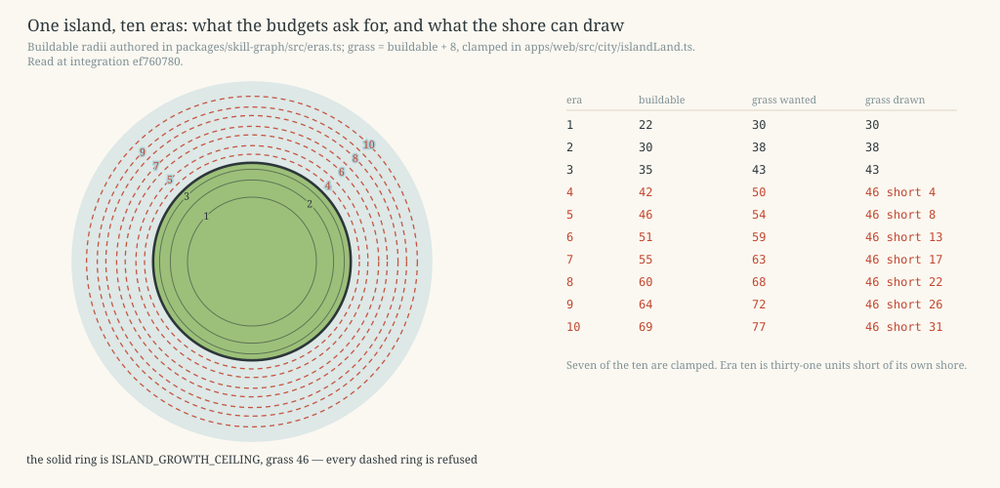
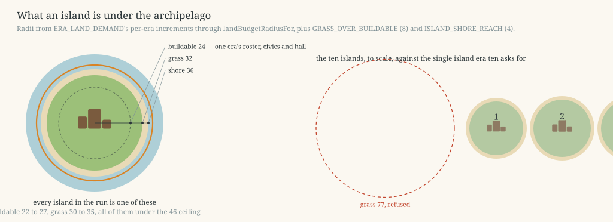
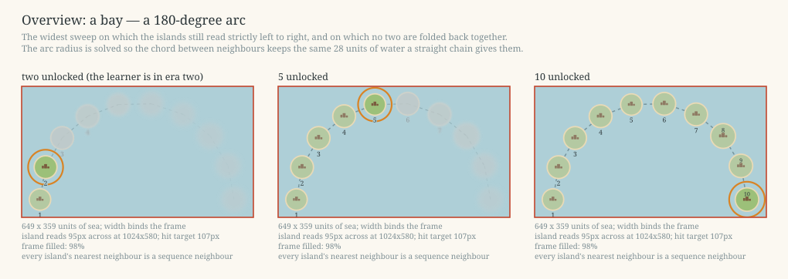
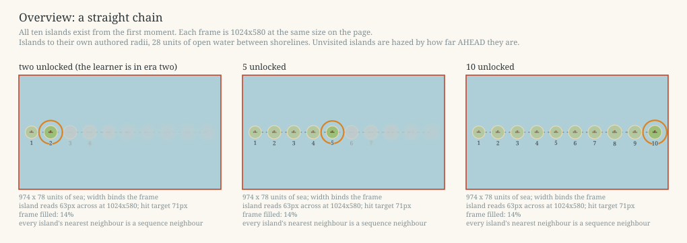
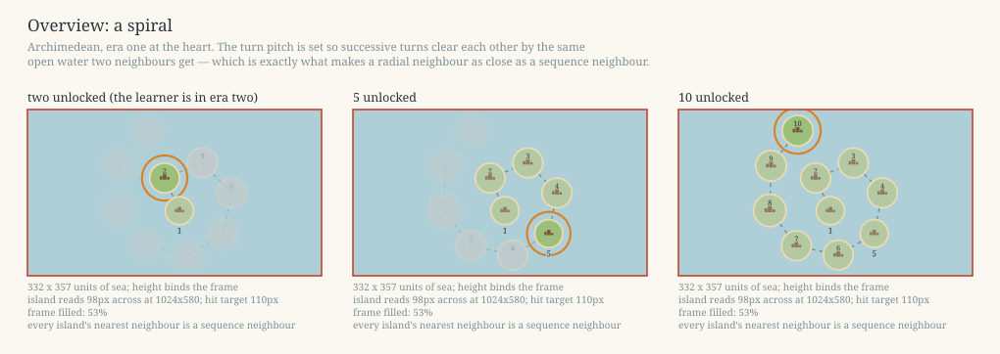
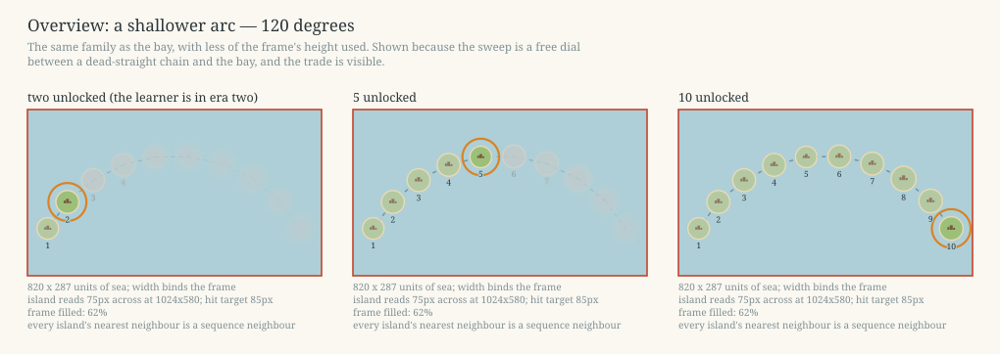
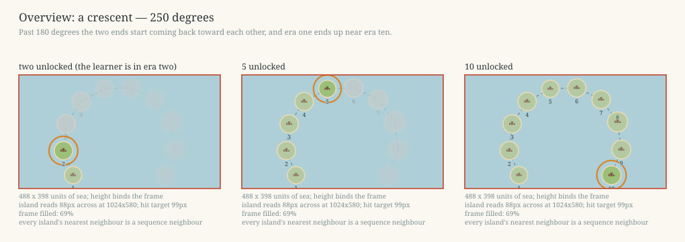
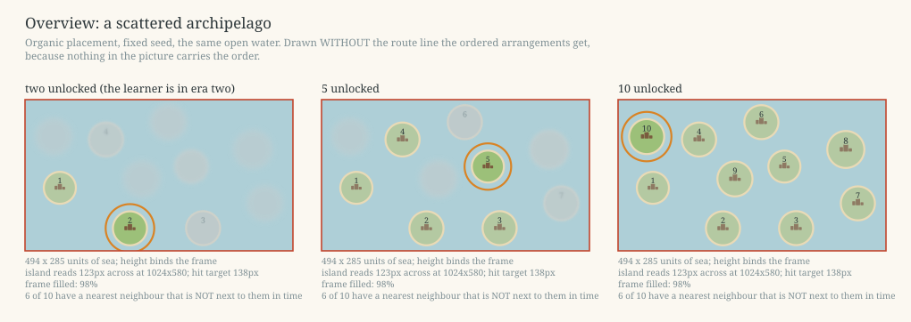
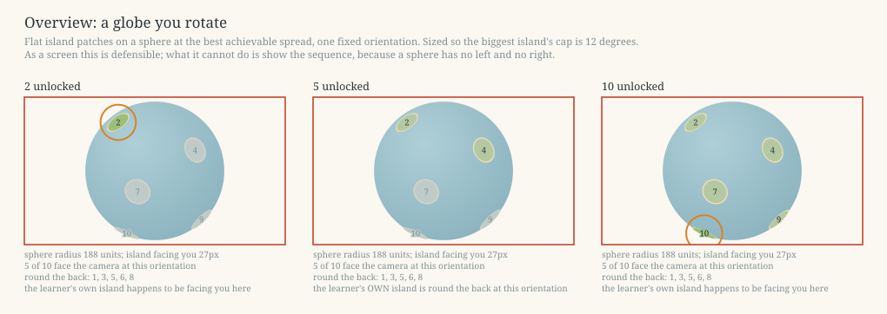
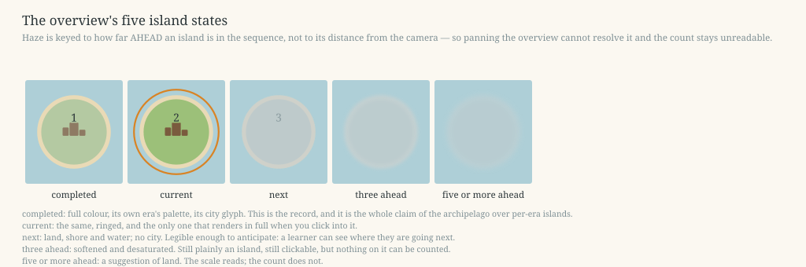

# The archipelago: ten islands, one rendered at a time

> ## 2026-08-09 OWNER RULING — FOUND FIRST, TRAVEL ONLY BY CHOICE
>
> This amendment supersedes the staged transition and ceremony passages below. An eligible
> learner passes one current-island net-score exam. The destination is then idempotently
> founded with its Town Hall while the current island remains standing. The reveal offers
> exactly **Sail to the next island** or **Keep learning here**. Founding is durable and does
> not imply travel; layouts, roads, civics, resources, damage, and completion state stay
> island-local. Diagnostic placement auto-founds its skipped `ERA_SEQUENCE` prefix without
> exams. See `2026-08-04-archipelago-transition-design.md` for the current transition.
>

**Status:** historical design analysis; the archipelago persistence is shipped and the
2026-08-09 transition amendment above is authoritative.
**Read at:** `integration` `ef760780`. Every figure below was re-measured at that tip; where a
figure in the brief has moved, the correction is marked ⚑.
**Scope:** this document changes no behaviour and no code.

---

## 1. The problem, in measured numbers

The single island does not survive ten eras. Four independent measurements, verified at the tip.

**Era nine's authored buildable radius is 64. The drawn island is clamped to grass 46.**
`packages/skill-graph/src/eras.ts` authors the buildable radius per era (D-ERA25);
`apps/web/src/city/islandLand.ts` draws grass at `buildable + 8` and clamps it at
`ISLAND_GROWTH_CEILING = 46`. Era nine therefore wants grass 72 and gets 46. Stated against the
buildable budget the brief's figure holds — 64 against 46, eighteen units — and the fuller
version is worse: the buildable disc era nine's *drawn* island can carry is `46 - 8 = 38`, so the
budget outruns what the shore can parcel by **26 units**.

**Era six wants grass 59 against the same 46**, from an authored buildable 51. Its Plague links
join authored building pairs that "need not touch"
(`apps/web/src/city/three/crisis/propagation.ts`), and the pairs are seated by a layout that
takes a radius; at era six's authored radius that layout spreads buildings to 51 and the island
is drawn to 46, so a band can be routed across ground the island does not draw.

**Seven of the ten eras are clamped**, not four: `classical` through `cyberpunk`. Era ten is
thirty-one units of grass short of its own budget.

**A nine-age roster seats 50 of 53, and 53 of 53 at era nine's authored radius.** Measured
through `catchup/ringLayout.ts` at `0b6f95f8`: the buildable disc now follows the drawn land —
22, 30, 35, 38, 38, 38, 38, 38, 38 — and a nine-age roster seats **50 of 53** on it against
**53 of 53** at the authored 64. Era ten seats 50 of 62. That gap is the ceiling's and not the
layout's, which is what makes it evidence for this proposal rather than for a layout fix.

⚑ **Two figures in earlier drafts of this section have expired, and the correction runs the
other way.** They were verified at `ef760780`, when
#544 read `OPEN`; it **merged at
2026-08-04T18:15:09Z**. So the drafts' *"19 of 53"* and *"a fifth-age learner gets 88 cells"* are
both dead: the disc follows the land now, and a fifth-age learner has **276 cells for 217
occupied**, which fits. The half of the problem #544 owned is fixed. What it could not fix is
what is left above — eras four to ten all get a disc of 38 against the 42 to 69 D-ERA25 authors,
because the drawn land is clamped, and #544's own body says so.

**And the ceiling is real rather than conservative.** `three/depthPrecision.test.ts` holds the
road layer to four resolvable depth steps at the furthest view; re-run at the tip, grass 30 gives
11.03 steps, grass 46 gives 4.69, and grass 50 gives **3.97** — under the bar. The clamp is a
measurement, so it cannot simply be raised.

**Four radius-related defect classes needed four separate fixes this week**, because each layer
derived its own notion of how big the island currently is: ground art
(#521, merged), decoration props
(#537, merged), crisis geometry
(#496, merged), and buildable cells
(#544). All four have merged. That is the class of defect a growing island generates and a fixed
island does not.

---

## 2. The archipelago model

**An island is one era's city.** Its own skill buildings, its own civic purchases, its own Town
Hall. Not the cumulative city — that is the whole of the change.

**This is what dissolves the ceiling, and it is the strongest single argument in the document.**
Derived from `ERA_LAND_DEMAND`'s per-era *increments* through `landBudgetRadiusFor`, an island
holds 46 to 72 occupied cells and wants a buildable radius of **22 to 27**, grass **30 to 35**.
Every era's own roster seats in full. Against a ceiling of 46, the largest island in the run is
eleven units under it, and `depthPrecision`'s arithmetic gives grass 35 **8.11 resolvable depth
steps** against a bar of 4 — twice the headroom, at the biggest island the design ever needs.

| era | own cells | buildable | grass | era | own cells | buildable | grass |
| --- | --- | --- | --- | --- | --- | --- | --- |
| 1 | 47 | 22 | 30 | 6 | 58 | 24 | 32 |
| 2 | 48 | 24 | 32 | 7 | 50 | 24 | 32 |
| 3 | 48 | 24 | 32 | 8 | 72 | 27 | 35 |
| 4 | 52 | 24 | 32 | 9 | 60 | 25 | 33 |
| 5 | 46 | 22 | 30 | 10 | 63 | 25 | 33 |

**All ten exist from the first moment.** Most are locked. An era advance *unlocks* the next
island rather than creating it, so the composition is fixed on day one and never re-authored.

**What happens to the buildings you already placed — the load-bearing question.** They stay
exactly where they are, on the island they were built on, fully placed and fully rendered *when
you are on that island*. They do not travel, so cramping never returns; they are not erased,
because the island they stand on is still there and is one click away. `city_placement` already
carries `era_built` on every row, so the island a building belongs to is a column that exists
and is already populated.

**What persists** is what persists today, partitioned by era rather than pooled: placements
(already keyed by `era_built`), roads (not yet — see §6), crisis damage, and the wallet — which is
**already** per-era in all but the read (§8.2). **Vitality is per-island on the same argument**:
livability, happiness and population belong to the island that earned them and do not carry
(§8.6). Nothing is destroyed by an advance; it is localised. A new island arrives with its hall
standing and one lesson's worth of its own material (§8.4).

**Can the learner revisit?** Yes. A past island is a **record** the learner can work on rather
than a live city: its footprint is fixed by what that era earned, nothing is sustained there and
nothing can fail there, and the people still walking it are decoration (§8.0).
§8 is that decision, its costs, and the economy that enforces it.

---

## 3. The interaction model (settled)

Fixed by the lead and treated here as given:

1. **One island renders at a time** — the one you are on. Essentially what ships today.
2. **Zooming out goes to an overview screen**, a distinct view, not a camera pull-back.
3. **Islands in the overview are represented lightly** — stylised, not rendered.
4. **Far and future islands are indistinct**, so the scale reads and the count does not.
5. **Clicking an island enters it**, and it renders fully then. A load, not a pan.

**Three costs this model deletes outright, and a reader will ask about each.**

**The mesh budget objection is answered and can be dropped.** Nine rendered cities never coexist.
`islandDressingFillsTheIsland.test.ts` holds one island to `MESH_CEILING = 2600` and measures
549 nodes at era one, 2248 at era two and 1433 at eras four to ten. Those are *per-island*
figures and they stay per-island: the overview draws stylised marks, so it loads no
`StarterIsland`, no decoration scatter, no citizens and no roads. The archipelago costs the
scene nothing it does not already pay.

**The depth-precision problem disappears with it.** Had the wide view been the village camera
dollied out over live geometry, framing ten islands would need a camera 524 to 1071 units from
its target depending on arrangement — against today's widest of 179 — and the road ladder's
0.05u step would resolve at **0.73 to 3.06 depth steps** against a bar of 4, i.e. it would
z-fight. A separate screen with no road decals has no such layer, so this is a cost the model
never incurs.

**And the pattern needs no teaching.** An overview you select levels from is familiar to every
player alive. For a remedial audience that is not a small thing: the navigation carries no
tutorial cost at all.

---

## 4. The arrangements

Assessed as **screen composition**, which is what the settled model makes them. All ten drawn to
their real authored radii, 28 units of open water between shorelines (`SEA_RADIUS -
ISLAND_GRASS_RADIUS`, era one's own margin), inside a 1024×580 frame.

Two measures do the discriminating.

**Frame fit.** How much of a 1.766:1 frame the ten-island composition uses, and therefore how big
one island reads.

**Ordering ambiguity**, measured rather than argued: for each island, the distance to its nearest
*non-sequence* neighbour divided by the distance to its nearest sequence neighbour. Near 1.0 the
picture cannot tell you what order the islands go in.

| arrangement | island reads | hit target | aspect (frame is 1.77) | ordering ratio |
| --- | --- | --- | --- | --- |
| straight chain | 63px | 71px | 12.49 — wastes 86% of the frame | 1.97 |
| arc, 120° | 75px | 85px | 2.86 | 1.96 |
| **bay, 180°** | **95px** | **107px** | **1.81 — 2.4% off the frame** | **1.94** |
| crescent, 250° | 88px | 99px | 1.23 | 1.91 |
| spiral | 98px | 110px | 0.93 | **1.05 — ambiguous** |
| scattered | 123px | 138px | 1.74 | 6 of 10 misordered |
| globe | 93px | — | 1.00 | no order; 5 of 10 hidden |

**The chain** is the most legible ordering that exists and needs no route line, and it is a good
picture on day one: one bright island and a long recession of hazed suggestions is exactly a
horizon. Its cost is the closing frame. At ten unlocked nothing is hazed, and nine finished
cities read at 63px in a ribbon that uses 14% of the screen. That closing frame is the payoff the
archipelago exists to deliver.

⚑ **The haze does not rescue the chain, and this is a conclusion re-run rather than carried
forward.** It rescues the chain's *opening* frame, where the far end is meant to be indistinct,
and does nothing for its *closing* frame, where nothing is hazed. What it does change is the
argument: the chain's problem is no longer that you cannot read the future, it is that you cannot
read your own past. Stylised city glyphs can be authored to read at 63px where a rendered skyline
could not, which narrows the gap honestly — what does not narrow is that the chain leaves 86% of
the screen empty and gives the smallest hit target of any option.

**The bay — a 180° arc — is the recommendation**, on three properties that are provable rather
than aesthetic.

- **It is the largest sweep on which the islands still read strictly left to right.** Position is
  `x = R·sin(a)` and `sin` is monotone exactly on `[-90°, +90°]`. Measured on the laid-out
  composition, x increases monotonically: −289, −272, −223, −147, −55, 43, 137, 218, 271, 289.
- **It is the largest sweep on which nothing folds back.** Past 180° two islands far apart in
  sequence start coming back together; at 250° the ends are 416 units apart against the bay's
  578, and at 320° they are 113 apart and adjacent.
- **Its ten-island bounding box is natively the frame's aspect** — 649 × 359, a ratio of 1.809
  against 1.766. It is the only arrangement that fills a 16:9 frame without a trick, and it
  frames identically whether the overview ends up oblique, isometric or flat.

Within that, it reads 95px against the chain's 63 — half again — with a 107px hit target.

**The spiral is the one to be careful about**, because its raw numbers are the best of the flat
family: 98px islands in a 332 × 357 box, and every island within 299 units of every other. That
compactness is bought by folding the sequence back on itself, and the fold is what breaks it. Its
turn pitch is `2 × widest island + gap = 106` units and its in-sequence spacing is 92 to 102, so
a radial neighbour is the same distance as a sequence neighbour: measured, **1.05** at island
nine. A picture in which era nine's nearest island is era three, 5% closer than era eight, cannot
be the record of an order. It also puts the learner at the centre with the run around them, where
the brief's own audience argument wants a horizon.

**The crescent and the shallower arc** are the same family as the bay and both are defensible;
the sweep is a free dial between "dead straight and maximally legible" and "fills the frame", and
180° is where both properties above stop holding.

**The scattered archipelago is the prettiest picture and is ruled out by the same measure**: six
of its ten islands have a nearest neighbour that is not next to them in time. It is a lovely
place and it is not a timeline.

### The globe, re-opened

⚑ My earlier argument against a globe was about permanent interaction cost in a persistent world,
and **that argument is gone.** As a *screen* a globe is genuinely defensible: rotation is a
familiar gesture, the footprint is fixed however many eras the game ends up with, and a world is
a more evocative object than a line of dots. Two further objections I had also die with the
settled model — the globe no longer has to be the same geometry the learner stands on, so there
is no curvature conflict, and it costs no orbit controls during play because there is no play in
it.

What survives is narrower and, I think, still decisive.

**A sphere has no left and no right, so it cannot show a sequence.** The order has to be carried
by a route line that goes round the back and by numbers on each island. Every other arrangement
here carries the order in the composition itself.

**It hides half of itself, permanently, at every orientation.** At the best achievable spread,
five of ten face the camera. There is no canonical view that shows the record, so a learner who
opens the screen to see where they have been must rotate to find out — and at some orientations
their own current island is round the back.

**It is the most expensive of the three ways to build a light overview.** An illustrated map or a
2.5D composition can be authored art; a globe must be a rendered sphere with placed patches, its
own camera, its own picking and its own remembered orientation. The lead's model asks for
"represented lightly", and this is the heaviest option.

**Where a globe would win**: if the run ever exceeds about fifteen eras, or if eras stopped being
a strict sequence and became branches. Neither is true, and the second would be a different
product.

---

## 5. What the islands look like

**Locked islands are hazed, and the haze is keyed to how far AHEAD an island is in the sequence —
not to its distance from the camera.** That is the one implementation detail that decides whether
this works. A distance-keyed fog resolves the moment a learner pans toward the far end, which
would let them count; a sequence-keyed treatment does not, so the count stays unreadable however
the screen is moved. It is also the cheaper thing to build: a per-island style state in a
stylised composition, not a fog volume over live terrain.

Six states, three visual levers — opacity, desaturation and softness of silhouette. The first five
are the haze ladder; the sixth is §8.7b's emptied island and is not hazed at all:

| state | treatment | what it says |
| --- | --- | --- |
| **completed** | full colour, its own era's palette, its city glyph | this is yours, and it is still here |
| **current** | the same, ringed | you are here |
| **next** | land, shore and water; no city; lightly desaturated | you can see where you are going |
| **three ahead** | softened and desaturated, still plainly an island, still clickable | a place, not a count |
| **five or more** | a suggestion of land in haze | the sea goes on |
| **emptied** (§8.7b) | unlocked and full colour, hall standing, no city | unfinished business, not damage. Never a warning colour |

The diagram draws the five haze states; the emptied island is the completed state with its city
glyph removed and its hall kept.

**Why this is the right answer and not a compromise**, worth stating because the reasoning
transfers: it uses aerial perspective, which is a real-world convention rather than a game one,
so it needs no legend and reads as *distance* rather than as *denial*. A grey padlock has to be
taught and says no. Haze says far. And it scales past the design — at fifteen eras the horizon
looks the same, so the composition never has to be re-authored.

**Completed islands stay fully drawn**, and that is the whole claim of an archipelago over
per-era islands. It costs nothing under the settled model: in the overview they are stylised
glyphs, and when entered they are one island, inside the same per-island mesh budget the game
already keeps.

*Costed and rejected, briefly:* **all ten equally visible** — the count becomes a debt, which is
the wrong first impression for this audience, and it is the same build cost, so it buys nothing.
**Progressive reveal of the next one or two** — cheap, but it deletes the motivational asset the
whole change is for and it makes the composition grow again, which is the problem being solved.

**The learner who tests out** arrives several islands in, with completed cities behind them they
did not place. Under this treatment their past is fully drawn and their future is haze, which is
right, and the islands should **not** be visually distinguished as inherited. D-ERA18 already
rules that a learner hand-places era one and the city places the rest, so marking the caught-up
islands second-class would be a message this audience does not need. What should change is the
catch-up walk itself: today it seats every handed age's roster on one disc and reports a
shortfall (19 of 53 at nine ages); under the archipelago each age's buildings go on that age's
island and **it fits by construction**. The walk becomes a flight across the bay with an island
built per age, which carries the history far better than the text summary it currently produces —
and because each island carries its own vitality and its own wallet, the learner arrives on era
five's island rather than in a city that has to explain a history it never lived (§8.6).

---

## 6. What breaks

Enumerated from source at `ef760780`. Honest about size.

**Layout — the smallest change of the lot.** `worldLayout.ts`'s predicates are all origin-centred
(`Math.hypot(x, z) <= BUILDABLE_RADIUS`). **Keep every island's grid island-local**, origin at
its own centre, and give the island a world transform. Then `isCellBuildable`,
`isFootprintInBounds`, `placementRefusal`, `findOpenCell`, `defaultPlacements` and `CELL_REACH`
are all untouched, and only the scene graph moves. This is the single most important architectural
choice in the proposal and it is what keeps the blast radius small.

**`islandLand.ts` (224 lines) is re-authored, not extended.** `eraLandDemand` becomes the era's
*own* demand instead of the cumulative one, `eraLandIsClamped` becomes permanently false, and
`ISLAND_GROWTH_CEILING` becomes a guard nothing approaches rather than a clamp seven eras hit.
`islandDressingRadius`'s beat-two latch loses its reason to exist.

**Persistence.** `city_placement` needs nothing — `era_built` is already the island id. `city_road`
does: its primary key is `(student_id, grid_col, grid_row)`, so two islands cannot both hold a
road at the same cell. One migration, one column, one key change. `city_state.era_id` is
unaffected.

**The economy** (`packages/economy/`, `apps/web/src/economy/`). Smaller than it sounds, because
material is already era-denominated and an advance already leaves the old balance behind (§8.2).
Four reads move from the live era to the island being stood on: `economySession.ts`'s
`spendableOf`, `Shop.tsx`'s displayed price, `materialWord.ts`'s material noun and
`roadsEconomy.ts`'s affordability check. Nine non-test call sites read `cityEraId()`/`useCityEra()`
in total. Two consequences worth naming: `city_state.road_gold_spent` is a single counter the
schema itself says *"HAS NO ERA ON IT"*, so per-island roads force the fix that file already names
— replacing it with an ordinary ledger spend; and **O-6's carry-forward is superseded and retired**
rather than wired, which removes a ruling already measured as retaining 12.5% where it claims 50%.

**The ceremony's four beats** (`eraCeremony.ts`, `eraCeremonyStage.ts`, `three/CeremonyLayer.tsx`,
`EraAdvanceCeremony.tsx`). All four change and **three of them get better**:

- *beat one, the city gathers* — unchanged mechanically, and it gains the meaning it has been
  missing: the crowd gathers **to leave**, for an island the learner can see. Under §8.0 the
  exodus is real, so this beat stops being a preamble and becomes the departure itself. It also
  carries the line about the stores staying behind (§8.5).
- *beat two, the island makes room* — **this is the beat the change fixes.** Its own author, on
  the frames: *"at this camera, with an opaque lagoon and a flat-topped stylised island, you do
  not see a mass heaving up out of the water, and I do not think you can without a different
  water material"* (#529, merged
  2026-08-04T19:09:03Z). Under
  the archipelago the beat is an **unlock**, not a lift: the view goes to the overview and the
  next island comes out of haze. That is a change of the whole frame and it needs no water
  material at all. `CeremonyCityStage.landRadius` and `NewGround`'s apron both retire.
- *beat three, the hall is rebuilt* — measured at **1.3% of the frame**, the weakest beat in the
  ceremony. It becomes a hall **founded on bare ground**, which uses more of the six-phase
  `REBUILD_STAGES` ladder that already exists than a swap does, because the early phases finally
  have somewhere to be: `TownHallStage` is already `site | construction | built` and `site` is a
  state today's beat three never gets to use. This is also what puts the new island's hall up
  before the learner lands on it (§8.4).
- *beat four, the age turns* — re-themes an island that has never worn a palette, rather than
  shifting one adjacent palette to another. A bigger change, for free.

**All four crisis surfaces** (`three/crisis/`, `registry.ts`, `hardWinter.ts`, `succession.ts`,
`plague.ts`, `intrusion.ts`). Each assumes one flat grid, and under island-local coordinates each
keeps it — a crisis happens on the island you are on. Two specifics: `hardWinterIsland` is already
era-parameterised and simply gets a smaller disc; `winter/liveCityLayout.ts` is pinned to
`CURRENT_ERA_ID` and must read the standing island. **A crisis may not span islands**, and that is
a ruling rather than a limitation — `test/plagueTopology.test.ts` forbids spatial tokens in every
source that can decide an infection, so a cross-island crisis is a new design and not a port.

**The catch-up walk** (`catchup/`, `catchUpWalk.ts`, `ringLayout.ts`, `CityCatchUp.tsx`). Becomes
a flight (§8.7a): one island per handed age, each auto-built to that era's finished state as the
camera reaches it. `ringLayout`
keeps its signature — it already takes a radius — and gets the era's own smaller one. The
shortfall report it exists to produce has nothing left to report, because a skipped era's roster
is seated on that era's own island.

**Vitality** (`packages/economy/src/capacity.ts`, `city/citizens.ts`,
`engines/game/src/citizens-population.ts`, `city-vitality.ts`, `city-departures.ts`,
`CityVitalityPanel.tsx`). The derivations are already functions of a building set rather than
running totals, so they need no change — only a per-island set (§8.6). Two things do change: the
population target becomes authored per era and the per-node increment derived from it, on
`ERA_MATERIAL_TOTAL`'s precedent; and the counted population splits from the rendered crowd, which
means `citizens.ts`'s `housed + waiting === population` identity has to be restated over the
sample. That identity is the highest-risk line in the whole amendment — left as written it asks
the roster to place thirty thousand figures. What retires is the plumbing that pours a history into
one city: the inherited-civics seeding of
#558 and the cumulative crowd of
#567, both of which are the right
answer for the single island and are what this week ships on.

**Camera framing** (`three/cityFraming.ts`, `three/orbitCamera.ts`, `three/CityScene.tsx`). The
in-island camera is **unchanged**, which is the point of the settled model: `islandFraming` keeps
fitting one island and `CityScene`'s `PAN_BOUND_RATIO` keeps bounding one island. What is new is
the zoom-out gesture reaching a screen rather than a distance, which is a route change and not a
camera change — and `VILLAGE_CAMERA.maxDistanceRatio` becomes the point at which that route
fires.

**The dressing system** (`eraDressing.ts`, `islandGround.ts`, `three/StarterIsland.tsx`, 2858
lines). Already per-era and already takes a radius. It gets *simpler*: `islandDressingRadius`'s
off-by-one-beat problem, the decoration band inverting at grown radii, and the re-scatter at the
hand-off are all artefacts of an island that changes size. A fixed island has none of them.

**New surface.** The overview itself — a route, a composition, ten island states, hit testing and
the entry transition. Call it `apps/web/src/archipelago/`. This is the only genuinely new code.

**Two things it should absorb rather than duplicate.** `eraTimelineView.ts` already computes per
era exactly what the overview needs — standing, mastered count, readiness — so **the overview is
the timeline drawn as geography** and `EraTimeline.tsx` should fold into it. And `cityAlbumView.ts`
records that the album *reconstructs* each past era's composition from the current placements;
under the archipelago that reconstruction becomes literal, which is a simplification. What the
overview must **not** become is a second Chronicle: §11.2 warns the three surfaces will be
confused, and the Chronicle is unbuilt and Evan's.

**Scale, honestly.** The overview is a self-contained new surface of moderate size. The per-era
island work is a re-authoring of one 224-line module plus an island-local coordinate seam, and it
touches the ceremony, the catch-up and one migration. It is not a two-week rewrite of the city;
it is also not a weekend. The largest single risk is not any of the above — it is that
`CitySurface.tsx` is 7548 lines and every seam runs through it.

---

## 7. Migration

Four stages, and the first two deliver value before anything structural moves.

**Stage 1 — the overview, with no island change at all.** Ten stylised islands in the bay
composition, with lock state and per-era mastery read from `eraTimelineView.ts` and each
completed island's unspent material read from `WalletView.materials` — **both of which already
exist and are already per-era**, so this needs no data migration, no change to `islandLand.ts`
and no change to placement. It ships the motivational asset on its own, and it is where the
composition gets its first look at a learner, which is the cheapest moment to change it.

⚑ **Stage 1 must not offer to enter a past island.** A learner who clicks one and finds they can
only look at it is a worse first impression than one who could not click at all. In stage 1 a
past island opens a **card** — its name, its skills, its mastery, its unspent material — and the
only island you enter is the one you are on. Entry arrives with stage 3, and the affordance
should arrive with it.

**Stage 2 — the era advance becomes an unlock.** Beat two retargets from raising land to
unlocking the next island in the overview. Fixes the ceremony's weakest visual on its own and
still touches no persistence. **Beat one** takes the one line of copy saying the era's stores stay
in the town that earned them (§8.5) — beat one because it is the beat about the island being left,
and because beat two is already carrying the unlock.

**Stage 3 — islands become per-era, and past islands become places.** `islandLand.ts` re-authored
to the per-era radii, island-local coordinates, placements partitioned by `era_built`, the
`city_road` migration, the founding grant, entry into past islands, and **the four economy reads
repointed from the live era to the island being stood on**. That repoint is not an optional
companion to entry — it is a *prerequisite* of it. The moment a learner can stand on era three's island while
`cityEraId()` still says era eight, the shop prices era three's buildings in era eight's material,
which is the 32x windfall `economySession.ts` already warns about. Ship entry without it and that
is the bug.

Practising, rearranging and repairing all come free with this stage: the first already mounts at
the Town Hall, the second is already granted at the schema, and the third already has its spend.

**Stage 4 — the catch-up becomes a flight across the bay** (§8.7a), the reset lands (§8.7b),
`ISLAND_GROWTH_CEILING` is demoted from a clamp to a guard, and the crisis replay lands as a
sandbox. ⚑ **This stage gets both simpler and more interesting, and it is worth separating the
two.** Simpler: there is no longer a history to compress into one city, so the inherited-civics
seeding, the cumulative crowd and the shortfall report all go; the per-island recap keeps its
cost while four full island re-themes come out of a five-age walk; and `catchUpBuildMode` becomes
a one-line change on a function #532 already introduced. More interesting: the flight is over
islands the learner can see in the overview before, during and after, which is what the walk's
text summary has been standing in for. Net, I expect this stage to shrink even with the reset in
it — the reset is one reason code and a re-run of machinery this stage already builds.

⚑ **Nothing after stage 4.** Demolition used to sit here as a deliberate last item; §8.1 now
recommends dropping it and §8.7b explains why the reset is what replaces it, so every approved
interaction lands by stage 4 and there is no tail.

Stages 1 and 2 are independently shippable and independently valuable. Stage 3 is the commitment.
**Neither of the two decisions in §8 moves a stage boundary**: they add a small repoint to stage 3
and one genuinely new mechanic after stage 4.

---

## 8. A past island is a record you can work on

### 8.0 The fiction, settled

The single island never forced this question and the archipelago does, so it is written down here
because it is load-bearing for the transition and for everything in §8.

**The player is the civilization's overall leader** — a leader taking a people through the ages,
not a founder establishing colonies. There is one people, and they move.

**The population departs, and the exodus is real and visible.** At an era advance the crowd
genuinely leaves for the next island and the transition shows it. This is what makes the advance
an event rather than a scene change, and it is what beat one has been half-saying all along
(*"they are coming in from every corner of the island"*) without a destination to give it a point.

**A revisited island still shows people walking around, and that is a deliberate inconsistency.**
The lead, ruling on it knowingly: *"i think its fine honestly — bit of a plot hole but nobody
really cares since its more of like a review/chronicler-adjacent function anyways."* ⚑ **Recorded
as a decision so nobody fixes it later.** That ambient crowd is **decorative, not simulated**: not
counted, not housed, not consuming livability, not a population in any mechanical sense. It exists
so a revisited island reads as a place rather than a ruin.

**So a past island is a record, and the second half of that is the consequential half.** Nothing
is sustained on a past island and nothing can fail there: no departures, no shortfall, no
vitality to keep. `deriveDepartures` and `deriveCityVitality` run on the island the learner is
standing on *as the live one*, and a past island's figures are dressing on a finished picture.
That is a simplification, not a gap.

⚑ **This reverses a framing earlier drafts of this document were written on** — that a past island
carried on living. §8.1 and §8.6 are re-read below under the record framing, and one interaction
does not survive it.

**The radius guarantee survives intact, and this is the objection a reader will reach for.** The
number the whole recommendation rests on — 22 to 27 buildable per island against 69 cumulative,
largest grass 35, eleven units under the ceiling — is a statement about an island's *footprint*.
None of the interactions below moves a footprint. The ones that could add cells are bounded by the
economy rather than by a rule (§8.2).

### 8.0a What the exodus can actually depict

⚑ **"The crowd departs" is a claim about the sample, not the statistic**, and the two diverge by a
factor of 480 across the run. Population is `60 × 2^(N-1)` and the rendered crowd caps at 64
(§8.6), so:

- **At era one the exodus is literally the whole city.** Sixty people, sixty-four figures of
  headroom — every person leaving is a person drawn. This is the advance a learner sees first and
  forms their model from, which is a piece of luck worth not squandering.
- **At era ten, 64 figures stand for 30,720 people.** The same walk-off, and it has to read as a
  city emptying rather than as a village emptying.

**So the scale must come from the count and the destination, not from the crowd**, because the
crowd is the same at both ends and cannot be made to carry it. Whoever designs the transition
should take that as a constraint rather than discover it: name the number, and let the figures be
the gesture. Trying to make sixty-four figures feel like thirty thousand is the one thing that
cannot work here.

### 8.1 What "interact" means, costed — re-read as review on a record

| interaction | cost | machinery | threatens the radius guarantee? |
| --- | --- | --- | --- |
| **practise that era's skills** | near zero | era-level interleaved practice ships and **already mounts at the Town Hall** (`.cursor/skills/era-infinite-practice/SKILL.md`). A past island's hall is the same door. | **No.** Adds nothing to the island. |
| **rearrange the layout** | near zero | already built and already free. D-TH9 keeps every placed building movable, *"purely spatial (no mastery/stage/star change)"*, and `city_placement` is already granted `update (grid_col, grid_row, rot)`. | **No.** Moves cells, never adds them. |
| **repair crisis damage** | low | `applyRepairSpend` exists, takes a material and a cost, and is idempotent per ruin. | **No.** A repair restores a building that was never removed. |
| ~~**demolish and rebuild**~~ | ⚑ **recommended dropped — see below, and §8.7b** | nothing exists | n/a |
| **reset the island and build it yourself** | moderate — one reason code, one re-run of the auto-build | §8.7b | **No.** The footprint is what that era earned either way. |
| **add buildings** | low, once per-island wallets land | the ordinary placement and purchase path | **Bounded, and measured in §8.2.** |
| **add roads** | low, but it forces a known fix | `roadsEconomy.ts` nets `road_gold_spent`, a counter the schema says *"HAS NO ERA ON IT"* | **Bounded the same way**, once the counter is per-island. |
| **replay that era's crisis** | low **if sandboxed** | the winter engine is *"a pure reducer with no economy write, no mastery write and no session handle … a sandbox by construction"* (`winter/liveCityLayout.ts`) | **No, if sandboxed.** |

⚑ **Under the record framing, demolition stops being worth building, and I now recommend
dropping it rather than scheduling it last.** It was already the only item that is a new mechanic
rather than a repoint — no delete path exists anywhere (`city_placement` carries no delete grant,
D-ERA7 gives a node *"one placement with no demolish and no rebuild path"*, and the failure floor
forbids *"permanently remov[ing] an earned building"*), so even scoped to civics it needs a delete
grant, a refund reason code that does not exist, and a ruling on what comes back. What has changed
is the other side of the trade. On a live city demolition is optimisation: you clear a building
that is no longer paying for itself. On a record there is nothing to optimise, because nothing is
sustained and nothing can fail — so what demolition buys is the ability to edit your own history,
which is a strange thing to offer and an expensive one to build. **Rearranging already delivers
everything demolition was wanted for**, at zero cost, and it curates the record instead of
rewriting it.

**The other four all get stronger under the record framing, not weaker.** Practising a past era's
skills is *the* review activity and needs no reframing at all. Repair becomes restoration — a
scarred island is a blemish on your own record, and putting it right is a satisfying act rather
than a rescue. Rearranging becomes curation, which is what players do with a finished city anyway
and is the reason city builders keep a free-move tool long after the optimisation is over.
Spending an island's leftover material completes the record rather than expanding a settlement.

**A crisis replay should be a sandbox.** A consequential replay would leave damage repairable only
in that island's own material, which a learner may have already spent — a dead end with no way
out. The engine is already sandbox-shaped, so this is the cheap version and the safe one.

### 8.2 The economy: each island has its own wallet

**Decided:** resources stay on the island. Advancing starts a fresh count. Material earned in era
three stays on era three and can only be spent there.

⚑ **This is very close to what already ships**, which is the largest finding in this amendment.
Established from the code rather than assumed:

- **Material is already era-denominated**, not one shared wallet. `ERA_MATERIALS` gives each era
  its own resource — stone, grain, bronze, silver, gold, gems, coal, electricity, silicon, data —
  and the ledger keys rows `(student_id, event_id, resource_type)`.
- **An advance already leaves the old material behind and starts the new era at zero.**
  `economySession.ts` states it in terms: *"a learner who advances holding 40 stone reads their
  new era's material at 0 until they earn some. The stone is not lost — the ledger is
  append-only … and stepping back to era one reports the same 40."*
- **Nothing is destroyed**, and that distinction is what makes this humane rather than punishing.
  The material is *localised*, not lost. "Your wallet resets when you advance" and "your money
  stays where you earned it" are the same mechanic and opposite experiences, and the second one
  is true.

So the implementation is not a new economy. It is **repointing four reads from the live era to
the island the learner is standing on** — `spendableOf` in `economySession.ts`, plus the three
Wave 1 repointed at `cityEraId()`/`useCityEra()`: `Shop.tsx`'s displayed price,
`materialWord.ts`'s material noun, and `roadsEconomy.ts`'s affordability check. Nine non-test call
sites read the live era in total.

**⚑ And it closes a ruled decision that was already known to be broken.** O-6 ruled a
carry-forward haircut, `materialCarryForward(amount) = floor(amount × 0.5 / 2)`. Two things were
measured about it on 2026-07-31 and recorded in
`docs/superpowers/specs/2026-07-31-era-material-carry-forward-ruling.md`: the shipped arithmetic
retains **12.5%** of purchasing power rather than the 50% the ruling claims, and it has **no call
site outside tests**. Per-island wallets **supersede O-6 and retire it**, which deletes a
mechanic nobody has to fix rather than adding one.

**Why this is the right answer, beyond being cheap.**

- **It closes the overflow hole without a rule.** Current-era material cannot reach a past island,
  so past islands cannot become extra capacity. The bounding argument needs no enforcement
  because the economy already is the enforcement. It also removes a windfall the code already
  warns about: prices climb `2^(N-1)`, so era-eight material spent at era-three prices would be a
  32x windfall.
- **Each era becomes independently tunable.** Today one ledger spans ten eras and a solvency
  measurement has to model the whole trajectory (`civicSolvency.test.ts` runs a ten-era sweep).
  Per-island wallets make each era a self-contained balance problem, which is a real gift to
  whoever tunes era eight.
- **It gives a revisit a purpose**, and this is what answers the "does a fixed island feel
  finished" risk better than any interaction does. See §8.3.

**What the leftover can actually buy, measured**, because this is the number the guarantee turns
on. `civicSolvency.test.ts`'s recomputed table gives each era's surplus over its optimal city:
**80 of 520 at era one (15%), 7,680 of 30,720 at era seven (25%), 15,360 of 138,240 at era nine
(11%)**. That surplus buys roughly 11% to 25% more civic building than the era's own city — about
**four to six cells**. Against islands sized at 45% to 53% fill, that takes the worst case to
about **58%**, against era one's calibrated 53.4%, at which the packing measurement still finds
seven legal 2×2 anchors open. The leftover cannot overflow an island because it is a fraction of
what the island was already sized to hold.

### 8.3 Does a fixed island read as finished?

The risk is real: an island you cannot add to may read as done in a way that discourages the trip
back. Practising is available from the current island's hall anyway, rearranging is a small draw,
and repair only matters if something is broken.

**The material still sitting on an island is what fixes it, and it costs one line of the
overview.** Show it on each completed island — *"80 stone here"*, in the framing §8.5 rules — and
the trip back has a concrete, positive purpose that is about gain rather than tidying.
`WalletView.materials` already carries the full per-material picture; its own docblock calls it
*"the full picture … what a per-era readout wants"*, so the data is sitting there. I think that is
sufficient, and I would not add a mechanic before seeing whether it is.

### 8.4 A new island arrives with its hall standing and a founding grant

**Decided.** An era-five learner does not step onto bare ground with a greyed-out build menu.

**The grant is one lesson's worth of that era's own material, taken out of the era's authored
total rather than added to it.** `lessonMaterialAmount(era)` already exists and is already derived
— the era total is authored and the per-lesson rate is divided out of it, on the lead's own 2026-07-29
ruling that *"each era should give about the same amount of total resource … adjust by scaling the
reward per lesson relative to the # of lessons."* So the grant is that same division, paid at the
start instead of after the first lesson, with the remaining lessons re-dividing what is left.

Four properties, and each is why this is anchored rather than picked:

- **It reproduces era one's tested opening state exactly.** Era one has a hall pre-seeded (D-TH6)
  and zero material, and its first lesson pays 100 stone. A learner one lesson into era one is
  the state every later island now arrives in.
- **It scales itself.** Costs and era totals both climb `2^(N-1)` (`ERA_COST_MULTIPLIER_STEP`), so
  a grant expressed as one lesson's payout scales with them and no second number has to track it.
  A flat grant would be a fifth of era two's city and a rounding error at era nine.
- **It is a real start and not a free city.** Against `civicSolvency.test.ts`'s optimal city it is
  **19% at era one, 22% at era two, 12% at era eight, 19% at era nine** — one or two buildings.
- ⚑ **It is solvency-neutral, which is why it is taken out of the total rather than added.** An
  additional grant would raise every era's surplus from 11-25% to 30-46%, roughly doubling the
  extra cells a past island could absorb and weakening the bound in §8.2. Taken from the total,
  `mintable` does not move, `civicSolvency.test.ts`'s ten-era sweep is untouched, and **the
  four-to-six-cell bound stands unchanged**.

**The hall does not collide with beat three — beat three is what puts it there.** "Arrives with
its hall standing" is the state *after* the ceremony, not before it. `TownHallStage` is already
`site | construction | built`, so bare ground is a state the hall can already be in, and the six
phases of `REBUILD_STAGES` that `rebuildStageIndex` maps beat three onto finally have somewhere to
start: today they describe a swap on a hall that is already up, which is why beat three measures
1.3% of the frame. Two things fall out. **D-ET12's "the hall never un-builds" stops needing
enforcement** — the old island's hall is not touched at all, so the invariant becomes structurally
true. And **era one is the exception and already is one**: D-TH6 pre-seeds it with no ceremony
before it.

The catch-up walk needs no special case either.
#532 already made *"the first founding
the ceremony and the rest recaps"*, so a caught-up learner's islands get their halls and their
grants from the recap that already runs per age.

### 8.5 The money stays where it was earned

**Decided, as a framing and not just as a mechanic.** The guiding sentence is *"your money stays
where you earned it"* — not "your wallet resets", not "unspent material is left behind". All three
describe the same code; only the first is true to what happens, because the ledger is append-only
and stepping back to era three reports the same balance it always had.

**Copy direction, not final copy.** At the advance, one line saying the era's stores stay in the
town that earned them and are there when the learner returns. ⚑ **It belongs at beat one, not
beat two** — I placed it at beat two earlier and that is now wrong. Beat two is the unlock, so the
learner is looking at the *new* island, and beat two is already carrying the unlock and the
camera; the message is about the island being *left*. Beat one is "the city gathers", it is the
only beat the archipelago does not otherwise rewrite, and under this model it gains exactly the
right meaning: the crowd gathers to depart, and the stores stay in the town.

**The same framing governs the overview.** A completed island reads **"80 stone here"** — a place
that still holds something. Not "80 stone unspent" and not "80 stone you did not spend": the same
fact, and the second and third are reproaches. This is the one line of the overview that turns a
finished island into somewhere worth going back to (§8.3), so the framing is load-bearing rather
than decorative.

### 8.6 Vitality is per-island too, and it dissolves the caught-up city

**Decided.** Livability and happiness do not carry across islands. Population does not carry
either: a later island *has* its own people rather than inheriting a running total. **A skipped
era's island is auto-built to that era's own finished state** — nothing is inherited and nothing
is carried forward.

The argument is the same one that made per-island wallets right, and it lands harder here: each
era becomes a self-contained balance problem instead of one ten-era trajectory. ⚑ **This is also
already how the tuning is computed.** `civicSolvency.test.ts` prices *each era's* cheapest closing
city over that era's own catalogue at that era's own prices against that era's own material, and
its population target is *"a pure function of which era you are in"* — `60 × 2^(N-1)`. The only
reason that per-era calculation has to be embedded in a cumulative sweep is that the shipped city
pools everything into one island.

**⚑ Verified rather than assumed: nothing in the vitality derivation is a running total.**
`citizenPopulation`, `residenceCapacity` and `contributionsOf` are all functions of a *building
set*, not accumulators — `citizens.ts` says so in terms (*"no stored counter for the two to drift
apart on"*). Hand them one island's placements and they return that island's vitality with no
change to the derivation at all.

**One thing does cross eras.** `CITIZEN_NODE_CAPACITY` is keyed on era one's six nodes, so *"in
eras two to ten no skill node has a residence figure at all … every mastery there is six more
mouths and no more room"*. Pooled, era one's houses absorb that; per-island there is nothing to
absorb it and each island's livability rests on its hub provision plus its own civics. I left this
as *"probably fine"* in an earlier pass; it is measured in §8.6a and it clears at every era.

⚑ **And vitality is live on exactly one island — the current one.** Under §8.0 nothing is
sustained on a past island, so its livability, happiness and departures are not recomputed and
cannot fail; what it holds is the record of what it held. The measurement in §8.6a is therefore
about each island *while it is the live one*, which is the only moment it has to clear, and the
per-island scope makes `deriveDepartures` a single-island question for the first time. The ambient
figures on a revisited island are drawn from the sample and counted by nothing.

**What dissolves.** #558 (inherited
civic buildings, merged 2026-08-04T20:53:28Z) and
#567 (population
tracking the era, 8 → 44/74/134/164/326, still open) both exist because one island had to hold a history it
never lived through, and both produced awkward readings — a "Content" city of eight under a
nineteen-building skyline, then a hundred people with no amenities. Under the archipelago neither
situation arises: an era-five learner stands on era five's island, with era five's buildings, era
five's people and era five's material, because that is what era five's island is.

**Both are the correct answer for what ships this week and neither is wasted.** They are the
single-island answer, they are what Friday runs on, and the split is clean: **the per-era
derivations survive and the inherit-into-one-city plumbing does not.** #567's ladder is
`FOUNDING_POPULATION + nodes × (CITIZENS_PER_COMPLETE_BUILDING + CITIZENS_PER_MASTERED_SKILL)`
evaluated over a cumulative node set; per-island it is the identical expression over one era's
node set. #558's "what would a played-through learner have built" is `civicSolvency`'s cheapest
closing city, which is already per-era; what goes is the seeding of it into somebody else's city.

**⚑ Population is exponential, and the exponent is not a free choice.** My earlier reading —
that the derivation gives a flat 38 to 62 and the growth had to be picked — was right about the
implementation and wrong about the model. The model in the tree has been exponential all along.

- `civicSolvency.test.ts` states it: *"an era's population target is its own headline magnitude:
  era one sustains ~60 … so the target is `3 ×` the magnitude, which is `60 × 2^(N-1)`. That is a
  pure function of which era you are in."*
- `civicCatalogue.ts` states the supply side: *"contributions follow the era ladder exactly — the
  magnitude is `20 × 2^(N-1)` in every era"*, so the target is literally three buildings' worth.
- #555, merged 2026-08-04, measured
  the gap: that target is **80.8× the real era-ten population** (30,720 against 380) and *"cancels
  the ladder on both sides"*, which is how a guard stayed green over a city shedding 75 people.

So this is not a new curve. It is the implementation being brought to a model already ratified,
and the ratified model is the *only* self-consistent one: at base `b`, an era needs
`3 × (b/2)^(N-1)` livability buildings. At `b = 2` that is three at every era, for ever. At
`b = 1.6` it is 0.4 at era ten — one building would over-provide the whole city and the era's
civic economy collapses. **The base is fixed at 2 by the contribution ladder that already ships**,
and picking any other number silently unpicks the catalogue.

**Population per island, then, is `60 × 2^(N-1)`: 60, 120, 240, 480, 960, 1,920, 3,840, 7,680,
15,360, 30,720.** Prehistoric is a camp of sixty and Cyberpunk is a city of thirty thousand, which
is the lead's bar met by a factor of 512.

**The same normalisation the material ladder already had.** Today's headcount is
`FOUNDING_POPULATION + nodes × 6`, so an era's population depends on how many nodes it happens to
have — which is *exactly* the defect `ERA_MATERIAL_TOTAL` was authored to fix on the supply side
(*"supply was a flat per-lesson amount, so an era's total income depended on how many lessons it
happened to have, while its need did not"*). The fix is the same shape: **author the era's
population target and derive the per-node increment from it**, which removes `nodes` from the
demand side as it was removed from the supply side.

**Livability and happiness need no separate curve — their targets are already this one.** The
capacity target *is* `60 × 2^(N-1)`. What was wrong was never the target; it was that the
population it is measured against was linear. Fix the population and the two are the same number
again, which is what makes #555's comparison meaningful instead of self-cancelling.

**⚑ The counted/rendered split is required, and it has one dangerous seam.** Thirty thousand
figures is not drawable, so the count is a statistic and the crowd is a sample. The seam is that
`citizens.ts` documents an identity — *"`roster.housed + roster.waiting.length === population`,
always"* — which ties the two together today. Under the split that identity must be restated over
the **sample**, with the statistic reported beside it; leaving it as written would ask the roster
to place 30,720 figures. Each consumer wants one or the other, and the split is clean:

| consumer | wants |
| --- | --- |
| `deriveCityVitality`, `deriveDepartures` (`engines/game/`) | the **statistic** — housing 8,000 of 12,000 means 4,000 leave |
| `CityVitalityPanel`, the explainers, the overview card | the **statistic** |
| `cityCitizenRoster`, `citizenPlaces`, `citizenRoutes`, `citizenShelter`, `ceremonyCrowd` | the **sample** |

**Where the sample caps: 64, and it is anchored rather than picked.** `gatheredCitizens` already
maxes at 62 and is already tuned and pinned against the engine, so 64 costs the scene nothing it
does not already pay at the ceremony. The mesh budget confirms it is the right order: against
`MESH_CEILING = 2600`, era two's island is the tightest at 2,248 drawn, leaving 352 — so a crowd
in the hundreds does not fit and a crowd of 64 does. Legibility says the same thing from the other
side: a citizen reads 15.0px at the working view against a 23px bar, and forty figures and four
hundred read alike at that size.

### 8.6a Does per-island livability clear? Measured, and yes

The risk I flagged — that `CITIZEN_NODE_CAPACITY` is keyed on era one's six nodes, so islands two
to ten have **zero** skill-derived residence — is much sharper under an exponential crowd, so it
is measured here rather than argued. Driven through `civicCatalogue` and `capacity`'s own
functions by exhaustive search over building counts, for each era's own catalogue against its own
target:

| era | population | cheapest closing city | provides | buildings | cells | era's material | clears |
| --- | --- | --- | --- | --- | --- | --- | --- |
| 1 | 60 | 520 | 80 / 60 | 6 | 24 | 600 | ✓ |
| 2 | 120 | 1,080 | 160 / 120 | 6 | 24 | 1,200 | ✓ |
| 3 | 240 | 2,160 | 240 / 240 | 6 | 24 | 2,400 | ✓ |
| 4 | 480 | 4,320 | 480 / 480 | 6 | 30 | 4,800 | ✓ |
| 5 | 960 | 8,640 | 960 / 960 | 6 | 24 | 9,600 | ✓ |
| 6 | 1,920 | 17,280 | 1,920 / 1,920 | 6 | 30 | 19,200 | ✓ |
| 7 | 3,840 | 30,720 | 3,840 / 3,840 | 6 | 24 | 38,400 | ✓ |
| 8 | 7,680 | 69,120 | 7,680 / 7,680 | 6 | 30 | 76,797 | ✓ |
| 9 | 15,360 | 138,240 | 15,360 / 15,360 | 6 | 30 | 153,600 | ✓ |
| 10 | 30,720 | 245,760 | 30,720 / 30,720 | 6 | 21 | 307,197 | ✓ |

**It clears at every era, and by construction rather than by luck.** Six buildings at every era,
providing exactly the target, affordable out of that era's own wallet with the same 11-25%
surplus, on 21 to 30 cells — which are precisely the civic increments the per-island radii in §2
were derived from. Add the hub's own provision (28, from #555's `sustains` of 72 less its
`residenceCapacity` of 44) and every island ends its era 28 over.

**Two things this changes, and one of them is an improvement.**

*The cushion is gone, and that is a real change.* Pooled, era one's 44 residence and every prior
era's civics absorbed a learner who under-bought. Per-island there is no cushion: a learner who
buys nothing on island seven is unhoused on island seven. Mid-era it still tracks, because
material and population are now derived from the same era total over the same node count, so each
lesson pays for the people it brings with the same surplus — but the feedback is local and
immediate where it used to be diffuse. I think that is better, and it is a change worth the lead
seeing rather than discovering.

*#555's actual trap is dissolved.* Its finding was not insolvency but that *"the gap is invisible
until it is unfixable"* — a learner lands 108 short at era ten and by then `civicOptionsForEra`
returns zero rows, so no action can raise livability. Per-island, a learner is always standing on
an island whose own catalogue is live, and can always go back to one that is. **There is no era at
which the lever is gone.**

**What "auto-builds that era's buildings" means.** Its **skill buildings**, one per node (D-ERA7),
and its **civic buildings**, the era's cheapest closing city — which is exactly what #558 already
computes. **Not roads**: they gate nothing (INV-COS-1), they are the learner's own expression, and
leaving them out costs nothing.

**Who lays it out.** D-ERA18's rule survives the move unchanged — *"the agency and the teaching
both land the first time; repeating them is repetition rather than learning"* — so island one is
hand-placed and skipped islands are laid out by the city. ⚑ One correction: the prompt at each
handed age is **two roads and not three** today (*Keep going* / *Stop here and learn this age*).
§10.7's three-road version was superseded by §10.10 and §10.19, and
#532 shipped the two-road prompt;
`catchUpBuildMode` derives who places from the walk's position rather than offering it as a
choice. Both roads survive the archipelago untouched. What is *better* than before is that a
learner can now go back to a skipped island and rearrange it (§8.1), which the single-island model
could not offer for a specific age.

### 8.7 Whose call

Per `OWNERS.md`, Gabe holds *"the city and its 3D layer, the crises, the era model and
progressions, the economy, persistence"*, so the per-island wallet, the founding grant and the
demolition refund are all his lane. Nothing here touches Anthony's learning lane. Evan's design
lane is untouched except that O-6's identity half is already settled per era.

### 8.7a The catch-up becomes a flight across the bay

**Decided.** The walk stays — *"big part of the experience"* — and becomes a **flight**: each
skipped island builds as the learner reaches it, its people arrive, and the camera travels on to
the next. Under one growing island the walk had to exist, because a skipped age had no
representation anywhere; the archipelago makes them objects in the bay, so what the walk now does
is take the learner past them rather than stand in for them.

**⚑ It is cheaper than five in-place foundings, and the saving has a name: the re-themes.**
`foundingClock.ts` prices today's walk at `FOUNDING_TARGET_SECONDS = 45` for the first age and
`RECAP_BEAT_SECONDS × 4 = 14s` for each one after
(#532's *"first founding is the
ceremony and the rest are recaps"*), so a learner placed at era six watches 45 + 4×14 = **101
seconds**. The per-island build still has to happen and costs about the same. What goes is that
today **each recap re-themes the same island** — ground, water, planting and roads all turn, which
is a full `StarterIsland` rebuild at 549 to 2,248 nodes — four times over for a five-age walk.
Under the flight each island is built once, in its own era's dressing, and never re-themed. Beat
two disappears from a recap outright: there is no land to grow, because the island is already
there.

**Two roads, and #532 already did most of the work.** ⚑ Checked, and the new ruling is aligned
rather than in tension: #532 replaced the three-road prompt with two and made the build mode
**derived rather than chosen** (`catchUpBuildMode(at)`), so there was never a per-age placement
choice to remove. What changes is one line — that function returns `city_places` at every
position instead of `learner_places` at the first — and the stop-or-continue prompt is untouched.

⚑ **One ruling to confirm, because the letter of D-ERA18 moves even though its reasoning does
not.** D-ERA18 says *"every student places era one by hand"*, and under the flight a tested-out
learner hand-places nothing during it. Its stated reason — *"the agency and the teaching both land
the first time; repeating them is repetition rather than learning"* — is preserved, because their
first hand-placement is their landing island, the one they will actually live in. The island it
happens on moves; the property D-ERA18 protects does not.

**"Stop here and learn this age" keeps working and keeps meaning what it means.** The flight ends
at that island, it becomes the learner's live island, and every island past it stays locked — so
the overview's haze treatment (§5) applies from there onward with no new work. The flight does
not continue to the placed era, because there is no longer a placed era to continue to.

**The music is written and is not in the tree.** `activeCeremony.ts` records that
#557 adds a `catchup-montage` slot
*"for exactly"* this passage — an accumulating piece with no arrival that can be faded wherever it
has reached, which fits a flight better than it fitted the old walk. ⚑ #557 reads `OPEN`, so this
is a fit to plan for rather than a dependency to rely on; the fifteenth slot that *did* merge
(#556) is `ceremony-advance`, and
`ceremonyMusicSkipsRecaps.test.tsx` deliberately keeps it off the recaps.

### 8.7b Reset: starting a past island from scratch

**Decided.** A past island's interactions are **practise, repair, rearrange, and reset to build it
yourself**. Reset is the counterweight to the flight offering no inline choice.

> **The flight is fast because you can always come back.**

That sentence is the whole of it, and it makes the two rulings one decision: the catch-up keeps
the placement agency it was built to protect, and loses the thing that made it long. The agency
moves from *inline and compulsory* to *later and optional*, which is strictly more agency and
less runtime.

**Demolition stays dropped, and the two survive separately because they ask different questions.**
Demolition asks *"is this building paying for itself"* — a live-city question, and meaningless on
a record where nothing is sustained. A reset asks *"I want to claim this age"*, which is exactly
what the flight skipped. Dropping demolition also removes the expensive part: nobody has to rule
on what a demolished civic refunds, because nothing is ever demolished.

#### The reset grant, and why it *is* the footprint bound

⚑ **A reset grants a budget, and sizing that budget to the era is what keeps the radius guarantee
— so the grant is not a convenience, it is the enforcement.** The guarantee (22 to 27 buildable
rather than 69) depends on no island ever holding more than one era's city. Rather than police
that with a rule, the same mechanism that closed the wallet overflow in §8.2 closes this one: if a
learner cannot *afford* more than that era's worth, they cannot build more than that era's worth.

**The grant is the era's own authored material total — `ERA_MATERIAL_TOTAL × 2^(N-1)`: 600, 1,200,
2,400, 4,800, 9,600, 19,200, 38,400, 76,797, 153,600, 307,197.** Derived from the era and never
flat, because costs climb `2^(N-1)` and a flat grant would be a whole city at era two and a
rounding error at era nine. It is the same currency and the same source as the founding grant, and
the relationship between them is principled: **the founding grant is one lesson's worth taken as
an advance against lessons still to come; the reset grant is the whole total, because on a reset
there are no lessons left to pay it out** — the learner already mastered that era.

**And it is exactly what a played-through learner had, which is the tightest reading of "within
reason".** §8.6a measured that this total buys that era's cheapest closing city — 520 at era one
through 245,760 at era ten — with the same 11-25% surplus every era carries, and §8.2 measured
what that surplus buys: four to six cells, taking an island from 45-53% fill to at most 58%
against a 53.4% calibration. A reset learner is handed neither more nor less than the age they
skipped.

> **The assertion that matters, because a future change could break it silently: the reset grant
> must equal that era's authored total, so a reset island can never afford more than a
> played-through one.** A grant made generous "so the rebuild feels good" would relax the radius
> guarantee without touching a radius, and nothing else in the system would notice.

#### An abandoned reset wipes the island

**Decided: no partial-reset state.** An island is a record, a played age, or empty. Nothing has to
be designed for the middle, and the half-finished island stops being a state anyone reasons about.

**What a wipe takes is what the learner placed; what it leaves is what founded the island.** The
**town hall stays.** Three reasons and they agree: it is what the learner raised rather than
something the wipe should judge; it is the island's landmark in the overview, which has to stay
identifiable at the 95px the bay draws an island at; and it is what the founding crowd belongs to,
which is what makes the population answer below fall out for free. Roads go with the buildings.

**A learner can therefore leave a permanent hole in their own record**, and it should read as
**unfinished business, not damage.** That is a sixth island state for §5's table: **unlocked, full
colour, hall standing, no city** — cleared ground with a hall on it, which is a place waiting
rather than a place broken. The overview's own material line does the rest of the work, because an
emptied island shows its whole era grant sitting unspent, which is an invitation in the §8.5
framing. ⚑ **The state is specified here and the treatment is the art lane's** — the one thing to
rule out is a warning colour, because a hole a learner chose is not a fault.

#### Population on a reset island: it empties with the buildings and refills as they go back up

⚑ **Recommended, and it falls out of the shipped derivation rather than needing a new one.** I
had this the other way in an earlier pass — "keeps its people, because population is derived from
mastery" — and that reading is wrong about the code. `citizenPopulation` is *"the founding crowd,
plus `CITIZENS_PER_COMPLETE_BUILDING` for every **placed** skill building whose practice has been
scored, plus `CITIZENS_PER_MASTERED_SKILL` again for every one of those that is mastered"*. It is
keyed on **placements**, not on mastery alone. So a wipe takes the placements and the crowd goes
with them, automatically, and each skill building the learner re-places brings its full six back
at once because the mastery was never lost.

That gives the version where rebuilding does something visible, and it does it without touching
D-CIT2, whose *"build a hundred Longhouses and not one person arrives"* is a rule about **civic**
buildings. Skill buildings have always driven the headcount, so this is the derivation working as
written.

**Checked against §8.0's ambient crowd, and the two compose.** On a *record* island the crowd is
decorative — uncounted, unhoused, consuming nothing. On a *reset* island it must be real, or the
livability puzzle is a puppet show in which you house people who do not need housing. The switch
is the island's state and the two never coexist, so there is one rule per state and no blend. And
because the hall stays, a wiped island keeps its founding crowd: **it is never empty of people,
only of the people its buildings brought.**

**One consequence worth naming, because it is the reason this ordering is the safe one.** Had the
island kept its full population through the wipe, it would open at the era's target with zero
housing, and `deriveDepartures` would start shedding on the first frame — a learner would watch
the crowd bleed out before they could place anything. Refill-with-rebuild has people arriving
*after* the buildings that house them are affordable, which is the same order the live island
already plays in.

### 8.8 The Chronicler: three surfaces, and the archipelago gives each one a home

**They should be coordinated, not absorbed**, and the reason is that the archipelago turns out to
give all three of §11.2's surfaces a natural place without merging any of them.
`cityAlbumView.ts` records the distinction and warns it will be confused unless it is written
down, with the test being inputs: *"neither can be derived from the other … the timeline is
identical for two learners at the same mastery, and the chronicler never is."* Read against that
test:

| §11.2 surface | its inputs | where the archipelago puts it |
| --- | --- | --- |
| **The Timeline** (ships, `EraTimeline.tsx`) | `(ERA_SEQUENCE, masteredNodeIds)` — the curriculum | **the overview screen**, whose inputs are exactly these plus lock state |
| **The Album** (built, `cityAlbumView.ts`) | `(placements, townHall, liveEraId)` — this player's layout | **the revisited island itself.** The album reconstructs each past era's composition from current placements; under the archipelago that reconstruction stops being a reconstruction |
| **The Chronicle** (unbuilt, Evan's) | a door back into a past skill's lesson or practice | **the door on a revisited island's hall** — which is precisely §8.1's recommended practice entry |

So the overview **absorbs the Timeline** (same inputs, argued below in §8.9) and the revisited
island **is** the Album made literal. The third row is the one to be careful about: the practice
door I recommend *is* the Chronicle's definition, arriving from the other direction, and §11.2
exists specifically to stop a second one being built. **That row is Evan's and should be settled
with him rather than claimed here** — the archipelago supplies the surface, and what goes through
the door is his design. Building it twice is the exact waste §11.2 was written to prevent, and
building it once in the wrong lane is how that happens.

### 8.9 What lives in the overview

It should carry what is about the whole run and nothing that is about one era: era names, lock
state, per-era mastery, and the per-island unspent balance. The Timeline folds in (§8.8);
achievements do not, and neither does the Album, which is now the revisited island itself. A
screen a learner opens ten times is a good place for the timeline and a bad place for everything
else.

---

## 9. Recommendation

**Adopt the archipelago, in the bay arrangement, staged as above.**

The argument that carries it is not the aesthetic one. It is that **an island holding one era's
city needs a buildable radius of 22 to 27 where a cumulative one needs 69**, so the growth
ceiling that seven of ten eras currently hit is not raised or worked around — it stops being
reachable, with twice the depth headroom to spare at the largest island the design ever needs.
Every one of the four radius defect classes this week came from a layer deriving its own answer
to "how big is the island now". Under a fixed per-era island there is no such question.

**Making past islands live does not put that number back in play**, and §8 is the argument. A
footprint is fixed by what its era earned; three of the interactions cannot add a cell, one only
frees cells, and the two that could add are held by per-island wallets to about four to six cells
— taking an island from 45-53% fill to at most 58%, against a calibration of 53.4% at which the
packing measurement still finds seven legal anchors open. The economy does the bounding, so no
rule has to.

Second: it fixes the ceremony's two weakest beats as a side effect, including the one its own
author says cannot be fixed at this camera.

Third: the overview is a familiar pattern that needs no teaching, and the haze treatment gives a
remedial learner a horizon instead of a debt.

**The strongest case against, stated fairly.** The single island is the thing that works. It is
demoed, it is dressed for ten eras, its crisis surfaces run on it, and the defects being cited are
all *fixable in place* — #544 is open and would take the seating from 19 of 53 to 50 of 53 today,
and the remaining three are a road-lane depth-budget problem that has a named owner. Against
that, this proposal introduces a new surface, a coordinate seam through a 7548-line component, a
migration, and a re-authoring of the module that four merged PRs have just stabilised, in
exchange for a problem that only fully bites at era eight — which no learner has reached. The
honest answer to that is scheduling, not architecture: the ceiling is real and arrives on a
schedule, and Stage 1 buys the visible half of the value without touching anything that is
currently working.

---

## What I could not determine

- **The overview's rendering technique** — illustrated map, 2.5D, or a light 3D scene — is an art
  call I have costed but not made. The composition arithmetic here holds for all three.
- **Whether D-ERA18's letter may move** (§8.7a). Its reasoning survives the flight intact; the
  island the first hand-placement happens on does not.
- **Whether a reset should also be offered on the island the learner is currently living on**,
  or only on past ones. I have scoped it to past islands; the live island has an unfinished city
  and nothing to reset to.
- **The emptied island's visual treatment** (§8.7b). The state is specified; how it is drawn is
  the art lane's, and the only thing ruled out here is a warning colour.
- **Whether the founding grant comes out of the era's first lesson alone or is spread across the
  rest** (§8.4). Both hold the era total; the second is invisible to the learner and is one
  division in `lessonMaterialAmount`, so it is a preference rather than a decision.
- **What the founding crowd is as a fraction of the era's target** (§8.6). The target and the
  base are settled at `60 × 2^(N-1)`; how much of it is standing there on arrival before any
  skill is mastered is the one term still to author, and it is one column.
- **The exact haze curve** — where "legible" becomes "a suggestion" — is a tuning decision that
  wants a learner in front of it, which is one reason Stage 1 is worth shipping first.
- **Whether the leftover-material prompt is enough** to make a fixed island worth revisiting
  (§8.3). I think it is, and I would rather measure that on stage 1 than add a mechanic against it.
